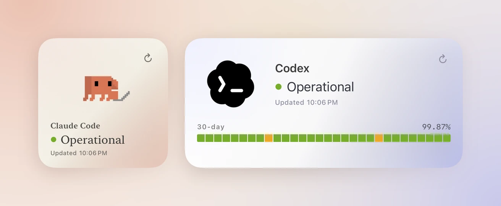
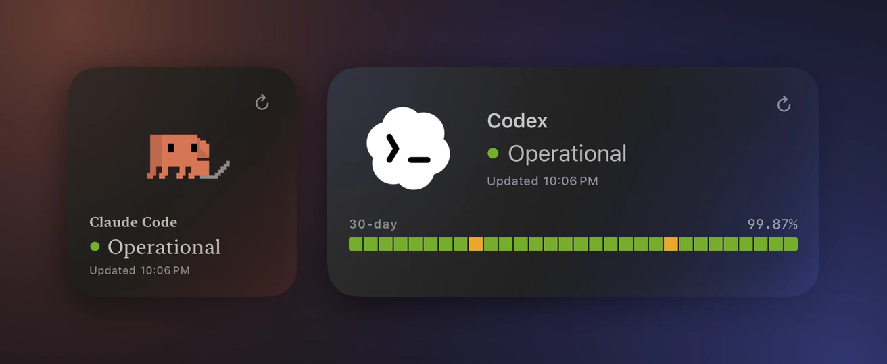
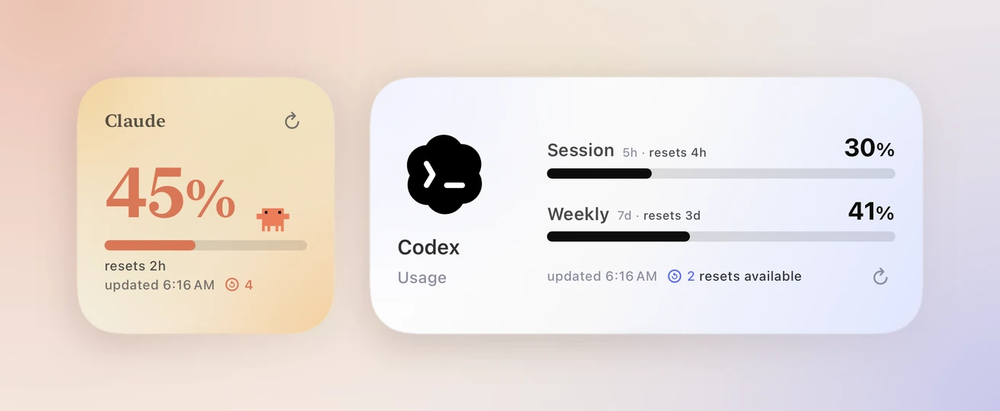
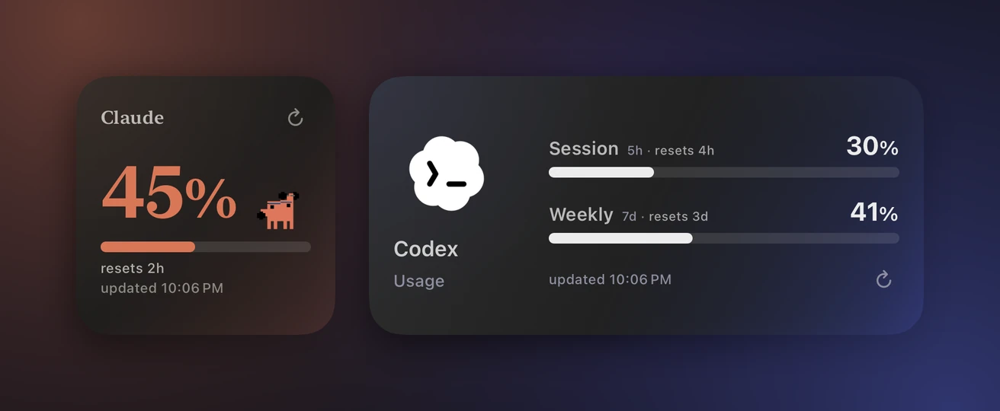
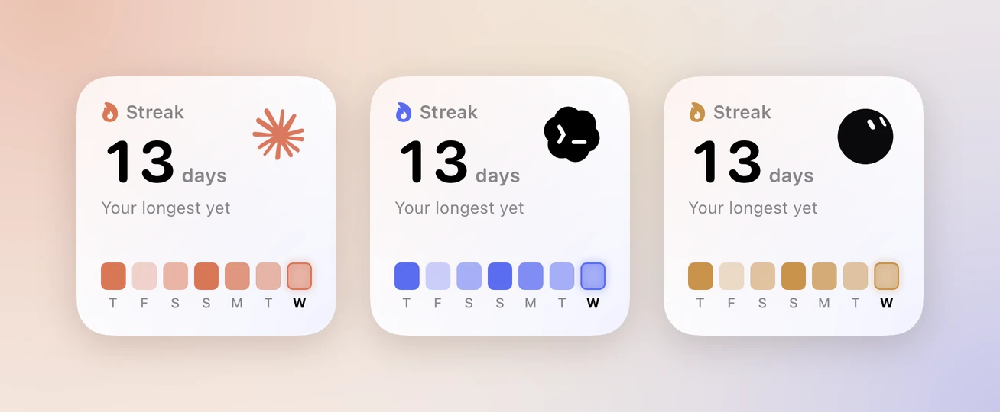
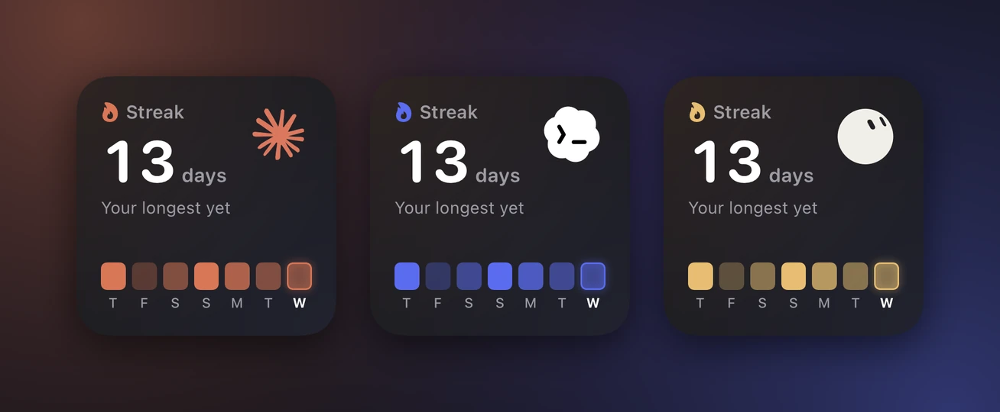

Nomo tiene siete widgets para tu iPhone. Dos son gratis: **Nomo**, para el
estado, y **Uso de Nomo**. Con un ordenador vinculado, **Actividad de Nomo**
también es gratis, en tamaño pequeño y mediano. Esta página trata de esos tres.
Los demás vienen con Nomo Pro: consulta [Widgets Pro](/es/widgets).

Para poner un widget en tu pantalla de inicio, consulta [Widget](/es/widget).

## Gratis y Pro {#free-and-pro}

| | Gratis | Nomo Pro  |
| --- | --- | --- |
| Widget de estado **Nomo** | ✓ | ✓ |
| Widget **Uso de Nomo** | ✓ | ✓ |
| [Actividad de Nomo](#nomo-activity), tamaños pequeño y mediano, con un ordenador vinculado | ✓ | ✓ |
| [Ritmo de Nomo](/es/widgets#nomo-pace), [Actividad de Nomo](/es/widgets#nomo-activity) (grande y pantalla de bloqueo), [Cuentas de Nomo](/es/widgets#nomo-accounts), [Agentes en directo](/es/widgets#live-agents), [Tokens de Nomo](/es/widgets#nomo-tokens) | | ✓ |
| [Más de una cuenta por proveedor](/es/widgets#more-than-one-account) | | ✓ |

## Estado de Nomo {#nomo-status}

<Frame caption="Estado de Nomo en tamaño pequeño y mediano.">
  

    
    
  

</Frame>

En la galería de widgets, este widget se llama **Nomo**.

**Qué muestra:** si un servicio funciona ahora mismo, como Claude Code o Codex.
Verás uno de estos estados:

- `Operativo`
- `Degradado`
- `Interrupción parcial`
- `Interrupción grave`
- `Mantenimiento`

Si Nomo no puede obtener el estado, muestra `No disponible`.

| Tamaño | Qué muestra |
| --- | --- |
| Pequeño | El servicio, su estado y cuándo se actualizó por última vez. |
| Mediano | Lo mismo, más los últimos 30 días en una barra y el porcentaje de disponibilidad. |

**Qué necesitas antes:** nada. Ni cuenta ni inicio de sesión.

**Configúralo:**

1. Añade el widget. Consulta [Widget](/es/widget).
2. Mantén pulsado el widget.
3. Toca **“Editar widget”**.
4. Toca **Proveedor** y elige uno: Claude, OpenAI, Cursor, xAI, Antigravity,
   Kimi, DeepSeek, Devin u OpenCode.
5. Toca **Servicio** y elige uno, como **Claude Code**.
6. Toca fuera del widget para terminar.

Para actualizarlo al momento, toca el botón de actualizar de su esquina. Toca en
cualquier otro sitio para abrir la página **Estado** de ese proveedor en Nomo.

Más información en [Estado](/es/status).

## Uso de Nomo {#nomo-usage}

<Frame caption="Uso de Nomo en tamaño pequeño y mediano.">
  

    
    
  

</Frame>

**Qué muestra:** cuánto has usado del límite de tu plan, para una cuenta, y
cuándo se restablece.

| Tamaño | Qué muestra |
| --- | --- |
| Pequeño | Una ventana: un porcentaje grande, una barra y cuándo se restablece. |
| Mediano | Dos ventanas, normalmente **Sesión** (5 horas) y **Semanal**, cada una con su barra y cuándo se restablece. |

Las barras se vuelven ámbar al 70 % y rojas al 90 %. Si tu plan no tiene límite
de 5 horas, el widget muestra `Sin límite de sesión`.

Si tienes restablecimientos de Claude o Codex, el tamaño Mediano muestra
cuántos junto a la hora de actualización. El Pequeño muestra el símbolo de
restablecimiento y el número. Mira
[Restablecimientos disponibles](/es/usage#available-resets).

**Qué necesitas antes:** una cuenta conectada, como Claude o Codex. Abre la
pestaña **Proveedores**, toca el proveedor y conéctalo. Consulta
[Uso](/es/usage). Hasta entonces, el widget muestra `Sin conectar`.

**Configúralo:**

1. Añade el widget. Consulta [Widget](/es/widget).
2. Mantén pulsado el widget.
3. Toca **“Editar widget”**.
4. Toca **Proveedor** y elige uno, como **Codex**.
5. Toca **Cuenta** y elige una. **Predeterminada** sigue a tu cuenta
   predeterminada de la app.
6. Toca **“Estilo del widget pequeño”** y elige uno. **“Porcentaje grande”**
   muestra el número en grande. **“Animación grande”** muestra el icono animado
   en grande.
7. Toca **“Enfoque del widget pequeño”** y elige la ventana que muestra el
   tamaño pequeño. **Automático** la elige por ti. Las opciones dependen del
   proveedor.
8. Toca fuera del widget para terminar.

Con Cursor hay una opción más: **“Icono de Cursor”**. Elige **Grok Bot** o
**“Logotipo de Cursor”**.

Para actualizarlo al momento, toca el botón de actualizar de su esquina. Toca en
cualquier otro sitio para abrir la página **Uso** de ese proveedor en Nomo.

### Límites de los modelos de Antigravity {#antigravity-model-limits}

Antigravity cuenta los modelos Claude y GPT aparte de Gemini. Según tu plan,
pueden tener un límite de 5 horas y otro semanal. En **“Enfoque del widget
pequeño”**, dos opciones muestran los límites de Claude y GPT:

- **“Límite del modelo”**: su límite semanal.
- **“Límite de 5 horas del modelo”**: su límite de 5 horas. La etiqueta de
  arriba del widget dice `5h · Claude & GPT`.

Si tu cuenta no informa de un límite de 5 horas, el widget muestra `—`. El
tamaño mediano no cambia.

## Actividad de Nomo {#nomo-activity}

<Frame caption="Actividad de Nomo en tamaño pequeño.">
  

    
    
  

</Frame>

**Qué muestra:** tu racha y los días en que programaste con agentes de IA. La
racha es cuántos días seguidos has programado. Un color más intenso significa
más programación ese día.

| Tamaño | Qué muestra |
| --- | --- |
| Pequeño | Tu racha y los últimos 7 días. |
| Mediano | Tu racha, un calendario de los últimos 30 días y tus totales de esos 30 días: horas, días y horas por semana. |

En un iPhone estrecho, el tamaño mediano no tiene sitio para los totales.

El tamaño grande y el de la pantalla de bloqueo vienen con Nomo Pro. Con Nomo
Pro, el mediano muestra las últimas 16 semanas. Consulta [Actividad de
Nomo](/es/widgets#nomo-activity) en Widgets Pro.

**Qué necesitas antes:**

- El plugin de Nomo en tu ordenador, versión **2.4.0** o posterior. Consulta
  [Instalación](/es/setup/install).
- Ese ordenador vinculado con Nomo. Vincular es gratis. Consulta
  [Vinculación](/es/setup/pairing).

**Configúralo:**

1. Añade el widget. Consulta [Widget](/es/widget).
2. Mantén pulsado el widget.
3. Toca **“Editar widget”**.
4. Toca **Personaje** y elige uno, como **Automático** o **Clawd**.
5. Toca fuera del widget para terminar.

Toca el widget para abrir Nomo en **Inicio**, en [Actividad](/es/activity).

Para ver todos los personajes, cómo se cuenta tu racha y qué sale de tu
ordenador, consulta [Actividad de Nomo](/es/widgets#nomo-activity) en Widgets
Pro.
