Ve tus sesiones de Google Antigravity en el iPhone: en la pantalla de bloqueo y
en la Dynamic Island. Cuando Antigravity quiere ejecutar un comando o cambiar un
archivo, tu teléfono te pide **Permitir** o **Denegar**. También puedes detener una sesión, o enviarle un mensaje, desde el teléfono.

Funciona con la app de escritorio de Antigravity y con la herramienta de línea
de comandos `agy`.

<Note>
  Sesiones forma parte de Nomo Pro. Necesitas Nomo **2.3.5** o posterior en tu
  teléfono y el plugin **2.3.5** o posterior en tu Mac.
</Note>

## Lo que funciona igual {#what-works-the-same}

Las sesiones, las carpetas y la [Dynamic Island](/es/sessions/island) funcionan
igual que con los demás agentes. Todo lo compartido está en un solo sitio:

- **Instalar** → [Instalación](/es/setup/install), pestaña **Antigravity**. Una
  sola instalación cubre la app de escritorio y `agy`.
- **Vincular** → [Vinculación](/es/setup/pairing). Una sola vinculación cubre
  todos los agentes del ordenador.
- **Comandos, actualización y desinstalación** →
  [Comandos](/es/sessions/commands), con [update](/es/sessions/commands#update)
  y [uninstall](/es/sessions/commands#uninstall).
- **Responder a las solicitudes** → [Responder desde el
  iPhone](/es/sessions/approvals).
- **Qué puede hacer cada agente** → [Qué puedes hacer](/es/sessions/features).
- **Algo no funciona** → [Solución de problemas](/es/sessions/troubleshooting).

## Los comandos de Nomo preguntan antes {#commands}

Antigravity pregunta antes de ejecutar cualquier comando de Nomo. Elige
**Allow** (permitir). Estos comandos solo preguntan en Antigravity. Nunca ponen
una tarjeta en tu teléfono.

`/nomo-status` da un resumen corto en palabras sencillas. Cuando todo va bien,
muestra una sola línea como esta:

```
✅ Connected to your phone as “MacBook Pro” · Phone approvals: on · Last activity: 2 min ago
```

Si algo falla, añade una línea que dice qué hacer.
`/nomo-status verbose` muestra todos los detalles.

¿Antigravity no reconoce los comandos? Ejecútalos
[desde Terminal](/es/sessions/commands#without-slash-commands).

## Lo que ves {#what-you-see}

- Una sesión aparece cuando envías tu **primer mensaje**, no cuando abres un
  chat.
- Su nombre es el título que Antigravity le da al chat. Hasta que Antigravity
  le pone uno, usa tu primer mensaje o, si no, el nombre de la carpeta.
- La etiqueta muestra el modelo que está usando Antigravity.

## Permitir o denegar desde el teléfono {#answering-from-your-phone}

Cuando Antigravity quiere **ejecutar un comando** o **crear o cambiar un
archivo**, tu teléfono te pregunta. Leer y buscar archivos nunca llega a tu
teléfono.

Mantén pulsada la sesión, o usa la Dynamic Island, y elige:

<Frame caption="Una sesión de Antigravity que pide ejecutar un comando.">
  <div className="device-frame">
    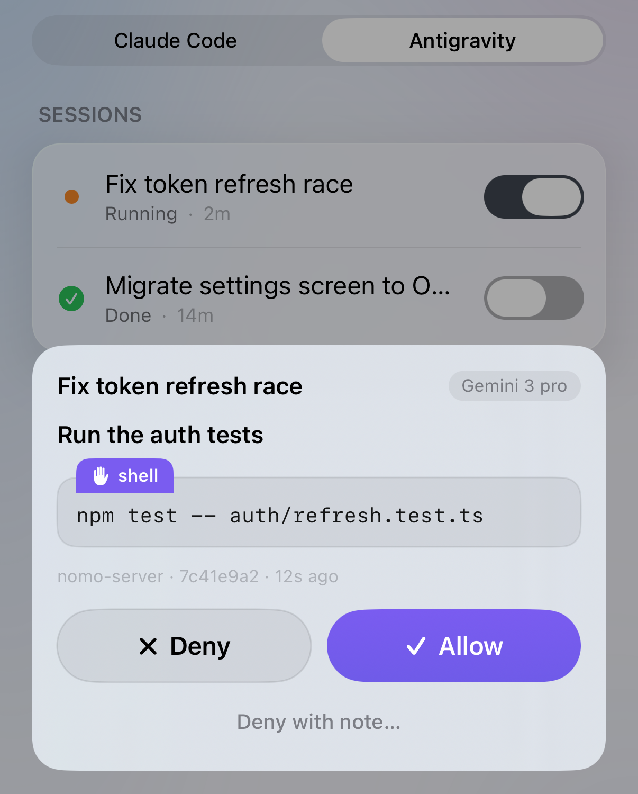
    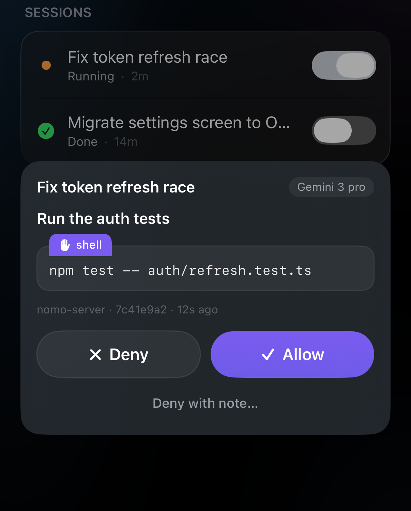
  </div>
</Frame>

- **Permitir**: Antigravity sigue adelante.
- **Denegar**: Antigravity se lo salta y continúa.
- **Denegar con nota…**: se lo salta y le dice a Antigravity por qué, con tus
  palabras.

Más en [Responder desde el iPhone](/es/sessions/approvals).

Conviene saber:

- **Tus propias reglas de Antigravity van primero.** Lo que tus reglas bloquean
  sigue bloqueado: tocar Permitir en el teléfono nunca lo anula. En `agy`, los
  comandos que tus reglas ya permiten se ejecutan sin preguntar a tu teléfono.
- **En la app de escritorio, todo pregunta a tu teléfono.** Nomo no puede ver
  los ajustes de permisos de la app de escritorio, así que cada comando y cada
  cambio de archivo llega a tu teléfono.
- **¿Paraste el chat en el ordenador?** La tarjeta desaparece sola de tu
  teléfono.
- **La terminal no muestra nada mientras espera.** Mientras una solicitud
  espera a tu teléfono, no aparece nada en la terminal. Es lo
  esperado: la solicitud está en tu teléfono.
- **¿Tienes abierto el panel de respuesta?** La solicitud también aparece en el
  chat y puedes responderla ahí; consulta [Aprobar desde el chat](#approve-in-chat).

## Detener {#interrupt}

Toca **[Detener](/es/sessions/list#interrupt-a-running-session)** en una sesión
de Antigravity `En ejecución` para pararla. Necesita la etiqueta verde
**⚡ Local**. Antigravity termina el paso en el que está, se detiene y la sesión
pasa a `Listo`. El chat sigue abierto: envía un mensaje nuevo para continuar.

## Responder desde el teléfono {#reply-from-your-phone}

Envía un mensaje a una sesión de Antigravity desde el iPhone: una corrección,
el siguiente paso o «sigue». Llega a Antigravity como si lo hubieras escrito en
el Mac. La pantalla de respuesta es un chat: tus mensajes van a la derecha y las
solicitudes de Antigravity aparecen a la izquierda.

<Note>
  **Por ahora, el iPhone y el Mac tienen que estar en la misma red Wi-Fi**, con
  **[Red local](/es/sessions/settings#local-network)** activada en Nomo. Esto
  cambiará con una próxima actualización del servidor; después, las respuestas
  funcionarán desde cualquier sitio.
</Note>

<Steps>
  <Step title="Abre la sesión">
    En Nomo, abre tu ordenador y elige la pestaña **Antigravity**. Toca el
    nombre de la sesión.

    Verás que la sesión se abre, con un botón azul **Responder** bajo sus
    detalles. Una sesión en ejecución también tiene un botón rojo **Detener**.

    <Frame caption="Una sesión de Antigravity en ejecución, abierta, con Detener y Responder bajo sus detalles.">
      <div className="device-frame">
        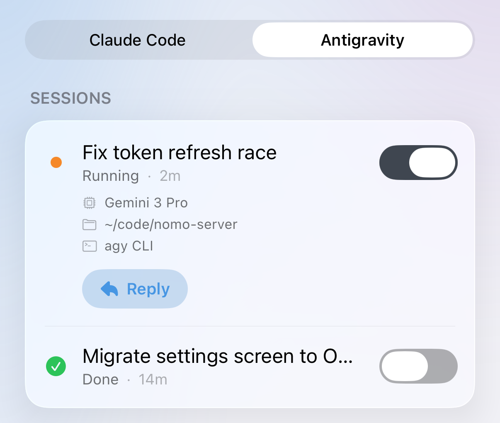
        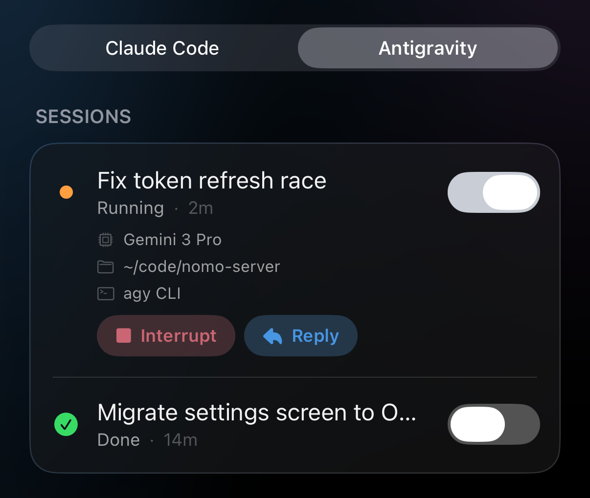
      </div>
    </Frame>
  </Step>

  <Step title="Toca Responder">
    Verás que sube un panel con el nombre de la sesión arriba y un cuadro que
    dice **Mensaje para esta sesión**.

    Para cerrar el panel en cualquier momento, toca **✕** arriba a la derecha.
  </Step>

  <Step title="Escribe tu mensaje y envíalo">
    Escribe tu mensaje y toca la flecha.

    Verás tu mensaje como una burbuja a la derecha, con una línea de estado
    debajo. El estado te dice dónde está el mensaje; consulta la lista de abajo.

    <Frame caption="Dos mensajes: el primero ya ha llegado a Antigravity; el segundo espera a su siguiente paso y aún se puede cancelar.">
      <div className="device-frame">
        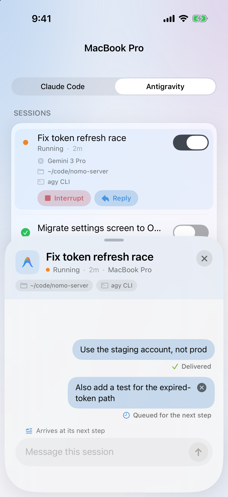
        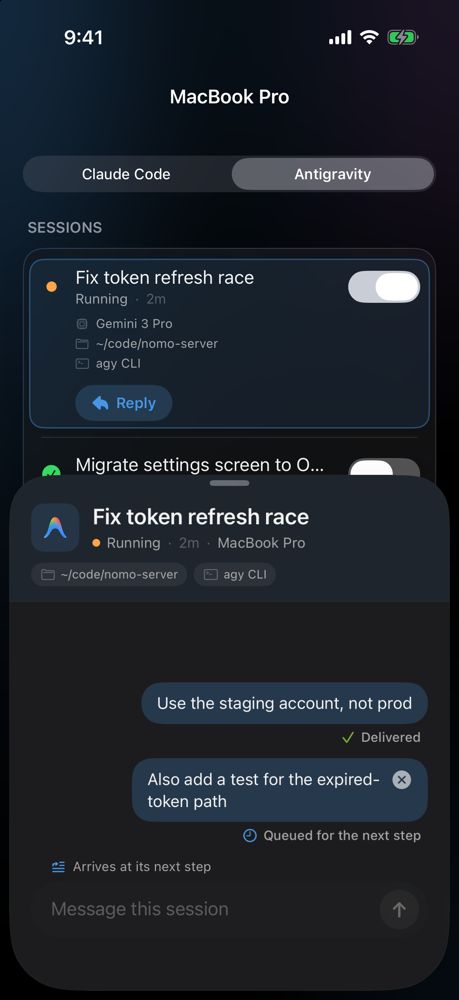
      </div>
    </Frame>
  </Step>
</Steps>

### Aprobar desde el chat {#approve-in-chat}

Si Antigravity pide ejecutar un comando mientras el panel de respuesta está
abierto, puedes responder ahí mismo, en el chat.

<Steps>
  <Step title="Busca la solicitud">
    Busca una burbuja a la izquierda, de Antigravity. Dice **Quiere ejecutar:**,
    luego el comando y después dos botones: **Denegar** y **Permitir**.

    <Frame caption="Antigravity pide ejecutar un comando dentro del chat de respuesta.">
      <div className="device-frame">
        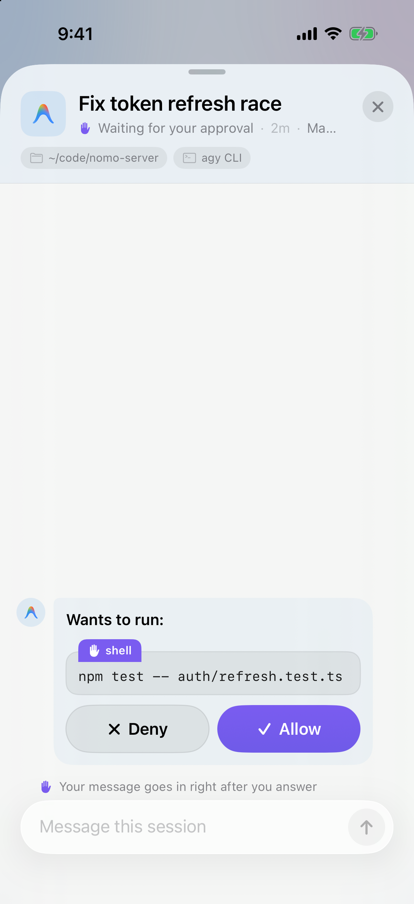
        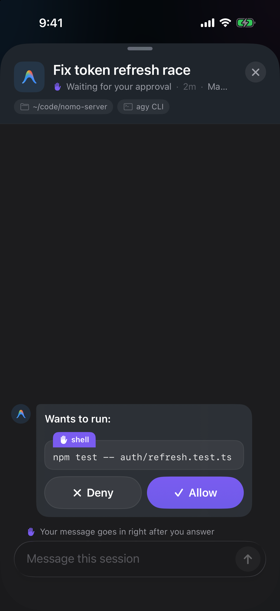
      </div>
    </Frame>
  </Step>

  <Step title="Toca Permitir o Denegar">
    Toca **Permitir** para que Antigravity lo ejecute. Toca **Denegar** para
    que se lo salte.

    Verás que la burbuja se reduce a una línea que dice qué ha pasado; consulta
    [Cómo se ve una solicitud respondida](#answered-requests).
  </Step>
</Steps>

Los botones **Denegar** y **Permitir** de la burbuja nunca envían lo que has
escrito en el cuadro. Tu texto se queda en el cuadro.

### Denegar y enviar {#deny-and-send}

¿Quieres decir que no y decirle a Antigravity qué hacer en su lugar? Haz las
dos cosas con un solo botón.

<Steps>
  <Step title="Escribe el motivo">
    Mientras la solicitud espera, escribe en el cuadro qué debería hacer
    Antigravity en su lugar; por ejemplo, «Usa bun, no npm».

    Verás que la flecha de enviar se convierte en un botón rojo
    **Denegar y enviar**, y la línea **Se envía como motivo para denegar**
    encima del cuadro.

    <Frame caption="Texto escrito mientras espera una solicitud: el botón de enviar pasa a ser Denegar y enviar.">
      <div className="device-frame">
        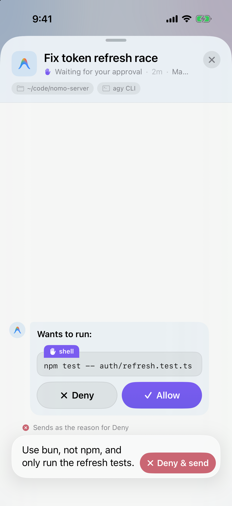
        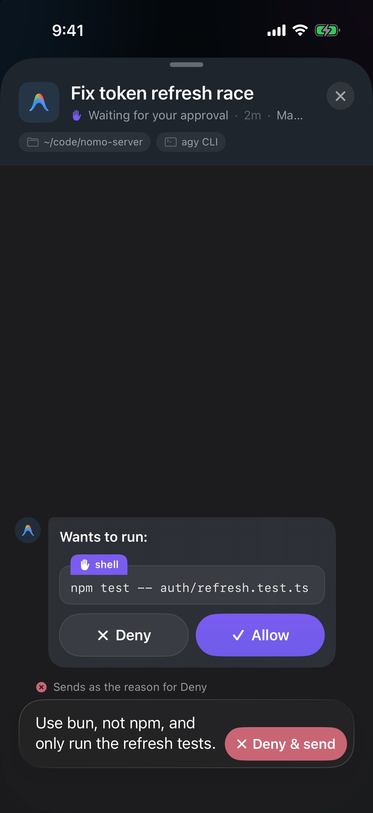
      </div>
    </Frame>
  </Step>

  <Step title="Toca Denegar y enviar">
    Antigravity se salta el comando y lee tu texto como el motivo.

    Verás que la solicitud cambia a **✕ Denegado**, con tu motivo citado
    debajo.
  </Step>
</Steps>

<Tip>
  Un motivo puede tener hasta 500 caracteres. Si escribes más, el botón sigue
  siendo la flecha normal de enviar. Tu mensaje espera y entra justo después de
  que respondas a la solicitud.
</Tip>

### Cómo se ve una solicitud respondida {#answered-requests}

| Ves | Qué significa |
| --- | --- |
| `✓ Permitido · <comando>` | La has permitido. |
| `✕ Denegado · <comando>` | La has denegado. Si usaste **Denegar y enviar**, tu motivo aparece citado debajo. |
| `Respondido en tu ordenador` | Se respondió en el Mac. |
| `Tiempo agotado — continúa en tu Mac` | Esperó demasiado a tu teléfono. Antigravity pregunta en el Mac. |

### Qué significa el estado bajo un mensaje {#reply-statuses}

| Ves | Qué significa |
| --- | --- |
| `Enviando…` | Tu teléfono lo está enviando. |
| `Esperando tu aprobación` | Antigravity espera a que respondas una solicitud en el chat. Tu mensaje entra justo después de que respondas. |
| `En cola para el siguiente paso` | Tu Mac ya lo tiene. Antigravity lo lee en su siguiente paso. Hasta entonces puedes tocar **×** en la burbuja para cancelarlo. |
| `Entregado` | Antigravity ya lo ha leído. |
| `Reanudando en tu Mac…` | La sesión había terminado y tu Mac la está volviendo a iniciar con tu mensaje. Solo lo ves cuando tu Mac de verdad ha empezado. Ya no se puede cancelar. |
| `Reanudado en tu Mac` | La sesión vuelve a estar en marcha con tu mensaje. |
| `Reconectando…` | Ahora mismo tu teléfono no llega a tu Mac. Lo sigue intentando solo; no hace falta que lo envíes otra vez. |

### Dónde funciona {#where-reply-works}

Depende de dónde uses Antigravity.

**Con la herramienta de línea de comandos `agy`:**

- **Mientras trabaja**: tu mensaje llega en su siguiente paso.
- **Terminada, con `agy` cerrado**: tu Mac vuelve a iniciar la sesión con tu
  mensaje. Verás `Reanudando en tu Mac…` y después `Reanudado en tu Mac`.
- **Terminada, pero con `agy` aún abierto**: tu mensaje espera. Muestra
  `En cola para el siguiente paso` hasta que envíes tu siguiente mensaje en
  `agy`, en el Mac; entonces Antigravity lee los dos.

**Con la app de escritorio de Antigravity:**

- **Mientras trabaja**: tu mensaje llega en su siguiente paso.
- **Terminada**: solo el Mac puede continuarla. **Responder** aparece en gris, y
  la línea de debajo dice **Las sesiones de la app Antigravity solo pueden
  continuar en tu Mac**.

<Frame caption="Una sesión terminada de la app de escritorio: Responder aparece en gris y la línea de debajo explica por qué.">
  <div className="device-frame">
    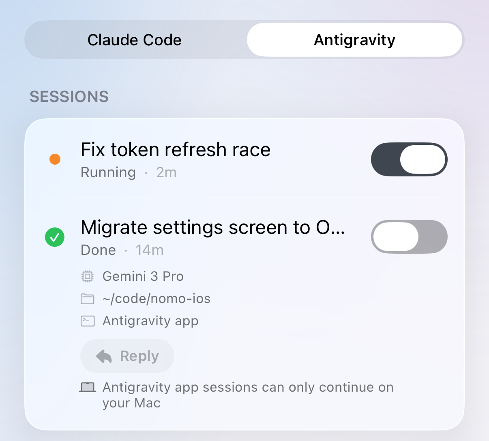
    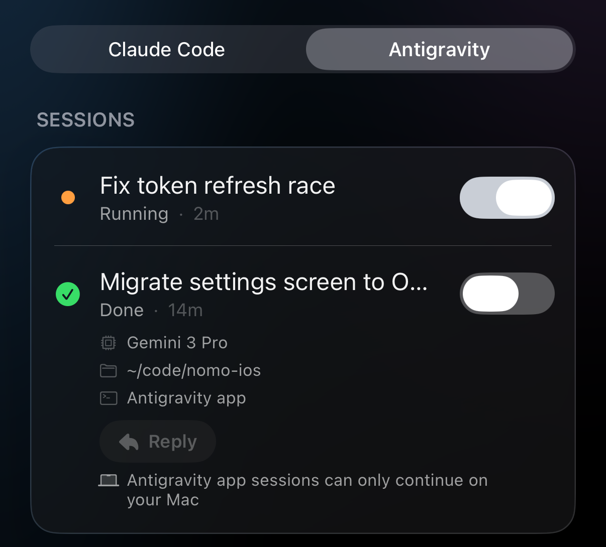
  </div>
</Frame>

Conviene saber:

- **Hasta 4000 caracteres** por mensaje. El cuadro deja de aceptar texto ahí.
- **Detener siempre gana.** Si tocas **[Detener](#interrupt)** mientras hay un
  mensaje en cola, Antigravity se detiene primero. El mensaje nunca se entrega
  al turno que has detenido.
- **Tus mensajes se quedan mientras Nomo esté abierto.** Si cierras Nomo del
  todo, el panel empieza vacío la próxima vez. Los mensajes que tu Mac ya tiene
  llegan igualmente.

## Lo que esta versión no hace {#what-this-version-doesnt-do}

- **Sin preguntas ni planes.** Las preguntas y las revisiones de planes de
  Antigravity no se muestran en tu teléfono.
- **Sin “Abrir en el Mac”.** El botón no está disponible en las sesiones de
  Antigravity.
- **Sin Permitir siempre.** Cada respuesta es un **Permitir** o **Denegar** de
  una sola vez.

## Algo no funciona {#troubleshooting}

<AccordionGroup>
  <Accordion title="Mi respuesta se queda en “En cola para el siguiente paso”">
    Tu Mac ya tiene el mensaje. Si Antigravity está trabajando, lo lee en su
    siguiente paso; un comando largo puede tardar un rato.

    Si la sesión ha terminado y `agy` sigue abierto en el Mac, el mensaje espera
    a tu siguiente mensaje allí. Envía algo en `agy` y Antigravity leerá los dos.
    O toca **×** en la burbuja para cancelarlo.
  </Accordion>

  <Accordion title="Un comando de Nomo muestra “operation not permitted”">
    Puede pasar la primera vez que usas un comando de Nomo en la app de
    escritorio de Antigravity. Es normal: Antigravity lo vuelve a intentar fuera
    de su sandbox por sí solo. Espera a que termine; no tienes que hacer nada.
  </Accordion>

  <Accordion title="Responder aparece en gris">
    La sesión es de la app de escritorio de Antigravity y ya ha terminado. Solo
    el Mac puede continuarla. Envía tu siguiente mensaje en la app.
  </Accordion>

  <Accordion title="Cada sesión sale dos veces">
    El plugin de Nomo para Claude Code está importado en Antigravity. Ejecuta
    esto en Terminal y después reinicia Antigravity:

    ```bash
    agy plugin uninstall nomo-cc
    ```
  </Accordion>

  <Accordion title="Un comando de Nomo dice que no encuentra sus archivos">
    La carpeta de Nomo se movió o se borró. Antigravity sigue funcionando, pero
    nada llega a tu teléfono. Vuelve a ejecutar el instalador y después reinicia
    Antigravity:

    ```bash
    bunx nomo-ai --antigravity
    ```
  </Accordion>
</AccordionGroup>

Todo lo demás —nada en tu teléfono, aprobaciones que dejaron de llegar, una
sesión atascada— está en [Solución de problemas](/es/sessions/troubleshooting).

## Avanzado {#advanced}

<AccordionGroup>
  <Accordion title="Cómo funciona" icon="gear">
    - **Qué cambia el instalador.** Clona el plugin en `~/.nomo`, añade un
      bloque llamado `nomo` a `~/.gemini/config/hooks.json` (el resto de
      bloques quedan intactos) y copia un pequeño plugin de Antigravity, `nomo`,
      con los cinco comandos `/nomo-*` en `~/.gemini/config/plugins/nomo`. Se
      niega, sin cambiar nada, si `hooks.json` no es JSON válido o si la carpeta
      de plugin `nomo` de ahí no es suya. Desinstalar quita solo ese bloque y
      esa carpeta.
    - **Hooks.** `SessionStart`, `PreInvocation`, `PostInvocation`, `Stop` y
      `PostToolUse` informan del estado. Responden `{}` al momento y hacen su
      trabajo en segundo plano, así que Antigravity nunca espera a Nomo. Una
      fila empieza en el primer `PreInvocation`, no en `SessionStart`.
    - **Aprobaciones.** Un hook `PreToolUse` se aplica solo a comandos de shell
      y a escrituras y ediciones de archivos (`run_command`, `write_file`,
      `write_to_file`, `edit_file`, `replace_file_content`,
      `multi_replace_file_content`), con un tiempo límite de 24 horas. Permitir
      responde `auto_approve`; Denegar responde `deny` con tu nota como motivo.
      Cualquier otro resultado responde `allow`, que deja la decisión a los
      propios ajustes y a la solicitud de Antigravity. Lo que pueda coincidir
      con una regla `deny` de `~/.gemini/antigravity-cli/settings.json` de `agy`
      nunca llega al teléfono; una llamada que cubre una regla `allow` de
      prefijo simple, y que ninguna regla `ask` toca, pasa directamente.
    - **A prueba de fallos.** Cada comando de hook comprueba primero que su
      script sigue existiendo. Si `~/.nomo` se movió o se borró, responde por
      su cuenta, así que nunca se bloquea nada. Cualquier error en el hook de
      aprobación también vuelve a la solicitud propia de Antigravity.
    - **Detener.** Tu teléfono pone una marca de un solo uso; el siguiente
      `PostInvocation` termina el turno. Un comando de shell o una escritura de
      archivo que espera al teléfono mientras la marca está puesta se deniega
      con “Stopped from phone”. Una marca sin usar se descarta a los 10
      minutos. Nomo nunca envía señales al proceso `agy`.
    - **Turnos que acaban sin evento.** Cuando cancelas un turno, o una
      ejecución termina, Nomo vigila el proceso que ejecutó el hook y el índice
      de conversaciones de Antigravity, y marca la fila como terminada. Una
      sesión sin actividad durante 30 minutos se quita como último recurso.
      Cancelar mientras hay una tarjeta en tu teléfono retira la tarjeta.
    - **Respuestas.** Tu teléfono sella un comando `send-message` (un id de
      mensaje y hasta 4000 caracteres) y lo envía por el enlace local y por el
      relé. El Mac escribe un archivo por mensaje, solo legible por su dueño
      (`<conversation>.<id>.agy-inbox`). El siguiente `PreInvocation` entrega
      todos los mensajes en cola al agente como mensajes del usuario; un mensaje
      que llega durante el último paso del turno hace que el `Stop` de ese turno
      continúe una vez. Los acuses vuelven en la actualización cifrada de la
      sesión: en cola, reanudando, entregado, reanudado, cancelado o rechazado.
      Para una conversación de `agy` terminada cuyo `agy` ya se cerró, Nomo
      ejecuta `agy --conversation <id> --print=<message>` en la carpeta de esa
      conversación (el mensaje es un único argumento, nunca lo interpreta una
      shell). Un `agy` terminado que sigue abierto guarda el mensaje para su
      siguiente turno: Nomo nunca abre un segundo `agy` en una conversación. Un
      Detener siempre gana: un mensaje nunca se entrega a un turno que se está
      deteniendo. Los mensajes que nadie recoge se borran al cabo de un día. Los
      comandos `/nomo-*` de Nomo nunca ponen una tarjeta en el teléfono.
    - **Título.** De solo lectura, desde `conversation_summaries.db` de
      Antigravity con el `sqlite3` del sistema. Antes de que exista: la primera
      línea de la transcripción de la conversación y, si no, el nombre de la
      carpeta del espacio de trabajo.
    - **Comandos.** Los comandos `/nomo-*` solo ejecutan los propios comandos
      locales de Nomo —vincular, estado, el interruptor de aprobaciones,
      reiniciar, desvincular—, cada uno detrás de la solicitud de ejecutar
      comandos de Antigravity. Nunca imprimen el enlace de vinculación ni el
      secreto del QR.

    Todos los detalles están en el
    [README](https://github.com/KarrixLee/nomo#install--antigravity) del
    plugin.
  </Accordion>
</AccordionGroup>
