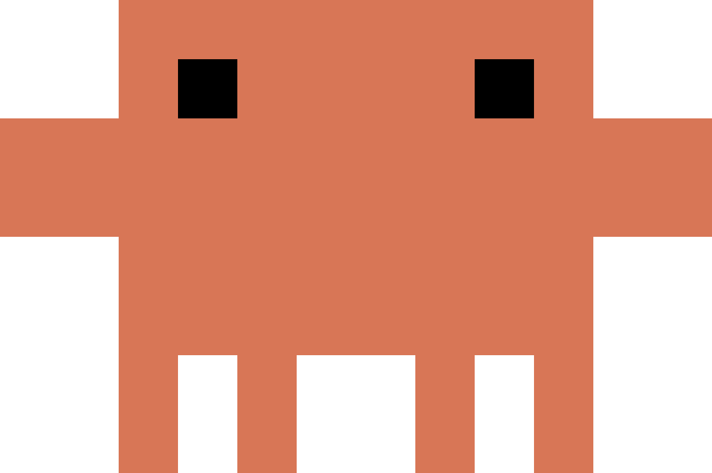
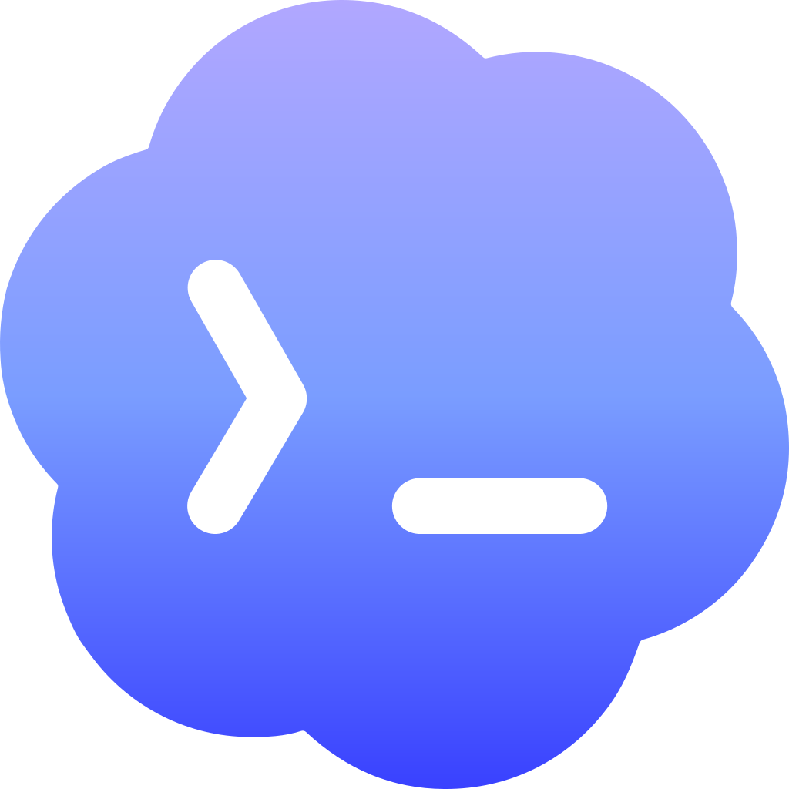
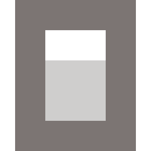

Cinco comandos en Claude Code, Codex, OpenCode y Antigravity, un sexto que solo
OpenCode necesita, y cuatro en Cursor. Se ejecutan desde dentro de una sesión del
agente, en el ordenador al que quieras afectar: un comando con `/` en Claude Code
y en OpenCode, una skill con `/` en Cursor y en Antigravity, una skill con `$` en
Codex. Vincular, el estado y el reinicio también funcionan en Terminal: consulta
[Desde Terminal](#terminal).

<Note>
  En Antigravity, cada comando de Nomo pregunta antes. Elige **Allow**
  (permitir): Antigravity pregunta antes de ejecutar cualquier comando en tu
  ordenador. Más en [Usar Antigravity](/es/sessions/antigravity#commands).
</Note>

<Tip>
  En Claude Code todo va con espacio de nombres: al escribir `/nomo-cc:` se
  listan todos. Los nombres de comando de OpenCode son planos y globales, así que
  allí los de Nomo no llevan ningún prefijo, y sus skills de Cursor y
  Antigravity tampoco.
</Tip>

| |  Claude Code |  Codex |  OpenCode |  Cursor |  Antigravity |
| --- | --- | --- | --- | --- | --- |
| <a href="#pair">Vincular este ordenador</a> | `/nomo-cc:pair` | `$nomo-pair` | `/nomo-pair` | `/nomo-pair` | `/nomo-pair` |
| <a href="#status">Comprobar la salud</a> | `/nomo-cc:status` | `$nomo-status` | `/nomo-status` | `/nomo-status` | `/nomo-status` |
| <a href="#approvals">Pausar o reanudar las aprobaciones</a> | `/nomo-cc:approvals` | `$nomo-approvals` | `/nomo-approvals` | — | `/nomo-approvals` |
| <a href="#reset">Limpiar sesiones atascadas</a> | `/nomo-cc:reset` | `$nomo-reset` | `/nomo-reset` | `/nomo-reset` | `/nomo-reset` |
| <a href="#unpair">Desconectar este ordenador</a> | `/nomo-cc:unpair` | `$nomo-unpair` | `/nomo-unpair` | `/nomo-unpair` | `/nomo-unpair` |
| <a href="#update">Actualizar el plugin</a> | — | — | `/nomo-update` | — | — |

Ninguno puede fallar a gritos. Todos terminan limpiamente incluso cuando no hay
nada que hacer: `Not paired` es un éxito, no un error.

Las casillas vacías de la última fila no son un olvido: Claude Code y Codex se
actualizan a través de sus propios anfitriones, así que Nomo no añade ningún
comando ahí, y Cursor se actualiza volviendo a ejecutar su instalador, igual que
Antigravity. Lo que necesita cada uno —que en el caso de Codex suele
ser nada— está en [update](#update).

La casilla vacía de Cursor en la fila de aprobaciones tampoco lo es: las
sesiones de Cursor son de solo lectura, así que no hay aprobaciones remotas que
pausar — [Usar Cursor](/es/sessions/cursor).

Quitar Nomo no tiene comando con `/`: es una línea que pegas en la terminal —
mira [uninstall](#uninstall).

## Desde Terminal {#terminal}

También puedes ejecutar los comandos principales en Terminal, desde cualquier
carpeta. En un Mac en el que [Grok Bot](/es/sessions/grok-bot) es tu única app
de IA, es la única forma.

| | Terminal |
| --- | --- |
| Instalar o actualizar Nomo | `bunx nomo-ai` |
| <a href="#pair">Vincular este ordenador</a> | `bunx nomo-ai pair` |
| Vincular con un código | `bunx nomo-ai pair code` |
| <a href="#status">Comprobar la salud</a> | `bunx nomo-ai status` |
| <a href="#reset">Limpiar sesiones atascadas y enviar tu actividad ya</a> | `bunx nomo-ai reset` |
| <a href="#uninstall">Quitar Nomo de un agente</a> | `bunx nomo-ai uninstall --cursor` |

Hacen lo mismo que los comandos dentro de tu agente. Una sola vinculación o un
solo reinicio cubre todos los agentes de ese ordenador. ¿No tienes bun? Usa
`npx nomo-ai` en su lugar, como `npx nomo-ai status`. Si Nomo aún no está
instalado, te lo dicen:

```
Nomo is not installed on this computer yet — run `bunx nomo-ai` first.
```

Al final de una instalación, `bunx nomo-ai` te pregunta si también quieres el
comando corto `nomo`. Si dijiste que sí, puedes escribir `nomo pair`,
`nomo status` y `nomo reset` en su lugar. `bunx nomo-ai …` funciona siempre,
digas lo que digas. No escribas `bunx nomo` ni `npx nomo`: el paquete de npm
llamado `nomo` no es de Nomo.

## pair {#pair}

<CodeGroup>
```bash Claude Code icon="/images/claude-code.svg"
/nomo-cc:pair          # QR code, opens your browser
/nomo-cc:pair code     # one-time code, printed in the terminal
```

```bash Codex icon="/images/codex.svg"
$nomo-pair             # QR code, opens your browser
$nomo-pair code        # one-time code, printed in the terminal
```

```bash OpenCode icon="/images/opencode.svg"
/nomo-pair             # QR code, opens your browser
/nomo-pair code        # one-time code, printed in the terminal
```

```bash Cursor icon="/images/providers/cursor.svg"
/nomo-pair             # QR code, opens your browser
/nomo-pair code        # one-time code, printed in the terminal
```

```bash Antigravity icon="/images/providers/antigravity.png"
/nomo-pair             # QR code, opens your browser
/nomo-pair code        # one-time code, shown in the chat
```

```bash Terminal icon="terminal"
bunx nomo-ai pair      # QR code, opens your browser
bunx nomo-ai pair code # one-time code, printed in the terminal
```
</CodeGroup>

Sin argumentos abre en tu navegador una página con la estética de la app y un
código QR. Escanéalo en la app y la página cambia sola a **Paired ✓**.

El argumento `code` se salta el navegador por completo e imprime un código de un
solo uso que puedes escribir, pensado para una máquina sin interfaz gráfica o una
sesión SSH. Es la vía de segunda opción a propósito: ese código acaba en tu
terminal y, por tanto, en la transcripción del agente.

Vincular un ordenador que ya está vinculado sustituye su vinculación. Si el
ordenador ya está vinculado, no hace falta vincularlo otra vez.

Las vinculaciones caducan a los **10 minutos** sin usarse. Una vinculación cubre
la máquina, no el agente: Claude Code, Codex, OpenCode, Cursor y Antigravity en el
mismo Mac la comparten. El recorrido completo está en [Vinculación](/es/setup/pairing).

## status {#status}

<CodeGroup>
```bash Claude Code icon="/images/claude-code.svg"
/nomo-cc:status
```

```bash Codex icon="/images/codex.svg"
$nomo-status
```

```bash OpenCode icon="/images/opencode.svg"
/nomo-status
```

```bash Cursor icon="/images/providers/cursor.svg"
/nomo-status
```

```bash Antigravity icon="/images/providers/antigravity.png"
/nomo-status           # a short summary in plain words
/nomo-status verbose   # the full readout below
```

```bash Terminal icon="terminal"
bunx nomo-ai status
```
</CodeGroup>

El primero que hay que ejecutar cuando algo se ve raro. Una máquina sana son
unas pocas líneas tranquilas: no hay marcas de visto, porque que todo esté bien
es justamente la ausencia de algo que decir.

```
Nomo 2.2.0 · Claude Code

Phone         paired · https://api.nomo.gg · pairing 3e65a0cb…
Delivery      last event sent 4m ago · watchdog running (pid 25780)
LAN           listening on port 51843 (id 9f3c1a20) since 3h ago
              phone last reached this Mac 12s ago (ping)
              address last advertised 4m ago (2 interfaces)
Approvals     on — permission prompts are held and sent to your phone

Claude Code — you are here
  Hooks       firing · last 8s ago
  Sessions    1 of 4 tracked here
```

Las filas de arriba describen el **ordenador**, y se leen igual desde
cualquier agente. Debajo viene el agente en el que estás de verdad, marcado con
`— you are here`.

<ResponseField name="Phone">
  Si este ordenador está vinculado siquiera, además del worker con el que habla y
  la vinculación que guarda. `NOT PAIRED` significa que nada de aquí llega a la
  app, y la flecha de debajo imprime el comando de [vinculación](#pair) del
  agente en el que estás.
</ResponseField>

<ResponseField name="Delivery">
  Cuándo salió realmente el último evento de este ordenador, y si el proceso
  supervisor está en marcha. Que el supervisor no esté corriendo no pasa nada por
  sí solo: arranca en la siguiente sesión. Que no se haya enviado nada (`never`)
  con una sesión realmente en marcha sí es un problema.
</ResponseField>

<ResponseField name="LAN">
  El enlace directo por [red local](/es/sessions/settings#local-network): el
  puerto y el id en los que escucha este ordenador, cuándo lo alcanzó tu teléfono
  por última vez y cuándo anunció el Mac su dirección. La línea del medio es la
  que importa: es la única prueba de que la vía directa haya funcionado alguna
  vez. Anunciada hace mucho y nunca alcanzada significa que tu teléfono no llega
  hasta aquí; anunciada hace segundos y todavía sin alcanzar es simplemente
  demasiado pronto para saberlo. Una petición rechazada imprime su motivo en
  lugar de dejar silencio. La fila desaparece entera en un ordenador que nunca ha
  escuchado: el interruptor está en tu teléfono y viene desactivado.
</ResponseField>

<ResponseField name="Approvals">
  `on` significa que las solicitudes de permiso se retienen aquí y se envían a tu
  teléfono. `PAUSED` significa que no: van a la terminal, y siguen así hasta que
  alguien las reanude, por muchos meses que pasen. Si tu teléfono ha dejado de
  preguntarte nada, esta fila es la explicación entera — ve
  [Pausar las aprobaciones](/es/sessions/approvals#pausing-it).
</ResponseField>

<ResponseField name="Hooks">
  Si tu agente le está pasando algo a Nomo, y cuánto hace de la última vez.
  OpenCode no tiene hooks, así que allí la fila se llama `Plugin`. ¿No se dispara
  nada? Reinicia Claude Code para que se carguen sus hooks; en Codex, ejecuta
  `/hooks`; en OpenCode, reinícialo para que se cargue el plugin; reinicia
  Cursor o Antigravity, que solo recogen los hooks al arrancar.
</ResponseField>

<ResponseField name="Runtime">
  Solo aparece cuando el entorno de ejecución de tus hooks está desactualizado:
  bun anterior a la **1.4.4**, o Node.js 22 anterior a la **22.23.4**. La flecha
  dice cómo actualizarlo: `bun upgrade` para bun. Es solo un aviso: los hooks
  siguen funcionando.
</ResponseField>

<ResponseField name="Sessions">
  Ahora se cuentan por agente: `1 of 4 tracked here` significa que este ordenador
  sigue cuatro sesiones y una de ellas es la tuya. Para las filas que deberían
  haber muerto está [reset](#reset).
</ResponseField>

Los problemas llevan dos marcas y nada más: `!` es el problema y `→` es qué hacer
al respecto, escrito en el dialecto de comandos del agente desde el que
preguntaste. Cada uno de los demás agentes del ordenador tiene una línea
condensada bajo **Also on this computer** — y cuando el roto es *uno de esos*, lo
dice aquí en lugar de esperar a que vayas a mirar:

```
Nomo 2.2.0 · Claude Code

Phone         NOT PAIRED — nothing from this computer reaches the app
              → run /nomo-cc:pair

Claude Code — you are here
  Hooks       firing · last 6s ago
  Sessions    1 of 3 tracked here

Also on this computer
  Codex       firing · last 12h ago · 2 of 3 tracked here
              ! Also runs the Claude Code plugin's hooks on every Codex event — double the work, no benefit.
              → in Codex run /hooks and untrust the `nomo-cc@nomo` entries
              → full detail: run $nomo-status inside Codex
  OpenCode    installed · no activity yet
```

Las filas que no tienen nada que decir se omiten: un ordenador sin vincular no
tiene entrega, LAN ni aprobaciones que reportar. El problema de otro agente se
explica aquí entero y después te remite al comando de estado de ese agente para
el resto del detalle. Y la primera línea lleva la versión del plugin: cítala si
abres una incidencia.

## approvals {#approvals}

<CodeGroup>
```bash Claude Code icon="/images/claude-code.svg"
/nomo-cc:approvals off      # pause on this computer
/nomo-cc:approvals on       # resume
/nomo-cc:approvals status   # which way is it set
```

```bash Codex icon="/images/codex.svg"
$nomo-approvals off         # pause on this computer
$nomo-approvals on          # resume
$nomo-approvals status      # which way is it set
```

```bash OpenCode icon="/images/opencode.svg"
/nomo-approvals off         # pause on this computer
/nomo-approvals on          # resume
/nomo-approvals status      # which way is it set
```

```bash Antigravity icon="/images/providers/antigravity.png"
/nomo-approvals off         # pause on this computer
/nomo-approvals on          # resume
/nomo-approvals status      # which way is it set
```
</CodeGroup>

Pausa las aprobaciones remotas en **este ordenador**, de modo que las solicitudes
de permiso van directas a la terminal en lugar de esperar a tu teléfono. La salida
de emergencia para un teléfono sin batería o fuera de alcance.

```
Remote approvals are OFF for this computer — Claude Code permission prompts
will appear in the terminal as usual (your phone is not asked).
```

Un interruptor por ordenador, **compartido por todos los agentes**: pausarlo en
Codex lo pausa también para Claude Code y OpenCode en esa máquina. No desvincula
nada y no toca los ajustes de tu teléfono.

Hay otro interruptor aparte, para todo el teléfono: **Responder en el iPhone**
en [Ajustes](/es/sessions/settings#remote-approvals).

Cursor no tiene comando de aprobaciones. Sus solicitudes nunca llegan a tu
teléfono, así que no hay nada que pausar.

## reset {#reset}

<CodeGroup>
```bash Claude Code icon="/images/claude-code.svg"
/nomo-cc:reset
```

```bash Codex icon="/images/codex.svg"
$nomo-reset
```

```bash OpenCode icon="/images/opencode.svg"
/nomo-reset
```

```bash Cursor icon="/images/providers/cursor.svg"
/nomo-reset
```

```bash Antigravity icon="/images/providers/antigravity.png"
/nomo-reset
```

```bash Terminal icon="terminal"
bunx nomo-ai reset
```
</CodeGroup>

Detiene el proceso supervisor y limpia las filas de sesión muertas o fantasma, y
después le dice a tu teléfono que las suelte. Luego envía tu actividad (el mapa
y la racha de [Actividad de Nomo](/es/widgets#nomo-activity)) en el momento, en
lugar de esperar hasta 6 horas.

```
Stopped the watchdog (it restarts automatically on your next session).
Cleared 4 stale session record(s) (4 end signals delivered to your phone).
Left 2 live sessions untouched.
Sent your activity summary (heatmap and streak) to your phone.
Pairing and keys were not touched — use the unpair command if you want that.
```

La línea de la actividad también puede decir `No activity to send yet.`, o que
ahora no ha podido enviarla y lo volverá a intentar más tarde por su cuenta. El
primer reinicio en un ordenador con un historial largo de Claude Code puede
tardar un rato.

Un solo reinicio cubre todos los agentes de ese ordenador.

Es lo seguro a lo que recurrir cuando las filas se ven obsoletas o duplicadas,
porque dice qué ha dejado intacto. Una fila de OpenCode pertenece al **servidor**
de OpenCode, así que cierra OpenCode primero si alguna no se va — ve
[Usar OpenCode](/es/sessions/opencode#reset-needs-opencode-closed).

## unpair {#unpair}

<CodeGroup>
```bash Claude Code icon="/images/claude-code.svg"
/nomo-cc:unpair
```

```bash Codex icon="/images/codex.svg"
$nomo-unpair
```

```bash OpenCode icon="/images/opencode.svg"
/nomo-unpair
```

```bash Cursor icon="/images/providers/cursor.svg"
/nomo-unpair
```

```bash Antigravity icon="/images/providers/antigravity.png"
/nomo-unpair
```
</CodeGroup>

Revoca la vinculación y borra la clave en ese ordenador.

Olvidar un ordenador **desde el teléfono** no es lo mismo: eso hace que deje de
aparecer en tu app, pero el Mac conserva su estado local hasta que ejecutes esto
allí.

## update {#update}

Solo OpenCode tiene un comando de actualización. Los demás agentes se
actualizan de otra forma: abre su pestaña.

`bunx nomo-ai` (o `npx nomo-ai`) también actualiza: un agente que ya tiene
Nomo aparece como actualización en lugar de como instalación. Solo se ejecutan
las de OpenCode, Cursor y Antigravity; las de Claude Code y Codex se
imprimen para que las ejecutes tú.

<Tabs>
  <Tab title="Claude Code" icon="/images/claude-code.svg">
    ```bash
    claude plugin update nomo-cc@nomo
    ```

    La actualización automática viene desactivada para los marketplaces de
    terceros, así que nada mueve una instalación por su cuenta. Para activarla:
    `/plugin` → **Marketplaces** → el de Nomo → **Enable auto-update**.
  </Tab>

  <Tab title="Codex" icon="/images/codex.svg">
    Normalmente no hay nada que ejecutar. Codex lee el plugin en vivo desde su
    ruta, así que traer los cambios en ese clon es toda la actualización, y no
    existe ningún verbo `codex plugin update`.

    Si añadiste el marketplace desde git, Codex guarda una instantánea, y
    refrescarla es la actualización:

    ```bash
    codex plugin marketplace upgrade <marketplace-name>
    ```

    El nombre es aquel con el que lo añadiste, no necesariamente `nomo`.
  </Tab>

  <Tab title="OpenCode" icon="/images/opencode.svg">
    ```bash
    /nomo-update
    ```

    Comprueba antes de cambiar nada. Estar al día es una parada, no un no-op
    con un pull detrás:

    ```
    OpenCode plugin: /Users/you/.nomo
    Already on 2.1.22 — nothing to do.
    ```

    Cuando sí hay algo que traer, dice qué antes de traerlo:

    ```
    OpenCode plugin: /Users/you/.nomo
    Update available: 2.1.22 → 2.1.23.
    ```

    Después trae los cambios, vuelve a ejecutar el instalador —que es lo que
    recoge cualquier comando `/nomo-*` nuevo que traiga la versión— y te dice
    que reinicies OpenCode. Los plugins se importan una sola vez, al arrancar su
    servidor, así que hasta entonces la copia vieja sigue siendo la que corre.

    Se niega en lugar de actuar cuando no puede estar seguro, y cada negativa
    dice qué hacer en su lugar: un clon fijado por una instalación anterior con
    `--ref`, un árbol de trabajo con cambios sin confirmar, un clon que se ha
    movido o borrado, un clon que no es el repositorio propio de Nomo, o que
    aquí no haya nada instalado.

    `bunx nomo-ai` ejecuta la misma actualización con `--global`: solo
    actualiza la instalación global, sea cual sea la carpeta desde la que lo
    ejecutes. Una instalación con `--project` se actualiza con `/nomo-update`,
    ejecutado dentro de OpenCode en ese proyecto.

    <Note>
      Actualiza el clon al que apunta el **stub** —la copia que OpenCode
      importa de verdad—, que no es necesariamente aquel de cuyo archivo de
      comando saliste. Si mantienes más de un clon, esa es la distinción que
      importa.
    </Note>
  </Tab>

  <Tab title="Cursor" icon="/images/providers/cursor.svg">
    El mismo comando con el que lo instalaste:

    ```bash
    bunx nomo-ai --cursor
    ```

    Reinicia Cursor después, y cualquier sesión de `cursor-agent` abierta.
  </Tab>

  <Tab title="Antigravity" icon="/images/providers/antigravity.png">
    El mismo comando con el que lo instalaste:

    ```bash
    bunx nomo-ai --antigravity
    ```

    Reinicia Antigravity después, y cualquier sesión de `agy` abierta.
  </Tab>

  <Tab title="Grok Bot" icon="robot">
    El mismo comando con el que lo instalaste:

    ```bash
    bunx nomo-ai --grokbot
    ```

    No hay nada que reiniciar. La siguiente ejecución de cada hora ya usa la
    actualización.
  </Tab>
</Tabs>

## uninstall {#uninstall}

Quita Nomo de un agente. Ejecútalo en la terminal, no dentro del agente: elige
la pestaña de tu agente, pega la línea y pulsa Intro.

<CodeGroup>
```bash Claude Code icon="/images/claude-code.svg"
claude plugin uninstall nomo-cc@nomo
```

```bash Codex icon="/images/codex.svg"
codex plugin remove nomo@nomo
```

```bash OpenCode icon="/images/opencode.svg"
rm ~/.config/opencode/plugins/nomo.js
rm ~/.config/opencode/commands/nomo-*.md
```

```bash Cursor icon="/images/providers/cursor.svg"
bunx nomo-ai uninstall --cursor
```

```bash Antigravity icon="/images/providers/antigravity.png"
bunx nomo-ai uninstall --antigravity
```

```bash Grok Bot icon="robot"
bunx nomo-ai uninstall --grokbot
```
</CodeGroup>

¿No tienes `bunx`? Usa `npx` en su lugar; por ejemplo,
`npx nomo-ai uninstall --cursor`. La forma antigua `--uninstall` también
funciona. O ejecuta el script propio del agente, como
`node ~/.nomo/plugin/scripts/cursor-install.mjs --uninstall`
(`antigravity-install.mjs` para Antigravity, `grokbot-install.mjs` para Grok
Bot).

En Grok Bot, esto quita la tarea en segundo plano de cada hora, y nada más.

Desinstalar deja el comando corto `nomo` en su sitio. Para quitarlo también,
ejecuta `bun remove -g nomo-ai` (o `npm uninstall -g nomo-ai`).

Antigravity avisa cuando termina:

```
✅ Nomo is removed from Antigravity. Restart Antigravity to finish. Your phone stays connected for your other coding apps.
```

Después reinicia el agente. En Cursor y Antigravity, cierra la app y vuelve a
abrirla, y reinicia cualquier `cursor-agent` o `agy` abierto.

Solo quita lo que Nomo añadió a ese agente. Tu teléfono sigue vinculado, así que
tus otros agentes siguen funcionando. Para desconectar también este ordenador,
ejecuta [unpair](#unpair) **antes**: cuando Nomo ya no está, ese comando tampoco.

¿Importaste en Antigravity el plugin de Nomo para Claude Code? Quítalo también
con `agy plugin uninstall nomo-cc` y reinicia Antigravity.

`bunx nomo-ai uninstall` siempre necesita que indiques el agente: nunca lo
adivina. Más sobre la instalación de cada agente en
[Instalación](/es/setup/install).

## Sin los comandos con / {#without-slash-commands}

¿Antigravity no reconoce los comandos de Nomo? Ejecútalos desde
Terminal. Vincular, el estado y el reinicio son más fáciles como
[comandos `bunx nomo-ai`](#terminal). La lista completa, que funciona con el
instalador de Nomo:

| | |
| --- | --- |
| Vincular | `~/.nomo/plugin/scripts/run.sh ~/.nomo/plugin/dist/pair.mjs` |
| Vincular con un código | `~/.nomo/plugin/scripts/run.sh ~/.nomo/plugin/dist/pair.mjs --show-code` |
| Comprobar el estado | `~/.nomo/plugin/scripts/run.sh ~/.nomo/plugin/dist/status-cmd.mjs antigravity` |
| Pausar las aprobaciones | `~/.nomo/plugin/scripts/run.sh ~/.nomo/plugin/dist/cc-permission.mjs off` |
| Reanudar las aprobaciones | `~/.nomo/plugin/scripts/run.sh ~/.nomo/plugin/dist/cc-permission.mjs on` |
| Limpiar sesiones atascadas | `~/.nomo/plugin/scripts/run.sh ~/.nomo/plugin/dist/reset.mjs` |
| Desvincular | `~/.nomo/plugin/scripts/run.sh ~/.nomo/plugin/dist/unpair.mjs` |

Tras vincular desde Terminal, ejecuta
`~/.nomo/plugin/scripts/run.sh ~/.nomo/plugin/dist/pair.mjs wait` y escanea el
código QR. Añade `--verbose` al instalador para ver qué cambia.

## Dónde se guarda el estado {#where-state-lives}

Todo lo que guarda el plugin está en `~/.config/cc-status/`: la vinculación, la
clave de cifrado (modo `0600`), un archivo por sesión seguida y un registro de
traza local. Nada de esa carpeta se envía a ningún sitio.

## El código fuente {#read-the-source}

Estos comandos son el plugin, y el plugin es de código abierto. Si quieres saber
exactamente qué se ejecuta en tu máquina y qué sale de ella, la respuesta está en
un solo repositorio: las instalaciones desde el marketplace son un clon literal
de él.

<Card title="KarrixLee/nomo" href="https://github.com/KarrixLee/nomo" icon="github" horizontal>
  El código completo del plugin, con licencia MIT. Las incidencias y los informes
  de errores también van aquí.
</Card>
