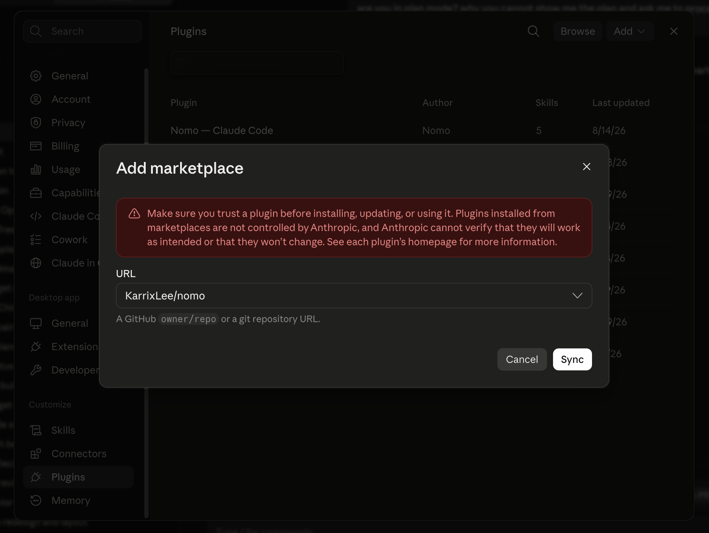
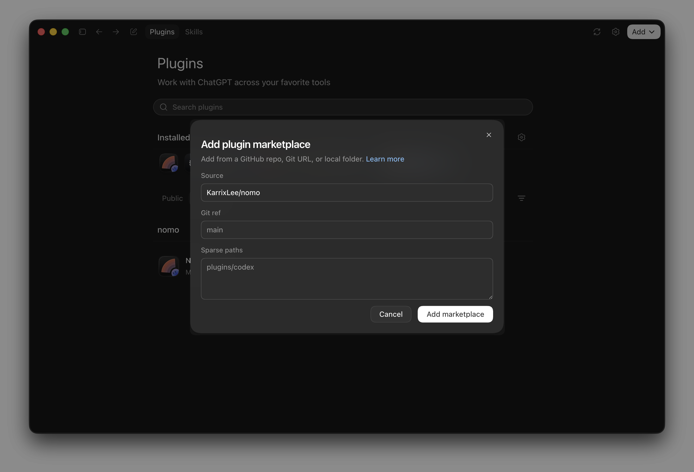
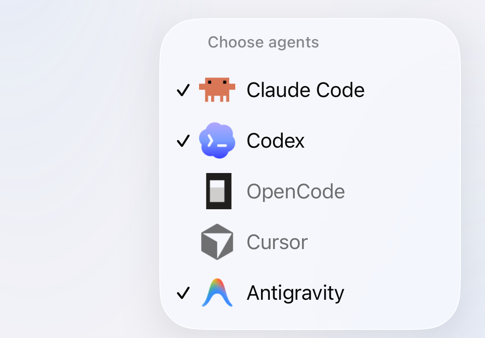
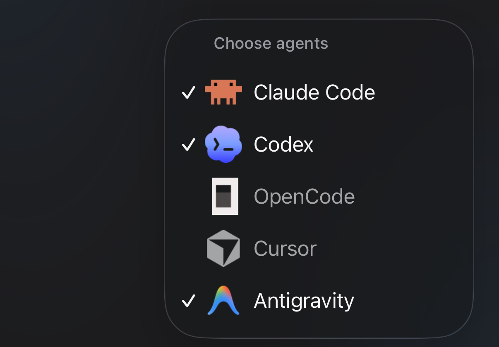

Instálalo una vez por ordenador. Necesitas **bun** o **node 18+**: el plugin no
tiene dependencias npm y funciona con los módulos integrados de Node. Mantén
bun en la **1.4.4** o posterior, y Node.js 22 en la **22.23.4** o posterior: el
comando status te avisa si son más antiguos.

## Instalación manual {#install-by-hand}

<Tabs>
  <Tab title="Claude Code" icon="/images/claude-code.svg">
    <Tabs>
      <Tab title="Terminal" icon="terminal">
        Desde una sesión de Claude Code:

        ```
        /plugin marketplace add KarrixLee/nomo
        /plugin install nomo-cc@nomo
        ```
      </Tab>

      <Tab title="App de escritorio" icon="window">
        **Settings** → **Plugins** → **Add** → **Add marketplace**. Pon el repositorio en **URL**:

        ```
        KarrixLee/nomo
        ```

        Luego pulsa **Sync** e instala **Nomo — Claude Code** desde la lista.

        <Frame caption="Basta con un owner/repo de GitHub — el repositorio de Nomo es el marketplace.">
          
        </Frame>
      </Tab>
    </Tabs>

    Reinicia Claude Code después para que se carguen los hooks del plugin.

    Comprueba que está ahí:

    ```
    /nomo-cc:status
    ```

    <Tip>
      Todos los comandos de Nomo en Claude Code llevan el espacio de nombres
      `nomo-cc:`; al escribir `/nomo-cc:` se listan.
    </Tip>
  </Tab>

  <Tab title="Codex" icon="/images/codex.svg">
    Codex **0.142 o posterior** incluye su propio sistema de plugins, así que
    Nomo se instala como un plugin independiente de Codex. Claude Code no es
    necesario.

    <Steps>
      <Step title="Instala el plugin">
        <Tabs>
          <Tab title="Terminal" icon="terminal">
            ```
            codex plugin marketplace add KarrixLee/nomo
            codex plugin add nomo@nomo
            ```

            La terminal integrada de la app de escritorio también sirve, si prefieres escribir.
          </Tab>

          <Tab title="App de escritorio" icon="window">
            **Plugins** → **Añadir** → **Añadir un marketplace**. Pon el repositorio en **Source**:

            ```
            KarrixLee/nomo
            ```

            Deja **Git ref** y **Sparse paths** como están: el texto gris es un marcador de posición, no un valor que tengas que escribir. Luego pulsa **Añadir un marketplace** e instala **nomo** desde la lista.

            <Frame caption="El repositorio de Nomo es el marketplace — no hay ningún catálogo que explorar ni al que enviar nada.">
              
            </Frame>
          </Tab>
        </Tabs>

        <Note>
          "Marketplace" aquí no es una tienda que se navega. Es un registro que apunta a un repositorio de GitHub — el de Nomo. Por eso primero añades el repositorio y luego instalas el plugin desde él.
        </Note>
      </Step>

      <Step title="Confía en los hooks — obligatorio">
        <Tabs>
          <Tab title="Terminal" icon="terminal">
            ```
            /hooks
            ```

            Confía en las **diez entradas de Nomo**. En la terminal aparecen en inglés, como «trust».
          </Tab>

          <Tab title="App de escritorio" icon="window">
            Ve al engranaje → **Hooks** → **Nomo** y actívalos.
          </Tab>
        </Tabs>

        <Warning>
          No te saltes este paso. Los hooks de Nomo vienen con el plugin, pero
          permanecen **inertes hasta que confíes en ellos**. Hasta que lo hagas, el
          plugin está instalado sin hacer nada: ninguna sesión llega a tu
          teléfono y nada informa de un error.
        </Warning>

        Es la propia barrera de seguridad de Codex, y Nomo no puede aprobarla por
        adelantado. Las líneas de comando de los hooks son estables byte a byte
        entre versiones, así que confiar una vez se mantiene tras las
        actualizaciones; solo una línea de hook modificada vuelve a abrir la
        revisión.
      </Step>

      <Step title="Comprueba">
        ```
        $nomo-status
        ```

        Informa del estado de la vinculación, el proceso supervisor, la **autorización de
        los hooks** y la última entrega, así que también sirve para comprobar que
        el paso de confianza surtió efecto.
      </Step>
    </Steps>

    <Tip>
      Las skills de Codex usan el prefijo `$` en lugar de una barra:
      `$nomo-pair`, `$nomo-status`, `$nomo-reset`, `$nomo-unpair`.
    </Tip>
  </Tab>

  <Tab title="OpenCode" icon="/images/opencode.svg">
    OpenCode no tiene marketplace ni comando de plugins: coge lo que encuentra en
    sus propias carpetas de configuración. Así que Nomo se instala desde un clon,
    y un solo script deja los archivos donde OpenCode ya mira.

    <Steps>
      <Step title="Clónalo y ejecuta el instalador">
        ```bash
        git clone https://github.com/KarrixLee/nomo.git ~/.nomo
        ~/.nomo/plugin/scripts/opencode-install.sh
        ```

        Clónalo donde quieras: el script averigua su propia ubicación, así que no
        hay ninguna ruta que buscar ni nada que editar a mano. Imprime
        exactamente lo que ha escrito:

        - `~/.config/opencode/plugins/nomo.js`: un stub de una línea que apunta
          de vuelta al clon.
        - `~/.config/opencode/commands/nomo-*.md`: los seis comandos.

        ¿Ya tienes Nomo instalado para Claude Code o Codex? Apunta el script a
        esa copia en lugar de clonar una segunda: `claude plugin list` o `codex plugin list` te dicen dónde está.

        <Tip>
          `--project` instala en `./.opencode` para un solo repositorio en lugar
          de globalmente. Volver a ejecutarlo no rompe nada, y es también la
          forma de mover el clon: lo ejecutas otra vez desde la ubicación nueva.
        </Tip>
      </Step>

      <Step title="Reinicia OpenCode — obligatorio">
        <Warning>
          OpenCode importa los plugins una sola vez, al arrancar su servidor, y
          no hay recarga en caliente. Hasta que lo cierres y lo vuelvas a abrir,
          el plugin está instalado sin hacer nada. La app de escritorio
          ejecuta ese mismo servidor, así que necesita el mismo reinicio.
        </Warning>
      </Step>

      <Step title="Comprueba">
        ```
        /nomo-status
        ```
      </Step>
    </Steps>

    Esa misma instalación vale también para la app de escritorio de OpenCode:
    ejecuta el propio servidor de OpenCode, que lee la misma carpeta de plugins.

    <Note>
      Actualizar más adelante es un solo comando desde dentro de OpenCode:
      `/nomo-update` comprueba primero, y luego trae los cambios y vuelve a
      ejecutar este instalador — [qué hace y cuándo se
      niega](/es/sessions/commands#update).
    </Note>

    <Tip>
      Los nombres de comando de OpenCode son planos y globales, así que los de
      Nomo no llevan ningún prefijo: `/nomo-pair`, no `/nomo-cc:pair` ni
      `$nomo-pair`. Los seis están en [Comandos](/es/sessions/commands).
    </Tip>

    Lo que llega distinto a tu teléfono está en
    [Usar OpenCode](/es/sessions/opencode).
  </Tab>

  <Tab title="Cursor" icon="/images/providers/cursor.svg">
    Una sola instalación cubre tanto el agente de la app de escritorio de Cursor
    como la CLI `cursor-agent`. Las sesiones de Cursor son de solo lectura en
    esta versión: [Usar Cursor](/es/sessions/cursor) explica qué significa eso.

    <Steps>
      <Step title="Ejecuta el instalador">
        <CodeGroup>
        ```bash bunx icon="terminal"
        bunx nomo-ai --cursor
        ```

        ```bash npx icon="terminal"
        npx nomo-ai --cursor
        ```
        </CodeGroup>

        Hace tres cosas:

        - Clona el plugin en `~/.nomo`.
        - Añade las entradas de hooks de Nomo a `~/.cursor/hooks.json`. Las
          fusiona con lo que ya haya y deja intactas las entradas de otras
          herramientas.
        - Instala cuatro skills en `~/.cursor/skills/`.
      </Step>

      <Step title="Reinicia Cursor — obligatorio">
        <Warning>
          Cursor solo recoge los hooks al arrancar. Cierra Cursor y vuelve a
          abrirlo, y reinicia cualquier sesión de `cursor-agent` que tengas
          abierta. Hasta que lo hagas, el plugin está instalado sin hacer nada.
        </Warning>
      </Step>

      <Step title="Vincula">
        En Cursor, escribe `/` para elegir una skill, y ejecuta:

        ```
        /nomo-pair
        ```

        Muestra un código QR: escanéalo con la app de Nomo. Donde no puedas
        abrir un navegador, `/nomo-pair code` te da un código corto para
        escribirlo. Las dos vías están explicadas paso a paso en
        [Vinculación](/es/setup/pairing).

        La vinculación se comparte entre los agentes de un mismo Mac. Un
        ordenador ya vinculado para Claude Code, Codex u OpenCode no necesita
        vincularse otra vez para Cursor: basta con instalar, y puedes saltarte
        este paso.
      </Step>

      <Step title="Muestra la pestaña Cursor">
        En la app, abre el ordenador. Las sesiones de Cursor están bajo la
        pestaña **Cursor** de su panel de sesiones.

        El panel muestra hasta tres pestañas de agente. Si Cursor no es una de
        ellas, toca el botón **+** (**Elegir agentes**) y actívalo.
      </Step>
    </Steps>

    <Tip>
      Los comandos de Nomo en Cursor son skills sin prefijo: `/nomo-pair`,
      `/nomo-status`, `/nomo-reset` y `/nomo-unpair`. Las cuatro están en
      [Comandos](/es/sessions/commands).
    </Tip>
  </Tab>

  <Tab title="Antigravity" icon="/images/providers/antigravity.png">
    Una sola instalación cubre tanto la app de escritorio de Antigravity como la
    CLI `agy`. Los comandos de shell y las escrituras de archivos se pueden
    responder desde tu teléfono: [Usar Antigravity](/es/sessions/antigravity)
    tiene los detalles.

    <Steps>
      <Step title="Ejecuta el instalador">
        Pega esto en Terminal y pulsa Retorno:

        <CodeGroup>
        ```bash bunx icon="terminal"
        bunx nomo-ai --antigravity
        ```

        ```bash npx icon="terminal"
        npx nomo-ai --antigravity
        ```
        </CodeGroup>

        Deberías ver:

        ```
        ✅ Antigravity is connected to Nomo. Restart Antigravity, then type /nomo-pair.
        ```
      </Step>

      <Step title="Reinicia Antigravity — obligatorio">
        <Warning>
          Cierra Antigravity del todo y vuelve a abrirlo. Si usas `agy`,
          reinícialo también. Nomo no se activa hasta que lo hagas.
        </Warning>
      </Step>

      <Step title="Escribe /nomo-pair">
        En un chat de Antigravity, escribe `/nomo-pair` y envíalo. Cuando
        Antigravity pregunte si ejecuta un comando de Nomo, elige **Allow**
        (permitir). Después escanea el código QR con Nomo en tu iPhone.

        Deberías ver en Antigravity: “Done! This computer is connected to your
        phone.” (listo, este ordenador está conectado a tu teléfono).

        En la app de escritorio de Antigravity, el primer comando de Nomo puede
        mostrar una línea que dice `operation not permitted`. Es normal:
        Antigravity lo vuelve a intentar fuera de su sandbox por sí solo. Solo
        espera.

        ¿Ya vinculaste el ordenador desde otro agente? Escribe `/nomo-status`
        para comprobarlo.
      </Step>

      <Step title="Envía un mensaje en Antigravity">
        Empieza un chat y envía cualquier cosa.

        Deberías ver la sesión en Nomo, en la pestaña **Antigravity** de tu
        ordenador. ¿No hay pestaña Antigravity? Toca el botón **+** (**Elegir
        agentes**) y activa Antigravity.

        <Frame caption="Elegir agentes, desde el botón +. Antigravity está marcado, así que tiene su propia pestaña.">
          <div className="device-frame">
            
            
          </div>
        </Frame>
      </Step>
    </Steps>

    <Warning>
      No importes en Antigravity el plugin de Nomo para Claude Code (por
      ejemplo, con `agy plugin import claude`): cada sesión saldría dos veces.
      Si lo hiciste, el instalador te avisa:

      ```
      ⚠️ Antigravity also has the Claude Code version of Nomo ("nomo-cc") imported. It would show every session twice — please remove it by running: agy plugin uninstall nomo-cc
      ```

      Para arreglarlo, ejecuta `agy plugin uninstall nomo-cc` y reinicia
      Antigravity.
    </Warning>
  </Tab>
</Tabs>

## Un solo comando {#one-command}

El instalador detecta cuáles de Claude Code, Codex, OpenCode, Cursor,
Antigravity y Grok Bot hay en esta máquina y deja Nomo puesto en los que elijas:

<CodeGroup>
```bash bunx icon="terminal"
bunx nomo-ai
```

```bash npx icon="terminal"
npx nomo-ai
```
</CodeGroup>

Al principio no hay nada marcado: las teclas de flecha (o `k` y `j`) mueven, el
espacio marca un agente y enter instala todos los marcados. Luego ejecuta la
instalación propia de cada uno: los mismos cinco caminos de arriba. No instala
nada globalmente y no deja ningún paquete detrás.

Para scripts y CI:

| Opción | |
| --- | --- |
| `--claude` `--codex` `--opencode` `--cursor` `--antigravity` `--grokbot` | instala solo esos: nombrar cualquiera de ellos se salta el selector |
| `--all` | todos, los haya encontrado o no; salvo Cursor y Antigravity, que se omiten si no están en este ordenador (nombra `--cursor` o `--antigravity` para intentarlo igualmente). Grok Bot solo se añade si es el único agente de este Mac |
| `-y`, `--yes` | sin selector; instala todo lo que encuentre. Grok Bot solo se añade si es el único agente de este Mac |
| `-n`, `--dry-run` | imprime los comandos y no ejecuta nada |
| `--global` | añade también el comando corto `nomo`, sin preguntar. Consulta [Desde Terminal](/es/sessions/commands#terminal) |
| `uninstall` | con `--cursor`, `--antigravity` o `--grokbot`: quita Nomo de ese agente (`--uninstall` también funciona). Indica el agente: nunca lo adivina. Consulta [uninstall](/es/sessions/commands#uninstall) |

Nunca vincula tu teléfono. Termina igual que en los pasos de arriba: reinicia el
agente, confía en los hooks si es Codex, y vincula — `bunx nomo-ai pair` en
Terminal, o `/nomo-pair`, `/nomo-cc:pair` en Claude Code y `$nomo-pair` en
Codex. Tienes más comandos de Terminal en
[Desde Terminal](/es/sessions/commands#terminal).

`--grokbot` es para un Mac en el que la app Grok Bot es tu única app de IA.
Solo funciona en macOS. En lugar de hooks, añade una pequeña tarea que cuenta tus
días con Grok Bot al iniciar sesión y una vez cada hora, y luego se detiene.
Consulta [Usar Grok Bot](/es/sessions/grok-bot).

Con `--all` o `-y`, Grok Bot se queda fuera si hay otro agente en este Mac,
porque ese agente ya envía tu actividad. El instalador lo dice:

```
Grok Bot left out — another agent here already sends its activity. Name it with --grokbot to install it anyway.
```

## Actualizaciones {#updating}

<Note>
  Para actualizar o desinstalar, consulta [Comandos → update](/es/sessions/commands#update)
  y [Comandos → uninstall](/es/sessions/commands#uninstall). Todos los agentes
  están ahí, cada uno en su pestaña.
</Note>

## Qué hace el plugin

Observa la sesión e informa a tu teléfono de los cambios de estado: en qué está
trabajando el agente, cuándo se detiene y cuándo necesita permiso para algo.

No envía nada hasta que [vincules un teléfono](/es/setup/pairing), y todo lo que
sí envía se cifra antes en esta máquina.

Sus hooks se ejecutan en la carpeta de tu proyecto, pero nunca cargan los
archivos `bunfig.toml` ni `.env` de ese proyecto.

El plugin es **de código abierto**: puedes leer exactamente qué recopila y qué
envía antes de instalarlo:

<Card title="KarrixLee/nomo" href="https://github.com/KarrixLee/nomo" icon="github" horizontal>
  El código fuente completo del plugin, con licencia MIT. Las instalaciones desde
  el marketplace son un simple clon de este repositorio.
</Card>

## Siguiente

<Card title="Vincula tu ordenador" href="/es/setup/pairing" icon="qrcode-read">
  Escanea un código QR, o escribe un código de un solo uso si no puedes abrir un
  navegador.
</Card>
