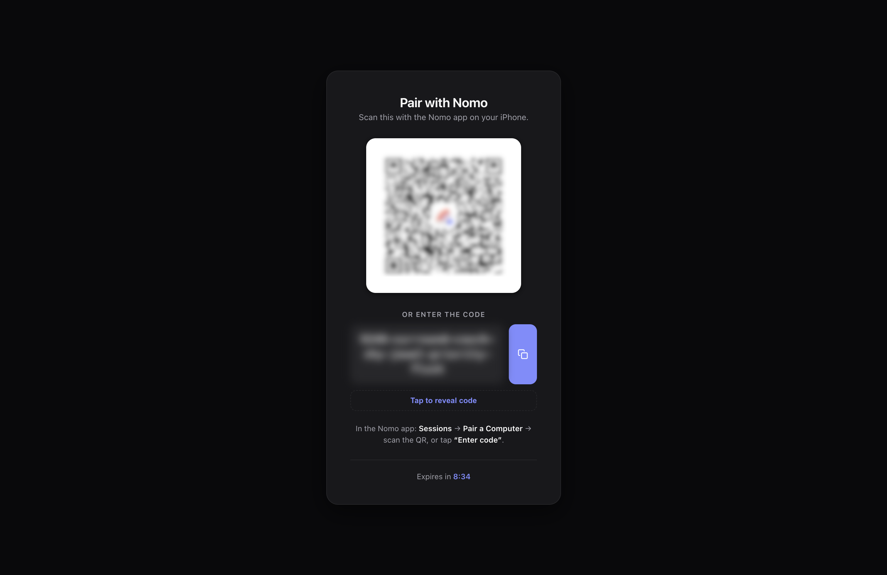

La vinculación entrega a tu teléfono y a tu ordenador una clave de cifrado
compartida. Ningún servidor la ve nunca, y por eso hace falta un escaneo o un
código escrito en lugar de un inicio de sesión.

Esto se hace una vez por ordenador. La vinculación caduca si no se usa durante
**10 minutos**.

Vincular es gratis. Nomo Free vincula un ordenador, y Nomo Pro vincula más.
[Gratis y Pro](/es/free-and-pro) muestra qué más añade Nomo Pro.

<Note>
  Una vinculación cubre la máquina, no el agente. Si usas cualquier combinación
  de Claude Code, Codex, OpenCode, Cursor, Antigravity y Devin en el mismo
  ordenador, lo comparten: no lo vinculas dos veces.
</Note>

<Tabs>
  <Tab title="Código QR" icon="qrcode-read">
    La vía normal. Úsala siempre que puedas abrir un navegador en el ordenador.

    <Steps>
      <Step title="Inicia la vinculación">
        <CodeGroup>
        ```bash Claude Code icon="/images/claude-code.svg"
        /nomo-cc:pair
        ```

        ```bash Codex icon="/images/codex.svg"
        $nomo-pair
        ```

        ```bash OpenCode icon="/images/opencode.svg"
        /nomo-pair
        ```

        ```bash Cursor icon="/images/providers/cursor.svg"
        /nomo-pair
        ```

        ```bash Antigravity icon="/images/providers/antigravity.png"
        /nomo-pair
        ```

        ```bash Devin icon="/images/providers/devin.svg"
        /nomo-pair
        ```
        </CodeGroup>

        En Antigravity, elige **Allow** (permitir) cuando pregunte si ejecuta un
        comando de Nomo. Con el plugin de Devin, escribe `/nomo:pair` en
        Devin. Si Devin no reconoce el comando, pega
        `~/.nomo/plugin/scripts/run.sh ~/.nomo/plugin/dist/pair.mjs` en
        Terminal.

        Se abre en tu navegador una página de vinculación con la estética de
        la app y un código QR.

        <Frame caption="La página de vinculación en tu ordenador. Cambia a Paired ✓ por sí sola en cuanto llega el escaneo.">
          
        </Frame>
      </Step>

      <Step title="Escanéalo">
        En Nomo, toca **Conecta tu Mac** en **Inicio**, o **+** en **Sesiones**.
        Apunta la cámara al código QR.

        {/* TODO: screenshot of the in-app scanner */}
      </Step>

      <Step title="Listo">
        La página cambia a **Paired ✓** por sí sola y se desmonta.
        Tu ordenador aparece ahora en la pestaña Sesiones.
      </Step>
    </Steps>

    <Tip>
      ¿Lo escaneaste con la app Cámara? El enlace de vinculación abre Nomo en
      **¿Vincular este ordenador?**, que muestra la vinculación y el servidor al
      que se conecta. No se vincula nada hasta que confirmas, y lo que se vincula
      es exactamente el enlace de esa pantalla.
    </Tip>

    <Note>
      El código QR y el código de un solo uso aparecen **solo** en esa página del
      navegador, nunca en tu terminal. Es deliberado: la salida de la terminal
      acaba en las transcripciones del agente, y estos son los valores que
      necesitaría un atacante.
    </Note>

  </Tab>

  <Tab title="Código escrito" icon="keyboard">
    Para una máquina sin interfaz gráfica, una sesión SSH o cualquier sitio donde
    no puedas abrir un navegador.

    <Warning>
      Esta vía pone el código de vinculación en tu terminal y, por tanto, en
      la transcripción del agente. Es un compromiso deliberado para máquinas sin
      navegador: prefiere la vía del QR cuando tengas uno.
    </Warning>

    <Steps>
      <Step title="Pide el código">
        Pasa `code` como argumento:

        <CodeGroup>
        ```bash Claude Code icon="/images/claude-code.svg"
        /nomo-cc:pair code
        ```

        ```bash Codex icon="/images/codex.svg"
        $nomo-pair code
        ```

        ```bash OpenCode icon="/images/opencode.svg"
        /nomo-pair code
        ```

        ```bash Cursor icon="/images/providers/cursor.svg"
        /nomo-pair code
        ```

        ```bash Antigravity icon="/images/providers/antigravity.png"
        /nomo-pair code
        ```

        ```bash Devin icon="/images/providers/devin.svg"
        /nomo-pair code
        ```
        </CodeGroup>

        Con el plugin de Devin, escribe `/nomo:pair code` en Devin.

        No se abre ningún navegador. Un código de un solo uso se imprime
        directamente en la terminal:

        ```
        One-time code: <shown here> · expires in 10 min
        ```
      </Step>

      <Step title="Qué aspecto tiene el código">
        Un número, después seis palabras, en minúsculas y unidas por guiones:

        ```
        7-anchor-brisk-cotton-dial-emerge-fabric
        ```

        <Info>
          Las palabras vienen de la lista BIP39: no hay dos que compartan sus
          primeras cuatro letras, y no hay caracteres que se confundan entre sí.
          Largo, pero difícil de escribir mal o de oír mal.
        </Info>
      </Step>

      <Step title="Escríbelo en la app">
        En Nomo, toca **Conecta tu Mac** en **Inicio**, o **+** en **Sesiones**.
        Después toca **Introducir código**.

        {/* TODO: screenshot of the Enter code screen */}
      </Step>
    </Steps>
  </Tab>
</Tabs>

## Comprobarlo más adelante

<CodeGroup>
```bash Claude Code icon="/images/claude-code.svg"
/nomo-cc:status
```

```bash Codex icon="/images/codex.svg"
$nomo-status
```
</CodeGroup>

Eso informa de si el ordenador sigue conectado y de si los eventos se están
entregando.

## Si la vinculación no funciona

- **No se abre ninguna página QR**: probablemente los hooks del plugin no se
  cargaron. Reinicia el agente e inténtalo de nuevo, o usa la vía del código
  escrito.
- **El escaneo funciona pero no aparece ningún ordenador**: ejecuta el comando de
  estado de arriba para ver si se están entregando eventos.
- **Las filas parecen obsoletas o duplicadas**: ejecuta `/nomo-cc:reset` (o
  `$nomo-reset`) para borrar filas de sesiones muertas sin deshacer la
  vinculación.
- **Quieres desconectar un ordenador**: `/nomo-cc:unpair` (o `$nomo-unpair`)
  elimina la vinculación y borra la clave local.
- **Un ordenador con Nomo Free**: Nomo Free vincula un ordenador. Para usar
  otro, mantén pulsado el vinculado en la pestaña **Sesiones**, toca
  **Olvidar este ordenador** y vuelve a vincular. O consigue Nomo Pro para
  vincular más.
- **Límite de ordenadores alcanzado**: ya tienes vinculados todos los
  ordenadores que permite tu plan. Mantén pulsado uno en la pestaña
  **Sesiones**, olvídalo y vuelve a vincular.
- **No se pudo verificar este iPhone**: el servidor de Nomo no pudo verificar tu
  teléfono. Inténtalo de nuevo y, si sigue pasando, contacta con soporte.
