Nomo Pro añade cinco widgets a los gratuitos. Cada uno responde a una pregunta
para la que, si no, abrirías la app.

- **Ritmo de Nomo**: ¿me llegará el uso hasta que se restablezca?
- **Actividad de Nomo**: ¿cuántos días seguidos he programado con un agente?
- **Cuentas de Nomo**: ¿a cuál de mis cuentas le queda menos?
- **Agentes en directo**: ¿qué están haciendo mis agentes ahora mismo?
- **Tokens de Nomo**: ¿cuántos tokens he usado y con qué modelos?

<Frame caption="Los cinco widgets Pro en una pantalla de inicio: Ritmo de Nomo, Agentes en directo, Actividad de Nomo, Tokens de Nomo y Cuentas de Nomo.">
  

    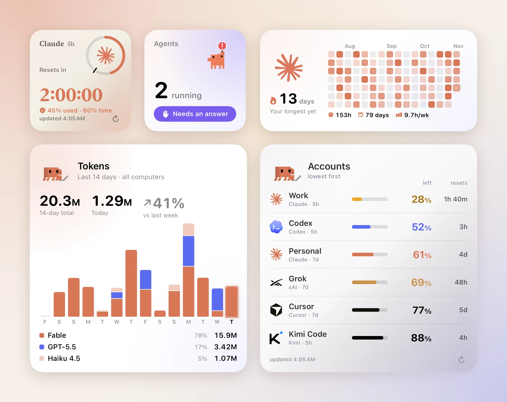
    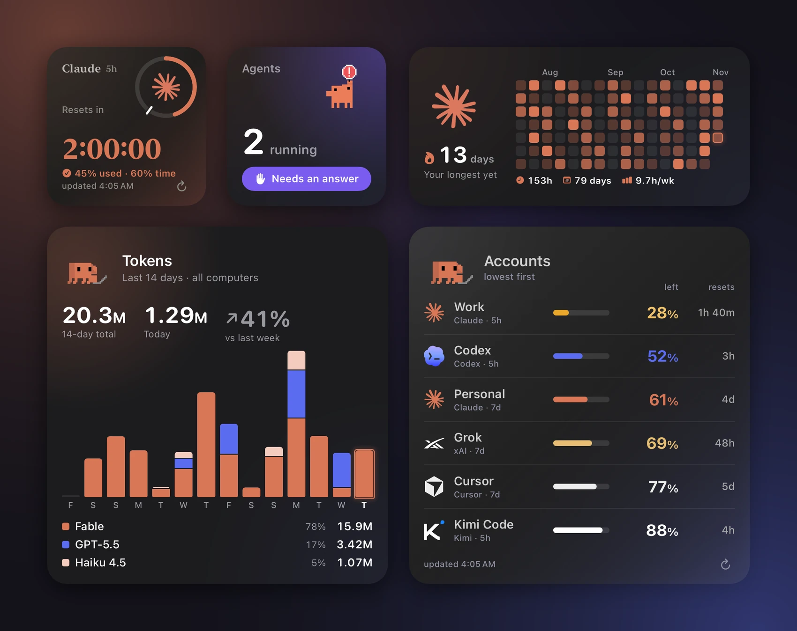
  

</Frame>

Ritmo de Nomo y Actividad de Nomo también tienen tamaños para la pantalla de
bloqueo.

Los widgets gratis están en [Widgets gratis](/es/free-widgets): Estado de Nomo,
Uso de Nomo y Actividad de Nomo en tamaño pequeño y mediano. Para poner un
widget en tu pantalla de inicio, consulta [Widget](/es/widget).

En la galería de widgets, la descripción de un widget Pro empieza por
**👑 Nomo Pro**.

Sin Nomo Pro, puedes añadir igualmente un widget Pro. Muestra una vista previa
atenuada con **Nomo Pro** y **Desbloquear** encima. Tócalo para abrir Nomo Pro
en la app. Una excepción: Actividad de Nomo es gratis en tamaño pequeño y
mediano, con un ordenador vinculado.

Tu racha y tus tokens dentro de la app están en la pestaña **Inicio**. Consulta
[Actividad](/es/activity).

## Ritmo de Nomo {#nomo-pace}

<Frame caption="Ritmo de Nomo en tamaño pequeño y mediano, y en la pantalla de bloqueo.">
  

    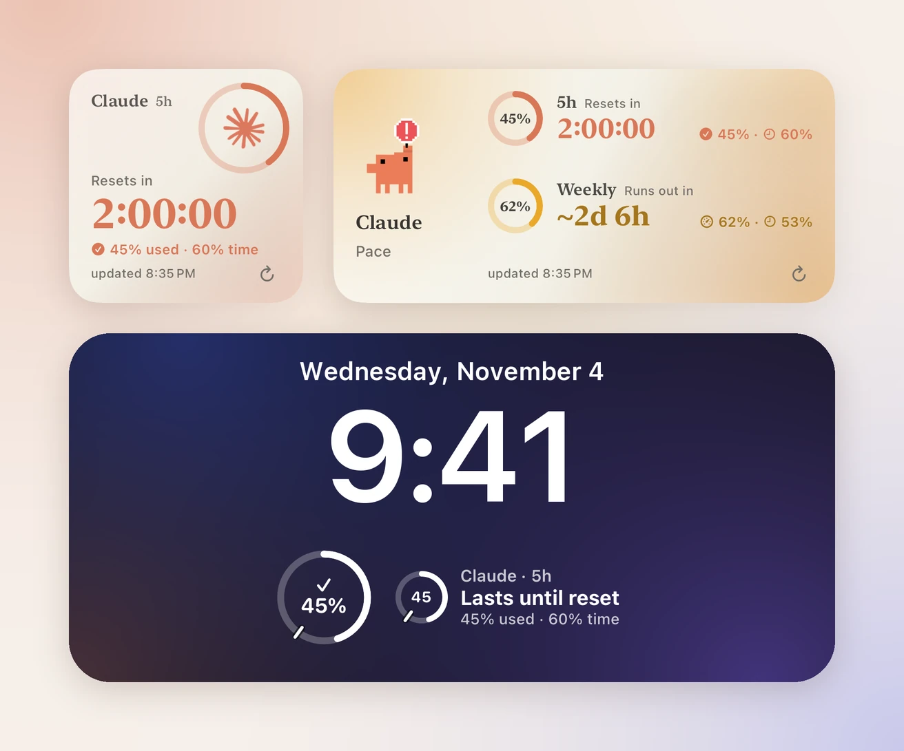
    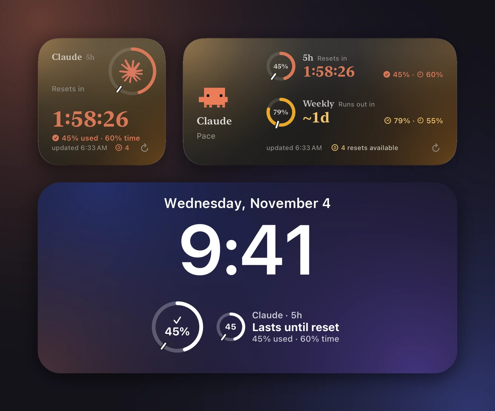
  

</Frame>

**Qué muestra:** si te quedarás sin uso antes de que tu límite se restablezca,
si sigues al ritmo actual.

La línea bajo el número grande compara dos cosas:

- **Uso**: cuánto del límite has usado.
- **plazo**: cuánto de la ventana de tiempo ha pasado.

Por ejemplo, `Uso 45 % · plazo 60 %`. Si el uso es menor que el plazo, vas bien.
El widget muestra **“Restablece en”** y una cuenta atrás hasta el
restablecimiento.

Si el uso es mayor que el plazo, vas demasiado rápido. El widget muestra
**“Se agota en”** y una cuenta atrás hasta el momento en que te quedarías sin
uso. Un `~` delante indica que es una estimación. El número se vuelve ámbar.

También verás:

- **“Aún es pronto para saberlo”**, justo después de que empiece una ventana.
  Todavía no hay datos suficientes.
- **“Al límite”**, cuando una ventana está al 100 %. La cuenta atrás es hasta el
  restablecimiento.
- **“El ritmo no está disponible para este plan”**, cuando el proveedor no dice
  cuándo se restablece el límite.

Los tamaños:

| Tamaño | Qué muestra |
| --- | --- |
| Pequeño | Una ventana y su anillo. |
| Mediano | Dos ventanas, normalmente la de 5 horas y la semanal. |
| Pantalla de bloqueo, redondo | Cuánto has usado. Una marca de verificación significa que vas bien. Cuando vas demasiado rápido, muestra la hora a la que te quedarías sin uso. |
| Pantalla de bloqueo, rectangular | `No se agota`, o la hora a la que te quedarías sin uso, como `Se agota ~21:20`. |

Cada anillo se llena según lo que has usado. La pequeña marca indica dónde
estarías si lo usaras a un ritmo constante. Si el relleno no llega a la marca,
vas bien.

**Usado o Restante:** Ritmo de Nomo sigue **Ajustes → Uso → Mostrar uso como**.
Con **Restante**, la línea dice `Queda 55 % · 40 % del plazo`. El anillo se vacía:
el relleno muestra lo que te queda y la marca, el tiempo que queda. Si el relleno
pasa la marca, vas bien. Los números de todos los tamaños también cambian.

Si tienes restablecimientos de Claude o Codex, el tamaño Mediano muestra
cuántos junto a la hora de actualización. El Pequeño muestra el símbolo de
restablecimiento y el número. Se vuelven ámbar o rojos cuando vas demasiado
rápido. Mira [Restablecimientos disponibles](/es/usage#available-resets).

**Qué necesitas antes:** una cuenta conectada, como Claude o Codex. Abre la
pestaña **Proveedores**, toca el proveedor y conéctalo. Consulta
[Uso](/es/usage).

**Configúralo:**

1. Añade el widget. Consulta [Widget](/es/widget).
2. Mantén pulsado el widget.
3. Toca **“Editar widget”**.
4. Toca **Proveedor** y elige uno, como **Claude**.
5. Toca **Cuenta** y elige una. **Predeterminada** sigue a tu cuenta
   predeterminada de la app.
6. Toca **Ventana** y elige una. **Automático** usa la ventana de 5 horas si tu
   plan la tiene y, si no, la semanal. Esto cambia los tamaños pequeño y de
   pantalla de bloqueo.
7. Toca fuera del widget para terminar.

Toca el widget para abrir la página **Uso** de ese proveedor en Nomo.

## Actividad de Nomo {#nomo-activity}

<Frame caption="Actividad de Nomo en tamaño pequeño, mediano y grande, y en la pantalla de bloqueo.">
  

    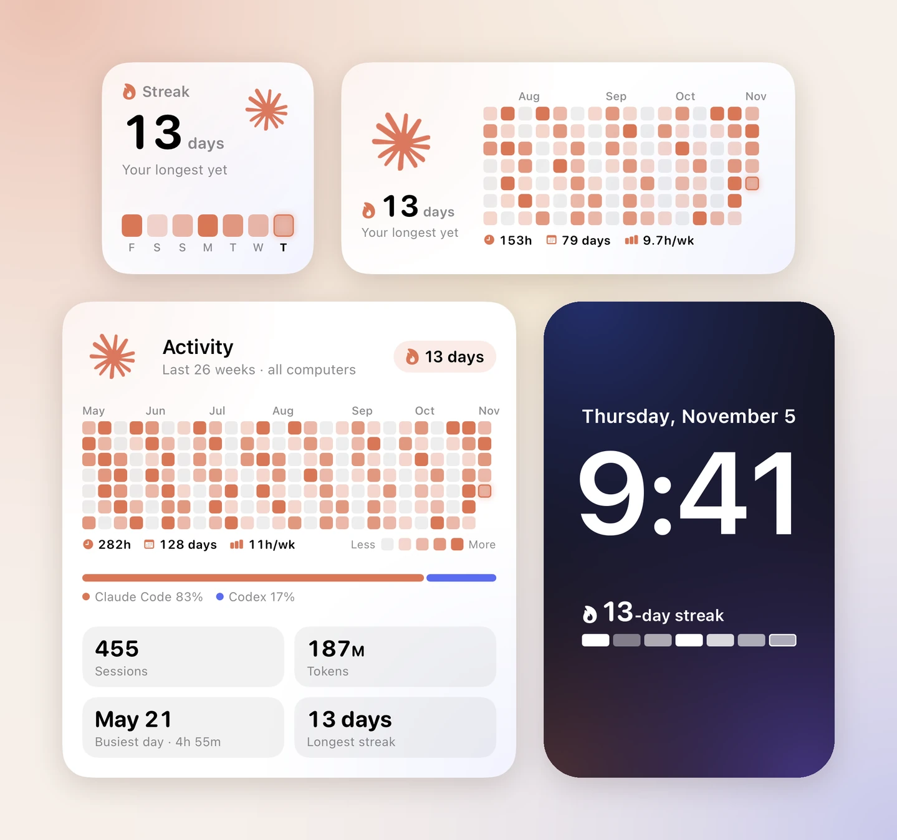
    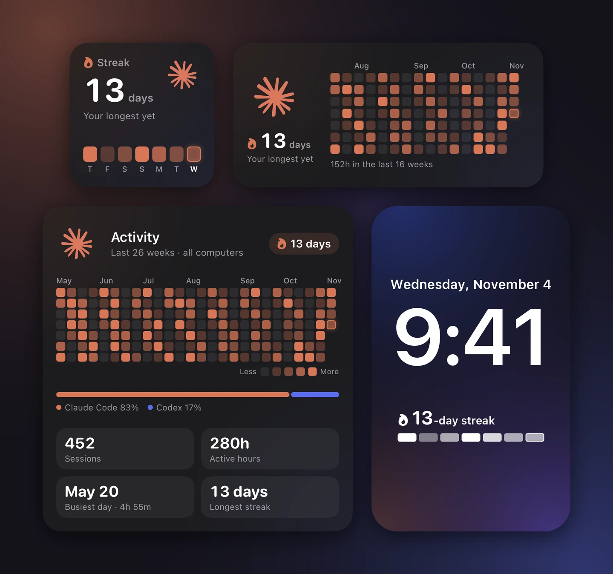
  

</Frame>

**Qué muestra:** un mapa de los días en que programaste con agentes de IA, como
el de un perfil de GitHub, además de tu racha. La racha es cuántos días seguidos
has programado. Suma todos los ordenadores vinculados, más Grok Bot y Cursor
desde tu inicio de sesión de Cursor. Consulta
[Más de un ordenador](#more-than-one-computer).

Un color más intenso significa más programación ese día. Tu racha no se reinicia
por la mañana: hasta tu primera sesión del día, cuenta hasta ayer.

| Tamaño | Qué muestra |
| --- | --- |
| Pequeño | Tu racha y los últimos 7 días. |
| Mediano | Tu racha, las últimas 16 semanas y tres datos bajo el mapa. |
| Grande | **“Últimas 26 semanas”** bajo el título, el mapa con los mismos tres datos, cómo se reparte tu actividad entre agentes con porcentajes y los totales: sesiones, tokens, tu día con más actividad y tu racha más larga. |
| Pantalla de bloqueo, rectangular | Tu racha y los últimos 7 días. |

El pequeño y el mediano son gratis con un ordenador vinculado. Sin Nomo Pro, el
mediano muestra los últimos 30 días en lugar de 16 semanas. Consulta [Widgets
gratis](/es/free-widgets#nomo-activity). El grande y el de la pantalla de
bloqueo vienen con Nomo Pro.

Los tres datos bajo el mapa cubren los días que muestra el mapa:

- Un reloj: tus horas activas.
- Un calendario: cuántos días tuviste actividad.
- Un gráfico de barras: tu media por semana.

Si el tamaño mediano no tiene sitio, solo muestra los dos primeros. Si esas
semanas no tienen nada de tiempo, solo se ve el calendario. Consulta
[Sin tiempo, solo tokens](#no-time-only-tokens).

En el tamaño grande, **Tokens** es tu total de las 26 semanas. Si tus
ordenadores no envían datos de tokens, esa casilla muestra **“Horas activas”**
en su lugar.

**Qué necesitas antes:**

- El plugin de Nomo en tu ordenador, versión **2.4.0** o posterior. Consulta
  [Instalación](/es/setup/install) y [Actualizaciones](/es/sessions/commands#update).
- Ese ordenador vinculado con Nomo. Consulta [Vinculación](/es/setup/pairing).

Para ver qué agentes cuenta, consulta [Qué agentes cuentan](#which-agents-count).

**Configúralo:**

1. Añade el widget. Consulta [Widget](/es/widget).
2. Mantén pulsado el widget.
3. Toca **“Editar widget”**.
4. Toca **Personaje** y elige uno: **Automático**, **Clawd**, **Codex**,
   **Grok Bot**, **Antigravity**, **Kimi**, **DeepSeek**, **Cursor**,
   **OpenCode** o **Devin**.
5. Toca fuera del widget para terminar.

**Automático** muestra el agente que más has usado en los últimos 7 días: el
que tiene más tiempo activo. Si Grok Bot o Cursor tuvieron actividad esos días,
se elige el que tiene más días activos. Si hay empate, gana el agente con más
días activos en los últimos 30 días. [Actividad](/es/activity#character) en
**Inicio** usa la misma regla.

Con cualquier otra opción, el widget muestra ese personaje y usa su color en el mapa,
el cuadro de hoy, la llama y la insignia de la racha: coral (Clawd), azul (Codex)
o dorado (Grok Bot). En el tamaño grande, la barra que reparte tu tiempo entre
agentes mantiene el color de cada agente. Un widget que ya estaba en la pantalla
de inicio empieza en **Automático**.

<Frame caption="Actividad de Nomo con Clawd, Codex y Grok Bot.">
  

    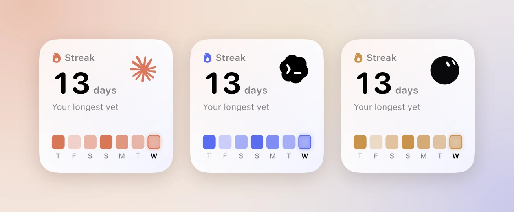
    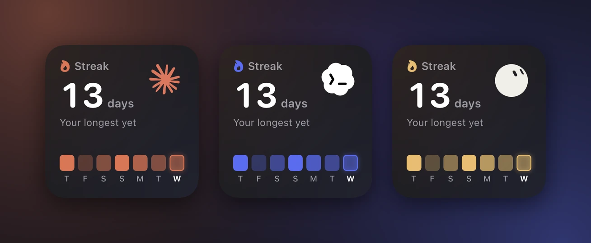
  

</Frame>

Solo Clawd, Codex y Grok Bot son personajes animados. Antigravity, Kimi,
DeepSeek, Cursor, OpenCode y Devin muestran su logotipo en un recuadro del color de su
marca, y ese color pasa al mapa, la llama, el cuadro de hoy y el brillo.

El humor de Clawd sigue a tu racha. Duerme cuando no tienes racha. Hace
ejercicio un día en que ya has programado, y teclea mientras hoy sigue vacío.
Con una racha de 30 días o más, o de al menos 7 días que sea la más larga hasta
ahora, Clawd se convierte en la chispa de Claude. Sigue siendo la opción
**Clawd**. Grok Bot duerme cuando no tienes racha. Codex siempre tiene el mismo
aspecto.

<Frame caption="Actividad de Nomo con Antigravity, DeepSeek y Kimi.">
  

    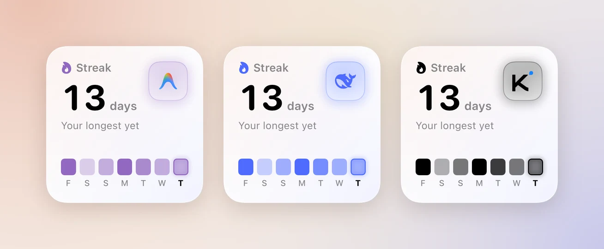
    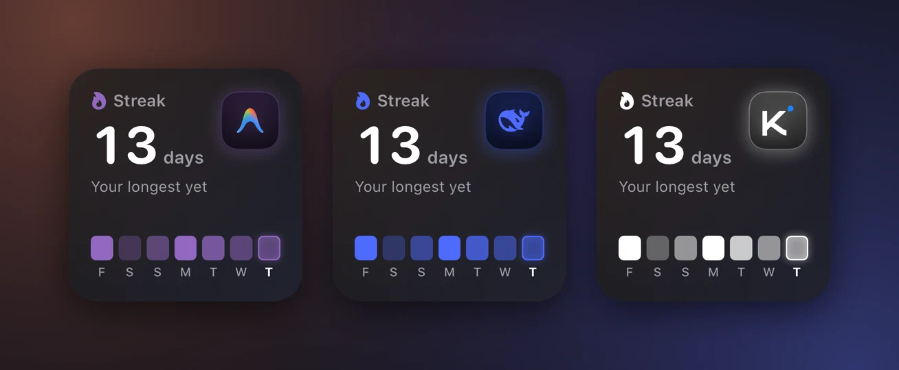
  

</Frame>

El plugin envía un resumen nuevo como mucho cada 6 horas, y una vez justo
después de actualizar el plugin. Nomo lo descarga cuando abres la app, como
mucho una vez por hora. Por eso el mapa puede ir unas horas por detrás. Al
abrir [Actividad](/es/activity) en **Inicio**, se descarga el resumen más
reciente al momento, como mucho una vez cada 30 segundos. También puedes
deslizar hacia abajo en **Inicio** para volver a descargarlo.

Toca el widget para abrir Nomo en **Inicio**, en [Actividad](/es/activity).

Lo que sale de tu ordenador para este mapa se detalla en
[Privacidad](#privacy). Son solo recuentos, nunca tus prompts ni tu código.

### Qué agentes cuentan {#which-agents-count}

Actividad de Nomo, Tokens de Nomo y [Actividad](/es/activity) en **Inicio**
cuentan los mismos agentes:

- **En tus ordenadores vinculados:** Claude Code, Codex, OpenCode, Devin y
  Antigravity. Los días pasados también aparecen, porque el plugin lee el
  historial que ya está en tu ordenador.
- **Sin ordenador:** Grok Bot y Cursor, desde tu inicio de sesión de Cursor en
  Nomo. Consulta [Grok Bot](#grok-bot).

Solo cuenta lo que se ejecuta en un ordenador vinculado. Las sesiones de Devin
Cloud en app.devin.ai no cuentan, ni tampoco Antigravity en un ordenador que no
está vinculado.

#### Devin y Antigravity {#devin-and-antigravity}

Desde Nomo 2.5.1, el plugin también cuenta:

- **Devin**: la CLI de Devin.
- **Antigravity**: la app de escritorio de Antigravity y la línea de comandos
  `agy`.

Para empezar a contarlos:

1. Actualiza el plugin de Nomo en tu ordenador a la 2.5.1 o posterior. Consulta
   [Actualizaciones](/es/sessions/commands#update).
2. Actualiza Nomo en tu iPhone a la 2.5.1 o posterior.

**Qué obtienes:**

- Gratis, los dos cuentan para tu racha, el calendario y tu tiempo programando.
  También aparecen en el reparto entre agentes.
- Con Nomo Pro, también ves sus tokens por modelo, como **SWE-2 Flash Medium**
  para Devin y **Gemini 3.8 Flash High** para Antigravity.
- Con Nomo Pro, también puedes elegirlos en la lista **Agentes** de Tokens de
  Nomo, y verlos en la vista **Agente** del
  [gráfico de tokens](/es/activity#tokens-chart).

### Grok Bot {#grok-bot}

Desde Nomo 2.4.2, Actividad de Nomo y Tokens de Nomo también cuentan Grok Bot.
No necesitas ordenador.

**Qué necesitas antes:**

- Nomo 2.4.2 y Nomo Pro.
- Cursor conectado en Nomo, con la misma cuenta que usas para Grok Bot.
  Conecta Cursor, no Grok. Consulta [Cursor y Grok](/es/usage#cursor-and-grok).

Después abre [Actividad](/es/activity) en **Inicio**. Descarga tus días y
tokens con Grok Bot al abrirse. Para mostrar Grok Bot en el widget, elige
**Grok Bot** en **Personaje**.

**Qué cuenta:**

- Un día cuenta si Grok Bot usó algún token ese día. Las rutinas programadas y
  lo que uses en la app de Grok Bot para el teléfono también cuentan.
- Tokens de Nomo y Actividad muestran las cifras reales de tokens
  de Grok Bot.
- Tu propio uso de Cursor, en el editor de Cursor o en su línea de comandos,
  aparece en su propia línea: **Cursor**.

#### Sin tiempo, solo tokens {#no-time-only-tokens}

Para Grok Bot y Cursor, Cursor solo informa de tokens. No hay tiempo ni
sesiones. Por eso:

- Una cifra que necesita tiempo o sesiones, como **“Horas activas”** o
  **Sesiones**, muestra **—** si ningún otro dato la aporta.
- En el mapa, un día de Grok Bot o Cursor se colorea según sus tokens,
  comparado con sus otros días.
- Cuando Grok Bot o Cursor tuvieron actividad, el reparto entre agentes cuenta
  días activos, no tiempo.
- Sus totales son los que informa Cursor y pueden incluir tokens de caché. En
  [Actividad](/es/activity#tokens-chart), la nota bajo **“Por modelo”** lo indica.

Lo que lee Nomo está en [Privacidad](#privacy).

<Card title="Grok Bot widgets on iPhone" icon="newspaper" href="https://nomo.gg/blog/grok-bot-widget-iphone/" horizontal>
  El tutorial completo con imágenes, en el blog de Nomo (en inglés).
</Card>

## Tokens de Nomo {#nomo-tokens}

<Frame caption="Tokens de Nomo en tamaño mediano y grande.">
  

    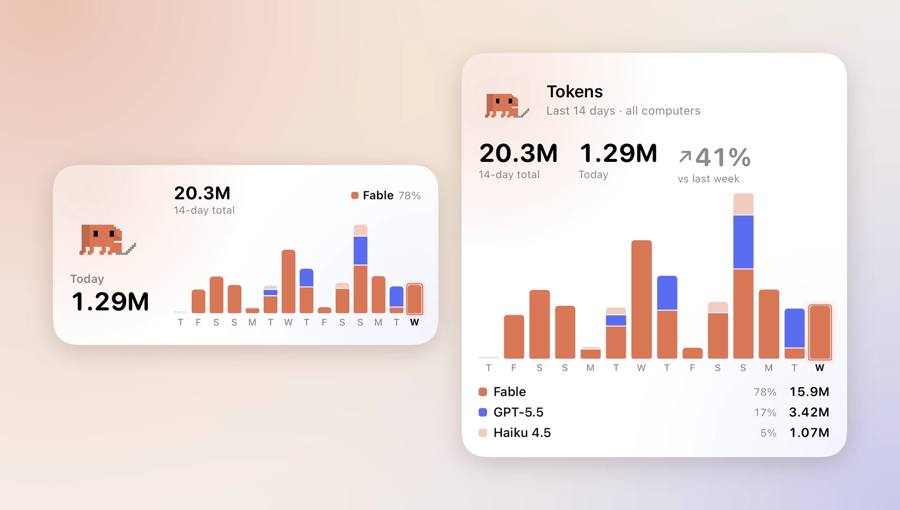
    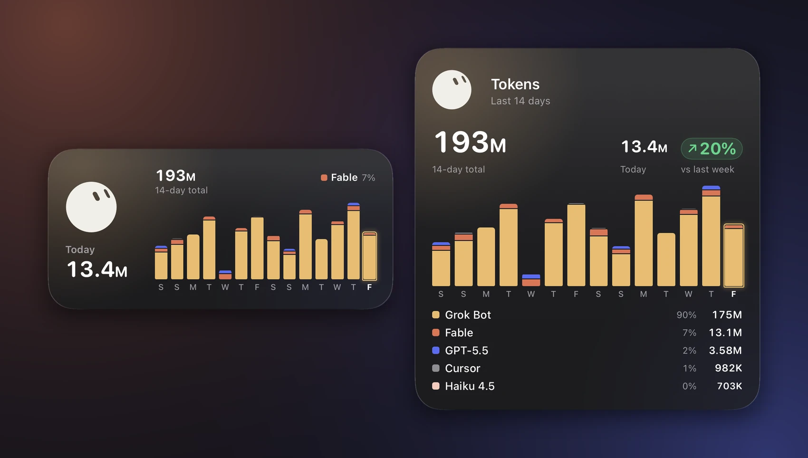
  

</Frame>

**Qué muestra:** cuántos tokens usaron tus agentes cada día durante los últimos
14 días. Cada día se divide por modelo o, si lo eliges, por agente. Suma todos
los ordenadores vinculados, más Grok Bot y Cursor desde tu inicio de sesión de
Cursor.

Aquí, tokens significa entrada + salida + razonamiento. La caché no se cuenta:
vuelve a leer el mismo contexto, así que taparía todas las demás cifras. La
tabla **“Por modelo”** de [Actividad](/es/activity#tokens-chart) muestra la
caché aparte.

| Tamaño | Qué muestra |
| --- | --- |
| Mediano | El total de 14 días, los tokens de hoy y tu modelo principal con su porcentaje. Grok Bot y Cursor no son modelos, así que aquí no cuentan. Por agente, tu agente principal en su lugar. |
| Grande | **“Últimos 14 días”** bajo el título. Las mismas cifras, más el cambio frente a la semana pasada y hasta 5 filas. Grok Bot y Cursor tienen una fila cada uno, junto a tus modelos. Si hay más de 5, la última fila suma el resto, como `6 modelos más`. Por agente, hasta 5 agentes en su lugar. |

Cada modelo mantiene un mismo color en todas partes: los modelos de Claude son
coral; GPT, azul; Grok, dorado; Gemini, morado; los modelos SWE de Devin, el azul de Devin, y los demás
modelos, gris. Por
agente, cada agente tiene su propio color, como coral para Claude Code, azul
para Codex y dorado para Grok Bot. La línea de Cursor es discontinua.

**Qué necesitas antes:** lo mismo que para Actividad de Nomo: el plugin de
Nomo en un ordenador vinculado, o Cursor conectado en Nomo para Grok Bot.
Consulta [Actividad de Nomo](#nomo-activity).

**Configúralo:**

1. Añade el widget. Consulta [Widget](/es/widget).
2. Mantén pulsado el widget.
3. Toca **“Editar widget”**.
4. Toca **Personaje** y elige uno. Las opciones son las mismas que en
   [Actividad de Nomo](#nomo-activity).
5. Toca **“Agrupar por”** y elige **Modelo** o **Agente**.
6. Toca **Estilo** y elige **Barras** o **Líneas**.
7. Si elegiste **Agente**, toca **Agentes**. Elige los agentes que quieras:
   Claude Code, Codex, OpenCode, Grok Bot, Cursor, Antigravity o Devin. Al
   principio están todos elegidos.
8. Toca fuera del widget para terminar.

**Agentes** solo aparece cuando **“Agrupar por”** está en **Agente**. Si eliges
solo algunos agentes, las cifras cuentan solo esos, y la etiqueta bajo el total
dice **“Agentes elegidos”** en lugar de **“Total de 14 días”**. Si ninguno de
los que elegiste usó tokens en esos 14 días, el widget muestra todos los
agentes.

Un widget nuevo empieza en **Modelo** y **Líneas**. Si antes elegiste
**Barras**, tu widget lo mantiene.

**Automático** sigue al proveedor de tu modelo principal: Clawd para Claude,
Codex para GPT, Grok Bot para Grok, Antigravity para Gemini y el logotipo de
Kimi, DeepSeek, Cursor o Devin para sus modelos. Cualquier otro modelo usa Clawd. Tu
elección solo cambia el personaje, el brillo del fondo y la barra de hoy. Los colores de los modelos no cambian nunca.

Cuando el widget muestra a Clawd, su humor sigue a tus tokens. Duerme tras 3
días sin tokens, y teclea mientras hoy aún no tiene ninguno. Cuando hoy es tu
mejor día de los 14, Clawd se convierte en la chispa de Claude. Sigue siendo la
opción **Clawd**. Grok Bot duerme tras 3 días sin tokens.

Toca el widget para abrir Nomo en **Inicio**, en
[Actividad](/es/activity#tokens-chart). Sin Nomo Pro, al tocarlo se abre Nomo
Pro.

Usa el mismo resumen que Actividad de Nomo. Lo que sale de tu ordenador aparece
en [Privacidad](#privacy).

## Cuentas de Nomo {#nomo-accounts}

<Frame caption="Cuentas de Nomo en tamaño mediano y grande.">
  

    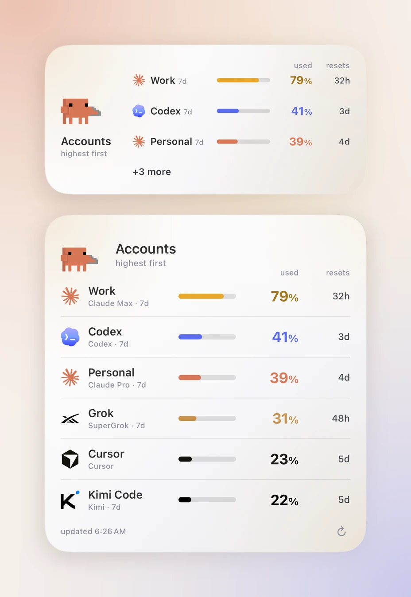
    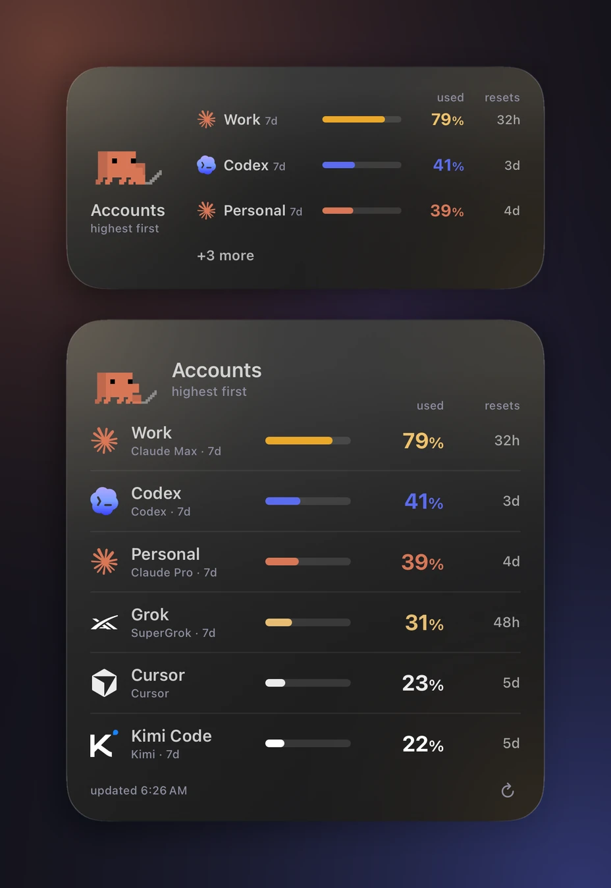
  

</Frame>

**Qué muestra:** todas las cuentas conectadas en un solo panel, de todos los
proveedores. La cuenta a la que le queda menos está arriba del todo.

Cada fila muestra el nombre de la cuenta, la ventana que está más cerca de
agotarse, cuánto ha usado y cuándo se restablece.

El número, la barra y el encabezado de la columna siguen **Ajustes → Uso →
Mostrar uso como**. Con **Restante**, muestran cuánto queda. El orden no cambia.

- El tamaño **mediano** muestra 4 filas. El **grande** muestra 8.
- Si tienes más cuentas que eso, la última fila indica cuántas más hay.
- Una cuenta en la que tienes que volver a iniciar sesión se queda en el panel,
  al final, con **“Vuelve a conectar en Nomo”**. Nunca desaparece.

**Qué necesitas antes:** al menos una cuenta conectada. Para seguir dos cuentas
del mismo proveedor, consulta [Más de una cuenta](#more-than-one-account).

**Configúralo:** añade el widget. Consulta [Widget](/es/widget).
No hay nada que elegir en **“Editar widget”**.

El panel muestra las últimas cifras que Nomo descargó. En el tamaño grande,
toca el botón de actualizar de su esquina para actualizar todas las cuentas.

Toca la fila de una cuenta para abrir la página **Uso** de ese proveedor en
Nomo, con esa cuenta. Una fila con **“Vuelve a conectar en Nomo”** funciona
igual. Toca en cualquier otro sitio, incluida la fila que indica cuántas cuentas
más hay, para abrir la pestaña **Proveedores**. Sin Nomo Pro, al tocarlo se
abre Nomo Pro.

## Agentes en directo {#live-agents}

<Frame caption="Agentes en directo en tamaño pequeño y mediano. La fila violeta necesita tu respuesta.">
  

    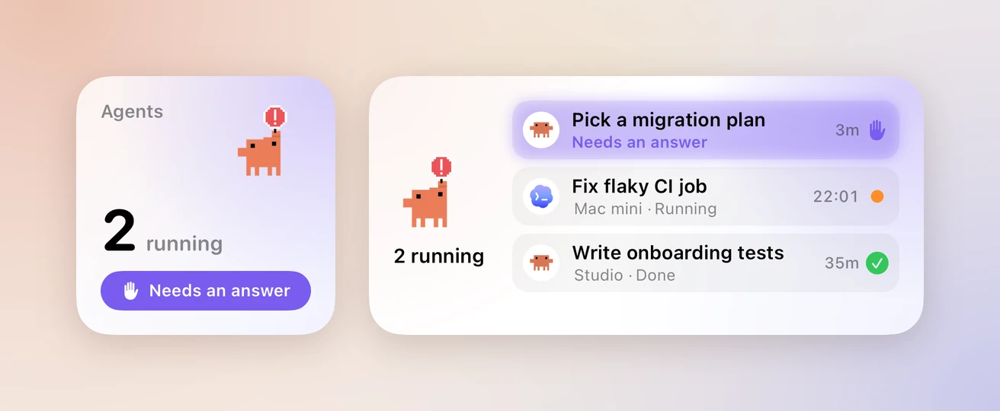
    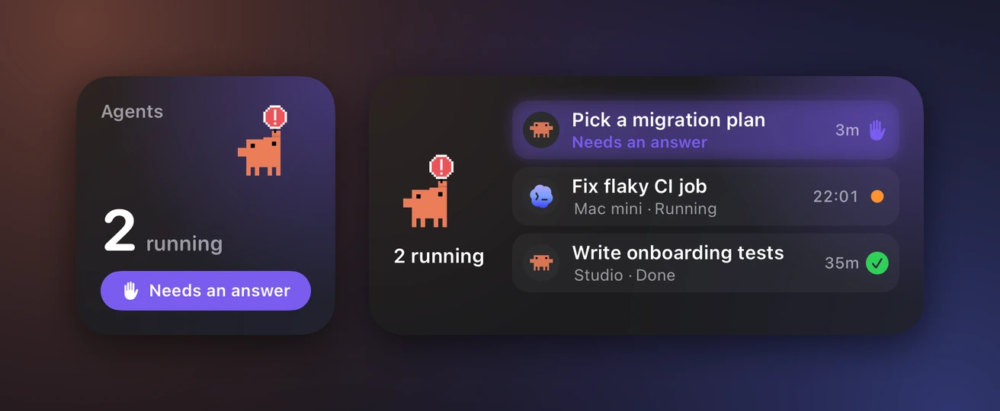
  

</Frame>

**Qué muestra:** tus sesiones de Claude Code, Codex y otros agentes ahora mismo.
Es la misma lista que la pestaña **Sesiones**.

**El violeta significa que una necesita tu respuesta.**

| Icono | Etiqueta | Qué significa |
| --- | --- | --- |
| Mano violeta | `Necesita permiso` | Pide permiso para una acción. Puedes responder desde el teléfono. |
| Mano violeta | `Necesita una respuesta` | Te hace una pregunta. Puedes responder desde el teléfono. |
| Mano naranja | `Necesita atención` | Se ha detenido y te espera, sin nada que responder desde el teléfono. |
| Punto naranja | `En ejecución` | Trabajando. No necesita nada de ti. |
| Marca verde | `Listo` | Terminada. |

Coinciden con la [pestaña Sesiones](/es/sessions/list#session-states).

- El tamaño **pequeño** muestra cuántas sesiones hay en ejecución. Cuando una te
  necesita, un botón violeta lo indica.
- El tamaño **mediano** muestra hasta 3 sesiones. Las que te necesitan aparecen
  primero.

El widget no tiene botones de permitir ni denegar. Tócalo para abrir
**Sesiones** en Nomo. En el tamaño mediano, toca una sesión para abrir esa
sesión.

El widget copia la lista de sesiones de la app Nomo. Si no se ha actualizado en
10 minutos, muestra un punto ámbar y cuánto hace que se actualizó. Abre Nomo
para actualizarlo.

**Qué necesitas antes:** un ordenador vinculado con el plugin de Nomo. Consulta
[Instalación](/es/setup/install) y [Vinculación](/es/setup/pairing).

**Configúralo:**

1. Añade el widget. Consulta [Widget](/es/widget).
2. Mantén pulsado el widget.
3. Toca **“Editar widget”**.
4. Toca **Personaje** y elige uno. Las opciones son las mismas que en
   [Actividad de Nomo](#nomo-activity).
5. Toca fuera del widget para terminar.

**Automático** sigue a la sesión que está arriba de la lista. Si es una sesión
de Antigravity, Cursor, OpenCode o Devin, muestra su logotipo. Con cualquier otra
opción, el widget muestra ese personaje y tiñe el fondo con un toque de su color.
Los colores de estado no cambian nunca: el violeta sigue indicando que una sesión
necesita tu respuesta. Un widget que ya estaba en la pantalla de inicio empieza
en **Automático**.

## Más de un ordenador {#more-than-one-computer}

Actividad de Nomo, Tokens de Nomo, [Actividad](/es/activity) en **Inicio** y
Wrapped suman todos los ordenadores vinculados.

- El tiempo activo cuenta una sola vez. Si programas en dos Mac a la vez, ese
  tiempo no se cuenta dos veces.
- Los tokens y las sesiones se suman.
- Un Mac que se vinculó dos veces cuenta una sola vez.
- Si eliminas un ordenador, su actividad sale de los totales.

### Cuando un ordenador no se cuenta {#not-counted}

Un ordenador con un plugin de Nomo anterior a la 2.4.0 no se cuenta. Verás:

- En Actividad, en **Inicio**, bajo tu racha: **“MacBook Air no se cuenta ·
  actualiza su plugin”**, con el nombre de ese ordenador. Si hay más de uno,
  dice cuántos, como **“2 ordenadores no se cuentan · actualiza sus plugins”**.
  Tócalo para ver cómo actualizar.
- En el widget Actividad de Nomo grande: **“1 ordenador sin contar”**. En los
  iPhone más pequeños, no hay sitio para mostrarlo.

Para arreglarlo, actualiza el plugin de Nomo en ese ordenador. Consulta
[Actualizaciones](/es/sessions/commands#update).

## Más de una cuenta {#more-than-one-account}

Con Nomo Pro, puedes añadir hasta 5 cuentas por cada proveedor. Por ejemplo, una
cuenta de Claude del trabajo y otra personal. Ritmo de Nomo, Uso de Nomo y
Cuentas de Nomo pueden usarlas todas.

Tus widgets muestran la cuenta **Predeterminada** salvo que elijas otra. Para
elegir una, mantén pulsado el widget, toca **“Editar widget”** y, luego, toca
**Cuenta**. Cuentas de Nomo muestra cada cuenta por separado.

Si eliminas una cuenta, los widgets que la mostraban muestran
**“Cuenta eliminada”**. No pasan a tu cuenta predeterminada. Edita el widget y
elige otra cuenta.

Si tu Nomo Pro termina, tus cuentas adicionales quedan en pausa. No se elimina
nada, y tu cuenta predeterminada se sigue actualizando. Un widget Uso de Nomo
con una cuenta adicional muestra **En pausa · Nomo Pro** y `Tu Nomo Pro ha
finalizado. Vuelve a suscribirte en Nomo para ver esta cuenta.` Tócalo para
abrir Nomo Pro. Un widget que muestra tu cuenta predeterminada nunca se pone en
pausa.

Para añadir, cambiar el nombre o eliminar una cuenta, consulta
[Más de una cuenta](/es/usage#more-than-one-account) en la página Uso.

## Probar con el modo de demostración {#try-it-with-demo-mode}

El modo de demostración rellena los widgets con datos de ejemplo, para que puedas
verlos antes de conectar nada.

1. Abre Nomo.
2. Toca la pestaña **Ajustes**.
3. Desplázate hasta **“Modo de demostración”**.
4. Activa **“Mostrar datos de ejemplo”**.

Ritmo de Nomo, Actividad de Nomo, Tokens de Nomo y Agentes en directo muestran
entonces datos de
ejemplo, no los tuyos. El modo de demostración siempre muestra datos de ejemplo.
La única excepción: en cuanto hay un ordenador vinculado, Agentes en directo
muestra tus sesiones reales.
Cuentas de Nomo solo muestra las cuentas que has añadido de verdad, así que se
queda vacío hasta que añadas una.

Si no tienes Nomo Pro, el modo de demostración también desbloquea los widgets
Pro, pero solo mientras no haya ningún ordenador vinculado.

Para volver a tus datos reales, desactiva **“Mostrar datos de ejemplo”**.

## Privacidad {#privacy}

**Actividad de Nomo**

- Qué sale de tu ordenador: para cada día y cada agente, el número de sesiones,
  el número de prompts, qué franjas de 5 minutos del día tuvieron actividad y los
  tokens totales por modelo.
- Qué no sale nunca: tus prompts, las respuestas del agente, los nombres de los
  proyectos y las rutas de los archivos.
- Para Devin y Antigravity, el plugin lee su historial en tu ordenador: la base
  de datos de sesiones de Devin y los archivos de conversaciones de Antigravity.
  Solo los lee, y solo toma los recuentos de arriba.
- Se cifra de extremo a extremo (AES-256-GCM, con tu clave de vinculación) antes
  de subirse. El relé de Nomo no puede leerlo y lo borra pasados **35 días**.
- También incluye un identificador aleatorio del ordenador. El plugin lo crea
  una vez en tu ordenador y lo guarda en `~/.config/cc-status/machine-id`. Nunca
  sale de tu hardware, como el número de serie, la dirección MAC, el nombre del
  ordenador o tu nombre de usuario. Se cifra de extremo a extremo con todo lo
  demás. Nomo solo lo usa para que tu iPhone no cuente el mismo ordenador dos
  veces. Para obtener uno nuevo, borra ese archivo.
- Se sube como mucho cada 6 horas, y solo cuando algo ha cambiado. El comando
  de reinicio lo sube en el momento. Si no ha
  cambiado nada, vuelve a enviar el mismo resumen una vez a la semana para que
  el relé no lo borre. Justo
  después de vincular un iPhone nuevo, se sube una vez en un minuto, más o
  menos.
- En tu ordenador, se guarda en `~/.config/cc-status/activity-days.json`. Solo tu
  cuenta de usuario puede leerlo. Guarda 400 días como máximo.

**Grok Bot y Cursor**

- Nomo solo lee recuentos de tokens por hora, con la cuenta de Cursor que
  conectas en Nomo. Nunca lee tus mensajes ni tu código.
- Los recuentos van directos del servidor de Cursor a tu teléfono. No se
  suben a ningún sitio.
- Para dejarlo, abre Cursor en la pestaña **Proveedores**, toca **Uso** y toca
  **Desconectar**. Esto también detiene tu uso de Cursor en Nomo.

**Tokens de Nomo y Actividad en Inicio**

- Usan el mismo resumen de actividad que Actividad de Nomo, y los mismos
  recuentos de Grok Bot y Cursor, así que todo lo anterior también se aplica a
  ellos.
- Tus elecciones del gráfico, tu filtro y el personaje que elijas se guardan
  solo en tu iPhone.

**Wrapped**

- Al compartir, solo se envía la imagen que ves en la tarjeta.

**Agentes en directo**

- El widget lee una instantánea de tus sesiones que la app guarda en tu iPhone.
  Se queda en el teléfono y nunca se envía a ningún sitio.

**Más de una cuenta**

- Tus inicios de sesión se guardan en el llavero del iPhone.
- Para iniciar sesión se usa una página del navegador nueva y privada, así que no
  reutiliza tu sesión de Safari.

**Los límites**

- El relé puede ver que hubo una subida, cuánto ocupaba y cuándo fue.
- Cualquiera que tenga tu teléfono desbloqueado puede ver tu actividad.

Para verlo todo, consulta las notas de seguridad del
[README del plugin](https://github.com/KarrixLee/nomo#security-at-a-glance).
