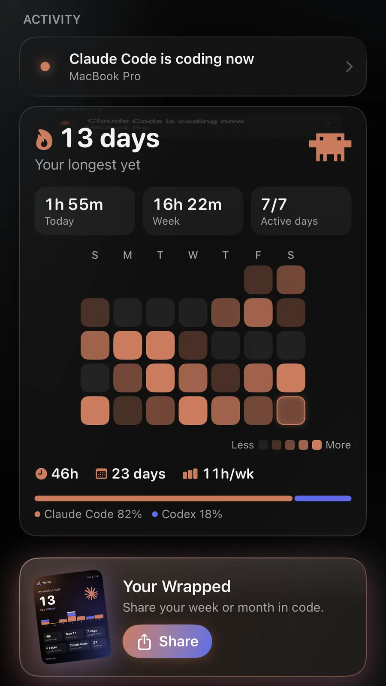
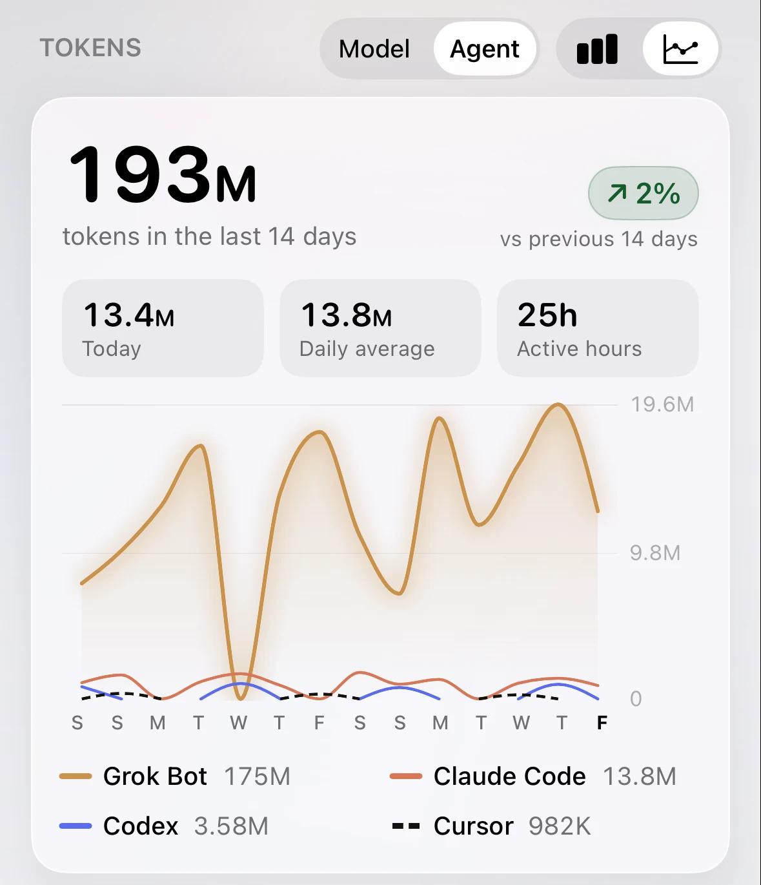
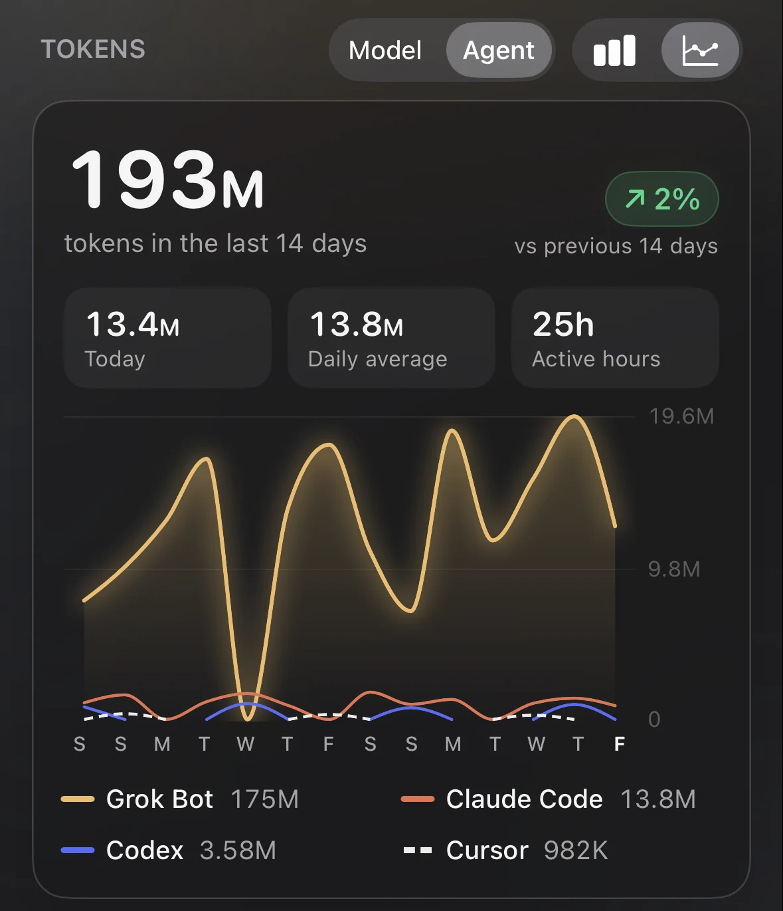

アクティビティには、AI エージェントでどれだけコーディングしたかが表示されます。Nomo の「ホーム」タブにあります。

## 設定 {#set-up}

<CardGroup cols={2}>
  <Card title="コマンド 1 つでセットアップ" href="/ja/setup/install" icon="download">
    コンピュータの Claude Code、Codex などのエージェントに Nomo を追加し、iPhone とペアリングします。コーディングするにつれて、アクティビティが埋まっていきます。
  </Card>
  <Card title="または手動でインストール" href="/ja/setup/manual" icon="screwdriver-wrench">
    エージェント自身のプラグインストアを使い、そのあと Nomo で QR コードをスキャンします。
  </Card>
</CardGroup>

コンピュータをペアリングする前は、アクティビティに空のカードが表示されます。カードの「Macをペアリング」をタップすると始められます。

<Frame caption="ペアリング前のアクティビティ: 空のカレンダーと「Macをペアリング」。">
  

    
    
  

</Frame>

<Frame caption="「ホーム」のアクティビティ: いまコーディング中のエージェント、連続記録、直近 30 日のカレンダー、「あなたのまとめ」。">
  

    
    
  

</Frame>

## 開き方 {#open-it}

1. Nomo を開きます。
2. 「ホーム」タブをタップします。
3. 「アクティビティ」までスクロールします。

Nomoアクティビティか Nomoトークンのウィジェットをタップしてもかまいません。Nomo の「ホーム」がアクティビティの位置で開きます。[Pro ウィジェット](/ja/widgets#nomo-activity)をご覧ください。

最新のアクティビティを取得するには、「ホーム」を下に引っ張ります。

## 表示される内容 {#what-it-shows}

- **コーディング中**: エージェントが動いている間は、いちばん上の行にそのことが表示されます（例: 「Claude Codeがコーディング中」とコンピュータの名前）。
- **連続記録**: エージェントで何日続けてコーディングしたか。
- **「今日」「今週」「アクティブ日数」**: 今日と今週のコーディング時間、そして今週コーディングした日数。
- **カレンダー**: 直近 30 日を 1 日 1 マスで表示します。色が濃いほど、その日に多くコーディングしたことを表します。Nomo Pro では直近 26 週間を表示します。
- **合計**: アクティブ時間、アクティブだった日数、1 週間あたりの時間。
- **エージェント**: エージェントごとの時間の割合（例: `Claude Code 82%`、`Codex 18%`）。

ペアリングしたコンピュータ上の Claude Code、Codex、OpenCode、Devin、Antigravity に加えて、Grok Bot と Cursor も数えます。それぞれに必要なものは[数えられるエージェント](/ja/widgets#which-agents-count)にあります。

アクティビティは、ペアリングしたすべてのコンピュータを合算します。[複数のコンピュータ](/ja/widgets#more-than-one-computer)をご覧ください。

連続記録は朝になってもリセットされません。その日最初のセッションまでは、昨日までの日数を数えます。

## キャラクターの選択 {#character}

連続記録のカードには、アニメーションするキャラクターがいます。いちばんよく使うエージェントに合わせて表示されます。別のキャラクターにするには:

1. 連続記録のカードをタッチして押さえたままにします。
2. カードが裏返って「キャラクター」が表示されます。
3. **Clawd**、**Codex**、**Grok Bot** などのキャラクターをタップします。いちばんよく使うエージェントに戻すには、「自動」をタップします。

カードは自動で元に戻ります。何も変えずに戻るには、**×** をタップします。

選んだキャラクターで、アクティビティの色も変わります。ウィジェットは「ウィジェットを編集」にある自分の「キャラクター」の設定を使います。

## あなたのまとめ {#wrapped}

「あなたのまとめ」では、1 週間や 1 か月を 1 枚の画像にしてシェアできます。

1. 「ホーム」で、連続記録のすぐ下にある「あなたのまとめ」までスクロールします。
2. 「共有」をタップします。
3. 「週」（直近 7 日）か「月」（直近 30 日）をタップします。
4. スタイル（棒グラフ、折れ線グラフ、ヒートマップ）を選びます。
5. 「共有」をタップして、送り先を選びます。

「投稿」か「ストーリーズ」の形でシェアできます。大きな数字は、連続記録かコーディング時間です。

Nomo Pro なら、「年」（今年のこれまで）を選んだり、大きな数字をトークンにしたりもできます。

<Frame caption="1 週間分のまとめのカード。iPhone の外観モードに関係なく、いつも暗い色です。">
  

    
  

</Frame>

まとめに、プロンプト、プロジェクト名、ファイルパスが含まれることはありません。

## トークン  {#tokens-chart}

Nomo Pro では、アクティビティにトークンも表示されます。カレンダーは直近 26 週間になり、「あなたのまとめ」のカードに「年」が加わります。

<Frame caption="Nomo Pro のアクティビティ: 26 週間のマップ、「年」を選べる「あなたのまとめ」、7 / 14 / 30 日の切り替え。">
  

    
    
  

</Frame>

「あなたのまとめ」の下で:

1. 「7日間」「14日間」「30日間」をタップして期間を選びます。
2. 「トークン」の横で「モデル」か「エージェント」をタップし、日ごとの内訳をモデル別かエージェント別にします。
3. 線のアイコンをタップすると折れ線グラフ、棒のアイコンをタップすると棒グラフになります。最初は折れ線グラフです。

<Frame caption="「エージェント」と折れ線グラフを選んだトークンのグラフ: エージェントごとに 1 本の線。">
  

    
    
  

</Frame>

カードには、合計、「今日」「1日平均」「アクティブ時間」、前の期間との比較が表示されます。モデル別では、上位 5 つのモデルを表示します。残りは「その他」にまとめます。

ここでのトークンは、入力 + 出力 + 推論です。キャッシュは数えません。同じコンテキストを読み直すものなので、ほかの数値をすべて覆い隠してしまうからです。グラフの下の「モデル別」の表には、モデルごとに「入力」「出力」「キャッシュ」「合計」が表示されます。

選んだ設定は、次回のために Nomo が覚えています。

### グラフの絞り込み {#tokens-filter}

モデルやエージェントを隠すには、グラフの下の名前をタップします。もう一度タップすると表示されます。グラフの上の数値は、隠したものも含めてすべて数えます。

リストから選ぶこともできます:

1. トークンのカードをタッチして押さえたままにします。
2. カードが裏返って「フィルタ」が表示されます。
3. タイルをタップして、隠すか表示するかを切り替えます。チェックマークは表示中という意味です。
4. すべてを表示に戻すには、「すべて表示」をタップします。
5. 戻るには、**×** をタップします。

最後の 1 つは隠せません。鍵のマークが表示されます。

## プライバシー {#privacy}

アクティビティが使うのは、日数、アクティブな時間、セッション数、トークン数といった数だけです。プロンプト、コード、プロジェクト名、ファイルパスは使いません。詳しくは、ウィジェットのページの[プライバシー](/ja/widgets#privacy)をご覧ください。
