Google Antigravity のセッションを、iPhone のロック画面と Dynamic Island で確認できます。Antigravity がコマンドを実行したりファイルを変更したりしようとすると、iPhone で「許可」か「拒否」を選べます。iPhone からセッションを中断したり、メッセージを送ったりもできます。

Antigravity デスクトップアプリでも、`agy` コマンドラインツールでも使えます。

<Note>
  セッションは Nomo Pro の機能です。iPhone に Nomo **2.3.5** 以降、Mac にプラグイン **2.3.5** 以降が必要です。
</Note>

## ほかのエージェントとの共通点 {#what-works-the-same}

セッション、フォルダ、[Dynamic Island](/ja/sessions/island) は、ほかのエージェントと同じように動作します。共通の内容は、それぞれ 1 か所にまとめてあります。

- **インストール** → [インストール](/ja/setup/install)の **Antigravity** タブ。1 回のインストールで、デスクトップアプリと `agy` の両方がカバーされます。
- **ペアリング** → [ペアリング](/ja/setup/pairing)。1 回のペアリングで、そのコンピュータのすべてのエージェントがカバーされます。
- **コマンド、更新、アンインストール** → [コマンド](/ja/sessions/commands)の [update](/ja/sessions/commands#update) と [uninstall](/ja/sessions/commands#uninstall)。
- **許可リクエストへの回答** → [iPhone からの回答](/ja/sessions/approvals)。
- **エージェントごとにできること** → [できること](/ja/sessions/features)。
- **うまくいかないとき** → [トラブルシューティング](/ja/sessions/troubleshooting)。

## Nomo のコマンドの実行確認 {#commands}

Antigravity は Nomo のコマンドを実行する前に確認してきます。「Allow」を選んでください。これらのコマンドは Antigravity の中でだけ確認されます。iPhone にカードが届くことはありません。

`/nomo-status` は、状態をわかりやすい言葉で短くまとめて表示します。問題がなければ、次のような 1 行が表示されます。

```
✅ Connected to your phone as “MacBook Pro” · Phone approvals: on · Last activity: 2 min ago
```

何か問題があると、どうすればよいかを示す行が追加されます。`/nomo-status verbose` では、詳しい情報がすべて表示されます。

Antigravity がコマンドを認識しない場合は、[ターミナルから](/ja/sessions/commands#without-slash-commands)実行してください。

## 表示されるもの {#what-you-see}

- セッションが現れるのは、**最初のメッセージ**を送ったときです。チャットを開いただけでは現れません。
- 名前は、Antigravity 自身が付けるチャットのタイトルです。タイトルが付くまでは、最初のメッセージ、またはフォルダ名が使われます。
- バッジには、Antigravity が使っているモデルが表示されます。

## iPhone からの回答 {#answering-from-your-phone}

Antigravity が**コマンドを実行**したり、**ファイルを作成・変更**したりしようとすると、iPhone で確認されます。ファイルの読み取りや検索が iPhone に届くことはありません。

セッションをタッチして押さえたままにするか、Dynamic Island を使って、次から選びます。


<Frame caption="コマンドの実行を求めている Antigravity のセッション。">
  <div className="device-frame">
    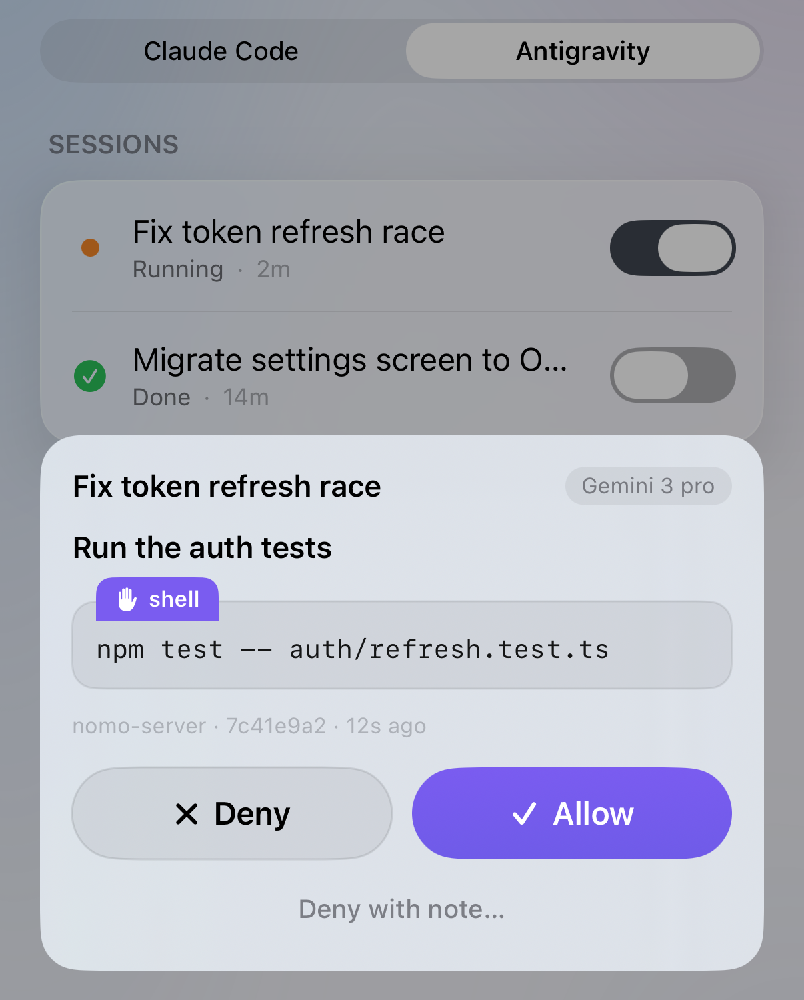
    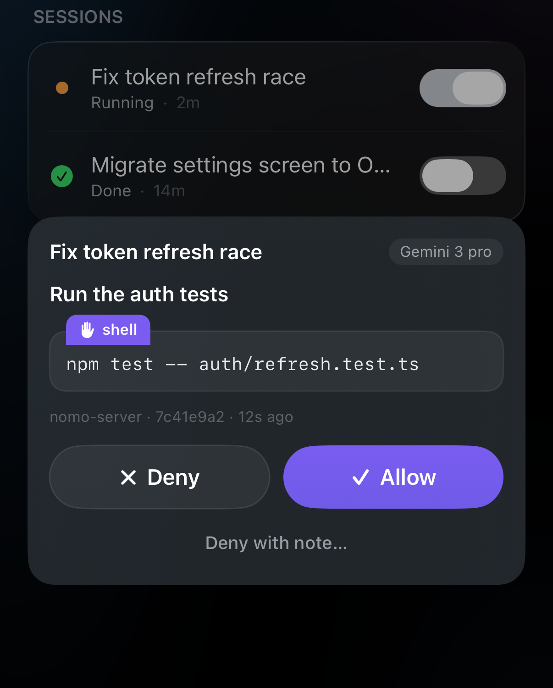
  </div>
</Frame>

- **「許可」** — Antigravity はそのまま進めます。
- **「拒否」** — Antigravity はその操作を飛ばして続けます。
- **「メモを付けて拒否…」** — 飛ばしたうえで、その理由をあなたの言葉で Antigravity に伝えます。

詳しくは [iPhone からの回答](/ja/sessions/approvals)をご覧ください。

知っておくと便利なこと:

- **Antigravity で設定したルールが優先されます。** ルールでブロックしているものはブロックされたままで、iPhone で「許可」をタップしても覆ることはありません。`agy` では、ルールですでに許可しているコマンドは iPhone に確認せずに実行されます。
- **デスクトップアプリでは、すべてが iPhone に届きます。** Nomo はデスクトップアプリの権限設定を読み取れないため、すべてのコマンドとファイルの変更が iPhone に届きます。
- **コンピュータでチャットを止めた場合は、** iPhone のカードは自動で消えます。
- **待っている間、ターミナルには何も表示されません。** リクエストが iPhone からの回答を待っている間、ターミナルには何も表示されません。これは想定どおりで、リクエストは iPhone に届いています。
- **返信シートを開いている場合は、** リクエストがチャットにも表示され、そこで回答できます。[チャットからの承認](#approve-in-chat)をご覧ください。

## 中断 {#interrupt}

`実行中` の Antigravity のセッションで[「中断」](/ja/sessions/list#interrupt-a-running-session)をタップすると、止められます。緑色の**⚡ ローカル**チップが必要です。Antigravity はいまのステップを終えてから止まり、セッションは `完了` になります。チャットは開いたままなので、続けるには新しいメッセージを送ってください。

## iPhone からの返信 {#reply-from-your-phone}

iPhone から Antigravity のセッションにメッセージを送れます。修正の指示でも、次の作業でも、「続けて」でもかまいません。Mac で入力したのと同じように Antigravity に届きます。返信画面はチャットの形になっていて、あなたのメッセージは右側に、Antigravity からのリクエストは左側に表示されます。

<Note>
  **現在は、iPhone と Mac が同じ Wi-Fi につながっていて**、Nomo の「**[ローカルネットワーク](/ja/sessions/settings#local-network)**」がオンになっている必要があります。今後のサーバーのアップデートで、どこからでも返信できるようになります。
</Note>

<Steps>
  <Step title="セッションを開く">
    Nomo でコンピュータを開き、**Antigravity** タブを選びます。セッションの名前をタップします。

    セッションが開き、詳細の下に青い「**返信**」ボタンが表示されます。実行中のセッションには、赤い「**中断**」ボタンも表示されます。

    <Frame caption="開いた状態の実行中の Antigravity セッション。詳細の下に「中断」と「返信」があります。">
      <div className="device-frame">
        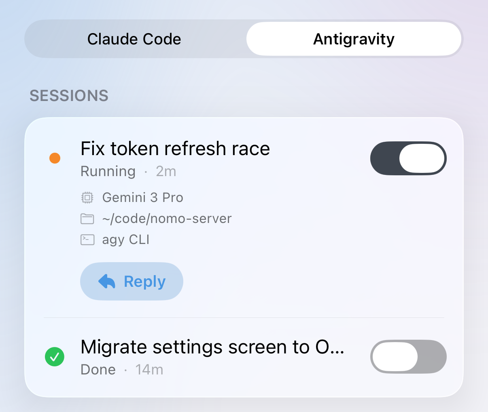
        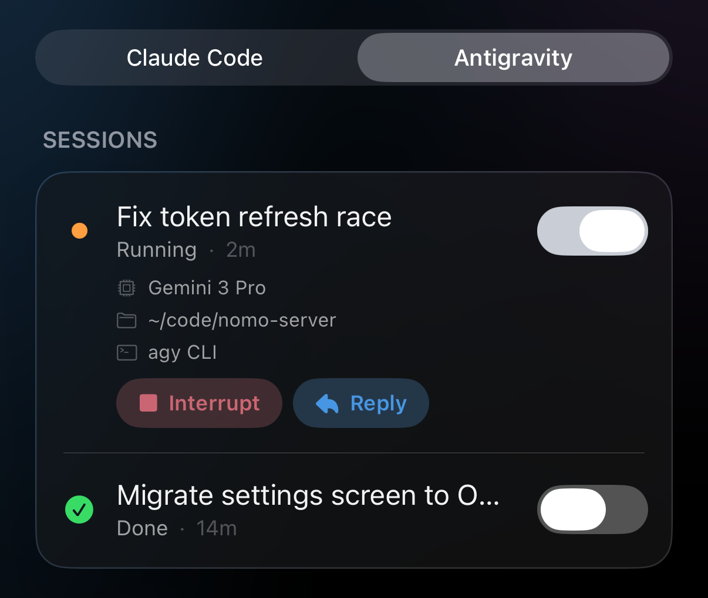
      </div>
    </Frame>
  </Step>

  <Step title="「返信」をタップする">
    上部にセッションの名前、下に「**このセッションにメッセージ**」と書かれた入力欄があるシートが表示されます。

    シートを閉じるときは、右上の **✕** をタップします。
  </Step>

  <Step title="メッセージを入力して送る">
    メッセージを入力して、矢印をタップします。

    メッセージが右側に吹き出しで表示され、その下に短い状態の行が表示されます。状態を見ると、メッセージがいまどこにあるかがわかります。下の一覧をご覧ください。

    <Frame caption="2 つのメッセージ。1 つ目は Antigravity に届き、2 つ目は次のステップを待っていて、まだ取り消せます。">
      <div className="device-frame">
        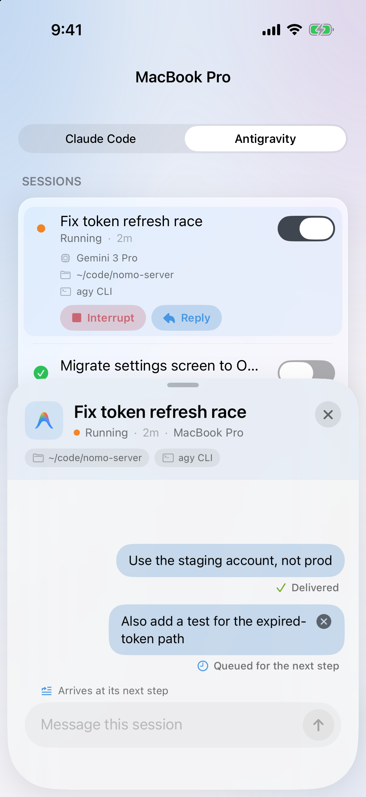
        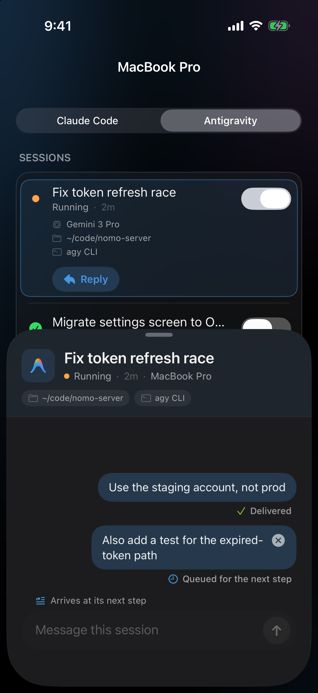
      </div>
    </Frame>
  </Step>
</Steps>

### チャットからの承認 {#approve-in-chat}

返信シートを開いているときに Antigravity がコマンドの実行を求めると、そのままチャットの中で回答できます。

<Steps>
  <Step title="リクエストを見つける">
    左側にある Antigravity からの吹き出しを探します。「**実行の許可を求めています：**」、コマンド、そして「**拒否**」と「**許可**」の 2 つのボタンが表示されています。

    <Frame caption="返信チャットの中で、Antigravity がコマンドの実行を求めています。">
      <div className="device-frame">
        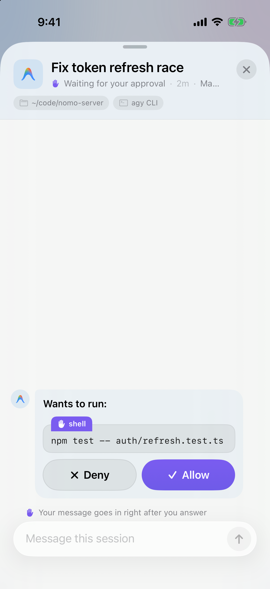
        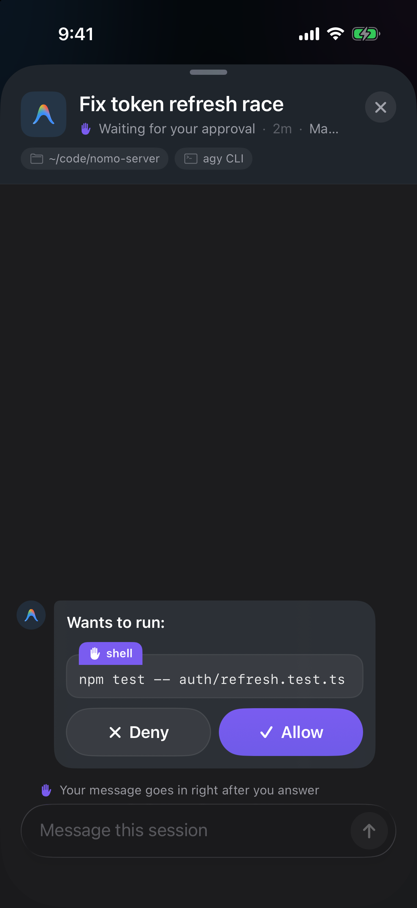
      </div>
    </Frame>
  </Step>

  <Step title="「許可」か「拒否」をタップする">
    実行させるときは「**許可**」を、飛ばさせるときは「**拒否**」をタップします。

    吹き出しが、結果を示す 1 行に縮まります。[回答済みのリクエストの表示](#answered-requests)をご覧ください。
  </Step>
</Steps>

吹き出しの「**拒否**」と「**許可**」ボタンが、入力欄に書いた内容を送ることはありません。入力した文字は入力欄に残ります。

### 拒否して送信 {#deny-and-send}

断ったうえで、代わりに何をしてほしいかを Antigravity に伝えたいときは、1 つのボタンで両方できます。

<Steps>
  <Step title="理由を入力する">
    リクエストが待っている間に、Antigravity に代わりにしてほしいことを入力欄に書きます。たとえば「npm ではなく bun を使って」などです。

    送信の矢印が赤い「**拒否して送信**」ボタンに変わり、入力欄の上に「**拒否の理由として送信されます**」と表示されます。

    <Frame caption="リクエストが待っている間に入力すると、送信ボタンが「拒否して送信」になります。">
      <div className="device-frame">
        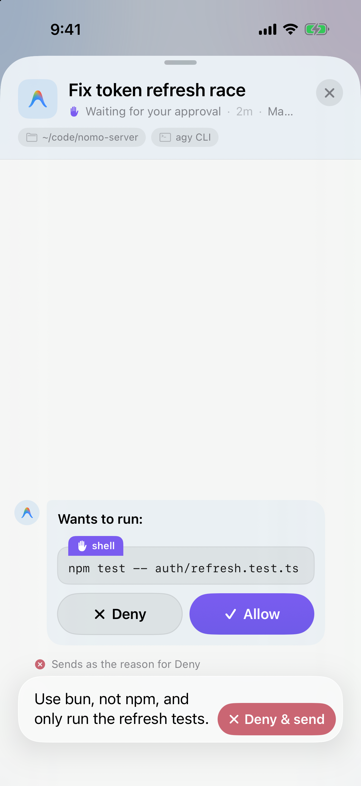
        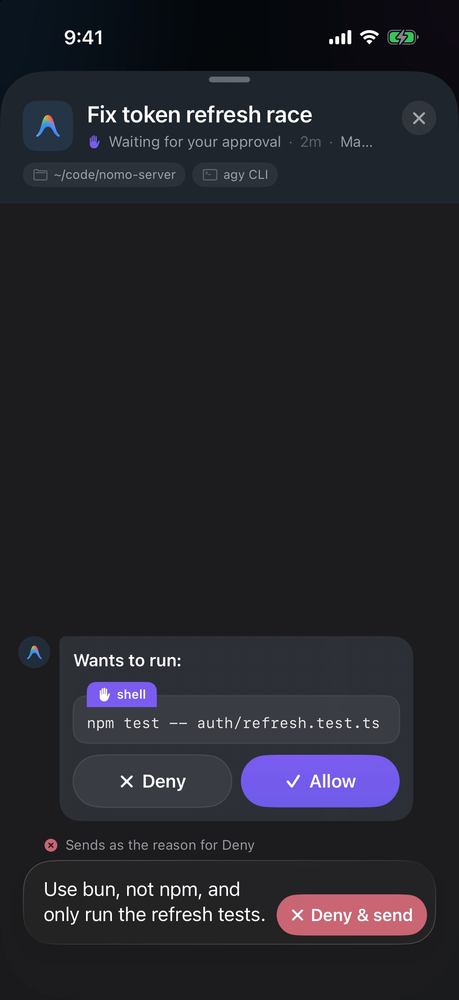
      </div>
    </Frame>
  </Step>

  <Step title="「拒否して送信」をタップする">
    Antigravity はそのコマンドを飛ばし、あなたの文章を理由として読み込みます。

    リクエストが **✕ 拒否済み** に変わり、その下にあなたの理由が引用されます。
  </Step>
</Steps>

<Tip>
  理由は 500 文字まで書けます。それより長いと、ボタンは通常の送信の矢印のままです。メッセージは待機し、リクエストに回答するとすぐに届きます。
</Tip>

### 回答済みのリクエストの表示 {#answered-requests}

| 表示 | 意味 |
| --- | --- |
| `✓ 許可済み · <コマンド>` | 許可しました。 |
| `✕ 拒否済み · <コマンド>` | 拒否しました。「**拒否して送信**」を使った場合は、その下に理由が引用されます。 |
| `コンピュータで回答済み` | Mac で回答されました。 |
| `タイムアウト — Mac で続行します` | iPhone からの回答を待ちきれませんでした。Antigravity が Mac で確認します。 |

### メッセージの下に出る状態 {#reply-statuses}

| 表示 | 意味 |
| --- | --- |
| `送信中…` | iPhone が送信しています。 |
| `承認待ち` | Antigravity が、チャット内のリクエストへの回答を待っています。回答するとすぐにメッセージが届きます。 |
| `次のステップを待っています` | Mac に届いています。Antigravity は次のステップで読み込みます。それまでは、吹き出しの **×** をタップして取り消せます。 |
| `届きました` | Antigravity が読み込みました。 |
| `Macで再開中…` | セッションが終わっていたので、Mac があなたのメッセージでもう一度始めています。Mac が実際に再開を始めたときにだけ表示されます。この時点では取り消せません。 |
| `Macで再開しました` | あなたのメッセージで、セッションがふたたび動いています。 |
| `再接続中…` | いま iPhone から Mac に接続できません。自動で再試行し続けるので、もう一度送る必要はありません。 |

### 使える場面 {#where-reply-works}

Antigravity をどこで使っているかによって変わります。

**`agy` コマンドラインツールの場合:**

- **作業中** — 次のステップでメッセージが届きます。
- **終わっていて、`agy` が閉じている** — Mac があなたのメッセージでセッションをもう一度始めます。`Macで再開中…` のあと、`Macで再開しました` と表示されます。
- **終わっているが、`agy` がまだ開いている** — メッセージは待機します。Mac の `agy` で次のメッセージを送るまで `次のステップを待っています` と表示され、送ると Antigravity は両方を読み込みます。

**Antigravity デスクトップアプリの場合:**

- **作業中** — 次のステップでメッセージが届きます。
- **終わっている** — 続けられるのは Mac だけです。「**返信**」はグレーになり、その下に「**AntigravityアプリのセッションはMacでのみ続けられます**」と表示されます。

<Frame caption="デスクトップアプリの終わったセッション。「返信」はグレーになり、その下の行に理由が表示されます。">
  <div className="device-frame">
    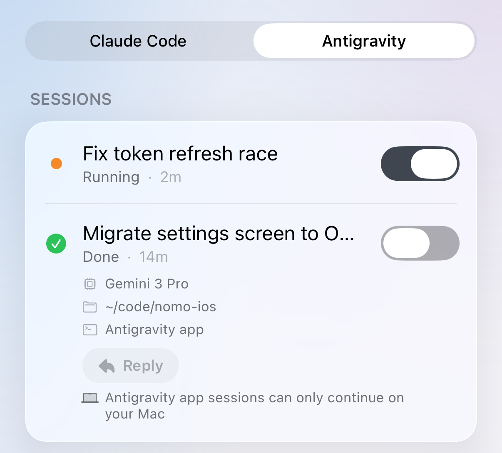
    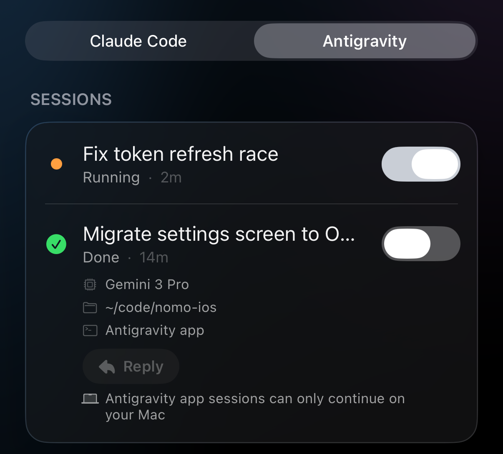
  </div>
</Frame>

知っておくと便利なこと:

- **1 通あたり最大 4,000 文字**です。それ以上は入力できません。
- **中断が常に優先されます。** メッセージがキューにある間に「**[中断](#interrupt)**」をタップすると、Antigravity が先に止まります。止めたターンにメッセージが渡されることはありません。
- **メッセージは Nomo を開いている間だけ残ります。** Nomo を完全に終了すると、次に開いたときシートは空になります。Mac にすでに届いているメッセージは、そのまま届きます。

## このバージョンでの制限 {#what-this-version-doesnt-do}

- **質問と計画は非対応。** Antigravity の質問と計画の確認は iPhone に表示されません。
- **「Macで開く」は非対応。** Antigravity のセッションでは、このボタンは使えません。
- **「常に許可」は非対応。** どの回答も、その場限りの「許可」か「拒否」です。

## うまくいかないとき {#troubleshooting}

<AccordionGroup>
  <Accordion title="返信が「次のステップを待っています」のまま">
    メッセージは Mac に届いています。Antigravity が作業中なら、次のステップで読み込まれます。長いコマンドの実行中は、しばらくかかることがあります。

    セッションが終わっていて、Mac で `agy` が開いたままの場合、メッセージはそこでの次のメッセージを待ちます。`agy` で何か送ると、Antigravity は両方を読み込みます。取り消すには、吹き出しの **×** をタップします。
  </Accordion>

  <Accordion title="Nomo のコマンドで「operation not permitted」と表示される">
    Antigravity デスクトップアプリで Nomo のコマンドを初めて使うときに表示されることがあります。これは正常です。Antigravity がサンドボックスの外で自動的にやり直します。終わるまで待ってください。何もする必要はありません。
  </Accordion>

  <Accordion title="「返信」がグレーになっている">
    Antigravity デスクトップアプリのセッションで、すでに終わっています。続けられるのは Mac だけです。次のメッセージはアプリから送ってください。
  </Accordion>

  <Accordion title="どのセッションも 2 つずつ表示される">
    Nomo の Claude Code プラグインが Antigravity に読み込まれています。ターミナルで次を実行してから、Antigravity を再起動してください。

    ```bash
    agy plugin uninstall nomo-cc
    ```
  </Accordion>

  <Accordion title="Nomo のコマンドでファイルが見つからないと表示される">
    Nomo のフォルダが移動または削除されています。Antigravity はそのまま使えますが、iPhone には何も届きません。インストーラーをもう一度実行してから、Antigravity を再起動してください。

    ```bash
    bunx nomo-ai --antigravity
    ```
  </Accordion>
</AccordionGroup>

そのほかの問題（iPhone に何も表示されない、承認を求められなくなった、セッションが止まったままなど）は、[トラブルシューティング](/ja/sessions/troubleshooting)をご覧ください。

## 技術的な詳細とセキュリティ {#technical-details-and-security}

Nomo が iPhone に送るのは、セッションの状況と、そのセッションからの確認だけです。送る内容はエンドツーエンド暗号化されます。何か問題が起きても、Antigravity はいつもどおりコンピュータで確認します。

内部のしくみはプラグインの README で説明しています: [Nomo と Antigravity の連携](https://github.com/KarrixLee/nomo#antigravity-integration)、[フックとセキュリティ](https://github.com/KarrixLee/nomo#antigravity-hooks)。
