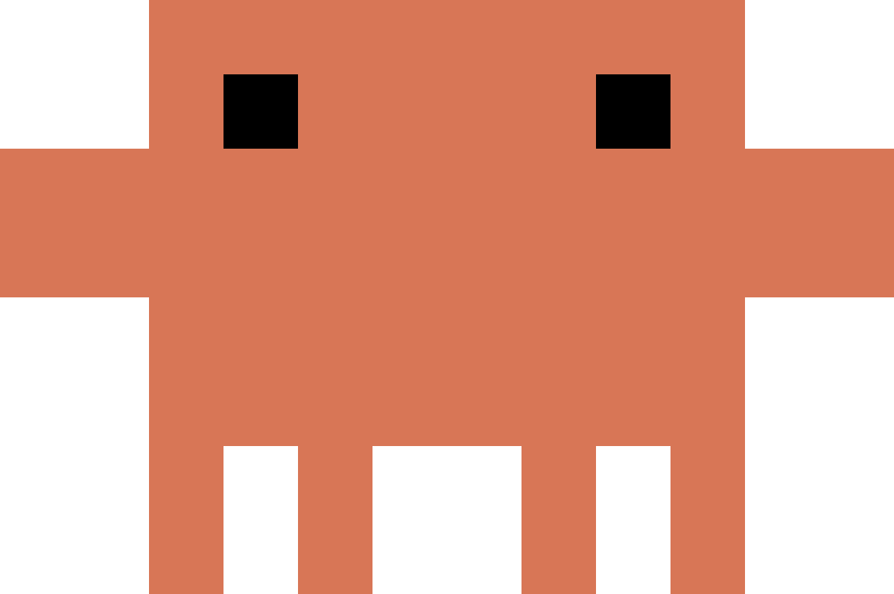
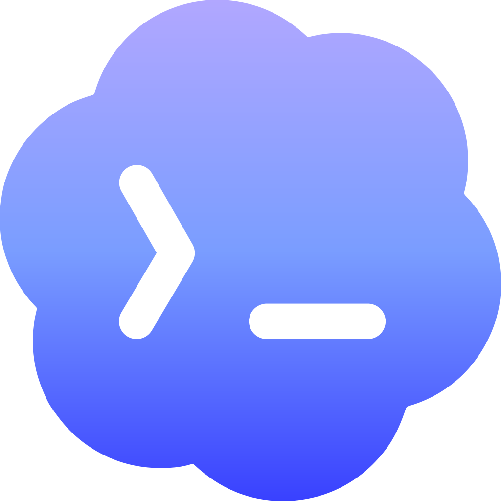
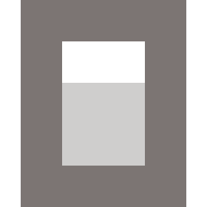

Claude Code、Codex、OpenCode、Antigravity に共通のコマンドが 5 つ、OpenCode だけに必要な 6 つ目、そして Cursor には 4 つあります。対象にしたいコンピュータで、エージェントのセッションの中から実行します — Claude Code と OpenCode では `/` のコマンド、Cursor と Antigravity では `/` のスキル、Codex では `$` のスキルです。ペアリング、状態確認、リセット、ペアリングの解除はターミナルからも実行できます。[ターミナルから実行する](#terminal)をご覧ください。

<Note>
  Antigravity では、Nomo のコマンドを実行するたびに確認が表示されます。「Allow」を選んでください — Antigravity は、コンピュータでコマンドを実行する前に必ず確認します。詳しくは [Antigravity での利用](/ja/sessions/antigravity#commands)をご覧ください。
</Note>

<Tip>
  Claude Code ではすべてが名前空間に入っています。`/nomo-cc:` と入力すると一覧が表示されます。OpenCode のコマンド名はフラットでグローバルなので、そちらでは Nomo のコマンドにも接頭辞は一切付きません — Cursor と Antigravity のスキルにも付きません。
</Tip>

| |  Claude Code |  Codex |  OpenCode |  Cursor |  Antigravity |
| --- | --- | --- | --- | --- | --- |
| <a href="#pair">このコンピュータをペアリングする</a> | `/nomo-cc:pair` | `$nomo-pair` | `/nomo-pair` | `/nomo-pair` | `/nomo-pair` |
| <a href="#status">状態を確認する</a> | `/nomo-cc:status` | `$nomo-status` | `/nomo-status` | `/nomo-status` | `/nomo-status` |
| <a href="#approvals">承認を一時停止・再開する</a> | `/nomo-cc:approvals` | `$nomo-approvals` | `/nomo-approvals` | — | `/nomo-approvals` |
| <a href="#reset">停止したセッションを消去する</a> | `/nomo-cc:reset` | `$nomo-reset` | `/nomo-reset` | `/nomo-reset` | `/nomo-reset` |
| <a href="#unpair">このコンピュータの接続を解除する</a> | `/nomo-cc:unpair` | `$nomo-unpair` | `/nomo-unpair` | `/nomo-unpair` | `/nomo-unpair` |
| <a href="#update">プラグインを更新する</a> | — | — | `/nomo-update` | — | — |

どれも派手に失敗することはありません。することが何もない場合でも、すべて正常に終了します — `Not paired` はエラーではなく成功です。

最終行が空欄なのは、抜けているからではありません。Claude Code と Codex はそれぞれのホスト側で更新するため、Nomo はそこにコマンドを足していません。Cursor と Antigravity はインストーラーをもう一度実行して更新します。それぞれに必要なもの — Codex の場合はたいてい何もありません — は [update](#update) にまとめてあります。

承認の行で Cursor が空欄なのも、抜けているからではありません。Cursor のセッションは読み取り専用で、一時停止するリモート承認がありません — [Cursor での利用](/ja/sessions/cursor)。

Nomo の削除には `/` コマンドがありません。ターミナルに 1 行貼り付けるだけです — [uninstall](#uninstall) を参照してください。

## ターミナルから実行する {#terminal}

主なコマンドは、ターミナルからも実行できます。どのフォルダからでもかまいません。AI アプリが [Grok Bot](/ja/sessions/grok-bot) だけの Mac では、この方法しかありません。

| | ターミナル |
| --- | --- |
| Nomo をインストール・更新する | `bunx nomo-ai` |
| <a href="#pair">このコンピュータをペアリングする</a> | `bunx nomo-ai pair` |
| コードを入力してペアリングする | `bunx nomo-ai pair code` |
| <a href="#status">状態を確認する</a> | `bunx nomo-ai status` |
| <a href="#reset">停止したセッションを消去し、アクティビティを今すぐ送る</a> | `bunx nomo-ai reset` |
| <a href="#unpair">このコンピュータの接続を解除する</a> | `bunx nomo-ai unpair` |
| <a href="#uninstall">エージェントから Nomo を削除する</a> | `bunx nomo-ai uninstall --cursor` |

どれも、エージェントの中で実行するコマンドと同じ働きをします。ペアリングもリセットも、1 回でそのコンピュータのすべてのエージェントに効きます。bun がない場合は、代わりに `npx nomo-ai` を使ってください。たとえば `npx nomo-ai status` です。Nomo がまだインストールされていない場合は、次のように表示されます。

```
Nomo is not installed on this computer yet — run `bunx nomo-ai` first.
```

インストールの最後に、`bunx nomo-ai` は短い `nomo` コマンドも追加するかどうかを尋ねます。追加した場合は、代わりに `nomo pair`、`nomo status`、`nomo reset` と入力できます。どちらの場合も、`bunx nomo-ai …` はいつでも使えます。`bunx nomo` や `npx nomo` とは入力しないでください。`nomo` という名前の npm パッケージは Nomo のものではありません。

## pair {#pair}

<CodeGroup>
```bash Claude Code icon="/images/claude-code.svg"
/nomo-cc:pair          # QR code, opens your browser
/nomo-cc:pair code     # one-time code, printed in the terminal
```

```bash Codex icon="/images/codex.svg"
$nomo-pair             # QR code, opens your browser
$nomo-pair code        # one-time code, printed in the terminal
```

```bash OpenCode icon="/images/opencode.svg"
/nomo-pair             # QR code, opens your browser
/nomo-pair code        # one-time code, printed in the terminal
```

```bash Cursor icon="/images/providers/cursor.svg"
/nomo-pair             # QR code, opens your browser
/nomo-pair code        # one-time code, printed in the terminal
```

```bash Antigravity icon="/images/providers/antigravity.png"
/nomo-pair             # QR code, opens your browser
/nomo-pair code        # one-time code, shown in the chat
```

```bash ターミナル icon="terminal"
bunx nomo-ai pair      # QR code, opens your browser
bunx nomo-ai pair code # one-time code, printed in the terminal
```
</CodeGroup>

引数なしで実行すると、テーマの適用されたページがブラウザで開き、QR コードが表示されます。アプリでスキャンすると、ページは自動的に **Paired ✓** に切り替わります。

`code` 引数を付けるとブラウザを完全に省き、入力できるワンタイムコードを出力します。ヘッドレスなマシンや SSH セッション向けです。これが第 2 の選択肢なのは意図的で、そのコードはターミナルに、つまりエージェントのトランスクリプトに残るからです。

すでにペアリングされているコンピュータをもう一度ペアリングすると、前のペアリングが置き換わります。すでにペアリング済みなら、もう一度ペアリングする必要はありません。

ペアリングは **10 分間**使われないと期限切れになります。1 つのペアリングが対象とするのはマシンであり、エージェントではありません — 同じ Mac の Claude Code、Codex、OpenCode、Cursor、Antigravity は同じペアリングを共有します。詳しい手順は[ペアリング](/ja/setup/pairing)にあります。

## status {#status}

<CodeGroup>
```bash Claude Code icon="/images/claude-code.svg"
/nomo-cc:status
```

```bash Codex icon="/images/codex.svg"
$nomo-status
```

```bash OpenCode icon="/images/opencode.svg"
/nomo-status
```

```bash Cursor icon="/images/providers/cursor.svg"
/nomo-status
```

```bash Antigravity icon="/images/providers/antigravity.png"
/nomo-status           # a short summary in plain words
/nomo-status verbose   # the full readout below
```

```bash ターミナル icon="terminal"
bunx nomo-ai status
```
</CodeGroup>

何かおかしいと思ったら、まず最初に実行するコマンドです。正常なマシンの出力は、落ち着いた数行だけです — チェックマークは出てきません。問題がないというのは、言うべきことが何もないということだからです。

```
Nomo 2.2.0 · Claude Code

Phone         paired · https://api.nomo.gg · pairing 3e65a0cb…
Delivery      last event sent 4m ago · watchdog running (pid 25780)
LAN           listening on port 51843 (id 9f3c1a20) since 3h ago
              phone last reached this Mac 12s ago (ping)
              address last advertised 4m ago (2 interfaces)
Approvals     on — permission prompts are held and sent to your phone

Claude Code — you are here
  Hooks       firing · last 8s ago
  Sessions    1 of 4 tracked here
```

空行より上は**コンピュータ**についての報告で、どのエージェントから実行しても同じ内容になります。その下に来るのが、いま実際にいるエージェントで、`— you are here` の印が付きます。

<ResponseField name="Phone">
  このコンピュータがそもそもペアリングされているか、通信先の中継サーバー、そして保持しているペアリングを示します。`NOT PAIRED` は、ここから何ひとつアプリに届かないという意味です。その下の矢印には、いま使っているエージェント向けの [pair](#pair) コマンドが出力されます。
</ResponseField>

<ResponseField name="Delivery">
  このコンピュータから最後にイベントが実際に出ていったのがいつか、そしてウォッチドッグが動いているかどうかです。ウォッチドッグが動いていないこと自体は問題ありません — 次のセッションで自動的に起動します。セッションが実際に動いているのに `never` と出ている場合は、問題です。
</ResponseField>

<ResponseField name="LAN">
  [ローカルネットワーク](/ja/sessions/settings#local-network)による直接接続です。このコンピュータが待ち受けているポートと id、iPhone が最後にここへ到達した時刻、そしてこの Mac が最後にアドレスを広告した時刻が並びます。重要なのは真ん中の行で、直接接続が実際に機能したことを示す唯一の証拠です。広告からかなり経っているのに一度も到達がないなら、iPhone からここへ届いていません。広告した直後でまだ到達がないだけなら、判断するには早すぎます。リクエストが拒否された場合は、沈黙のままにせず理由が表示されます。一度も待ち受けたことのないコンピュータでは、この行そのものが出ません — スイッチは iPhone 側にあり、初期状態ではオフです。
</ResponseField>

<ResponseField name="Approvals">
  `on` は、許可リクエストがここで保留され、iPhone に送られるという意味です。`PAUSED` はそうならないという意味で、代わりにターミナルへ出ます。誰かが再開するまで — 何か月後であっても — その状態が続きます。iPhone が何も尋ねてこなくなったなら、この行がその答えのすべてです。[一時停止する](/ja/sessions/approvals#pausing-it)をご覧ください。
</ResponseField>

<ResponseField name="Hooks">
  エージェントが Nomo にデータを渡しているか、そして最後に渡したのがどれくらい前かを示します。OpenCode にフックはないので、そちらではこの行の名前が `Plugin` になります。何も発火していないときは、Claude Code ではフックを読み込ませるために再起動してください。Codex では `/hooks` を実行します。OpenCode ではプラグインを読み込ませるために再起動してください。Cursor と Antigravity も再起動してください。どちらもフックを読み込むのは起動時だけです。
</ResponseField>

<ResponseField name="Runtime">
  フックを動かしているランタイムが古いときだけ表示されます。bun が **1.4.4** より古い場合、または Node.js 22 が **22.23.4** より古い場合です。矢印はアップグレードの方法を示します — bun なら `bun upgrade` です。警告にすぎず、フックは動き続けます。
</ResponseField>

<ResponseField name="Sessions">
  いまはエージェントごとに数えます。`1 of 4 tracked here` は、このコンピュータが 4 件のセッションを追跡していて、そのうち 1 件があなたのものだという意味です。とっくに終わっているはずの行は、[reset](#reset) の出番です。
</ResponseField>

問題には 2 つの印だけが付きます。`!` が問題そのもの、`→` がその対処で、実行したエージェントのコマンドの書き方に合わせて書かれます。そのコンピュータ上のほかのエージェントは、**Also on this computer** の下に 1 行ずつ凝縮して並びます — そして*そちら*が壊れているときは、あなたが見に行くのを待たずに、ここでそう伝えます。

```
Nomo 2.2.0 · Claude Code

Phone         NOT PAIRED — nothing from this computer reaches the app
              → run /nomo-cc:pair (or bunx nomo-ai pair)

Claude Code — you are here
  Hooks       firing · last 6s ago
  Sessions    1 of 3 tracked here

Also on this computer
  Codex       firing · last 12h ago · 2 of 3 tracked here
              ! Also runs the Claude Code plugin's hooks on every Codex event — double the work, no benefit.
              → in Codex run /hooks and untrust the `nomo-cc@nomo` entries
              → full detail: run $nomo-status inside Codex
  OpenCode    installed · no activity yet
```

何も言うことがない行は省かれます — ペアリングされていないコンピュータには、報告する配信も LAN も承認もありません。ほかのエージェントの問題はここで詳しく説明したうえで、残りの詳細についてはそのエージェント自身のステータスのコマンドを案内します。そして 1 行目にはプラグインのバージョンが載ります。バグを報告するときは、これを添えてください。

## approvals {#approvals}

<CodeGroup>
```bash Claude Code icon="/images/claude-code.svg"
/nomo-cc:approvals off      # pause on this computer
/nomo-cc:approvals on       # resume
/nomo-cc:approvals status   # which way is it set
```

```bash Codex icon="/images/codex.svg"
$nomo-approvals off         # pause on this computer
$nomo-approvals on          # resume
$nomo-approvals status      # which way is it set
```

```bash OpenCode icon="/images/opencode.svg"
/nomo-approvals off         # pause on this computer
/nomo-approvals on          # resume
/nomo-approvals status      # which way is it set
```

```bash Antigravity icon="/images/providers/antigravity.png"
/nomo-approvals off         # pause on this computer
/nomo-approvals on          # resume
/nomo-approvals status      # which way is it set
```
</CodeGroup>

**このコンピュータ**のリモート承認を一時停止し、許可リクエストが iPhone を待たずにターミナルへ直行するようにします。iPhone の電池が切れている、手元にないといったときの逃げ道です。

```
Remote approvals are OFF for this computer — Claude Code permission prompts
will appear in the terminal as usual (your phone is not asked).
```

スイッチはコンピュータごとに 1 つで、**すべてのエージェントで共有されます** — Codex で一時停止すると、そのマシンの Claude Code と OpenCode でも一時停止されます。ペアリングを解除することも、iPhone 側の設定に触れることもありません。

iPhone 全体に効く別のスイッチもあります。[設定](/ja/sessions/settings#remote-approvals)の「iPhoneで回答」です。

Cursor に approvals コマンドはありません。Cursor の許可リクエストは iPhone に届かないため、一時停止するものがありません。

## reset {#reset}

<CodeGroup>
```bash Claude Code icon="/images/claude-code.svg"
/nomo-cc:reset
```

```bash Codex icon="/images/codex.svg"
$nomo-reset
```

```bash OpenCode icon="/images/opencode.svg"
/nomo-reset
```

```bash Cursor icon="/images/providers/cursor.svg"
/nomo-reset
```

```bash Antigravity icon="/images/providers/antigravity.png"
/nomo-reset
```

```bash ターミナル icon="terminal"
bunx nomo-ai reset
```
</CodeGroup>

ウォッチドッグを停止し、無効になったセッションや実体のないセッションの行を消去して、それらを削除するよう iPhone に伝えます。続けて、アクティビティ（[Nomoアクティビティ](/ja/widgets#nomo-activity)のヒートマップと連続記録）をすぐに送ります。最大 6 時間待つ必要はありません。

```
Stopped the watchdog (it restarts automatically on your next session).
Cleared 4 stale session record(s) (4 end signals delivered to your phone).
Left 2 live sessions untouched.
Sent your activity summary (heatmap and streak) to your phone.
Pairing and keys were not touched — to disconnect this computer, run bunx nomo-ai unpair (or your agent's unpair command).
```

アクティビティの行は、`No activity to send yet.` と表示されることもあります。また、今は送れないので後で自動的にもう一度試す、と表示されることもあります。Claude Code の履歴が長いコンピュータでは、最初のリセットに時間がかかることがあります。

リセットは 1 回で、そのコンピュータのすべてのエージェントに効きます。

行が古いままだったり重複したりしているときに、まず試すべき安全なコマンドです。何に手を付けなかったかまで報告してくれます。OpenCode の行は OpenCode の**サーバー**に属するため、消えない行があるときは先に OpenCode を終了してください — [OpenCode での利用](/ja/sessions/opencode#reset-needs-opencode-closed)をご覧ください。

## unpair {#unpair}

<CodeGroup>
```bash Claude Code icon="/images/claude-code.svg"
/nomo-cc:unpair
```

```bash Codex icon="/images/codex.svg"
$nomo-unpair
```

```bash OpenCode icon="/images/opencode.svg"
/nomo-unpair
```

```bash Cursor icon="/images/providers/cursor.svg"
/nomo-unpair
```

```bash Antigravity icon="/images/providers/antigravity.png"
/nomo-unpair
```

```bash ターミナル icon="terminal"
bunx nomo-ai unpair
```
</CodeGroup>

ペアリングを取り消し、そのコンピュータ上の鍵を消去します。

**iPhone から**コンピュータを削除するのは別のことです。そちらはアプリに表示されなくなるだけで、このコマンドを実行するまで Mac はローカルの状態を保持し続けます。

## update {#update}

更新コマンドがあるのは OpenCode だけです。ほかのエージェントは別の方法で更新します — 使っているエージェントのタブを開いてください。

`bunx nomo-ai`（または `npx nomo-ai`）でも更新できます。すでに Nomo が入っているエージェントは、インストールではなく更新として表示されます。実行されるのは OpenCode、Cursor、Antigravity の分だけで、Claude Code と Codex の分は表示されるだけです。

<Tabs>
  <Tab title="Claude Code" icon="/images/claude-code.svg">
    ```bash
    claude plugin update nomo-cc@nomo
    ```

    自動更新はサードパーティのマーケットプレイスでは無効が既定なので、放っておいてインストールが動くことはありません。有効にするには `/plugin` → **Marketplaces** → Nomo のもの → **Enable auto-update** と進みます。
  </Tab>

  <Tab title="Codex" icon="/images/codex.svg">
    通常、実行するものはありません。Codex はプラグインをそのパスから直接読み込むため、そのクローンで取得することが更新のすべてです。`codex plugin update` という動詞もそもそも存在しません。

    マーケットプレイスを git から追加した場合は、Codex がスナップショットを保持しており、それを更新することが更新にあたります。

    ```bash
    codex plugin marketplace upgrade <marketplace-name>
    ```

    名前は追加したときのもので、必ずしも `nomo` とは限りません。
  </Tab>

  <Tab title="OpenCode" icon="/images/opencode.svg">
    ```bash
    /nomo-update
    ```

    何かを変更する前に必ず確認します。最新であればそこで終わりで、ついでに取得することもありません。

    ```
    OpenCode plugin: /Users/you/.nomo
    Already on 2.1.22 — nothing to do.
    ```

    取得するものがある場合は、取得する前に内容を伝えます。

    ```
    OpenCode plugin: /Users/you/.nomo
    Update available: 2.1.22 → 2.1.23.
    ```

    そのあと取得し、インストーラーを実行し直して — 新しい `/nomo-*` コマンドが追加されていれば、これが取り込みます — OpenCode の再起動を促します。プラグインはサーバーの起動時に 1 回だけ読み込まれるため、再起動するまでは古いコピーが動いたままです。

    判断がつかないときは、実行せずに断ります。断る理由ごとに、代わりにすべきことも示します。以前の `--ref` 付きインストールで固定されたクローン、コミットしていない変更が残る作業ツリー、移動または削除されたクローン、Nomo 自身のリポジトリではないクローン、そして何もインストールされていない場合です。

    `bunx nomo-ai` は同じ更新を `--global` 付きで実行します。どのフォルダから実行しても、更新するのはグローバルインストールだけです。`--project` でのインストールは、そのプロジェクトの OpenCode の中で `/nomo-update` を実行して更新します。

    <Note>
      更新の対象は、**スタブ**が指しているクローン — OpenCode が実際に読み込むコピー — であって、入力したコマンドファイルの出どころとは限りません。クローンを複数持っている場合は、ここが重要な違いになります。
    </Note>
  </Tab>

  <Tab title="Cursor" icon="/images/providers/cursor.svg">
    インストールしたときと同じコマンドです。

    ```bash
    bunx nomo-ai --cursor
    ```

    そのあと Cursor を再起動し、開いている `cursor-agent` のセッションがあればそれも再起動してください。
  </Tab>

  <Tab title="Antigravity" icon="/images/providers/antigravity.png">
    インストールしたときと同じコマンドです。

    ```bash
    bunx nomo-ai --antigravity
    ```

    そのあと Antigravity を再起動し、開いている `agy` のセッションがあればそれも再起動してください。
  </Tab>

  <Tab title="Grok Bot" icon="robot">
    インストールしたときと同じコマンドです。

    ```bash
    bunx nomo-ai --grokbot
    ```

    再起動するものはありません。次の 1 時間ごとの実行から、更新後のものが使われます。
  </Tab>
</Tabs>

## uninstall {#uninstall}

1 つのエージェントから Nomo を削除します。エージェントの中ではなく、ターミナルで実行します。使っているエージェントのタブを選び、その行を貼り付けて Return キーを押します。

<CodeGroup>
```bash Claude Code icon="/images/claude-code.svg"
claude plugin uninstall nomo-cc@nomo
```

```bash Codex icon="/images/codex.svg"
codex plugin remove nomo@nomo
```

```bash OpenCode icon="/images/opencode.svg"
rm ~/.config/opencode/plugins/nomo.js
rm ~/.config/opencode/commands/nomo-*.md
```

```bash Cursor icon="/images/providers/cursor.svg"
bunx nomo-ai uninstall --cursor
```

```bash Antigravity icon="/images/providers/antigravity.png"
bunx nomo-ai uninstall --antigravity
```

```bash Grok Bot icon="robot"
bunx nomo-ai uninstall --grokbot
```
</CodeGroup>

`bunx` がない場合は、代わりに `npx` を使ってください — たとえば `npx nomo-ai uninstall --cursor` です。以前の書き方の `--uninstall` も使えます。または、エージェント専用のスクリプトを実行します。たとえば `node ~/.nomo/plugin/scripts/cursor-install.mjs --uninstall` です（Antigravity なら `antigravity-install.mjs`、Grok Bot なら `grokbot-install.mjs`）。

Grok Bot の場合に削除されるのは、1 時間ごとに動くバックグラウンドジョブだけです。ほかには何も削除しません。

アンインストールしても、短い `nomo` コマンドは残ります。これも削除するには、`bun remove -g nomo-ai`（または `npm uninstall -g nomo-ai`）を実行します。

Antigravity は、完了すると次のように表示します。

```
✅ Nomo is removed from Antigravity. Restart Antigravity to finish. Your phone stays connected for your other coding apps.
```

そのあとエージェントを再起動します。Cursor と Antigravity は、アプリを終了してもう一度開き、開いている `cursor-agent` や `agy` も再起動してください。

削除されるのは、Nomo がそのエージェントに追加したものだけです。iPhone とのペアリングはそのまま残るので、ほかのエージェントは引き続き使えます。このコンピュータの接続も切りたい場合は、`bunx nomo-ai unpair` を実行してください。アンインストールの前でも後でもかまいません。[unpair](#unpair) をご覧ください。

Nomo の Claude Code プラグインを Antigravity に読み込んでいた場合は、`agy plugin uninstall nomo-cc` でそちらも削除し、Antigravity を再起動します。

`bunx nomo-ai uninstall` には必ずエージェントを指定してください — 推測はしません。エージェントごとのインストールについては[インストール](/ja/setup/install)を参照してください。

## コマンドを使わずに実行する {#without-slash-commands}

Antigravity が Nomo のコマンドを認識しない場合は、代わりにターミナルから実行します。ペアリング、状態確認、リセット、ペアリングの解除は、[`bunx nomo-ai` のコマンド](#terminal)を使うのがいちばん簡単です。Nomo インストーラーでインストールした場合に使える、すべてのコマンドの一覧です。

| | |
| --- | --- |
| ペアリング | `~/.nomo/plugin/scripts/run.sh ~/.nomo/plugin/dist/pair.mjs` |
| コードを入力してペアリング | `~/.nomo/plugin/scripts/run.sh ~/.nomo/plugin/dist/pair.mjs --show-code` |
| 状態の確認 | `~/.nomo/plugin/scripts/run.sh ~/.nomo/plugin/dist/status-cmd.mjs antigravity` |
| 承認の一時停止 | `~/.nomo/plugin/scripts/run.sh ~/.nomo/plugin/dist/cc-permission.mjs off` |
| 承認の再開 | `~/.nomo/plugin/scripts/run.sh ~/.nomo/plugin/dist/cc-permission.mjs on` |
| 止まったセッションの消去 | `~/.nomo/plugin/scripts/run.sh ~/.nomo/plugin/dist/reset.mjs` |
| ペアリングの解除 | `~/.nomo/plugin/scripts/run.sh ~/.nomo/plugin/dist/unpair.mjs` |

ターミナルからペアリングしたあとは、`~/.nomo/plugin/scripts/run.sh ~/.nomo/plugin/dist/pair.mjs wait` を実行して QR コードをスキャンします。インストーラーに `--verbose` を付けると、何を変更するかを確認できます。

## 状態の保存場所 {#where-state-lives}

プラグインが保持するものはすべて `~/.config/cc-status/` にあります。ペアリング、暗号鍵（モードは `0600`）、追跡中のセッションごとのファイル 1 つずつ、そしてローカルのトレースログです。このフォルダの中身がどこかへ送られることはありません。

## ソースコード {#read-the-source}

これらのコマンドはプラグインそのものであり、プラグインはオープンソースです。自分のマシンで何が動き、何が外へ出るのかを正確に知りたい場合、その答えは 1 つのリポジトリにあります — マーケットプレイスからのインストールも、その単純なクローンです。

<Card title="KarrixLee/nomo" href="https://github.com/KarrixLee/nomo" icon="github" horizontal>
  プラグインの全ソースコード、MIT ライセンス。issue やバグ報告もこちらへ。
</Card>
