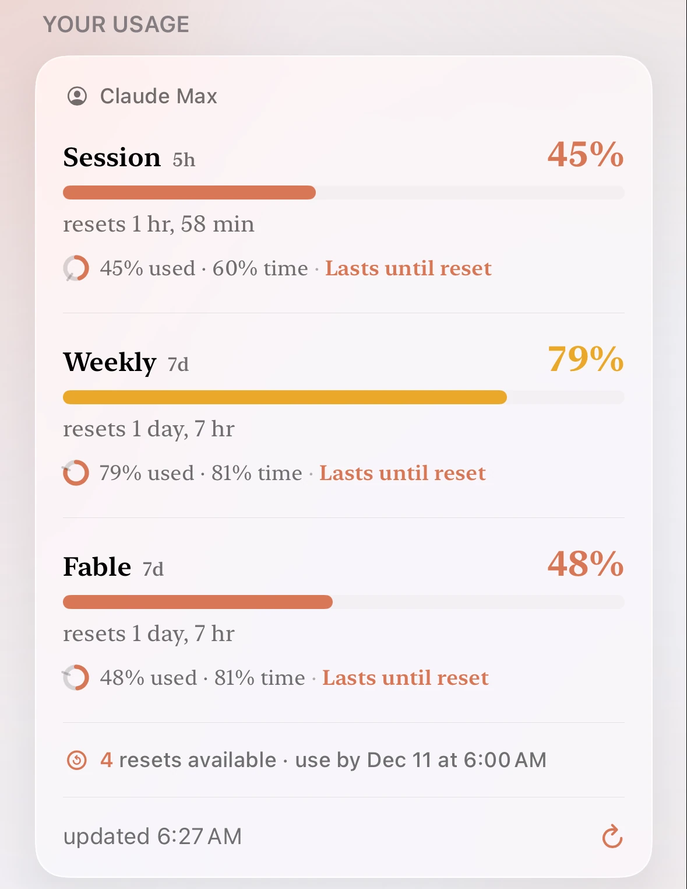
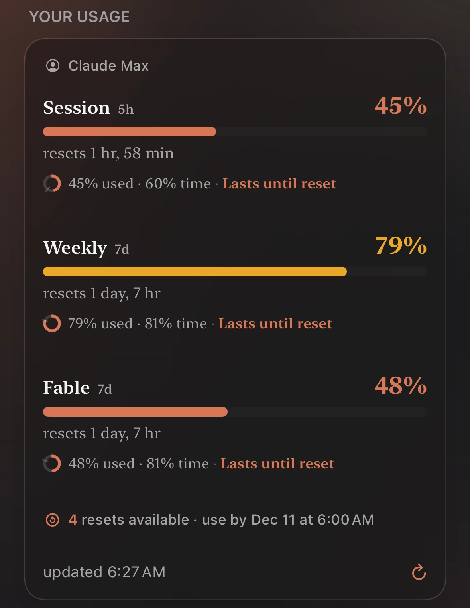

使用量は[ステータス](/ja/status)と同じつくりです — ウィジェットと通知 — ただし手順が 1 つだけ増えます。アカウントから数値を読み取るため、サインインが必要です。Mac 側のプラグインはこちらも不要で、スマートフォンだけで完結します。

<Frame caption="Claude の使用量タブ。5 時間の枠、週の枠、Fable の枠、それぞれがいつリセットされるか、そして使えるリセット。">
  

    
  

</Frame>

## 対応プロバイダ

**Claude**、**Codex**、**Cursor**、**xAI**、**Antigravity**、**Kimi** の 6 つです。[ステータス](/ja/status)の対象のうち、ステータスだけの DeepSeek を除くすべてです。

6 つとも、報告する枠の 70%、90%、100% の時点で**アラート**を出せます — [使用量アラート](/ja/notifications#usage-alerts)をご覧ください。

2 つのウィジェットでラベルが 1 つだけ異なります。使用量では **Codex** と表示されますが、ステータスが見ているのは **OpenAI** 全体です。消費しているのは Codex のプランで、落ちるのは OpenAI だからです。

**Antigravity** は **Google Antigravity** の割り当てを、別枠の **Claude & GPT** の上限も含めて、貼り付けるトークンではなく Google のサインイン経由で読み取ります。

**Kimi** は **Kimi Code** プランの 5 時間の上限と週の上限を読み取ります。接続すると短いコードが表示されるので、Kimi のサインインページで承認すれば完了です。

## サインイン {#signing-in}

**プロバイダー**タブからプロバイダーを開き、すでに契約しているアカウントを接続します。Nomo が読むのは、そのアカウント自身が見られるのと同じ数値です — API キーではありませんし、貼り付けるものもありません。

<Note>
  **ログイン情報はスマートフォンから出ません。**トークンは端末のキーチェーンに保管され、送られる先はそれが属するプロバイダーだけです — Claude のトークンは Anthropic へ、OpenAI のトークンは OpenAI へ。使用量は端末上で取得され、Nomo のサーバーを通ることは一切ありません。
</Note>

Nomo は非公式のアプリであり、読み取り対象のどのプロバイダーとも関係はありません。

### Cursor と Grok {#cursor-and-grok}

Cursor と Grok は Safari でサインインします。パスキー、パスワード管理アプリ、Safari でサインイン済みのアカウントをそのまま使えます。

**Cursor**

1. Nomo を開きます。
2. 「プロバイダー」タブをタップします。
3. 「Cursor」をタップします。
4. 上部の「使用量」をタップします。
5. 「Cursorアカウントを接続」をタップします。
6. **cursor.com** を使ったサインインの許可を iOS が求めます。「続ける」をタップします。
7. Cursor のページでサインインします。

ページは自動で閉じ、使用量が表示されます。60 日ほどごとに、もう一度サインインしてください。

<Warning>
  Grok Bot を使っていますか？ 接続するのは Grok ではなく **Cursor** です。Cursor のページでは、Grok Bot に使っているのと同じアカウントでサインインします。Grok か X のアカウントです。Nomo で **Grok** を接続しても、表示されるのは週間上限だけです。Grok Bot を使った日とトークンは、Cursor からしか届きません。[Grok Bot](/ja/widgets#grok-bot)をご覧ください。
</Warning>

The X Subscription では、Grok Bot と Cursor が 1 つの週間上限を共有し、Nomo はそれを表示します。以前の Cursor のプランでは Grok Bot に別の上限があり、Nomo はそれを読み取りません。

**Grok**

1. 「接続」をタップします。
2. **x.ai** を使ったサインインの許可を iOS が求めます。「続ける」をタップします。
3. xAI のページが開き、Nomo に `ABCD-1234` のような短いコードが表示されます。
4. xAI のページのコードと一致するか確認します。
5. xAI のページで承認します。

Grok のサインインは Nomo が自動で更新します。

Grok の使用量を表示するには、SuperGrok や X のサブスクリプションなど、有料の Grok プランが必要です。無料のアカウントは接続されたままですが、バーの代わりに「Grok の使用量を表示するには有料の Grok プランが必要です」と表示されます。

<Note>
  Nomo 2.4.0 にアップデートしたら、Grok にもう一度サインインしてください。以前の Grok のサインインは引き継がれません。
</Note>

## 消費ペース  {#pace}

Nomo Pro では、「使用量」ページの各上限の下に 1 行追加されます。上限がリセットされるまで使用量が持つかどうかがわかります。

<Frame caption="どちらの上限も時間の経過より速く使われているので、両方の行がアンバーになっています。">
  

    
    
  

</Frame>

行の最初には、`使用45%・経過60%` のような 2 つの値が表示されます。

- **使用**: 上限のうち、どれだけ使ったか。
- **経過**: 期間のうち、どれだけの時間が過ぎたか。

使用が経過より少なければ問題ありません。値のあとには、次のどれかが表示されます。

- 「リセットまで持つ」: 問題ありません。
- 「使い切りまで」と残り時間: アンバーで表示されます。今のスピードのままだと、リセット前に使い切ります。前に `~` が付いているのは推定値という意味です。
- 「まだ判断できません」: 期間が始まったばかりです。
- 「上限に到達」: 上限をすべて使い切りました。

この行は「設定 → 使用量 → 使用量の表示」に従います。「残り」にすると `残り55%・残り時間40%` と表示されます。

一部の Cursor のプランには、消費ペースがありません。その上限には行が表示されません。

ホーム画面では、[Nomo消費ペース](/ja/widgets#nomo-pace)ウィジェットで同じ内容を確認できます。

**Nomo Pro がない場合**は、最初の上限の下に「リセット前に使い切るかがわかります」という行が **PRO** のラベル付きで 1 つだけ表示されます。タップすると Nomo Pro の画面が開きます。

## 使えるリセット {#available-resets}

Claude と Codex では、あとで使える上限のリセットがもらえることがあります。1 回以上あるときは、その回数と、いちばん早い使用期限が表示されます。日時はお使いのタイムゾーンです。例: 「使えるリセット4回 · 12月11日 6:00までに使用」。

<Frame caption="使用量のカードには、使えるリセットの回数と、最初のリセットの使用期限が表示されます。">
  

    
    
  

</Frame>

同じリセットは、各プロバイダーのサイトでも確認できます。

- **Claude**: claude.ai の **Settings → Usage** にある **Limit resets**。
- **Codex**: chatgpt.com の **Settings → Usage** にある **Usage limit resets**。

使用量カードには回数と期限の両方が表示されます。[Nomo使用量](/ja/free-widgets#nomo-usage)と[Nomo消費ペース](/ja/widgets#nomo-pace)のウィジェットには回数が表示されます。

**リマインダー:** リセットの期限の 1 週間前と 1 日前にお知らせします。各プロバイダーの[使用量のアラート](/ja/notifications#usage-alerts)に従います。専用のスイッチはありません。止めるには、そのプロバイダーの使用量のアラートをオフにします。深夜にあたるお知らせは夕方か朝に届きます。期限を過ぎてから届くことはありません。

Nomo はリセットを表示するだけです。使ったり消費したりはしません。これまでと同じ使用量の取得で、Anthropic または OpenAI から直接 iPhone に届きます。

## 上限に達したとき {#when-you-hit-a-limit}

いずれかの枠が 100% に達すると、使用量カードの下に「上限に到達」という案内が表示され、ボタンが 1 つ付きます — 「Claudeの使用量を管理」、または表示中のプロバイダーの名前が入ったものです。タップすると、そのプロバイダー自身の使用量設定がブラウザで開きます。プランによっては、そこで追加の使用量を利用できる場合があります。

そこで何が提供されているかは Nomo にはわかりませんし、Nomo 自身が何かを販売することもありません。自分で探すことになるはずのページへの近道です。

この案内が表示されるのは Claude、Codex、Cursor、xAI で、米国、欧州連合、日本の App Store アカウントが対象です。

## 複数のアカウント  {#more-than-one-account}

Nomo Pro では、プロバイダーごとに最大 5 つのアカウントを追加できます。例えば、仕事用の Claude アカウントと個人用のアカウントです。アカウントごとに行が分かれ、それぞれの使用量が表示されます。名前の下には、`Max 20x · me@acme.com` のようにプランとメールアドレスが表示されます。見出しには、**3/5** のように接続済みのアカウント数が表示されます。

<Frame caption="2 つの Claude アカウント。Work がデフォルトです。">
  

    
    
  

</Frame>

### 別のアカウントを追加 {#add-another-account}

1. Nomo を開きます。
2. 「プロバイダー」タブをタップします。
3. **Claude** などのプロバイダーをタップします。
4. 上部の「使用量」をタップします。
5. 1 つ目のアカウントにサインインしていることを確認します。
6. アカウントの下にある「別のアカウントを追加」をタップします。
7. 「続ける」をタップします。
8. もう 1 つのアカウントでサインインします。1 つ目とは別のメールアドレスを使ってください。

<Frame caption="「続ける」をタップするとサインインページが開きます。X をタップすると、何も追加せずに閉じます。">
  

    
    
  

</Frame>

Nomo は新しいプライベートなサインインページを開くので、すでにサインインしているアカウントは使われません。追加済みのアカウントはサインインしたままです。

Claude の場合は、サインイン後に Claude がコードを表示します。

1. コードをコピーします。
2. Nomo に戻ります。Nomo がコードを貼り付けて接続します。
3. 何も起きない場合は、「貼り付け」をタップし、「接続」をタップします。

<Frame caption="Claude の場合: サインイン後に Claude が表示するコードを貼り付けます。">
  

    
    
  

</Frame>

新しいアカウントには、プロバイダーがメールアドレスを公開していれば、そのアドレスが名前として付きます。すでに Nomo にあるアカウントでサインインすると「このアカウントはすでに追加されています」と表示され、何も変わりません。

プロバイダーのアカウントが 5 つになると、「別のアカウントを追加」は淡色表示になります。

### アカウントの管理 {#manage-accounts}

アカウントの横にある **···** をタップし、次のどれかをタップします。

- 「名前を変更」: `仕事` や `個人` など、短い名前を付けます。
- 「デフォルトにする」: デフォルトのアカウントにします。デフォルトのアカウントには「デフォルト」のラベルが付きます。
- 「削除」: このアカウントを Nomo からサインアウトします。ほかのアカウントはサインインしたままです。このアカウントを表示していたウィジェットには「削除されたアカウント」と表示され、別のアカウントを選ぶよう求められます。デフォルトのアカウントには切り替わりません。

<Frame caption="デフォルトではないアカウントの ··· メニュー。">
  

    
    
  

</Frame>

上部の「使用量」カードは、デフォルトのアカウントを表示した状態で開きます。ほかのアカウントを表示するには、一覧でそのアカウントをタップします。表示中のアカウントは淡くハイライトされます。

### ウィジェットでのアカウント {#accounts-in-widgets}

ウィジェットには、ほかを選ばない限りデフォルトのアカウントが表示されます。

1. ウィジェットをタッチして押さえたままにします。
2. 「ウィジェットを編集」をタップします。
3. 「アカウント」をタップし、1 つ選びます。

「アカウント」は [Nomo使用量](/ja/free-widgets#nomo-usage) と [Nomo消費ペース](/ja/widgets#nomo-pace) にあります。[Nomoアカウント](/ja/widgets#nomo-accounts) は、すべてのアカウントを一度に表示します。

### Nomo Pro がない場合 {#without-nomo-pro}

Nomo Pro がない場合、アカウントはプロバイダーごとに 1 つです。「別のアカウントを追加」には **PRO** のラベルが表示されます。タップすると Nomo Pro の画面が開きます。登録すると、そのままアカウントの追加に進みます。デモモードでは、追加のアカウントは使えません。

Nomo Pro が終了すると、追加のアカウントは削除されずに一時停止されます。「一時停止中 · PRO」と表示され、更新されるのはデフォルトのアカウントだけになります。デフォルトのアカウントが一時停止されることはありません。一時停止中のアカウントをタップすると、Nomo Pro の画面が開きます。続きから使うには、「再登録する」をタップします。

一時停止中のアカウントに設定した Nomo使用量ウィジェットには、「一時停止中 · Nomo Pro」と `Nomo Proが終了しました。Nomoで再登録すると、このアカウントを表示できます。` が表示されます。タップすると Nomo Pro の画面が開きます。

## ウィジェット

<Card title="ウィジェット" href="/ja/widget" icon="puzzle-piece" horizontal>
  短い動画が 2 本 — ホーム画面への追加と、見たいサービスの指定。
</Card>

## 通知

<Card title="通知" href="/ja/notifications" icon="bell" horizontal>
  プロバイダーの使用量が 70%、90%、100% に達したときにお知らせします。
</Card>
