Nomo には iPhone 用のウィジェットが 7 つあります。無料で使えるのは、ステータスを表示する **Nomo** と **Nomo使用量** の 2 つです。残りの 5 つは Nomo Pro で使えます。

このページでは、それぞれのウィジェットに表示される内容と設定方法を説明します。ホーム画面にウィジェットを置く方法は、[ウィジェット](/ja/widget)をご覧ください。

## 無料版と Pro {#free-and-pro}

| | 無料 | Nomo Pro  |
| --- | --- | --- |
| **Nomo** ステータスウィジェット | ✓ | ✓ |
| **Nomo使用量** ウィジェット | ✓ | ✓ |
| **Nomo消費ペース**、**Nomoアクティビティ**、**Nomoアカウント**、**ライブエージェント**、**Nomoトークン** | | ✓ |
| 1 つのプロバイダーに複数のアカウント | | ✓ |

ウィジェットギャラリーでは、Pro ウィジェットの説明は **👑 Nomo Pro** で始まります。

Nomo Pro がなくても、Pro ウィジェットは追加できます。その場合は薄く表示されたプレビューの上に **Nomo Pro** と「ロック解除」が表示されます。タップすると、アプリで Nomo Pro の画面が開きます。

## 無料のウィジェット {#free-widgets}

### Nomo ステータス {#nomo-status}

<Frame caption="Nomo ステータスの小と中のサイズ。">
  

    
    
  

</Frame>

ウィジェットギャラリーでは、このウィジェットの名前は **Nomo** です。

**表示される内容:** Claude Code や Codex など、1 つのサービスが今正常に動いているかどうか。表示は次のどれかです。

- `正常稼働`
- `パフォーマンス低下`
- `一部障害`
- `重大な障害`
- `メンテナンス中`

ステータスを取得できないときは `取得できません` と表示されます。

| サイズ | 表示される内容 |
| --- | --- |
| 小 | サービス、そのステータス、最後に更新された時刻。 |
| 中 | 小と同じ内容に加えて、過去 30 日間のバーと稼働率。 |

**事前に必要なもの:** ありません。アカウントもサインインも不要です。

**設定方法:**

1. ウィジェットを追加します。[ウィジェット](/ja/widget)をご覧ください。
2. ウィジェットをタッチして押さえたままにします。
3. 「ウィジェットを編集」をタップします。
4. 「プロバイダー」をタップし、Claude、OpenAI、Cursor、xAI、Antigravity、Kimi、DeepSeek から 1 つ選びます。
5. 「サービス」をタップし、**Claude Code** などを 1 つ選びます。
6. ウィジェットの外側をタップして終了します。

すぐに更新するには、隅にある更新ボタンをタップします。それ以外の場所をタップすると、Nomo でそのプロバイダーの「ステータス」ページが開きます。

詳しくは[ステータス](/ja/status)をご覧ください。

### Nomo使用量 {#nomo-usage}

<Frame caption="Nomo使用量の小と中のサイズ。">
  

    
    
  

</Frame>

**表示される内容:** 1 つのアカウントについて、プランの上限のうちどれだけ使ったかと、いつリセットされるか。

| サイズ | 表示される内容 |
| --- | --- |
| 小 | 1 つの期間: 大きなパーセント、バー、リセットまでの時間。 |
| 中 | 2 つの期間。通常は「セッション」（5 時間）と「週間」で、それぞれにバーとリセットまでの時間が表示されます。 |

バーは 70% でアンバー、90% で赤に変わります。プランに 5 時間の上限がない場合は、代わりに `セッション上限なし` と表示されます。

**事前に必要なもの:** Claude や Codex など、接続済みのアカウント。「プロバイダー」タブを開いてプロバイダーをタップし、接続してください。[使用量](/ja/usage)をご覧ください。接続するまでは `未接続` と表示されます。

**設定方法:**

1. ウィジェットを追加します。[ウィジェット](/ja/widget)をご覧ください。
2. ウィジェットをタッチして押さえたままにします。
3. 「ウィジェットを編集」をタップします。
4. 「プロバイダー」をタップし、**Codex** などを 1 つ選びます。
5. 「アカウント」をタップし、1 つ選びます。「デフォルト」を選ぶと、アプリで設定したデフォルトのアカウントに従います。
6. 「小サイズウィジェットのスタイル」をタップし、1 つ選びます。「大きなパーセント」は数字を大きく表示します。「大きなアニメーション」はアニメーションするアイコンを大きく表示します。
7. 「小サイズウィジェットの表示対象」をタップし、小サイズに表示する期間を選びます。「自動」を選ぶと自動で決まります。選べる項目はプロバイダーによって異なります。
8. ウィジェットの外側をタップして終了します。

Cursor では、「Cursorのアイコン」も選べます。**Grok Bot** か「Cursorのロゴ」を選んでください。

すぐに更新するには、隅にある更新ボタンをタップします。それ以外の場所をタップすると、Nomo でそのプロバイダーの「使用量」ページが開きます。

## Pro ウィジェット  {#pro-widgets}

Nomo Pro では、無料のウィジェットに加えて 5 つのウィジェットが使えます。どれも、本来ならアプリを開いて確かめることに答えてくれます。

- **Nomo消費ペース**: 使用量はリセットまで持つか。
- **Nomoアクティビティ**: エージェントを使ったコーディングが何日続いているか。
- **Nomoアカウント**: どのアカウントの残りがいちばん少ないか。
- **ライブエージェント**: エージェントが今何をしているか。
- **Nomoトークン**: どのモデルで、どれだけトークンを使ったか。

<Frame caption="ホーム画面に置いた 5 つの Pro ウィジェットすべて: Nomo消費ペース、ライブエージェント、Nomoアクティビティ、Nomoトークン、Nomoアカウント。">
  

    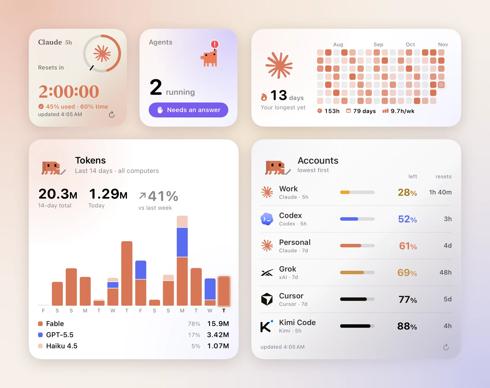
    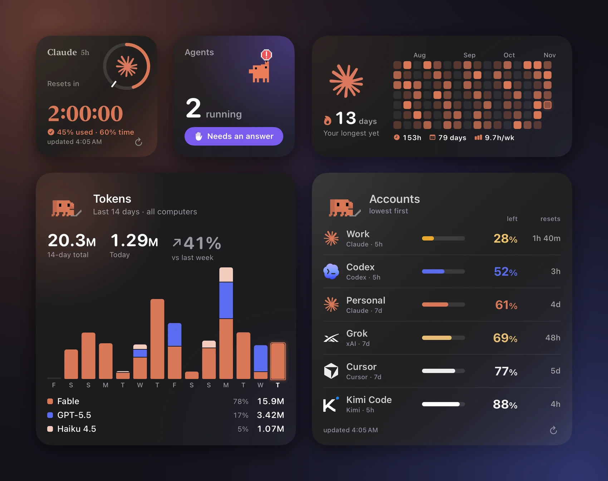
  

</Frame>

Nomo消費ペースと Nomoアクティビティには、ロック画面用のサイズもあります。

### Nomo消費ペース  {#nomo-pace}

<Frame caption="Nomo消費ペースの小と中のサイズ、そしてロック画面。">
  

    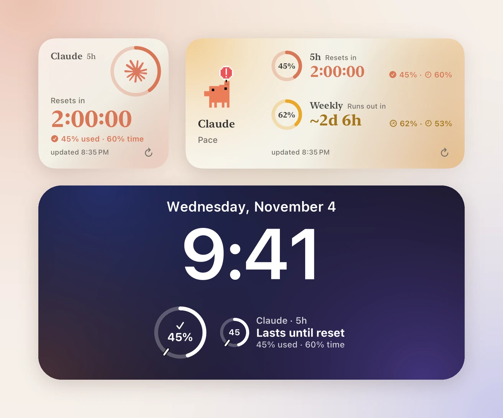
    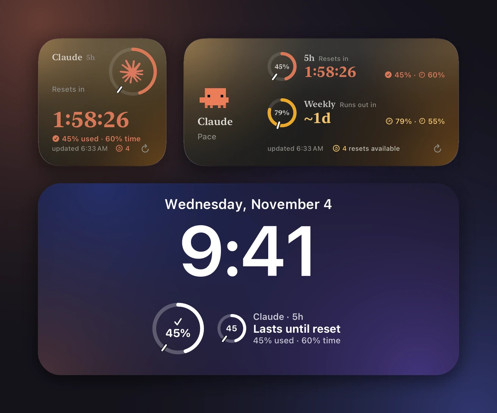
  

</Frame>

**表示される内容:** 今のスピードで使い続けた場合に、上限がリセットされる前に使い切ってしまうかどうか。

大きな数字の下の行は、2 つの値を比べています。

- **使用**: 上限のうち、どれだけ使ったか。
- **経過**: 期間のうち、どれだけの時間が過ぎたか。

例えば `使用45%・経過60%` です。使用が経過より少なければ問題ありません。ウィジェットには「リセットまで」と、リセットまでのカウントダウンが表示されます。

使用が経過より多ければ、使うスピードが速すぎます。ウィジェットには「使い切りまで」と、使い切るまでのカウントダウンが表示されます。前に `~` が付いているのは推定値という意味です。数字はアンバーに変わります。

ほかに、次の表示もあります。

- 「まだ判断できません」: 期間が始まった直後です。判断できるだけのデータがまだありません。
- 「上限に到達」: 期間の使用量が 100% に達したときです。カウントダウンはリセットまでの時間です。
- 「このプランでは消費ペースを表示できません」: 上限がいつリセットされるかを、プロバイダーが公開していない場合です。

サイズ:

| サイズ | 表示される内容 |
| --- | --- |
| 小 | 1 つの期間と、そのリング。 |
| 中 | 2 つの期間。通常は 5 時間の期間と週間の期間です。 |
| ロック画面（円形） | どれだけ使ったか。チェックマークは問題なしという意味です。使うスピードが速すぎるときは、使い切る時刻を表示します。 |
| ロック画面（長方形） | `リセットまで持つ`、または使い切る時刻（例: `~21:20に上限到達`）。 |

どのリングも、使った量に応じて埋まっていきます。小さな目盛りは、均等なペースで使った場合に今どこまで来ているはずかを示します。埋まった部分が目盛りの手前なら問題ありません。

**「使用済み」と「残り」:** Nomo消費ペースは「設定 → 使用量 → 使用量の表示」に従います。「残り」にすると、行は `残り55%・残り時間40%` と表示されます。リングは減っていく表示になり、埋まった部分が残りの量を、小さな目盛りが残り時間を示します。埋まった部分が目盛りを越えていれば問題ありません。どのサイズでも数字が切り替わります。

**事前に必要なもの:** Claude や Codex など、接続済みのアカウント。「プロバイダー」タブを開いてプロバイダーをタップし、接続してください。[使用量](/ja/usage)をご覧ください。

**設定方法:**

1. ウィジェットを追加します。[ウィジェット](/ja/widget)をご覧ください。
2. ウィジェットをタッチして押さえたままにします。
3. 「ウィジェットを編集」をタップします。
4. 「プロバイダー」をタップし、**Claude** などを 1 つ選びます。
5. 「アカウント」をタップし、1 つ選びます。「デフォルト」を選ぶと、アプリで設定したデフォルトのアカウントに従います。
6. 「期間」をタップし、1 つ選びます。「自動」は、プランに 5 時間の期間があればそれを、なければ週間の期間を使います。これによって小サイズとロック画面サイズの表示が変わります。
7. ウィジェットの外側をタップして終了します。

ウィジェットをタップすると、Nomo でそのプロバイダーの「使用量」ページが開きます。

### Nomoアクティビティ  {#nomo-activity}

<Frame caption="Nomoアクティビティの小、中、大のサイズ、そしてロック画面。">
  

    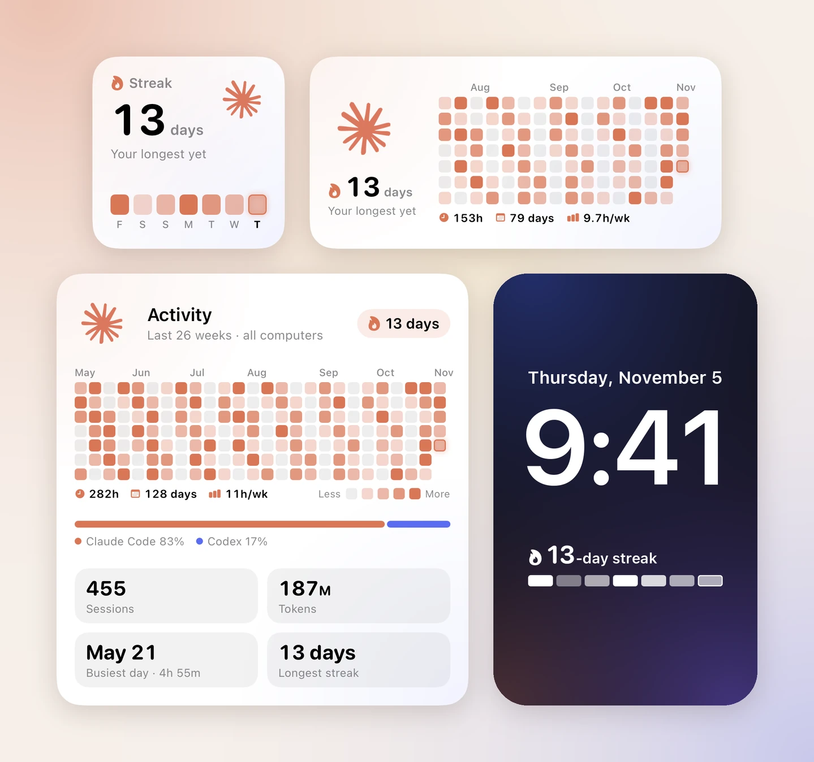
    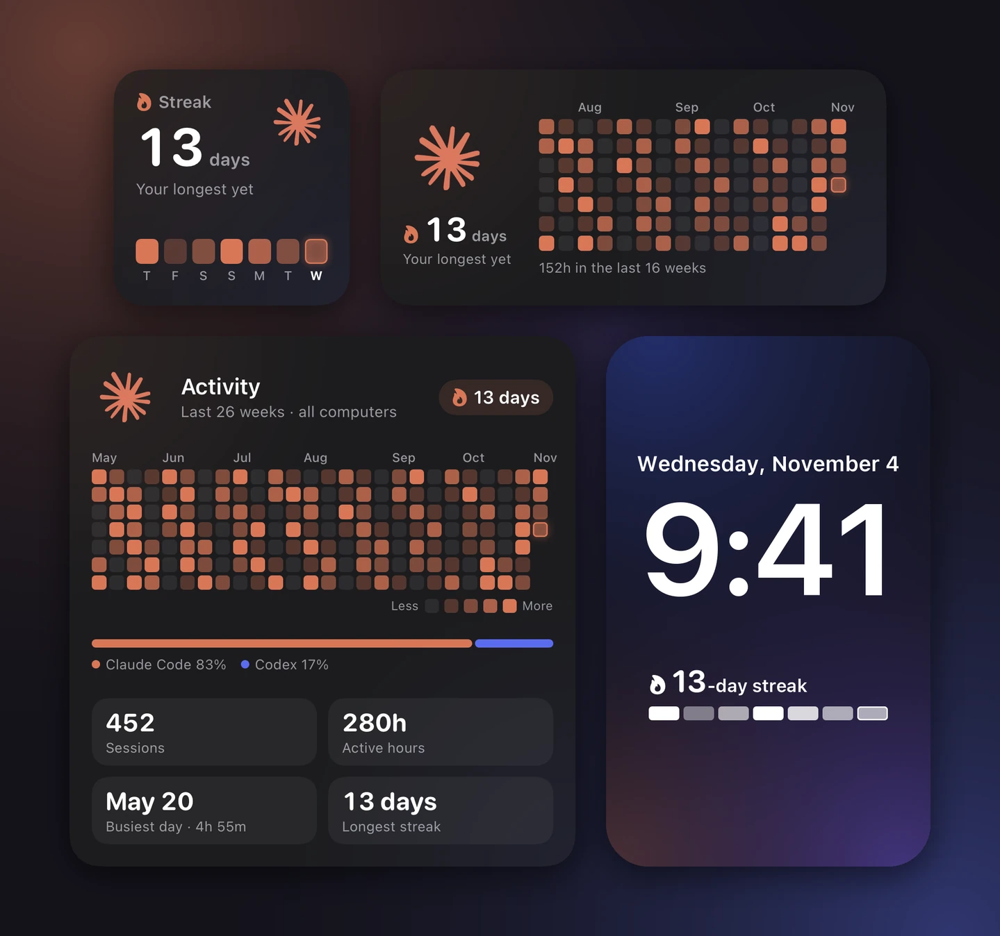
  

</Frame>

**表示される内容:** AI エージェントでコーディングした日のマップ（GitHub のプロフィールにあるものと同じような表示）と、連続記録。連続記録とは、コーディングが何日続いているかです。ペアリングしたすべてのコンピュータを合わせて数えます。[複数のコンピュータ](#more-than-one-computer)をご覧ください。

色が濃いほど、その日のコーディング量が多いことを示します。連続記録は朝にリセットされません。その日の最初のセッションまでは、前日までの日数を数えます。

| サイズ | 表示される内容 |
| --- | --- |
| 小 | 連続記録と直近 7 日。 |
| 中 | 連続記録、直近 16 週間、マップの下の 3 つの数値。 |
| 大 | 直近 26 週間と同じ 3 つの数値、エージェントごとの時間の割合、そして合計（セッション数、トークン、いちばん多くコーディングした日、最長の連続記録）。 |
| ロック画面（長方形） | 連続記録と直近 7 日。 |

マップの下の 3 つの数値は、マップに表示されている週の分です。

- 時計: アクティブな時間。
- カレンダー: アクティブだった日数。
- 棒グラフ: 1 週間あたりの平均。

中サイズで場所が足りないときは、最初の 2 つだけが表示されます。

大サイズの「トークン」は、26 週間の合計です。コンピュータからトークンのデータが届いていない場合は、代わりに「アクティブ時間」が表示されます。

**事前に必要なもの:**

- コンピュータに入れた Nomo プラグイン（バージョン **2.4.0** 以降）。[インストール](/ja/setup/install)と[更新](/ja/sessions/commands#update)をご覧ください。
- そのコンピュータを Nomo とペアリングしておくこと。[ペアリング](/ja/setup/pairing)をご覧ください。

Claude Code、Codex、OpenCode を数えます。プラグインがコンピュータにすでにある履歴を読み取るので、過去の日も表示されます。

Nomo 2.4.2 からは、Grok Bot もトークンと一緒に数えます。コンピュータは必要ありません。Nomo で、Grok Bot に使っているアカウントで **Cursor** を接続してください。Nomo は Cursor のサーバーから直接トークン数を読み取ります。その日に Grok Bot が少しでもトークンを使っていれば、その日を数えるので、スケジュールされたルーティンも数えます。あなた自身の Cursor の利用も、別の行「**Cursor**」に表示されます。手順は [Grok Bot での利用](/ja/sessions/grok-bot#streak)にまとめています。

**設定方法:**

1. ウィジェットを追加します。[ウィジェット](/ja/widget)をご覧ください。
2. ウィジェットをタッチして押さえたままにします。
3. 「ウィジェットを編集」をタップします。
4. 「キャラクター」をタップし、「自動」、**Clawd**、**Codex**、**Grok Bot**、**Antigravity**、**Kimi**、**DeepSeek**、**Cursor**、**OpenCode** から 1 つ選びます。
5. ウィジェットの外側をタップして終了します。

「自動」は、直近 7 日間でいちばん使ったエージェントを表示します。それ以外を選ぶと、そのキャラクターが表示され、マップ、今日のマス、連続記録の炎とバッジがそのキャラクターの色になります（Clawd はコーラル、Codex は青、Grok Bot はゴールド）。大サイズで、エージェントごとの時間の割合を示すバーは、各エージェントの色のままです。すでにホーム画面にあるウィジェットは「自動」から始まります。

<Frame caption="Clawd、Codex、Grok Bot の Nomoアクティビティ。">
  

    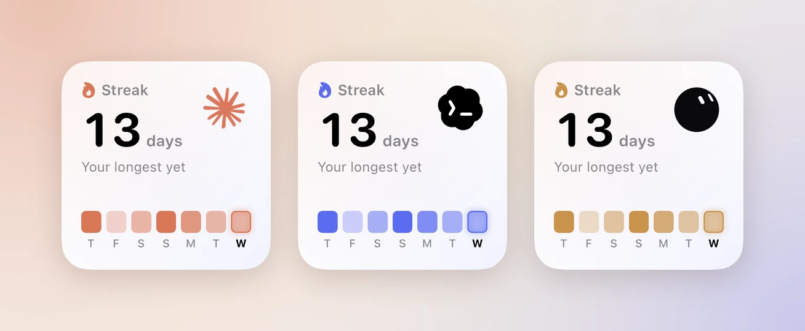
    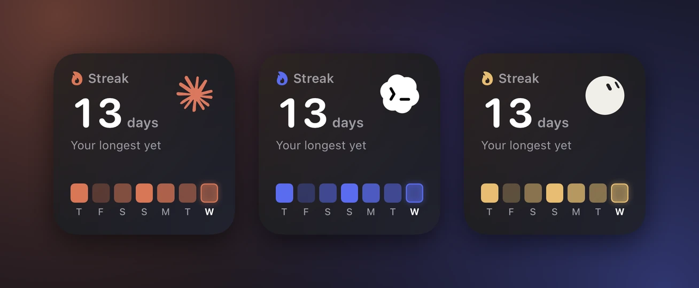
  

</Frame>

アニメーションするキャラクターは Clawd、Codex、Grok Bot だけです。Antigravity、Kimi、DeepSeek、Cursor、OpenCode では、ブランドカラーのタイルにロゴが表示され、マップ、炎、今日のマス、光がその色になります。

<Frame caption="Antigravity、DeepSeek、Kimi の Nomoアクティビティ。">
  

    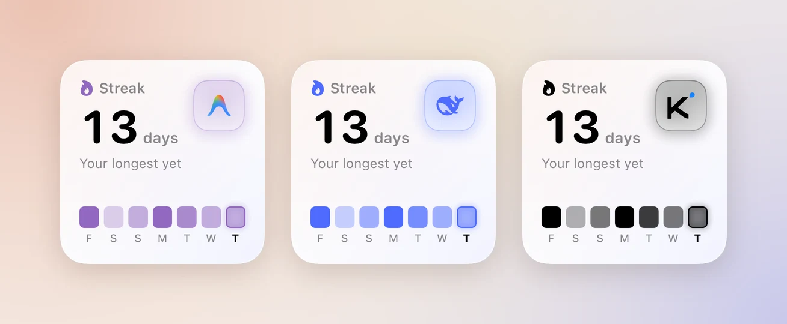
    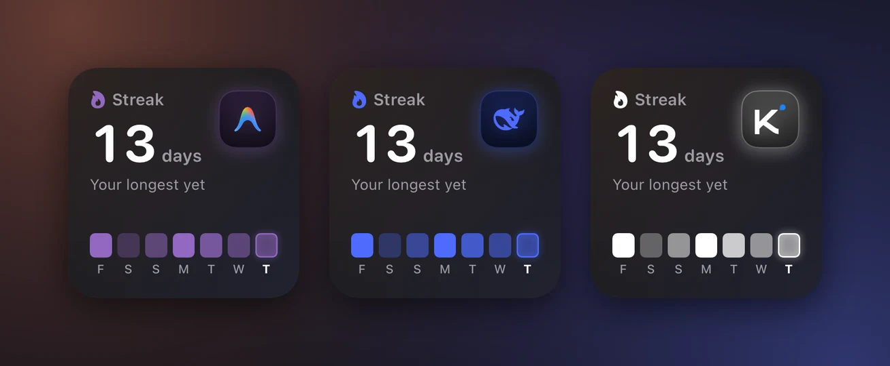
  

</Frame>

プラグインが新しい集計を送るのは、多くても 6 時間に 1 回と、プラグインを更新した直後に 1 回です。Nomo はアプリを開いたときにそれを取得します（多くても 1 時間に 1 回）。そのため、マップが数時間遅れていることがあります。[アクティビティ画面](#activity-screen)を開くと、最新の集計をすぐに取得します（多くても 30 秒に 1 回）。画面を下に引っ張って、もう一度取得することもできます。

ウィジェットをタップすると、Nomo の[アクティビティ画面](#activity-screen)が開きます。

このマップのためにコンピュータから送られるものは、[プライバシー](#privacy)に記載しています。送られるのは件数だけで、プロンプトやコードは決して送られません。

### Nomoトークン  {#nomo-tokens}

<Frame caption="Nomoトークンの中と大のサイズ。">
  

    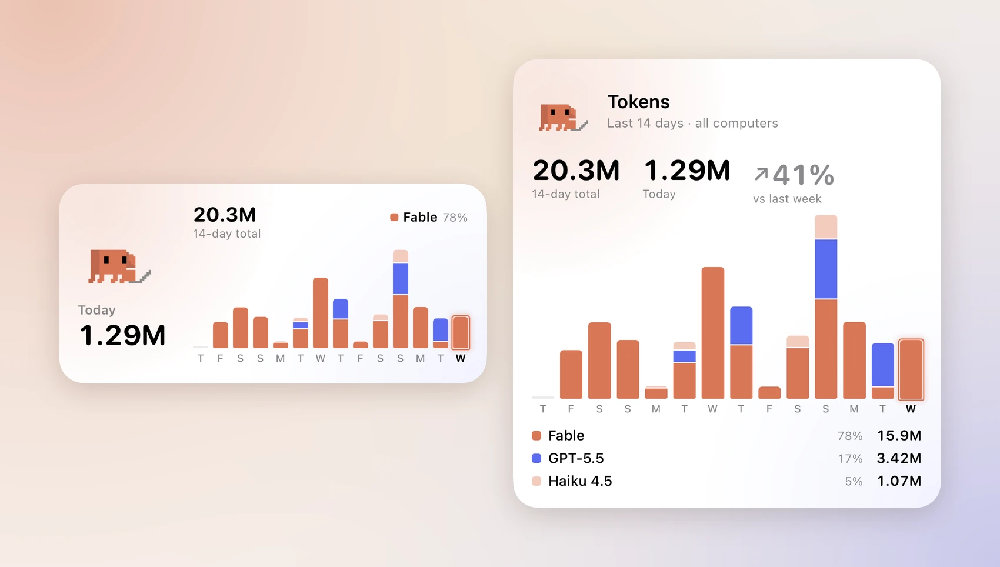
    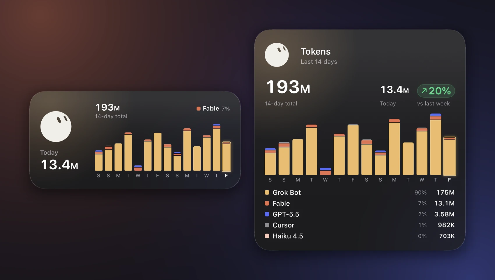
  

</Frame>

**表示される内容:** ペアリングしたすべてのコンピュータで、エージェントが直近 14 日間に毎日使ったトークンの量。日ごとのバーはモデル別に分かれています。

ここでのトークンは、入力 + 出力 + 推論です。キャッシュは数えません。同じコンテキストを読み直すものなので、ほかの数値をすべて覆い隠してしまうからです。キャッシュは[アクティビティ画面](#activity-screen)で別に表示されます。

| サイズ | 表示される内容 |
| --- | --- |
| 中 | 14 日間の合計、今日のトークン、いちばん使ったモデルとその割合。 |
| 大 | 中と同じ内容に加えて、先週比と上位 4 つのモデル。残りは `その他6個のモデル` のように 1 行にまとめられます。 |

どのモデルも、どこでも同じ色で表示されます。Claude のモデルはコーラル、GPT は青、Grok はゴールド、Gemini は紫、その他のモデルはグレーです。

**事前に必要なもの:** Nomoアクティビティと同じです。Nomo プラグインを入れてペアリングしたコンピュータか、Grok Bot の場合は Nomo で接続した Cursor が必要です。[Nomoアクティビティ](#nomo-activity)をご覧ください。

**設定方法:**

1. ウィジェットを追加します。[ウィジェット](/ja/widget)をご覧ください。
2. ウィジェットをタッチして押さえたままにします。
3. 「ウィジェットを編集」をタップします。
4. 「キャラクター」をタップし、1 つ選びます。選べるものは [Nomoアクティビティ](#nomo-activity) と同じです。
5. ウィジェットの外側をタップして終了します。

「自動」は、いちばん使ったモデルのプロバイダーに合わせます。Claude なら Clawd、GPT なら Codex、Grok なら Grok Bot、Gemini なら Antigravity、Kimi、DeepSeek、Cursor のモデルならそれぞれのロゴです。それ以外のモデルは Clawd です。選んだキャラクターで変わるのは、キャラクター、背景の光、今日のバーだけです。モデルの色は変わりません。

ウィジェットをタップすると、Nomo の[アクティビティ画面](#activity-screen)が開きます。Nomo Pro がない場合は、タップすると Nomo Pro の画面が開きます。

Nomoアクティビティと同じサマリーを使います。コンピュータから送られるものは、[プライバシー](#privacy)に記載しています。

### Nomoアカウント  {#nomo-accounts}

<Frame caption="Nomoアカウントの中と大のサイズ。">
  

    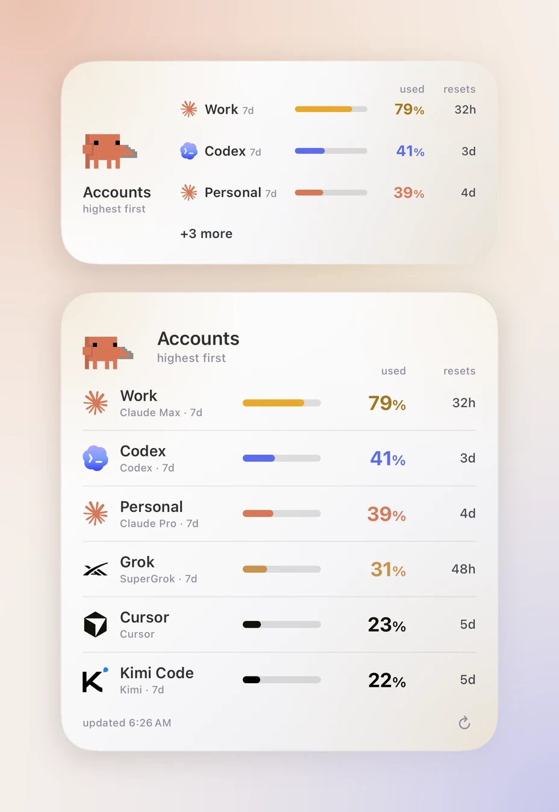
    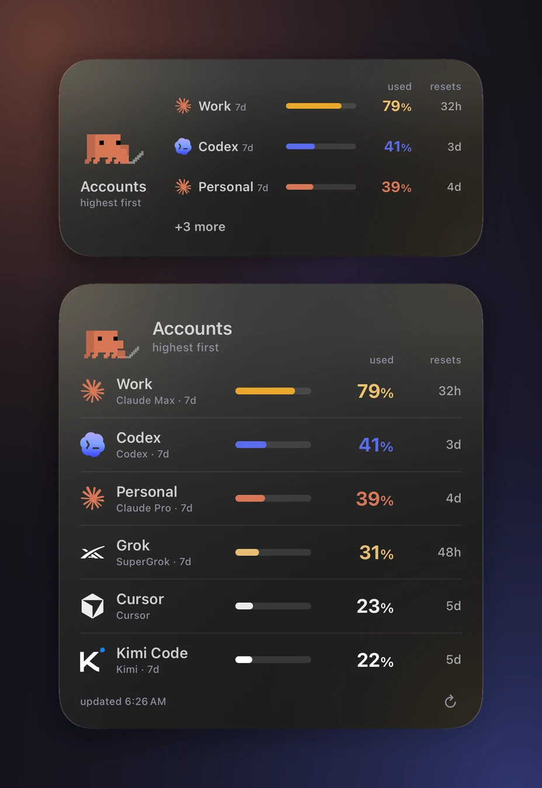
  

</Frame>

**表示される内容:** すべてのプロバイダーの、接続済みのアカウントすべてを 1 つのボードに。残りがいちばん少ないアカウントがいちばん上に来ます。

各行には、アカウント名、使い切るのにいちばん近い期間、使った量、リセットの時期が表示されます。

数字、バー、列の見出しは「設定 → 使用量 → 使用量の表示」に従います。「残り」にすると、残りの量を表示します。並び順は変わりません。

- **中**は 4 行、**大**は 8 行を表示します。
- アカウントがそれより多い場合、最後の行に残りの件数が `ほか3件` のように表示されます。
- サインインし直す必要があるアカウントは、ボードのいちばん下に「Nomoで再接続」と表示されたまま残ります。消えることはありません。

**事前に必要なもの:** 接続済みのアカウントが 1 つ以上。同じプロバイダーの 2 つのアカウントを追跡するには、[複数のアカウント](#more-than-one-account)をご覧ください。

**設定方法:** ウィジェットを追加します。[ウィジェット](/ja/widget)をご覧ください。「ウィジェットを編集」で選ぶものはありません。

ボードには、Nomo が最後に取得した数値が表示されます。大サイズでは、隅にある更新ボタンをタップすると、すべてのアカウントが更新されます。

アカウントの行をタップすると、Nomo でそのプロバイダーの「使用量」ページが開き、そのアカウントが表示されます。「Nomoで再接続」の行も同じです。それ以外の場所（`ほか3件` の行を含む）をタップすると、「プロバイダー」タブが開きます。Nomo Pro がない場合は、タップすると Nomo Pro の画面が開きます。

### ライブエージェント  {#live-agents}

<Frame caption="ライブエージェントの小と中のサイズ。紫色の行は回答を待っています。">
  

    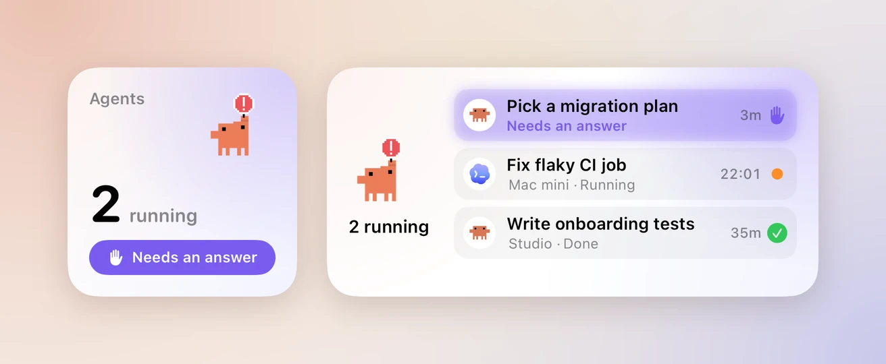
    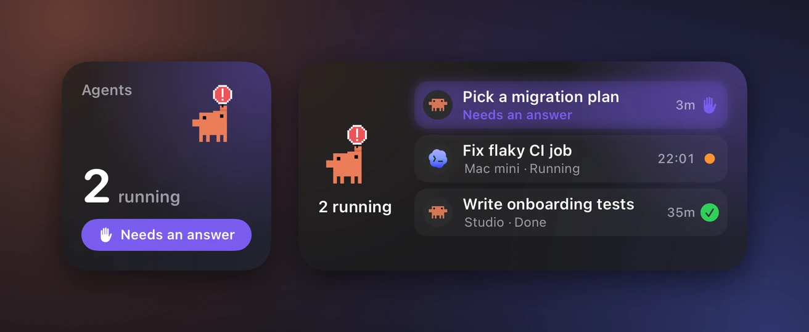
  

</Frame>

**表示される内容:** Claude Code、Codex、その他のエージェントの今のセッション。「セッション」タブと同じリストです。

**紫色は、回答を待っているセッションがあるという意味です。**

| アイコン | ラベル | 意味 |
| --- | --- | --- |
| 紫の手 | `許可が必要` | 操作の許可を求めています。iPhone から回答できます。 |
| 紫の手 | `回答が必要` | 質問をしています。iPhone から回答できます。 |
| オレンジの手 | `対応が必要` | 止まってあなたを待っていますが、iPhone から回答できることはありません。 |
| オレンジの点 | `実行中` | 作業中です。あなたがすることはありません。 |
| 緑のチェック | `完了` | 終了しました。 |

これは[「セッション」タブ](/ja/sessions/list#session-states)の表示と同じです。

- **小**は、実行中のセッションの数を表示します。対応が必要なセッションがあると、紫色のボタンでそれを知らせます。
- **中**は、最大 3 つのセッションを表示します。対応が必要なものが先に並びます。

ウィジェットには「許可」や「拒否」のボタンはありません。タップすると、Nomo で「セッション」が開きます。中サイズでは、セッションをタップするとそのセッションが開きます。

ウィジェットは、Nomo アプリのセッションリストをコピーしています。10 分間更新されていないと、アンバーの点と、最後に更新されてからの時間が表示されます。Nomo を開くと更新されます。

**事前に必要なもの:** Nomo プラグインを入れてペアリングしたコンピュータ。[インストール](/ja/setup/install)と[ペアリング](/ja/setup/pairing)をご覧ください。

**設定方法:**

1. ウィジェットを追加します。[ウィジェット](/ja/widget)をご覧ください。
2. ウィジェットをタッチして押さえたままにします。
3. 「ウィジェットを編集」をタップします。
4. 「キャラクター」をタップし、1 つ選びます。選べるものは [Nomoアクティビティ](#nomo-activity) と同じです。
5. ウィジェットの外側をタップして終了します。

「自動」は、リストのいちばん上のセッションに合わせて表示します。Antigravity、Cursor、OpenCode のセッションなら、そのロゴです。それ以外を選ぶと、そのキャラクターが表示され、背景にその色がうっすら付きます。ステータスの色は変わりません。紫色は、回答を待っているセッションがあるという意味のままです。すでにホーム画面にあるウィジェットは「自動」から始まります。

## アクティビティ画面とまとめ  {#activity-screen}

アクティビティ画面では、連続記録とトークンを詳しく確認できます。シェアできる「まとめ」カードも作れます。

<Frame caption="アクティビティ画面の上部: 連続記録、7 / 14 / 30 日間の切り替え、トークンのグラフ。">
  

    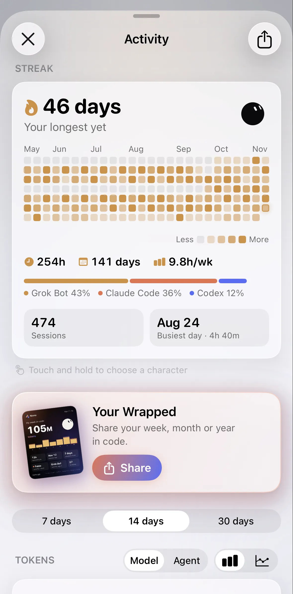
    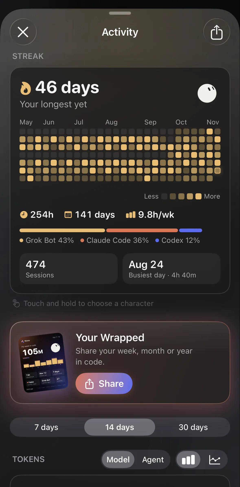
  

</Frame>

開くには:

1. Nomo を開きます。
2. 「セッション」タブをタップします。
3. タブバーのすぐ上にある[連続記録バー](#streak-bar)をタップします。iOS 26.0 以前では、代わりにリストのいちばん上にある「アクティビティ」カードをタップします。

Nomoアクティビティや Nomoトークンのウィジェットをタップしても開きます。Nomo を閉じていても開きます。Nomo は Nomo Pro の登録状況を確かめてから画面を開くので、登録している人が誤って Nomo Pro の画面に移動することはありません。

iOS 26.0 以前で Nomo Pro がない場合、カードには王冠、「アクティビティ」、「連続記録、毎日のトークン、まとめはNomo Proで。」と表示されます。タップすると Nomo Pro の画面が開きます。

画面に表示される内容:

- 「連続記録」: 連続記録と、直近 26 週間のマップ。マップの下には、[ウィジェット](#nomo-activity)と同じ 3 つの数値が表示されます。
- 「7日間」「14日間」「30日間」の切り替え。切り替えると、グラフが次の期間へ動いて変わります。
- 「トークン」: モデル別に積み上げた毎日のトークンのグラフと、「今日」「1日平均」「アクティブ時間」、前の期間との比較。
- 「モデル別」: モデルごとの「入力」「出力」「キャッシュ」「合計」の表。

画面を開くと、1 秒ほどのアニメーションで表示されます。「視差効果を減らす」をオンにしている場合は、すべてがそのまま表示されます。

画面のキャラクターと色は、「自動」にした [Nomoトークン](#nomo-tokens) と同じく、いちばん使ったモデルのプロバイダーに合わせます。連続記録バーも同じです。

### 連続記録バー  {#streak-bar}

iOS 26.1 以降では、「セッション」タブのタブバーのすぐ上に小さなバーが浮かんで表示されます。連続記録、今週のトークン、直近 7 日のミニグラフが表示されます。

- スクロールすると小さくなり、タブバーの横に移動します。
- タップするとアクティビティ画面が開きます。

次のように表示されることもあります。

| 表示 | 意味 | タップすると |
| --- | --- | --- |
| 「連続記録を始めましょう」 | まだコンピュータをペアリングしていません。 | 「コンピュータをペアリング」と同じペアリングの手順が開きます。 |
| 「まだセッションがありません」 | コンピュータはペアリング済みですが、まだセッションが届いていません。 | アクティビティ画面が開きます。 |
| 「Nomoプラグインを更新」 | ペアリングしたどのコンピュータも、Nomo プラグインが 2.4.0 より古いバージョンです。 | 更新の手順が開きます。 |

バーが小さくなっているときは、「コンピュータをペアリング」「まだセッションがありません」「プラグインを更新」と表示されます。

このバーを使うには Nomo Pro が必要です。Nomo Pro がない場合、バーは表示されません。

Nomo の新しいバージョンが出ると、この場所にはアップデートのバーが表示されます。Nomo をアップデートするか、アップデートのバーの **×** をタップすると、連続記録バーが戻ります。

iOS 26.0 以前ではバーはありません。代わりに、連続記録のカードが「セッション」リストのいちばん上に表示されます。

### まとめ {#wrapped}

「まとめ」は、1 週間、1 か月、1 年を、シェアできる 1 枚の画像にします。

1. アクティビティ画面のいちばん下までスクロールします。
2. 「あなたのまとめ」をタップします。
3. 「週」（直近 7 日間）、「月」（直近 30 日間）、「年」（今年）のどれかをタップします。
4. 「共有」をタップし、送り先を選びます。

<Frame caption="1 週間のまとめカード。iPhone の外観モードに関係なく、常にダークです。">
  

    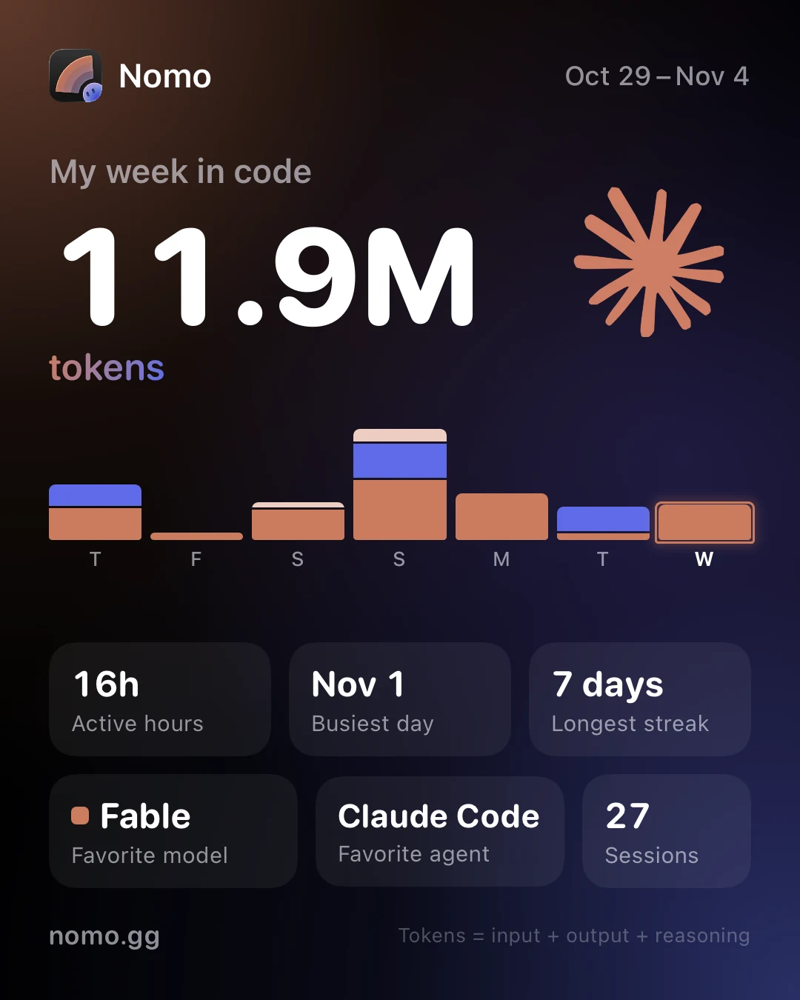
  

</Frame>

カードには、トークン、グラフ、アクティブ時間、最も多くコーディングした日、最長の連続記録、よく使うモデルとエージェント、セッション数が表示されます。キャラクターは、よく使うモデルのプロバイダーか、よく使うエージェントに合わせます。「共有」で 1080 × 1350 の画像として送れます。プロンプト、プロジェクト名、ファイルパスが含まれることはありません。

## 複数のコンピュータ {#more-than-one-computer}

Nomoアクティビティ、Nomoトークン、アクティビティ画面、まとめ、連続記録バーは、ペアリングしたすべてのコンピュータを合算します。

- アクティブな時間は 1 回だけ数えます。2 台の Mac で同時にコーディングしても、その時間が 2 回数えられることはありません。
- トークンとセッション数は合算されます。
- 2 回ペアリングされた Mac は、1 台として数えます。
- コンピュータを削除すると、そのアクティビティは合計から外れます。

### 集計されないコンピュータ {#not-counted}

Nomo プラグインが 2.4.0 より古いコンピュータは集計されません。次のように表示されます。

- アクティビティ画面の連続記録の下: 「MacBook Airは集計されていません · プラグインを更新してください」のように、そのコンピュータの名前が入ります。2 台以上ある場合は、「2台のコンピュータが集計されていません · プラグインを更新してください」のように台数が表示されます。タップすると更新の方法が表示されます。
- 大サイズの Nomoアクティビティウィジェット: 「1台のコンピュータが未集計」。いちばん小さい iPhone では、表示する場所がありません。

解決するには、そのコンピュータの Nomo プラグインを更新します。[更新](/ja/sessions/commands#update)をご覧ください。

## 複数のアカウント  {#more-than-one-account}

Nomo Pro では、プロバイダーごとに最大 5 つのアカウントを追加できます。例えば、仕事用の Claude アカウントと個人用のアカウントです。Nomo消費ペース、Nomo使用量、Nomoアカウントのどれでも使えます。

ほかのアカウントを選ばない限り、ウィジェットには「デフォルト」のアカウントが表示されます。選ぶには、ウィジェットをタッチして押さえたままにし、「ウィジェットを編集」をタップしてから「アカウント」をタップします。Nomoアカウントでは、すべてのアカウントがそれぞれ表示されます。

アカウントを削除すると、そのアカウントを表示していたウィジェットには「削除されたアカウント」と表示されます。デフォルトのアカウントには切り替わりません。ウィジェットを編集して、別のアカウントを選んでください。

Nomo Pro が終了すると、追加のアカウントは一時停止されます。削除されるものはなく、デフォルトのアカウントは引き続き更新されます。追加のアカウントに設定した Nomo使用量ウィジェットには、「一時停止中 · Nomo Pro」と `Nomo Proが終了しました。Nomoで再登録すると、このアカウントを表示できます。` が表示されます。タップすると Nomo Pro の画面が開きます。デフォルトのアカウントを表示しているウィジェットが一時停止されることはありません。

アカウントの追加、名前の変更、削除については、使用量ページの[複数のアカウント](/ja/usage#more-than-one-account)をご覧ください。

## デモモードで試す {#try-it-with-demo-mode}

デモモードでは、ウィジェットにサンプルデータが入ります。何も接続しないうちから、ウィジェットの見た目を確かめられます。

1. Nomo を開きます。
2. 「設定」タブをタップします。
3. 「デモモード」までスクロールします。
4. 「サンプルデータを表示」をオンにします。

すると、Nomo消費ペース、Nomoアクティビティ、Nomoトークン、ライブエージェントに、自分のデータではなくサンプルデータが表示されます。デモモードでは常にサンプルデータが表示されます。唯一の例外として、コンピュータをペアリングすると、ライブエージェントには実際のセッションが表示されます。
Nomoアカウントには実際に追加したアカウントしか表示されないため、アカウントを追加するまでは空のままです。

Nomo Pro がない場合も、デモモードで Pro ウィジェットのロックが解除されます。ただし、ペアリングしたコンピュータが 1 台もないあいだだけです。

実際のデータに戻すには、「サンプルデータを表示」をオフにします。

## プライバシー {#privacy}

**Nomoアクティビティ**

- コンピュータから送られるもの: 1 日ごと、エージェントごとの、セッション数、プロンプト数、その日のどの 5 分枠にアクティビティがあったか、モデルごとのトークン数の合計。
- 決して送られないもの: プロンプト、エージェントの返答、プロジェクト名、ファイルパス。
- アップロードの前にエンドツーエンド暗号化（AES-256-GCM、ペアリングの鍵を使用）されます。Nomo の中継サーバーは内容を読めず、**35 日**後に削除します。
- ランダムなコンピュータ ID も含まれます。プラグインがコンピュータ上で一度だけ作り、`~/.config/cc-status/machine-id` に保存します。シリアル番号、MAC アドレス、コンピュータ名、ユーザー名など、ハードウェアの情報から作られることはありません。ほかの内容と同じくエンドツーエンド暗号化されます。Nomo がこれを使うのは、iPhone が同じコンピュータを 2 回数えないようにするためだけです。新しい ID にするには、このファイルを削除します。
- アップロードは多くても 6 時間に 1 回で、何か変化があったときだけです。reset コマンドを実行すると、すぐにアップロードされます。変化がない場合も、中継サーバーで削除されないよう、週に 1 回同じ概要を送り直します。新しい iPhone とペアリングした直後は、1 分ほどで一度アップロードされます。
- コンピュータでは `~/.config/cc-status/activity-days.json` に保存されます。読めるのはあなたのユーザーアカウントだけです。保存されるのは最大 400 日分です。

**Grok Bot と Cursor**

- Nomo が読み取るのは、Nomo で接続した Cursor のアカウントの、1 時間ごとのトークン数だけです。メッセージやコードは読み取りません。
- 数値は Cursor のサーバーから直接 iPhone に届きます。どこにもアップロードされません。

**Nomoトークンとアクティビティ画面**

- Nomoアクティビティと同じアクティビティのサマリーを使うので、上記の内容がそのまま当てはまります。

**まとめ**

- 共有で送られるのは、カードに表示されている画像だけです。

**ライブエージェント**

- ウィジェットは、アプリが iPhone に保存したセッションのスナップショットを読み取ります。スナップショットは iPhone にとどまり、どこにも送信されません。

**複数のアカウント**

- ログイン情報は iPhone のキーチェーンに保存されます。
- サインインには新しいプライベートなブラウザページを使うので、Safari のログインが使い回されることはありません。

**限界**

- 中継サーバーからは、アップロードがあったこと、そのサイズ、日時が見えます。
- ロックを解除したあなたの iPhone を持っている人は、誰でもあなたのアクティビティを見ることができます。

全体像については、[プラグインの README](https://github.com/KarrixLee/nomo#readme) にあるセキュリティの説明をご覧ください。
