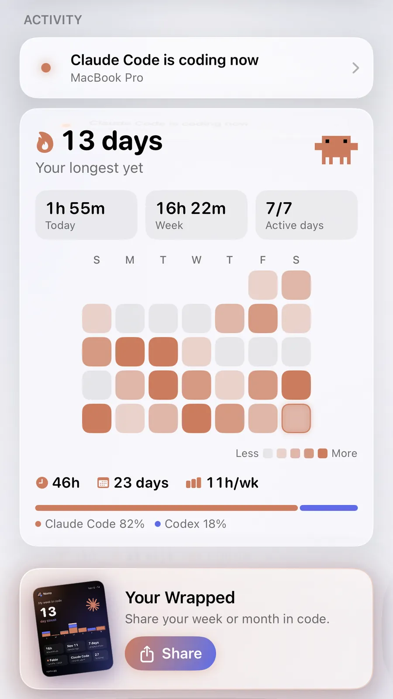
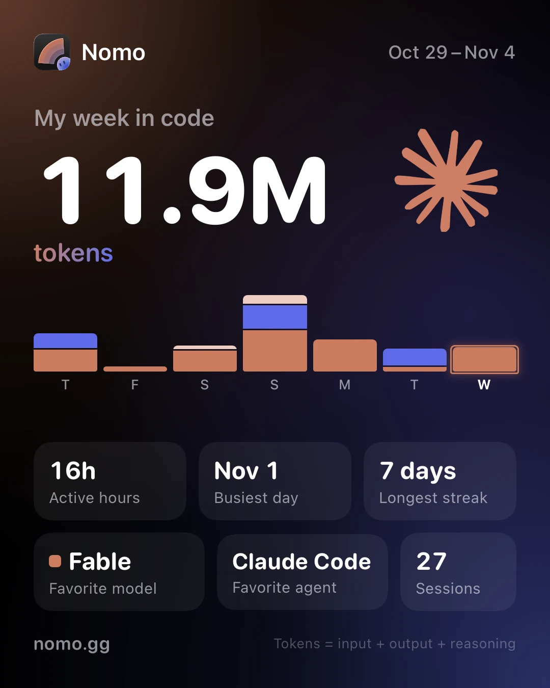
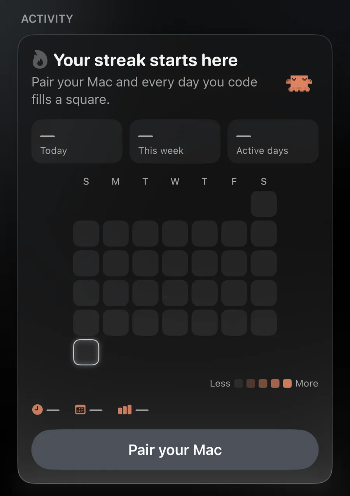

활동에는 AI 에이전트로 얼마나 코딩했는지가 표시됩니다. Nomo의 **홈** 탭에
있습니다.

아직 설정하지 않았나요? [플러그인을 설치](/ko/setup/install)한 뒤
[컴퓨터를 페어링](/ko/setup/pairing)하십시오. 코딩할수록 활동이 채워집니다.

<Frame caption="홈의 활동: 지금 코딩 중인 에이전트, 연속 기록, 최근 30일 달력, 나의 결산.">
  

    
    
  

</Frame>

## 여는 방법 {#open-it}

1. Nomo를 엽니다.
2. **홈** 탭을 탭합니다.
3. **활동**까지 스크롤합니다.

Nomo 활동이나 Nomo 토큰 위젯을 탭해도 됩니다. Nomo의 **홈**이 활동 위치에서
열립니다. [Pro 위젯](/ko/widgets#nomo-activity)을 참고하십시오.

최신 활동을 가져오려면 **홈**에서 아래로 당깁니다.

## 표시 내용 {#what-it-shows}

- **코딩 중**: 에이전트가 실행되는 동안 맨 위의 줄에 표시됩니다. 예:
  **Claude Code 코딩 중**과 컴퓨터 이름.
- **연속 기록**: 에이전트로 며칠 연속 코딩했는지.
- **오늘**, **이번 주**, **활동 일수**: 오늘과 이번 주의 코딩 시간, 그리고
  이번 주에 코딩한 날 수.
- **달력**: 최근 30일을 하루 한 칸으로 보여 줍니다. 색이 진할수록 그날 더 많이
  코딩했다는 뜻입니다. Nomo Pro에서는 최근 26주를 보여 줍니다.
- **합계**: 활동 시간, 활동한 날 수, 주당 시간.
- **에이전트**: 에이전트별 시간 비율. 예: `Claude Code 82%`, `Codex 18%`.

모든 에이전트가 집계됩니다. 활동은 페어링한 모든 컴퓨터를 합산합니다.
[여러 컴퓨터](/ko/widgets#more-than-one-computer)를 참고하십시오.

연속 기록은 아침에 초기화되지 않습니다. 그날 첫 세션 전까지는 어제까지를
셉니다.

## 캐릭터 선택 {#character}

연속 기록 카드에는 움직이는 캐릭터가 있습니다. 가장 많이 쓰는 에이전트를
따라갑니다. 다른 캐릭터를 고르려면:

1. 연속 기록 카드를 길게 터치합니다.
2. 카드가 뒤집히며 **캐릭터**가 나타납니다.
3. **Clawd**, **Codex**, **Grok Bot** 같은 캐릭터를 탭합니다. 가장 많이 쓰는
   에이전트를 다시 따라가려면 **자동**을 탭합니다.

카드는 저절로 돌아옵니다. 바꾸지 않고 돌아가려면 **×**를 탭합니다.

고른 캐릭터에 따라 활동의 색도 바뀝니다. 위젯은 **위젯 편집**에 있는 자체
**캐릭터** 옵션을 따릅니다.

## 나의 결산 {#wrapped}

나의 결산은 한 주나 한 달을 공유할 수 있는 이미지 한 장으로 만들어 줍니다.

1. **홈**에서 연속 기록 바로 아래의 **나의 결산**까지 스크롤합니다.
2. **공유**를 탭합니다.
3. **주**(최근 7일)나 **월**(최근 30일)을 탭합니다.
4. 스타일을 고릅니다: 막대, 선, 히트맵.
5. **공유**를 탭하고 보낼 곳을 고릅니다.

**게시물**이나 **스토리**로 공유할 수 있습니다. 큰 숫자는 연속 기록이나 코딩
시간입니다.

Nomo Pro에서는 **년**(올해 지금까지)도 고를 수 있고, 큰 숫자로 토큰을 보여 줄
수도 있습니다.

<Frame caption="한 주의 결산 카드. iPhone의 화면 모드와 상관없이 항상 어둡습니다.">
  

    
  

</Frame>

결산에는 프롬프트, 프로젝트 이름, 파일 경로가 절대 들어가지 않습니다.

## 토큰  {#tokens-chart}

Nomo Pro에서는 활동에 토큰도 표시됩니다. 달력은 최근 26주를 보여 주고, 나의
결산 카드에 **년**이 추가됩니다.

<Frame caption="Nomo Pro의 활동: 26주 지도, 년을 고를 수 있는 나의 결산, 7 / 14 / 30일 전환.">
  

    
    
  

</Frame>

나의 결산 아래에서:

1. **7일**, **14일**, **30일** 중 하나를 탭해 기간을 고릅니다.
2. **토큰** 옆에서 **모델**이나 **에이전트**를 탭해 하루를 모델별 또는
   에이전트별로 나눕니다.
3. 선 아이콘을 탭하면 선 차트, 막대 아이콘을 탭하면 막대 차트가 됩니다.
   처음에는 선 차트로 표시됩니다.

<Frame caption="에이전트와 선을 고른 토큰 차트: 에이전트마다 선 하나.">
  

    
    
  

</Frame>

카드에는 합계, **오늘**, **일 평균**, **활동 시간**, 이전 기간 대비 변화가
표시됩니다. 모델별로 보면 차트는 상위 5개 모델을 보여 줍니다. 나머지는
**기타**로 합칩니다.

여기서 토큰은 입력 + 출력 + 추론입니다. 캐시는 세지 않습니다. 같은 컨텍스트를
다시 읽는 것이라 다른 수치를 모두 덮어버리기 때문입니다. 차트 아래의
**모델별** 표에는 모델마다 **입력**, **출력**, **캐시**, **합계**가
표시됩니다.

고른 설정은 Nomo가 다음을 위해 기억합니다.

### 차트 필터 {#tokens-filter}

모델이나 에이전트를 숨기려면 차트 아래의 이름을 탭합니다. 다시 탭하면
보입니다. 차트 위의 숫자는 여전히 모두 셉니다.

목록에서 고를 수도 있습니다:

1. 토큰 카드를 길게 터치합니다.
2. 카드가 뒤집히며 **필터**가 나타납니다.
3. 타일을 탭해 숨기거나 보이게 합니다. 체크 표시는 보이는 상태라는 뜻입니다.
4. 모두 다시 보이게 하려면 **모두 보기**를 탭합니다.
5. 돌아가려면 **×**를 탭합니다.

마지막 하나는 숨길 수 없습니다. 자물쇠가 표시됩니다.

## 개인정보 보호 {#privacy}

활동은 날짜, 활동 시간, 세션 수, 토큰 수 같은 숫자만 사용합니다. 프롬프트,
코드, 프로젝트 이름, 파일 경로는 절대 사용하지 않습니다. 전체 목록은 위젯
페이지의 [개인정보 보호](/ko/widgets#privacy)에 있습니다.

## 설정 {#set-up}

컴퓨터를 페어링하기 전에는 활동에 빈 카드가 표시됩니다. 카드의
**Mac 페어링**을 탭해 시작하십시오.

<Frame caption="페어링 전의 활동: 빈 달력과 Mac 페어링.">
  

    
    
  

</Frame>

두 단계면 됩니다. 둘 다 무료입니다.

<CardGroup cols={2}>
  <Card title="1. 플러그인 설치" href="/ko/setup/install" icon="download">
    컴퓨터의 Claude Code, Codex 또는 다른 에이전트에 Nomo를 추가합니다.
  </Card>
  <Card title="2. 컴퓨터 페어링" href="/ko/setup/pairing" icon="qrcode-read">
    Nomo로 QR 코드를 스캔합니다. 코딩할수록 활동이 채워집니다.
  </Card>
</CardGroup>
