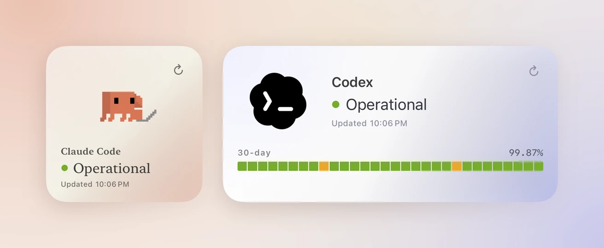
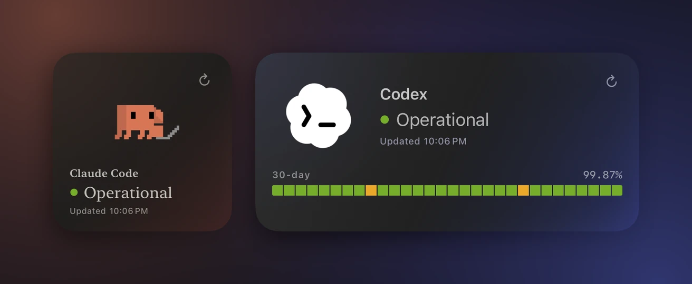
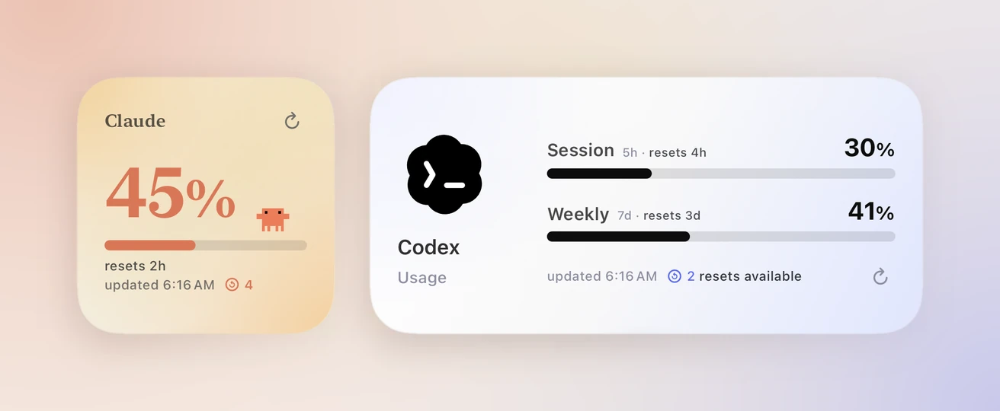
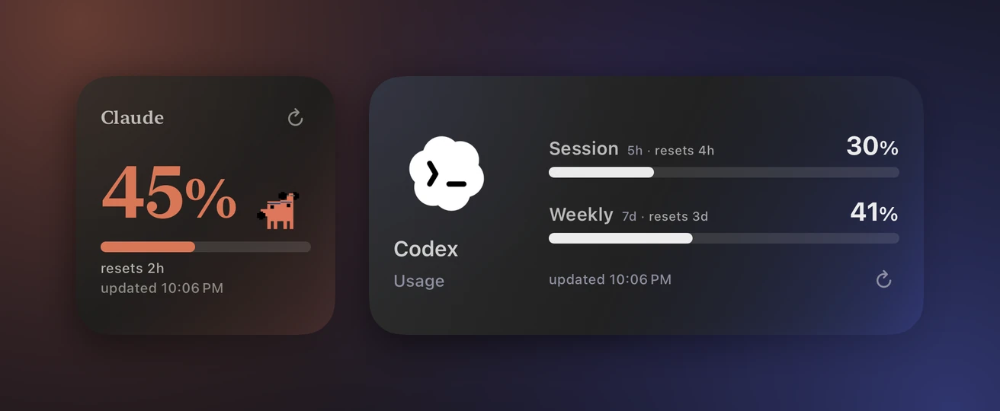

Nomo에는 iPhone용 위젯이 7개 있습니다. 그중 2개는 무료입니다. 상태를 보여 주는
**Nomo**와 **Nomo 사용량**입니다. 이 페이지에서는 이 두 위젯을 다룹니다. 나머지
5개는 Nomo Pro에 포함됩니다. [Pro 위젯](/ko/widgets)을 참고하십시오.

홈 화면에 위젯을 놓으려면 [위젯](/ko/widget)을 참고하십시오.

## 무료와 Pro {#free-and-pro}

| | 무료 | Nomo Pro  |
| --- | --- | --- |
| **Nomo** 상태 위젯 | ✓ | ✓ |
| **Nomo 사용량** 위젯 | ✓ | ✓ |
| [Nomo 사용 속도](/ko/widgets#nomo-pace), [Nomo 활동](/ko/widgets#nomo-activity), [Nomo 계정](/ko/widgets#nomo-accounts), [실시간 에이전트](/ko/widgets#live-agents), [Nomo 토큰](/ko/widgets#nomo-tokens) | | ✓ |
| [제공업체당 둘 이상의 계정](/ko/widgets#more-than-one-account) | | ✓ |

## Nomo 상태 {#nomo-status}

<Frame caption="소형과 중형의 Nomo 상태.">
  

    
    
  

</Frame>

위젯 갤러리에서 이 위젯의 이름은 **Nomo**입니다.

**보여주는 내용:** Claude Code나 Codex 같은 서비스 하나가 지금 정상인지.
다음 중 하나가 표시됩니다.

- `정상`
- `성능 저하`
- `부분 장애`
- `심각한 장애`
- `점검 중`

상태를 가져올 수 없으면 `확인 불가`가 표시됩니다.

| 크기 | 표시 내용 |
| --- | --- |
| 소형 | 서비스, 그 상태, 마지막으로 업데이트된 시각. |
| 중형 | 같은 내용에 더해 최근 30일 막대와 가동률. |

**먼저 필요한 것:** 없습니다. 계정도 로그인도 필요 없습니다.

**설정하기:**

1. 위젯을 추가합니다. [위젯](/ko/widget)을 참고하십시오.
2. 위젯을 길게 터치합니다.
3. **위젯 편집**을 탭합니다.
4. **제공업체**를 탭하고 Claude, OpenAI, Cursor, xAI, Antigravity, Kimi,
   DeepSeek 중 하나를 고릅니다.
5. **서비스**를 탭하고 **Claude Code** 같은 서비스를 하나 고릅니다.
6. 위젯 바깥을 탭해 마칩니다.

바로 업데이트하려면 모서리의 새로 고침 버튼을 탭합니다. 다른 곳을 탭하면
Nomo에서 해당 제공업체의 **상태** 페이지가 열립니다.

자세한 내용은 [상태](/ko/status)를 참고하십시오.

## Nomo 사용량 {#nomo-usage}

<Frame caption="소형과 중형의 Nomo 사용량.">
  

    
    
  

</Frame>

**보여주는 내용:** 계정 하나의 요금제 한도를 얼마나 썼는지, 그리고 언제
재설정되는지.

| 크기 | 표시 내용 |
| --- | --- |
| 소형 | 기간 하나: 큰 퍼센트, 막대, 재설정까지 남은 시간. |
| 중형 | 기간 두 개. 보통 **세션**(5시간)과 **주간**이며, 각각 막대와 재설정까지 남은 시간이 표시됩니다. |

막대는 70%에서 호박색, 90%에서 빨간색으로 바뀝니다. 요금제에 5시간 한도가
없으면 대신 `세션 한도 없음`이 표시됩니다.

Claude나 Codex 재설정이 있으면 중형에서는 업데이트 시간 옆에 개수가
표시됩니다. 소형에서는 재설정 기호와 숫자만 표시됩니다.
[사용 가능한 재설정](/ko/usage#available-resets)을 참고하십시오.

**먼저 필요한 것:** Claude나 Codex 같은 연결된 계정. **제공업체** 탭을 열고
제공업체를 탭해 연결합니다. [사용량](/ko/usage)을 참고하십시오. 연결하기
전에는 `연결되지 않음`이 표시됩니다.

**설정하기:**

1. 위젯을 추가합니다. [위젯](/ko/widget)을 참고하십시오.
2. 위젯을 길게 터치합니다.
3. **위젯 편집**을 탭합니다.
4. **제공업체**를 탭하고 **Codex** 등 하나를 고릅니다.
5. **계정**을 탭하고 하나를 고릅니다. **기본**은 앱의 기본 계정을 따릅니다.
6. **작은 위젯 스타일**을 탭하고 하나를 고릅니다. **큰 퍼센트**는 숫자를 크게
   보여줍니다. **큰 애니메이션**은 움직이는 아이콘을 크게 보여줍니다.
7. **작은 위젯 표시 항목**을 탭하고 소형에 보여줄 기간을 고릅니다. **자동**은
   알아서 고릅니다. 고를 수 있는 항목은 제공업체마다 다릅니다.
8. 위젯 바깥을 탭해 마칩니다.

Cursor에는 옵션이 하나 더 있습니다. **Cursor 아이콘**에서 **Grok Bot**이나
**Cursor 로고**를 고릅니다.

바로 업데이트하려면 모서리의 새로 고침 버튼을 탭합니다. 다른 곳을 탭하면
Nomo에서 해당 제공업체의 **사용량** 페이지가 열립니다.
