Google Antigravity 세션을 iPhone의 잠금 화면과 Dynamic Island에서 볼 수
있습니다. Antigravity가 명령을 실행하거나 파일을 바꾸려 하면, 휴대폰이
**허용**할지 **거부**할지 물어봅니다. 휴대폰에서 세션을 중단하거나 메시지를 보낼 수도 있습니다.

Antigravity 데스크톱 앱과 `agy` 명령줄 도구 모두에서 동작합니다.

<Note>
  세션은 Nomo Pro에 포함됩니다. 휴대폰에는 Nomo **2.3.5** 이상, Mac에는
  플러그인 **2.3.5** 이상이 필요합니다.
</Note>

## 동일하게 동작하는 것 {#what-works-the-same}

세션, 폴더, [Dynamic Island](/ko/sessions/island)는 다른 에이전트와 똑같이
동작합니다. 공통된 내용은 모두 한곳에 정리되어 있습니다.

- **설치** → [설치](/ko/setup/install)의 **Antigravity** 탭. 설치 한 번으로
  데스크톱 앱과 `agy`가 모두 처리됩니다.
- **페어링** → [페어링](/ko/setup/pairing). 페어링 한 번이 컴퓨터의 모든
  에이전트에 적용됩니다.
- **명령, 업데이트, 제거** → [명령](/ko/sessions/commands)의
  [update](/ko/sessions/commands#update)와
  [uninstall](/ko/sessions/commands#uninstall).
- **권한 요청에 답하기** → [휴대폰에서 답변하기](/ko/sessions/approvals).
- **에이전트별로 할 수 있는 일** → [할 수 있는 일](/ko/sessions/features).
- **문제가 생겼을 때** → [문제 해결](/ko/sessions/troubleshooting).

## Nomo 명령 실행 전 확인 {#commands}

Antigravity는 Nomo 명령을 실행하기 전에 먼저 묻습니다. **Allow**를
선택하십시오. 이 명령들은 Antigravity 안에서만 확인을 받습니다. 휴대폰에 카드를
보내지 않습니다.

`/nomo-status`는 쉬운 말로 짧게 요약해 보여 줍니다. 모든 것이 정상이면 다음과
같은 한 줄을 보여 줍니다.

```
✅ Connected to your phone as “MacBook Pro” · Phone approvals: on · Last activity: 2 min ago
```

문제가 있으면 무엇을 해야 하는지 알려 주는 줄이 추가됩니다.
`/nomo-status verbose`는 자세한 내용까지 모두 보여 줍니다.

Antigravity가 명령을 알지 못한다면
[터미널에서](/ko/sessions/commands#without-slash-commands) 실행하십시오.

## 표시되는 것 {#what-you-see}

- 세션은 채팅을 열 때가 아니라 **첫 메시지**를 보낼 때 나타납니다.
- 이름은 Antigravity가 붙인 채팅 제목입니다. Antigravity가 제목을 만들기
  전까지는 첫 메시지가, 그것도 없으면 폴더 이름이 표시됩니다.
- 배지에는 Antigravity가 사용하는 모델이 표시됩니다.

## 휴대폰에서 답변하기 {#answering-from-your-phone}

Antigravity가 **명령을 실행**하거나 **파일을 만들거나 바꾸려** 하면 휴대폰이
물어봅니다. 파일 읽기와 검색은 휴대폰에 오지 않습니다.

세션을 길게 터치하거나 Dynamic Island를 사용해 다음 중 하나를 선택합니다.


<Frame caption="명령 실행을 요청하는 Antigravity 세션.">
  <div className="device-frame">
    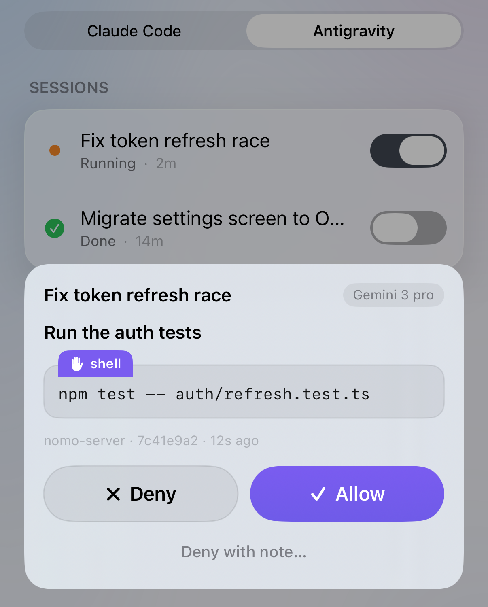
    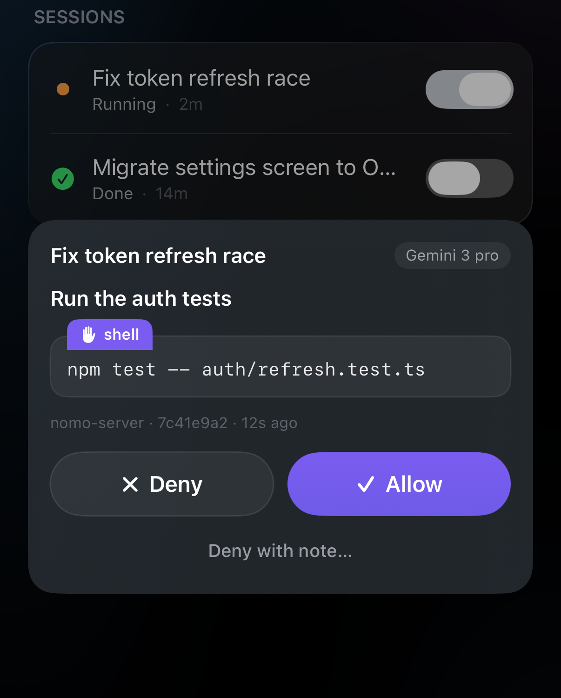
  </div>
</Frame>

- **허용** — Antigravity가 그대로 진행합니다.
- **거부** — Antigravity가 그 작업을 건너뛰고 계속합니다.
- **메모와 함께 거부…** — 건너뛰면서, 그 이유를 직접 쓴 말로 Antigravity에
  전달합니다.

자세한 내용은 [휴대폰에서 답변하기](/ko/sessions/approvals)에 있습니다.

알아 두면 좋은 것:

- **Antigravity 자체 규칙이 먼저입니다.** 규칙이 막는 것은 계속 막힙니다 —
  휴대폰에서 **허용**을 탭해도 뒤집을 수 없습니다. `agy`에서는 규칙이 이미
  허용하는 명령이 휴대폰에 묻지 않고 실행됩니다.
- **데스크톱 앱에서는 모든 것이 휴대폰에 옵니다.** Nomo는 데스크톱 앱의 권한
  설정을 볼 수 없으므로, 모든 명령과 파일 변경이 휴대폰에 옵니다.
- **컴퓨터에서 채팅을 멈췄나요?** 휴대폰의 카드는 저절로 사라집니다.
- **기다리는 동안 터미널에는 아무것도 표시되지 않습니다.** 요청이 휴대폰의
  답을 기다리는 동안 터미널에는 아무것도 나오지 않습니다. 정상입니다.
  요청은 휴대폰에 있습니다.
- **답장 시트가 열려 있나요?** 요청이 채팅에도 표시되어 거기서 답할 수
  있습니다. [채팅에서 승인하기](#approve-in-chat)를 참고하십시오.

## 중단 {#interrupt}

**실행 중**인 Antigravity 세션에서
**[중단](/ko/sessions/list#interrupt-a-running-session)**을 탭하면 멈춥니다.
초록색 **⚡ 로컬** 칩이 필요합니다. Antigravity는 진행 중인 단계를 마친 뒤에
멈추고, 세션은 **완료**로 표시됩니다. 채팅은 열린 채로 남으므로 새 메시지를
보내면 이어서 진행합니다.

## 휴대폰에서 답장하기 {#reply-from-your-phone}

iPhone에서 Antigravity 세션에 메시지를 보냅니다. 수정 사항이든, 다음 작업이든,
"계속해"든 괜찮습니다. Mac에서 입력한 것처럼 Antigravity에 전달됩니다. 답장
화면은 채팅 형태입니다. 내 메시지는 오른쪽에, Antigravity의 요청은 왼쪽에
표시됩니다.

<Note>
  **현재는 iPhone과 Mac이 같은 Wi-Fi에 연결되어 있어야 하며**, Nomo에서
  **[로컬 네트워크](/ko/sessions/settings#local-network)**가 켜져 있어야 합니다.
  곧 나올 서버 업데이트 이후에는 어디서나 답장할 수 있습니다.
</Note>

<Steps>
  <Step title="세션 열기">
    Nomo에서 컴퓨터를 열고 **Antigravity** 탭을 선택합니다. 세션 이름을
    탭합니다.

    세션이 펼쳐지고, 세부 정보 아래에 파란색 **답장** 버튼이 표시됩니다.
    실행 중인 세션에는 빨간색 **중단** 버튼도 있습니다.

    <Frame caption="펼친 상태의 실행 중인 Antigravity 세션. 세부 정보 아래에 중단과 답장이 있습니다.">
      <div className="device-frame">
        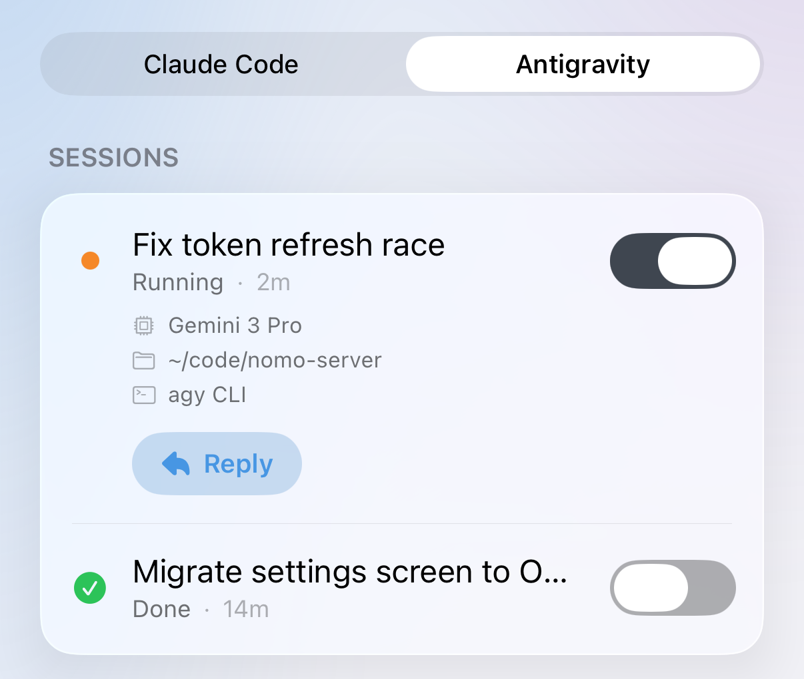
        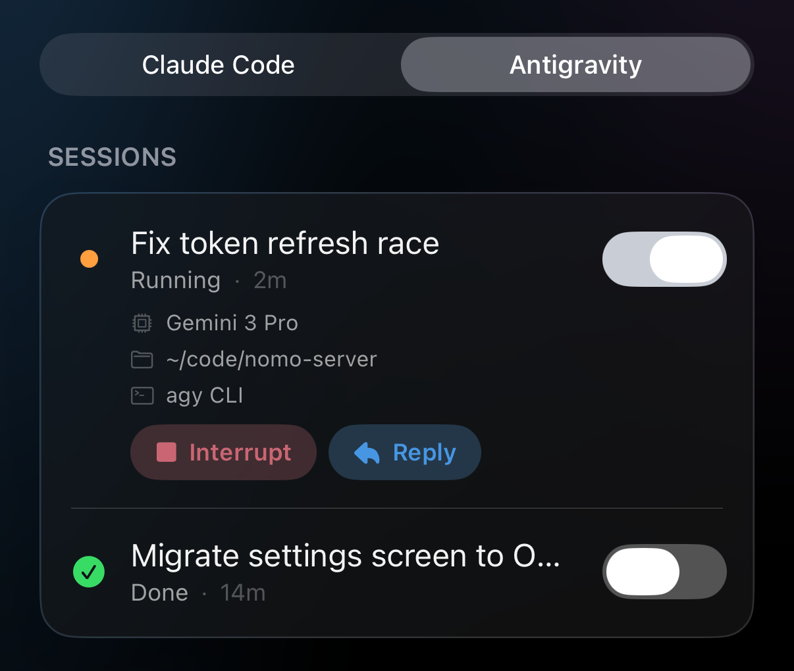
      </div>
    </Frame>
  </Step>

  <Step title="답장 탭하기">
    위쪽에 세션 이름이 있고 **이 세션에 메시지 보내기**라고 적힌 입력란이 있는
    시트가 올라옵니다.

    시트를 닫으려면 오른쪽 위의 **✕**를 탭합니다.
  </Step>

  <Step title="메시지를 입력하고 보내기">
    메시지를 입력한 다음 화살표를 탭합니다.

    메시지가 오른쪽에 말풍선으로 표시되고, 그 아래에 짧은 상태 줄이
    나타납니다. 상태를 보면 메시지가 지금 어디에 있는지 알 수 있습니다. 아래
    목록을 참고하십시오.

    <Frame caption="메시지 두 개. 첫 번째는 Antigravity에 전달되었고, 두 번째는 다음 단계를 기다리고 있어 아직 취소할 수 있습니다.">
      <div className="device-frame">
        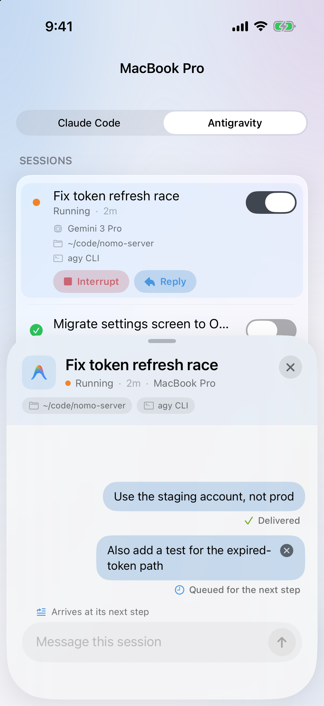
        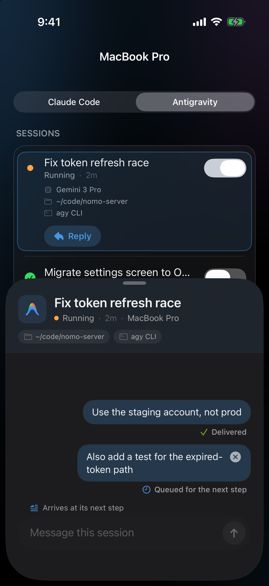
      </div>
    </Frame>
  </Step>
</Steps>

### 채팅에서 승인하기 {#approve-in-chat}

답장 시트가 열려 있을 때 Antigravity가 명령 실행을 요청하면, 채팅 안에서 바로
답할 수 있습니다.

<Steps>
  <Step title="요청 찾기">
    왼쪽에서 Antigravity가 보낸 말풍선을 찾습니다. **실행하려는 명령:**, 명령,
    그리고 **거부**와 **허용** 두 버튼이 표시됩니다.

    <Frame caption="답장 채팅 안에서 Antigravity가 명령 실행을 요청합니다.">
      <div className="device-frame">
        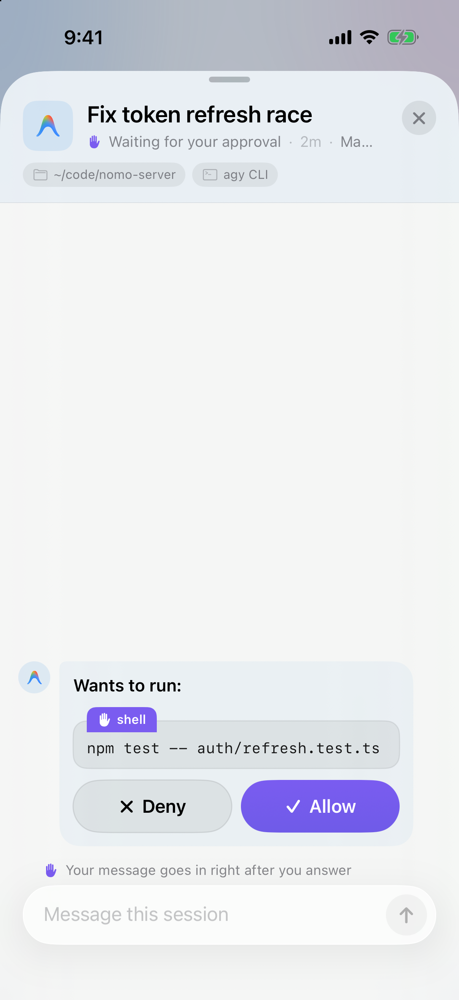
        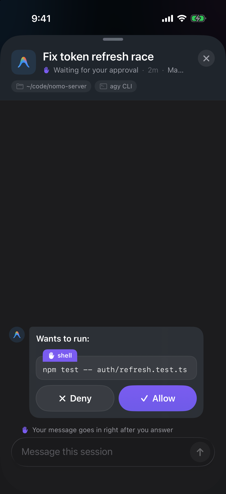
      </div>
    </Frame>
  </Step>

  <Step title="허용 또는 거부 탭하기">
    Antigravity가 실행하게 하려면 **허용**을, 건너뛰게 하려면 **거부**를
    탭합니다.

    말풍선이 결과를 알려 주는 한 줄로 줄어듭니다.
    [답한 요청의 표시](#answered-requests)를 참고하십시오.
  </Step>
</Steps>

말풍선의 **거부**와 **허용** 버튼은 입력란에 쓴 내용을 보내지 않습니다. 입력한
글은 입력란에 그대로 남습니다.

### 거부하고 보내기 {#deny-and-send}

거절하면서 대신 무엇을 하면 좋을지 Antigravity에 알려 주고 싶다면, 버튼 하나로
둘 다 할 수 있습니다.

<Steps>
  <Step title="이유 입력하기">
    요청이 기다리는 동안, Antigravity가 대신 해야 할 일을 입력란에 씁니다.
    예: "npm 말고 bun을 사용해".

    보내기 화살표가 빨간색 **거부하고 보내기** 버튼으로 바뀌고, 입력란 위에
    **거부 사유로 전송됩니다**라는 줄이 표시됩니다.

    <Frame caption="요청이 기다리는 동안 글을 입력하면 보내기 버튼이 거부하고 보내기로 바뀝니다.">
      <div className="device-frame">
        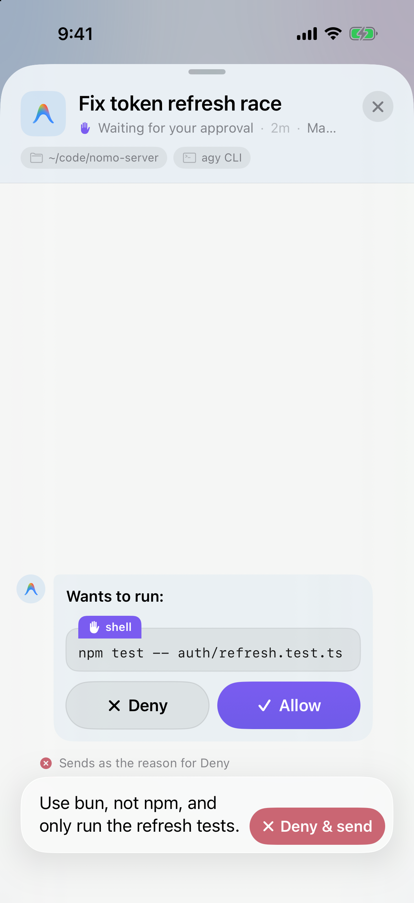
        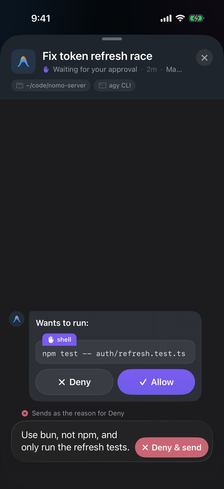
      </div>
    </Frame>
  </Step>

  <Step title="거부하고 보내기 탭하기">
    Antigravity가 명령을 건너뛰고, 입력한 글을 이유로 읽습니다.

    요청이 **✕ 거부됨**으로 바뀌고, 그 아래에 이유가 인용됩니다.
  </Step>
</Steps>

<Tip>
  이유는 500자까지 쓸 수 있습니다. 더 길게 쓰면 버튼은 일반 보내기 화살표로
  남습니다. 메시지는 기다렸다가 요청에 응답하면 바로 전달됩니다.
</Tip>

### 답한 요청의 표시 {#answered-requests}

| 표시 | 의미 |
| --- | --- |
| `✓ 허용됨 · <명령>` | 허용했습니다. |
| `✕ 거부됨 · <명령>` | 거부했습니다. **거부하고 보내기**를 사용했다면 그 아래에 이유가 인용됩니다. |
| `컴퓨터에서 답변함` | Mac에서 답했습니다. |
| `시간 초과 — Mac에서 계속합니다` | 휴대폰의 답을 너무 오래 기다렸습니다. Antigravity가 Mac에서 묻습니다. |

### 메시지 아래 상태의 의미 {#reply-statuses}

| 표시 | 의미 |
| --- | --- |
| `보내는 중…` | 휴대폰이 보내고 있습니다. |
| `승인 대기 중` | Antigravity가 채팅 안의 요청에 대한 답을 기다리고 있습니다. 응답하면 바로 메시지가 전달됩니다. |
| `다음 단계 대기 중` | Mac에 도착했습니다. Antigravity가 다음 단계에서 읽습니다. 그 전까지는 말풍선의 **×**를 탭해 취소할 수 있습니다. |
| `전달됨` | Antigravity가 읽었습니다. |
| `Mac에서 다시 시작하는 중…` | 세션이 끝나 있었기 때문에 Mac이 메시지와 함께 세션을 다시 시작하고 있습니다. Mac이 실제로 다시 시작했을 때만 표시됩니다. 이제는 취소할 수 없습니다. |
| `Mac에서 다시 시작됨` | 메시지와 함께 세션이 다시 실행되고 있습니다. |
| `다시 연결 중…` | 지금은 휴대폰이 Mac에 연결할 수 없습니다. 자동으로 계속 시도하므로 다시 보낼 필요가 없습니다. |

### 사용할 수 있는 경우 {#where-reply-works}

Antigravity를 어디에서 사용하는지에 따라 다릅니다.

**`agy` 명령줄 도구:**

- **작업 중** — 메시지가 다음 단계에서 전달됩니다.
- **끝났고 `agy`가 닫혀 있음** — Mac이 메시지와 함께 세션을 다시 시작합니다.
  `Mac에서 다시 시작하는 중…`에 이어 `Mac에서 다시 시작됨`이 표시됩니다.
- **끝났지만 `agy`가 아직 열려 있음** — 메시지가 기다립니다. Mac의 `agy`에서
  다음 메시지를 보낼 때까지 `다음 단계 대기 중`으로 표시되고, 보내면
  Antigravity가 둘 다 읽습니다.

**Antigravity 데스크톱 앱:**

- **작업 중** — 메시지가 다음 단계에서 전달됩니다.
- **끝남** — Mac에서만 이어서 할 수 있습니다. **답장** 버튼이 회색으로 바뀌고,
  그 아래에 **Antigravity 앱 세션은 Mac에서만 계속할 수 있습니다**라고
  표시됩니다.

<Frame caption="데스크톱 앱에서 끝난 세션. 답장이 회색으로 바뀌고, 그 아래 줄에 이유가 표시됩니다.">
  <div className="device-frame">
    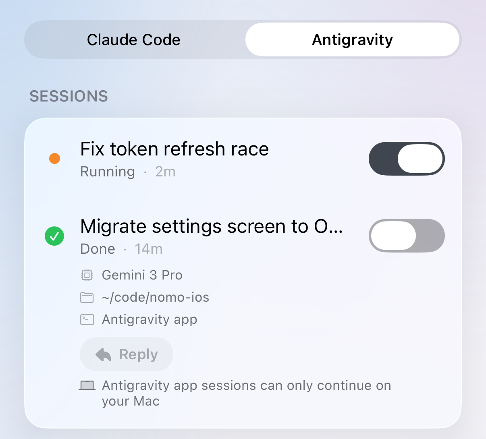
    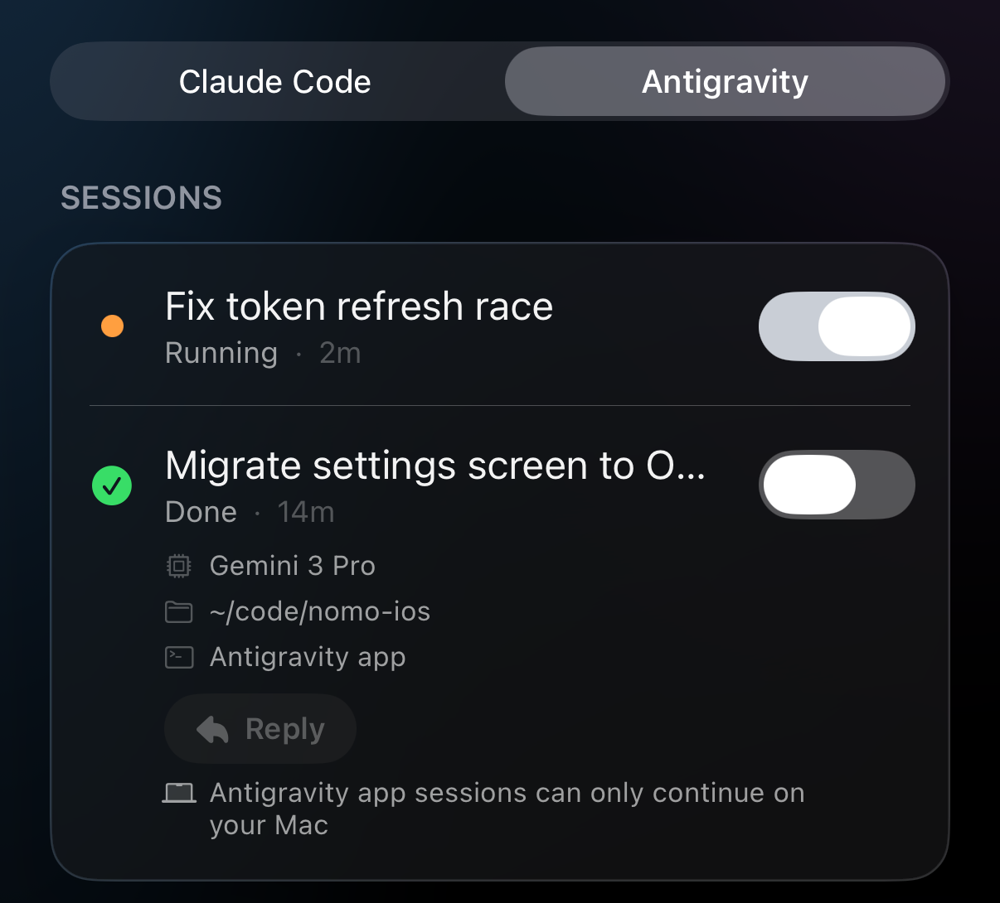
  </div>
</Frame>

알아 두면 좋은 점:

- **메시지 하나에 최대 4,000자**입니다. 그 이상은 입력되지 않습니다.
- **중단이 항상 우선합니다.** 메시지가 대기 중일 때 **[중단](#interrupt)**을
  탭하면 Antigravity가 먼저 멈춥니다. 멈춘 턴에는 메시지가 전달되지 않습니다.
- **메시지는 Nomo가 열려 있는 동안만 남습니다.** Nomo를 완전히 종료하면 다음에
  열 때 시트가 비어 있습니다. Mac에 이미 도착한 메시지는 그대로 전달됩니다.

## 이 버전에서 지원하지 않는 것 {#what-this-version-doesnt-do}

- **질문과 계획 미지원.** Antigravity의 질문과 계획 검토는 휴대폰에 표시되지
  않습니다.
- **‘Mac에서 열기’ 미지원.** Antigravity 세션에서는 이 버튼을 쓸 수 없습니다.
- **항상 허용 미지원.** 모든 답변은 한 번만 적용되는 **허용** 또는 **거부**입니다.

## 문제 해결 {#troubleshooting}

<AccordionGroup>
  <Accordion title="답장이 ‘다음 단계 대기 중’에서 바뀌지 않음">
    메시지는 Mac에 도착해 있습니다. Antigravity가 작업 중이면 다음 단계에서
    읽습니다. 긴 명령을 실행하는 중이면 시간이 걸릴 수 있습니다.

    세션이 끝났고 Mac에서 `agy`가 아직 열려 있다면, 메시지는 그곳에서 보내는
    다음 메시지를 기다립니다. `agy`에서 무엇이든 보내면 Antigravity가 둘 다
    읽습니다. 말풍선의 **×**를 탭해 취소할 수도 있습니다.
  </Accordion>

  <Accordion title="Nomo 명령에 ‘operation not permitted’가 표시됨">
    Antigravity 데스크톱 앱에서 Nomo 명령을 처음 사용할 때 나타날 수 있습니다.
    정상입니다. Antigravity가 샌드박스 밖에서 알아서 다시 시도합니다. 끝날
    때까지 기다리십시오. 따로 할 일은 없습니다.
  </Accordion>

  <Accordion title="답장 버튼이 회색으로 표시됨">
    Antigravity 데스크톱 앱의 세션이고 이미 끝났습니다. Mac에서만 이어서 할 수
    있습니다. 다음 메시지는 앱에서 보내십시오.
  </Accordion>

  <Accordion title="모든 세션이 두 번씩 표시됨">
    Nomo의 Claude Code 플러그인을 Antigravity로 가져온 상태입니다. 터미널에서
    다음을 실행한 다음 Antigravity를 재시작하십시오.

    ```bash
    agy plugin uninstall nomo-cc
    ```
  </Accordion>

  <Accordion title="Nomo 명령이 파일을 찾을 수 없다고 표시됨">
    Nomo 폴더가 옮겨졌거나 삭제되었습니다. Antigravity는 계속 동작하지만 휴대폰에는
    아무것도 오지 않습니다. 설치 도구를 다시 실행한 다음 Antigravity를
    재시작하십시오.

    ```bash
    bunx nomo-ai --antigravity
    ```
  </Accordion>
</AccordionGroup>

휴대폰에 아무것도 표시되지 않거나, 휴대폰에서 승인을 묻지 않거나, 세션이 멈춘
경우 등 그 밖의 문제는 [문제 해결](/ko/sessions/troubleshooting)에 있습니다.

## 기술 세부 정보와 보안 {#technical-details-and-security}

Nomo는 세션이 하는 일과 요청만 휴대폰으로 보내며, 종단 간 암호화됩니다.
문제가 생기면 Antigravity는 평소처럼 컴퓨터에서 묻습니다.

내부 동작 방식은 플러그인 README에 있습니다: [Nomo와 Antigravity의 연동](https://github.com/KarrixLee/nomo#antigravity-integration), [Hook과 보안](https://github.com/KarrixLee/nomo#antigravity-hooks).
