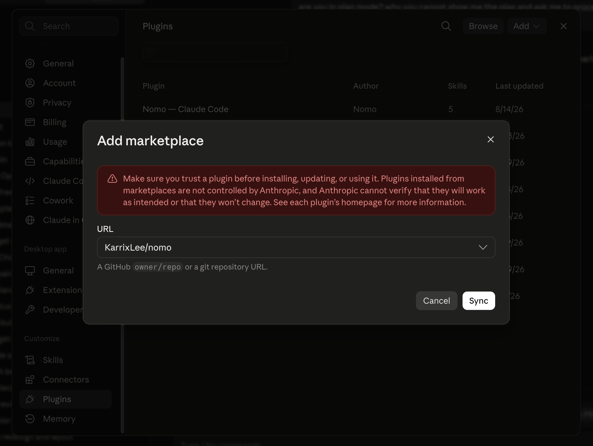
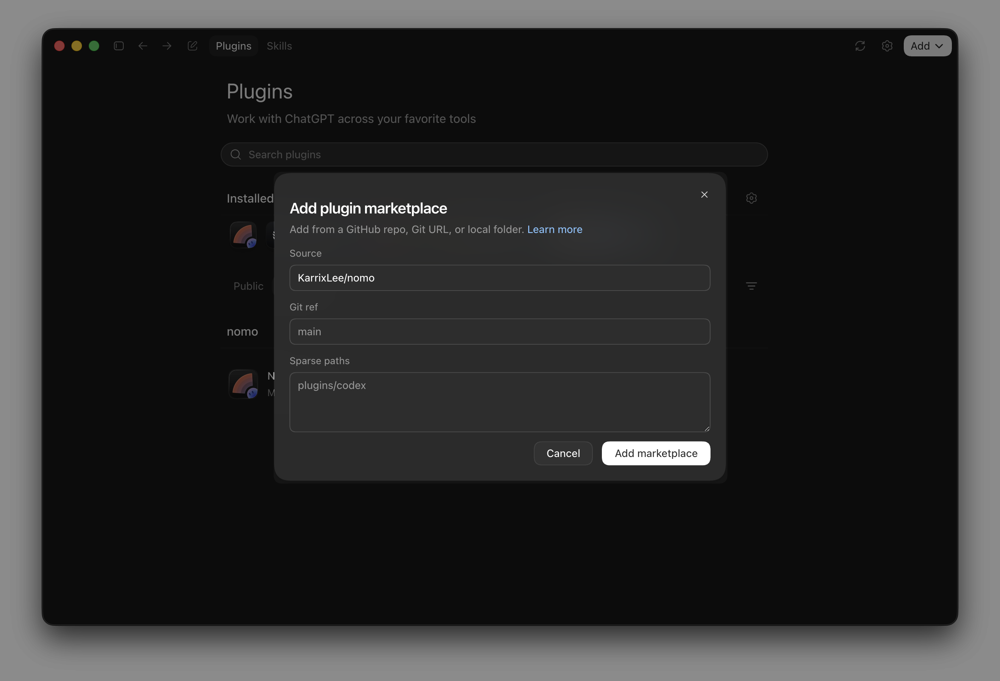
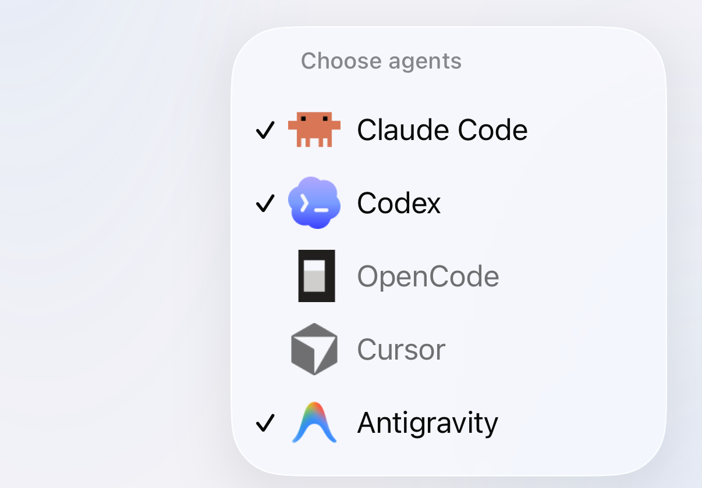
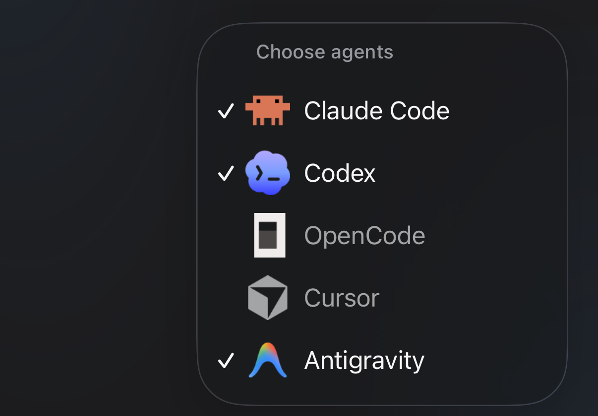

컴퓨터마다 한 번씩 설치합니다. **bun** 또는 **node 18 이상**이 필요합니다 — 플러그인에는 npm 의존성이 없으며 Node 내장 기능만으로 동작합니다. bun은 **1.4.4** 이상, Node.js 22는 **22.23.4** 이상으로 유지하십시오. 그보다 오래된 버전이면 status 명령이 경고합니다.

## 수동 설치 {#install-by-hand}

<Tabs>
  <Tab title="Claude Code" icon="/images/claude-code.svg">
    <Tabs>
      <Tab title="터미널" icon="terminal">
        Claude Code 세션 안에서 실행합니다.

        ```
        /plugin marketplace add KarrixLee/nomo
        /plugin install nomo-cc@nomo
        ```
      </Tab>

      <Tab title="데스크톱 앱" icon="window">
        **Settings** → **Plugins** → **Add** → **Add marketplace**로 이동한 다음, **URL**에 저장소를 입력합니다.

        ```
        KarrixLee/nomo
        ```

        그런 다음 **Sync**를 누르고 목록에서 **Nomo — Claude Code**를 설치합니다.

        <Frame caption="GitHub의 owner/repo만 있으면 됩니다. Nomo의 저장소 자체가 마켓플레이스입니다.">
          
        </Frame>
      </Tab>
    </Tabs>

    플러그인의 Hook이 로드되도록 이후 Claude Code를 재시작합니다.

    설치됐는지 확인합니다:

    ```
    /nomo-cc:status
    ```

    <Tip>
      Claude Code의 모든 Nomo 명령은 `nomo-cc:` 네임스페이스를 사용합니다 —
      `/nomo-cc:`를 입력하면 목록이 표시됩니다.
    </Tip>
  </Tab>

  <Tab title="Codex" icon="/images/codex.svg">
    Codex **0.142 이상**에는 자체 플러그인 시스템이 포함되어 있어, Nomo를 독립적인
    Codex 플러그인으로 설치합니다. Claude Code는 필요하지 않습니다.

    <Steps>
      <Step title="플러그인 설치">
        <Tabs>
          <Tab title="터미널" icon="terminal">
            ```
            codex plugin marketplace add KarrixLee/nomo
            codex plugin add nomo@nomo
            ```

            입력하는 편이 빠르다면 데스크톱 앱의 내장 터미널에서도 됩니다.
          </Tab>

          <Tab title="데스크톱 앱" icon="window">
            **플러그인** → **추가** → **마켓플레이스 추가**로 이동한 다음, **Source**에 저장소를 입력합니다.

            ```
            KarrixLee/nomo
            ```

            **Git ref**와 **Sparse paths**는 그대로 두십시오 — 회색 글자는 플레이스홀더이지 입력해야 할 값이 아닙니다. 그런 다음 **마켓플레이스 추가**를 누르고 목록에서 **nomo**를 설치합니다.

            <Frame caption="Nomo의 저장소 자체가 마켓플레이스입니다. 둘러볼 목록도, 제출 절차도 없습니다.">
              
            </Frame>
          </Tab>
        </Tabs>

        <Note>
          여기서 말하는 "마켓플레이스"는 둘러보는 스토어가 아닙니다. GitHub 저장소 — Nomo 자신의 저장소 — 를 가리키는 레지스트리입니다. 그래서 저장소를 먼저 추가하고, 거기서 플러그인을 설치합니다.
        </Note>
      </Step>

      <Step title="Hook 신뢰 — 필수">
        <Tabs>
          <Tab title="터미널" icon="terminal">
            ```
            /hooks
            ```

            **Nomo 항목 열 개**를 신뢰합니다. 터미널에서는 영어로 “trust”라고 표시됩니다.
          </Tab>

          <Tab title="데스크톱 앱" icon="window">
            톱니바퀴 아이콘에서 **Hooks** → **Nomo**로 이동해 켭니다.
          </Tab>
        </Tabs>

        <Warning>
          이 단계를 건너뛰지 마십시오. Nomo의 Hook은 플러그인과 함께 설치되지만
          **신뢰하기 전까지는 동작하지 않습니다**. 신뢰하기 전에는 플러그인이
          설치만 되어 있고 아무 일도 하지 않습니다 — 세션이 휴대폰에 도달하지
          않으며, 오류도 보고되지 않습니다.
        </Warning>

        이것은 Codex 자체의 안전 장치이며, Nomo가 미리 승인할 수 없습니다. Hook
        명령줄은 릴리스 간에 바이트 단위로 동일하므로, 한 번 신뢰하면 업데이트
        후에도 유지됩니다 — Hook 명령줄이 바뀐 경우에만 검토가 다시 열립니다.
      </Step>

      <Step title="확인">
        ```
        $nomo-status
        ```

        페어링, 워치독, **Hook 신뢰**, 마지막 전달 상태를 보고합니다 — 따라서 신뢰
        단계가 실제로 적용됐는지 확인하는 방법이기도 합니다.
      </Step>
    </Steps>

    <Tip>
      Codex 스킬은 슬래시 대신 `$` 접두사를 사용합니다 — `$nomo-pair`,
      `$nomo-status`, `$nomo-reset`, `$nomo-unpair`.
    </Tip>
  </Tab>

  <Tab title="OpenCode" icon="/images/opencode.svg">
    OpenCode에는 마켓플레이스도 플러그인 명령도 없습니다 — 자체 설정 폴더에서
    발견한 것을 그대로 가져다 씁니다. 그래서 Nomo는 클론에서 설치하며, 스크립트
    하나가 OpenCode가 이미 들여다보는 위치에 파일을 놓아 줍니다.

    <Steps>
      <Step title="클론하고 설치 스크립트 실행">
        ```bash
        git clone https://github.com/KarrixLee/nomo.git ~/.nomo
        ~/.nomo/plugin/scripts/opencode-install.sh
        ```

        클론 위치는 어디든 상관없습니다 — 스크립트가 자기 위치를 스스로
        알아내므로 찾아볼 경로도, 손으로 고칠 것도 없습니다. 무엇을 썼는지는
        그대로 출력합니다.

        - `~/.config/opencode/plugins/nomo.js` — 클론을 가리키는 한 줄짜리 스텁.
        - `~/.config/opencode/commands/nomo-*.md` — 명령 여섯 개.

        Claude Code나 Codex용으로 Nomo를 이미 설치했습니까? 두 번 클론하지 말고
        스크립트를 그 사본으로 가리키십시오 — `claude plugin list` 또는
        `codex plugin list`가 위치를 알려 줍니다.

        <Tip>
          `--project`를 주면 전역 대신 저장소 하나의 `./.opencode`에 설치합니다.
          다시 실행해도 안전하며, 클론을 옮길 때도 이 방법을 씁니다. 새 위치에서
          한 번 더 실행하면 됩니다.
        </Tip>
      </Step>

      <Step title="OpenCode 재시작 — 필수">
        <Warning>
          OpenCode는 서버가 시작될 때 플러그인을 한 번만 불러오며, 핫 리로드가
          없습니다. 종료했다가 다시 열기 전까지 플러그인은 설치만 되어 있고 아무
          일도 하지 않습니다. 데스크톱 앱도 같은 서버를 실행하므로 같은 재시작이
          필요합니다.
        </Warning>
      </Step>

      <Step title="확인">
        ```
        /nomo-status
        ```
      </Step>
    </Steps>

    이 설치 한 번이 OpenCode 데스크톱 앱까지 함께 처리합니다. 앱은 OpenCode
    자체 서버를 실행하고, 그 서버가 같은 플러그인 폴더를 읽습니다.

    <Note>
      나중에 업데이트하는 것은 OpenCode 안에서 명령 하나면 됩니다.
      `/nomo-update`는 먼저 확인한 다음 받아 오고, 이 설치 스크립트를 다시
      실행합니다 — [무엇을 하고 언제 거부하는지](/ko/sessions/commands#update).
    </Note>

    <Tip>
      OpenCode의 명령 이름은 전역에 평평하게 놓이므로 Nomo 명령에도 접두사가
      전혀 붙지 않습니다. `/nomo-cc:pair`나 `$nomo-pair`가 아니라
      `/nomo-pair`입니다. 여섯 개 전부 [명령](/ko/sessions/commands)에 있습니다.
    </Tip>

    휴대폰에서 다르게 나타나는 것은
    [OpenCode 사용하기](/ko/sessions/opencode)에 정리되어 있습니다.
  </Tab>

  <Tab title="Cursor" icon="/images/providers/cursor.svg">
    설치 한 번으로 Cursor 데스크톱 앱의 에이전트와 `cursor-agent` CLI가 모두
    처리됩니다. 이 버전에서 Cursor 세션은 읽기 전용입니다 — 그것이 무슨 뜻인지는
    [Cursor 사용하기](/ko/sessions/cursor)에 있습니다.

    <Steps>
      <Step title="설치 도구 실행">
        <CodeGroup>
        ```bash bunx icon="terminal"
        bunx nomo-ai --cursor
        ```

        ```bash npx icon="terminal"
        npx nomo-ai --cursor
        ```
        </CodeGroup>

        다음 세 가지를 합니다.

        - 플러그인을 `~/.nomo`에 클론합니다.
        - `~/.cursor/hooks.json`에 Nomo의 Hook 항목을 추가합니다. 이미 있는
          내용과 병합하며 다른 도구의 항목은 건드리지 않습니다.
        - `~/.cursor/skills/` 아래에 Skill 네 개를 설치합니다.
      </Step>

      <Step title="Cursor 재시작 — 필수">
        <Warning>
          Cursor는 시작할 때에만 Hook을 읽어 들입니다. Cursor를 종료했다가 다시
          열고, 열려 있는 `cursor-agent` 세션도 재시작하십시오. 그러기 전까지
          플러그인은 설치만 되어 있고 아무 일도 하지 않습니다.
        </Warning>
      </Step>

      <Step title="페어링">
        Cursor에서 `/`를 입력해 Skill을 고르고 다음을 실행합니다.

        ```
        /nomo-pair
        ```

        QR 코드가 표시되면 Nomo 앱으로 스캔합니다. 브라우저를 열 수 없는
        환경에서는 `/nomo-pair code`가 대신 입력할 짧은 코드를 줍니다. 두 방법
        모두 [페어링](/ko/setup/pairing)에 단계별로 설명되어 있습니다.

        페어링은 한 Mac의 에이전트들이 공유합니다. 이미 Claude Code, Codex 또는
        OpenCode용으로 페어링한 컴퓨터는 Cursor를 위해 다시 페어링할 필요가
        없습니다 — 설치만으로 충분하며, 이 단계는 건너뛰어도 됩니다.
      </Step>

      <Step title="Cursor 탭 표시">
        앱에서 컴퓨터를 엽니다. Cursor 세션은 세션 드로어의 **Cursor** 탭 아래에
        있습니다.

        드로어에는 에이전트 탭이 최대 세 개까지 표시됩니다. Cursor가 그중에
        없으면 **+** 버튼(**에이전트 선택**)을 탭해 켭니다.
      </Step>
    </Steps>

    <Tip>
      Nomo의 Cursor 명령은 접두사가 없는 Skill입니다 — `/nomo-pair`,
      `/nomo-status`, `/nomo-reset`, `/nomo-unpair`. 네 개 전부
      [명령](/ko/sessions/commands)에 있습니다.
    </Tip>
  </Tab>

  <Tab title="Antigravity" icon="/images/providers/antigravity.png">
    설치 한 번으로 Antigravity 데스크톱 앱과 `agy` CLI가 모두 처리됩니다. 셸
    명령과 파일 쓰기에는 휴대폰에서 답할 수 있습니다 — 자세한 내용은
    [Antigravity 사용하기](/ko/sessions/antigravity)에 있습니다.

    <Steps>
      <Step title="설치 도구 실행">
        터미널에 붙여 넣고 Return 키를 누릅니다.

        <CodeGroup>
        ```bash bunx icon="terminal"
        bunx nomo-ai --antigravity
        ```

        ```bash npx icon="terminal"
        npx nomo-ai --antigravity
        ```
        </CodeGroup>

        다음과 같이 표시됩니다.

        ```
        ✅ Antigravity is connected to Nomo. Restart Antigravity, then type /nomo-pair.
        ```
      </Step>

      <Step title="Antigravity 재시작 — 필수">
        <Warning>
          Antigravity를 완전히 종료한 다음 다시 여십시오. `agy`를 사용한다면
          그것도 재시작하십시오. 그러기 전까지 Nomo는 동작하지 않습니다.
        </Warning>
      </Step>

      <Step title="/nomo-pair 입력">
        Antigravity 채팅에 `/nomo-pair`를 입력해 보냅니다. Antigravity가 Nomo
        명령을 실행할지 물으면 **Allow**를 선택합니다. 그런 다음 iPhone의
        Nomo로 QR 코드를 스캔합니다.

        Antigravity에 "Done! This computer is connected to your phone."(완료! 이
        컴퓨터가 휴대폰에 연결되었습니다)이 표시됩니다.

        Antigravity 데스크톱 앱에서는 첫 Nomo 명령에서 `operation not permitted`라는
        줄이 한 줄 표시될 수 있습니다. 정상입니다. Antigravity가 샌드박스 밖에서
        알아서 다시 시도하므로 그대로 기다리십시오.

        다른 에이전트에서 이미 페어링했다면 대신 `/nomo-status`를 입력해
        확인합니다.
      </Step>

      <Step title="Antigravity에서 메시지 보내기">
        채팅을 시작하고 아무 메시지나 보냅니다.

        Nomo에서 컴퓨터의 **Antigravity** 탭 아래에 세션이 나타납니다.
        Antigravity 탭이 없다면 **+** 버튼(**에이전트 선택**)을 탭해
        Antigravity를 켭니다.

        <Frame caption="+ 버튼에서 여는 에이전트 선택. Antigravity가 선택되어 있어 자체 탭이 생깁니다.">
          <div className="device-frame">
            
            
          </div>
        </Frame>
      </Step>
    </Steps>

    <Warning>
      Nomo의 Claude Code 플러그인을 Antigravity로 가져오지 마십시오(예:
      `agy plugin import claude`). 모든 세션이 두 번씩 표시됩니다. 이미
      가져왔다면 설치 도구가 다음과 같이 경고합니다.

      ```
      ⚠️ Antigravity also has the Claude Code version of Nomo ("nomo-cc") imported. It would show every session twice — please remove it by running: agy plugin uninstall nomo-cc
      ```

      고치려면 `agy plugin uninstall nomo-cc`를 실행하고 Antigravity를
      재시작하십시오.
    </Warning>
  </Tab>
</Tabs>

## 명령 한 줄 {#one-command}

설치 도구가 이 컴퓨터에서 Claude Code, Codex, OpenCode, Cursor, Antigravity, Grok Bot을 찾아내고, 고른 것들에
Nomo를 넣어 줍니다.

<CodeGroup>
```bash bunx icon="terminal"
bunx nomo-ai
```

```bash npx icon="terminal"
npx nomo-ai
```
</CodeGroup>

처음에는 아무것도 선택되어 있지 않습니다. 방향 키(또는 `k` / `j`)로 옮기고,
스페이스로 선택하고, 엔터로 선택한 것들을 한꺼번에 설치합니다. 그다음에는 각
에이전트 고유의 설치 절차 — 위의 다섯 가지 — 를 그대로 실행합니다. 전역에 무언가를
설치하지도, 패키지를 남기지도 않습니다.

스크립트나 CI에서는 다음 옵션을 쓸 수 있습니다.

| 옵션 | |
| --- | --- |
| `--claude` `--codex` `--opencode` `--cursor` `--antigravity` `--grokbot` | 그것들만 설치합니다. 하나라도 지정하면 선택 화면을 건너뜁니다 |
| `--all` | 찾아냈든 아니든 전부. 단, Cursor, Antigravity, Grok Bot은 이 컴퓨터에 없으면 건너뜁니다(그래도 시도하려면 `--cursor`, `--antigravity`, `--grokbot`을 지정하십시오) |
| `-y`, `--yes` | 선택 화면 없이, 찾아낸 것을 모두 설치합니다 |
| `-n`, `--dry-run` | 실행할 명령을 출력만 하고 아무것도 실행하지 않습니다 |
| `--global` | 묻지 않고 짧은 `nomo` 명령도 추가합니다. [터미널 명령](/ko/sessions/commands#terminal)을 참고하십시오 |
| `uninstall` | `--cursor`, `--antigravity`, `--grokbot` 중 하나와 함께 쓰면 해당 에이전트에서 Nomo를 제거합니다(`--uninstall`도 됩니다). 에이전트를 지정해야 하며, 추측하지 않습니다. [uninstall](/ko/sessions/commands#uninstall)을 참고하십시오 |

휴대폰 페어링은 하지 않습니다. 그다음은 위 단계와 똑같이 마무리합니다. 에이전트를
재시작하고, Codex라면 Hook을 신뢰하고, 페어링합니다 — 터미널에서는
`bunx nomo-ai pair`, 또는 `/nomo-pair`, Claude Code에서는 `/nomo-cc:pair`,
Codex에서는 `$nomo-pair`입니다. 다른 터미널 명령은
[터미널 명령](/ko/sessions/commands#terminal)에 있습니다.

`--grokbot`은 Grok Bot 앱만 AI 앱으로 쓰는 Mac을 위한 옵션입니다. Hook 대신
1시간마다 도는 작은 작업을 추가하며, macOS에서만 동작합니다.
[Grok Bot 사용하기](/ko/sessions/grok-bot)를 참고하십시오.

## 업데이트 {#updating}

<Note>
  업데이트나 제거는 [명령 → update](/ko/sessions/commands#update)와
  [명령 → uninstall](/ko/sessions/commands#uninstall)을 참고하십시오. 모든
  에이전트가 각자의 탭에 정리되어 있습니다.
</Note>

## 플러그인이 하는 일

세션을 관찰하고 상태 변화를 휴대폰으로 보고합니다: 에이전트가 무엇을 작업 중인지,
언제 멈추는지, 언제 무언가에 대한 권한이 필요한지.

[휴대폰을 페어링](/ko/setup/pairing)하기 전까지는 아무것도 보내지 않으며, 보내는
모든 내용은 이 컴퓨터에서 먼저 암호화됩니다.

Hook은 프로젝트 폴더에서 실행되지만, 그 프로젝트의 `bunfig.toml`이나 `.env` 파일은
절대 불러오지 않습니다.

이 플러그인은 **오픈 소스**입니다 — 설치하기 전에 무엇을 수집하고 무엇을
전송하는지 그대로 읽어볼 수 있습니다:

<Card title="KarrixLee/nomo" href="https://github.com/KarrixLee/nomo" icon="github" horizontal>
  전체 플러그인 소스이며 MIT 라이선스입니다. 마켓플레이스 설치는 이 저장소를
  그대로 복제합니다.
</Card>

## 다음 단계

<Card title="컴퓨터 페어링" href="/ko/setup/pairing" icon="qrcode-read">
  QR 코드를 스캔하거나, 브라우저를 열 수 없다면 일회용 코드를 입력합니다.
</Card>
