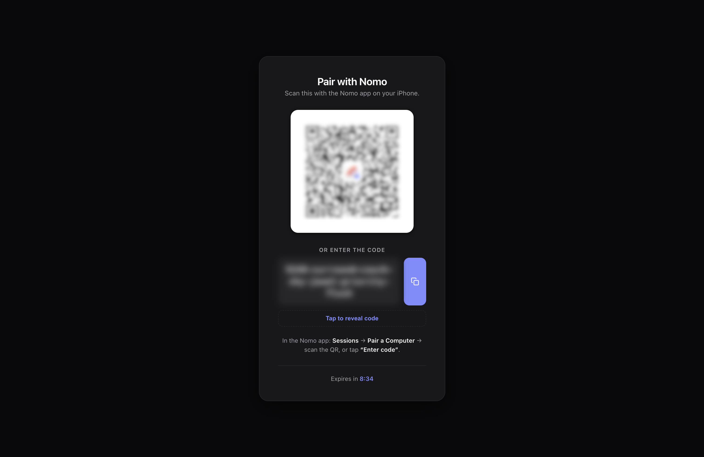

컴퓨터마다 한 번씩 설치합니다. **bun** 또는 **node 18 이상**이 필요합니다 — 플러그인에는 npm 의존성이 없으며 Node 내장 기능만으로 동작합니다. bun은 **1.4.4** 이상, Node.js 22는 **22.23.4** 이상으로 유지하십시오. 그보다 오래된 버전이면 status 명령이 경고합니다.

## 명령 한 줄로 설치 {#one-command}

<Steps>
  <Step title="설치 도구 실행">
    터미널에 붙여 넣고 Return 키를 누릅니다.

    <CodeGroup>
    ```bash bunx icon="terminal"
    bunx nomo-ai
    ```

    ```bash npx icon="terminal"
    npx nomo-ai
    ```
    </CodeGroup>

    이 컴퓨터의 에이전트(Claude Code, Codex, OpenCode, Cursor, Antigravity, Devin)를 찾아 선택해 둡니다. Return 키를 누르면 설치합니다. 목록을 바꾸려면 방향 키(또는 `k` / `j`)로 옮기고 스페이스로 선택하거나 해제하십시오.

    짧은 `nomo` 명령도 추가하며, 이렇게 알려 줍니다.

    ```
    Installed the short command: type nomo pair, nomo status or nomo reset from any folder.
    ```
  </Step>

  <Step title="휴대폰 페어링">
    `Pair your phone now? [Y/n]`라고 물으면 Return 키를 눌러 '예'로 답하십시오.

    브라우저에 QR 코드가 있는 페이지가 열립니다. iPhone에서 Nomo를 열고 스캔하십시오. [페어링](/ko/setup/pairing)에서 단계별로 안내하며, 브라우저를 열 수 없을 때 입력하는 짧은 코드(`nomo pair code`)도 함께 설명합니다.

    <Frame caption="컴퓨터에 표시되는 페어링 페이지입니다. 스캔이 완료되면 자동으로 Paired ✓(페어링 완료)로 바뀝니다.">
      
    </Frame>

    '아니요'라고 답했거나 나중에 페어링하려면 터미널에서 `nomo pair`를 실행하십시오.

    에이전트 안에서 페어링할 수도 있습니다. Claude Code에서는 `/nomo-cc:pair`, Codex에서는 `$nomo-pair`, OpenCode, Cursor, Antigravity, Devin에서는 `/nomo-pair`입니다(Devin 플러그인을 쓴다면 `/nomo:pair`).

    이미 페어링되어 있나요? 그렇다고 알려 주고 이 단계를 건너뜁니다.
  </Step>

  <Step title="에이전트 재시작 — 필수">
    Nomo를 설치한 에이전트를 각각 종료한 다음 다시 여십시오. 그러기 전까지 Nomo는 동작하지 않습니다.

    OpenCode는 먼저 페어링한 다음 재시작해야 Nomo가 켜집니다. OpenCode 2.x에서는 터미널에서 `opencode service restart`를 실행해 재시작한 뒤 OpenCode를 여세요 — [이유](/ko/sessions/opencode#opencode-2x).

    Codex를 쓴다면 Nomo의 Hook도 신뢰해야 합니다. Codex에서 `/hooks`를 입력하고 Nomo 항목을 신뢰하십시오. 자세한 내용은 [수동 설치](/ko/setup/manual)의 **Codex** 탭에 있습니다.
  </Step>
</Steps>

에이전트 자체의 플러그인 스토어를 쓰고 싶다면 [수동 설치](/ko/setup/manual)를 참고하십시오.

<Note>
  짧은 `nomo` 명령을 추가하지 않으려면 `--no-global`을 붙이십시오. 나중에 `nomo`를 찾을 수 없다면 `bunx nomo-ai`로도 똑같이 됩니다. 예: `bunx nomo-ai pair`. [`nomo`를 찾을 수 없다면](/ko/sessions/commands#nomo-not-found)을 참고하십시오.
</Note>

<Accordion title="설치 도구 옵션(스크립트 및 CI)">
  | 옵션 | |
  | --- | --- |
  | `--claude` `--codex` `--opencode` `--cursor` `--antigravity` `--devin` | 그것들만 설치합니다. 하나라도 지정하면 선택 화면을 건너뜁니다 |
  | `--all` | 찾아냈든 아니든 전부. 단, Cursor, Antigravity, Devin은 이 컴퓨터에 없으면 건너뜁니다(그래도 시도하려면 `--cursor`, `--antigravity`, `--devin`을 지정하십시오) |
  | `-y`, `--yes` | 선택 화면 없이, 찾아낸 것을 모두 설치합니다 |
  | `-n`, `--dry-run` | 실행할 명령을 출력만 하고 아무것도 실행하지 않습니다 |
  | `--no-global` | 짧은 `nomo` 명령을 추가하지 않습니다. [터미널 명령](/ko/sessions/commands#terminal)을 참고하십시오 |
  | `uninstall` | `--cursor`, `--antigravity` 또는 `--devin`과 함께 쓰면 해당 에이전트에서 Nomo를 제거합니다(`--uninstall`도 됩니다). 에이전트를 지정해야 하며, 추측하지 않습니다. [uninstall](/ko/sessions/commands#uninstall)을 참고하십시오 |

  `-y`를 붙이거나 대화형 터미널이 아닌 곳(CI 등)에서 실행하면 페어링을 묻지 않습니다.
</Accordion>

## 업데이트 {#updating}

<Note>
  업데이트나 제거는 [명령 → update](/ko/sessions/commands#update)와
  [명령 → uninstall](/ko/sessions/commands#uninstall)을 참고하십시오. 모든
  에이전트가 각자의 탭에 정리되어 있습니다.
</Note>

이 컴퓨터의 플러그인이 오래되면 휴대폰이 알려 줍니다. 세션의 해당 컴퓨터에 업데이트 알림이 나타납니다. 업데이트하면 지금 실행 중인 것을 볼 수 있습니다.

## 플러그인이 하는 일

세션을 관찰하고 상태 변화를 휴대폰으로 보고합니다: 에이전트가 무엇을 작업 중인지,
언제 멈추는지, 언제 무언가에 대한 권한이 필요한지.

무료 페어링에서는 무료 기능에 필요한 것만 보냅니다.
[What leaves your computer](https://github.com/KarrixLee/nomo#what-leaves-your-computer)를 참고하십시오.

[휴대폰을 페어링](/ko/setup/pairing)하기 전까지는 아무것도 보내지 않으며, 보내는
모든 내용은 이 컴퓨터에서 먼저 암호화됩니다.

Hook은 프로젝트 폴더에서 실행되지만, 그 프로젝트의 `bunfig.toml`이나 `.env` 파일은
절대 불러오지 않습니다.

이 플러그인은 **오픈 소스**입니다 — 설치하기 전에 무엇을 수집하고 무엇을
전송하는지 그대로 읽어볼 수 있습니다:

<Card title="KarrixLee/nomo" href="https://github.com/KarrixLee/nomo" icon="github" horizontal>
  전체 플러그인 소스이며 MIT 라이선스입니다. 마켓플레이스 설치는 이 저장소를
  그대로 복제합니다.
</Card>

## 다음에 일어나는 일

[컴퓨터를 페어링](/ko/setup/pairing)한 뒤 **홈** 탭을 엽니다. 코딩하면 연속
기록과 코딩 시간이 [활동](/ko/activity)에 표시됩니다. 무료입니다.

## 다음 단계

<Card title="연속 기록 보기" href="/ko/activity" icon="fire">
  코딩하면 연속 기록과 코딩 시간이 홈에 표시됩니다.
</Card>
