사용량은 [상태](/ko/status)와 같은 방식으로 동작합니다 — 위젯 하나와 알림 —
다만 한 단계가 더 있습니다. 계정에서 숫자를 읽어 오기 때문에 로그인이 필요합니다.
Mac 플러그인은 여전히 필요 없고, 이 기능도 휴대폰만으로 동작합니다.

<Frame caption="Claude의 사용량 탭 — 5시간 한도와 주간 한도, 그리고 각각 언제 초기화되는지.">
  

    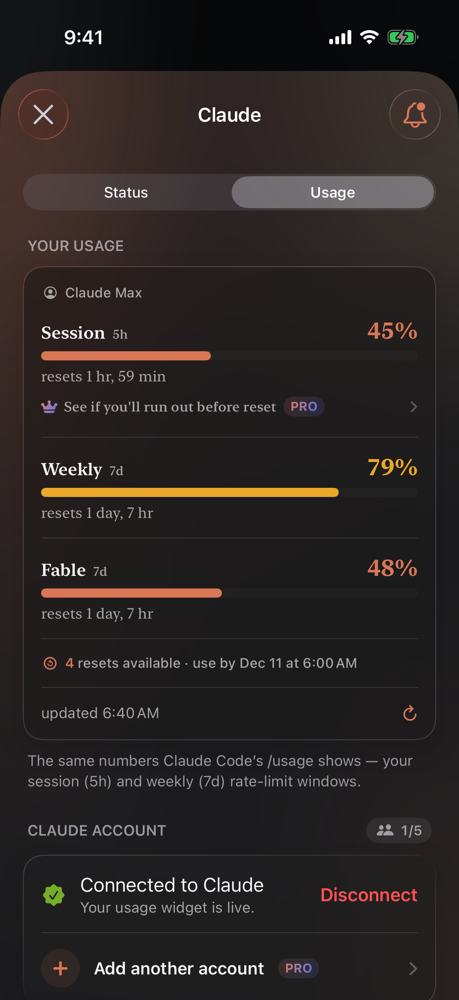
  

</Frame>

## 지원 제공업체

**Claude**, **Codex**, **Cursor**, **xAI**, **Antigravity**, **Kimi**, 여섯
곳입니다. [상태](/ko/status)가 다루는 곳 중 상태 전용인 DeepSeek만 빠집니다.

여섯 곳 모두 각자 보고하는 구간의 70%, 90%, 100%에서 **알림**을 보낼 수 있습니다 —
[사용량 알림](/ko/notifications#usage-alerts)을 참고하세요.

두 위젯 사이에서 이름 하나가 다릅니다. 사용량에는 **Codex**로 표시되지만 상태가
지켜보는 것은 **OpenAI** 전체입니다. 소비하는 것은 Codex 요금제이고, 장애가 나는
것은 OpenAI이기 때문입니다.

**Antigravity**는 별도의 **Claude & GPT** 한도를 포함한 **Google Antigravity**
할당량을, 붙여넣는 토큰이 아니라 Google 로그인으로 읽습니다.

**Kimi**는 **Kimi Code** 요금제의 5시간 한도와 주간 한도를 읽습니다. 연결하면
짧은 코드가 표시되며, Kimi 로그인 페이지에서 승인하면 끝납니다.

## 로그인

**제공업체** 탭에서 해당 제공업체를 열고, 이미 요금을 내고 있는 계정을
연결합니다. Nomo는 그 계정이 스스로에 대해 볼 수 있는 것과 같은 숫자를 읽습니다
— API 키가 아니며, 어딘가에 붙여 넣을 것도 없습니다.

<Note>
  **로그인 정보는 휴대폰에 머무릅니다.** 토큰은 기기의 키체인에 보관되며, 그
  토큰이 속한 제공업체로만 전송됩니다 — Claude 토큰은 Anthropic으로, OpenAI 토큰은
  OpenAI로. 사용량은 기기에서 직접 가져오며 Nomo의 서버를 거치지 않습니다.
</Note>

Nomo는 비공식 앱이며, 데이터를 읽어 오는 어떤 제공업체와도 제휴 관계가 없습니다.

### Cursor와 Grok {#cursor-and-grok}

Cursor와 Grok은 Safari로 로그인합니다. 패스키, 암호 관리 앱, Safari에 이미
로그인한 계정을 그대로 쓸 수 있습니다.

**Cursor**

1. **연결**을 탭합니다.
2. iOS가 **cursor.com**으로 로그인해도 되는지 묻습니다. **계속**을 탭합니다.
3. Cursor 페이지에서 로그인합니다.

페이지가 저절로 닫히고 사용량이 표시됩니다. 약 60일마다 다시 로그인하세요.

**Grok**

1. **연결**을 탭합니다.
2. iOS가 **x.ai**로 로그인해도 되는지 묻습니다. **계속**을 탭합니다.
3. xAI 페이지가 열리고, Nomo에 `ABCD-1234` 같은 짧은 코드가 표시됩니다.
4. xAI 페이지의 코드와 같은지 확인합니다.
5. xAI 페이지에서 승인합니다.

Grok 로그인은 Nomo가 알아서 갱신합니다.

Grok 사용량을 보려면 SuperGrok이나 X 구독 같은 유료 Grok 요금제가 필요합니다.
무료 계정은 연결된 상태로 남지만, 막대 대신 **Grok 사용량을 보려면 유료 Grok
요금제가 필요합니다**가 표시됩니다.

<Note>
  Nomo 2.4.0으로 업데이트한 뒤 Grok에 한 번 더 로그인하세요. 이전 Grok 로그인은
  이어지지 않습니다.
</Note>

## 사용 속도  {#pace}

Nomo Pro를 쓰면 **사용량** 페이지의 한도마다 아래에 한 줄이 더 표시됩니다.
한도가 재설정될 때까지 사용량이 버틸지 알려 줍니다.

<Frame caption="두 한도 모두 시간이 지나는 속도보다 빨리 쓰이고 있어서 두 줄 모두 호박색입니다.">
  

    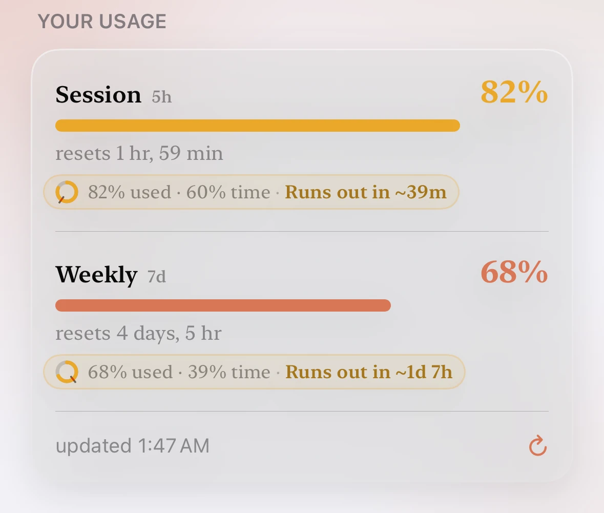
    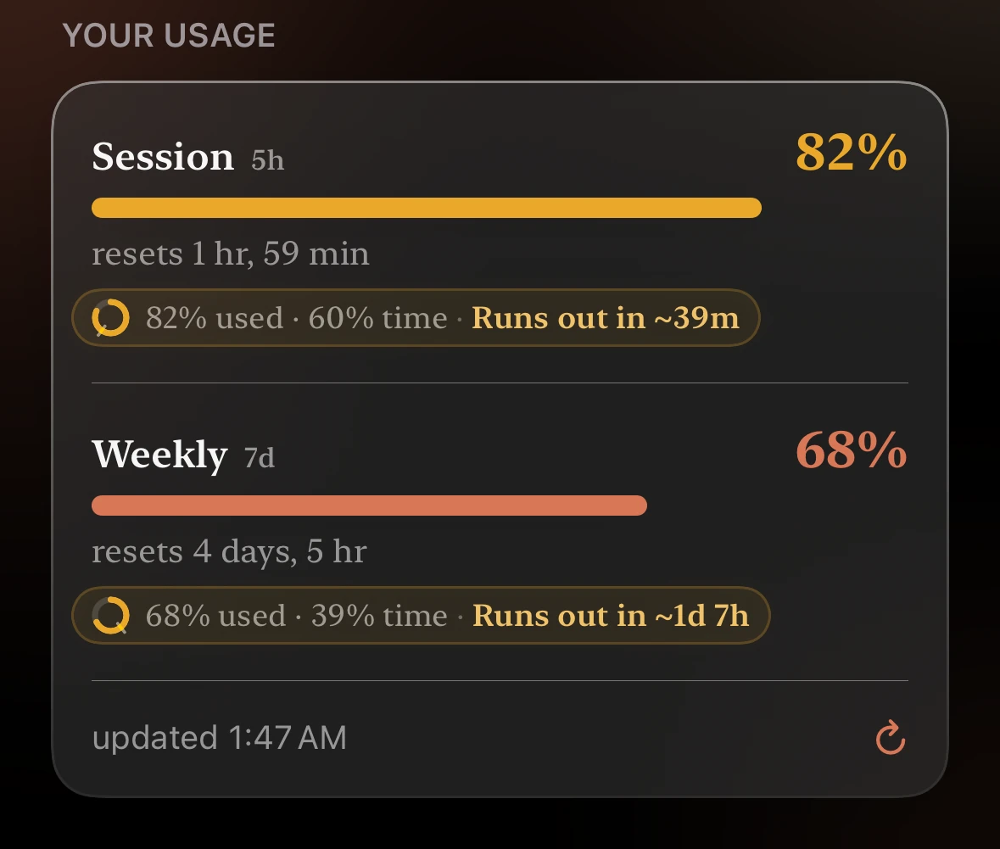
  

</Frame>

줄은 `사용 45% · 경과 60%`처럼 두 숫자로 시작합니다.

- **사용**: 한도 중 얼마나 썼는지.
- **경과**: 기간 중 시간이 얼마나 지났는지.

사용이 경과보다 낮으면 괜찮습니다. 숫자 뒤에는 다음 중 하나가 표시됩니다.

- **재설정까지 충분**: 괜찮습니다.
- **소진까지**와 남은 시간: 호박색으로 표시됩니다. 지금 속도라면 재설정 전에
  다 써버립니다. 앞에 붙은 `~`는 추정치라는 뜻입니다.
- **아직 판단하기 이릅니다**: 기간이 막 시작되었습니다.
- **한도 도달**: 한도를 모두 썼습니다.

일부 Cursor 요금제에는 사용 속도가 없습니다.
그런 한도에는 이 줄이 표시되지 않습니다.

홈 화면에서는 [Nomo 사용 속도](/ko/widgets#nomo-pace) 위젯이 같은 내용을
보여줍니다.

**Nomo Pro가 없으면** 첫 번째 한도 아래에 **재설정 전에 소진될지 확인하세요**
줄 하나만 **PRO** 태그와 함께 표시됩니다. 탭하면 Nomo Pro가 열립니다.

## 한도에 도달했을 때

어느 구간이든 100%에 도달하면 사용량 카드 아래에 **한도 도달** 안내가 나타나고,
버튼이 하나 있습니다 — **Claude에서 사용량 관리**, 또는 보고 있는 제공업체의
이름으로 표시됩니다. 이 버튼은 해당 제공업체의 사용량 설정을 브라우저에서 열며,
요금제에 따라 그곳에서 추가 사용량을 이용할 수 있습니다.

Nomo는 그곳에서 무엇을 제공하는지 볼 수 없고, 직접 판매하는 것도 없습니다. 어차피
찾아가야 했을 페이지로 가는 지름길일 뿐입니다.

이 안내는 Claude, Codex, Cursor, xAI에 대해, 미국, 유럽 연합, 일본의 App Store
계정에서 표시됩니다.

## 여러 계정  {#more-than-one-account}

Nomo Pro에서는 제공업체마다 계정을 최대 5개까지 추가할 수 있습니다. 예를 들어
업무용 Claude 계정과 개인용 계정입니다. 계정마다 행이 따로 있고, 각자의
사용량이 표시됩니다.

<Frame caption="Claude 계정 2개. Work가 기본 계정입니다.">
  

    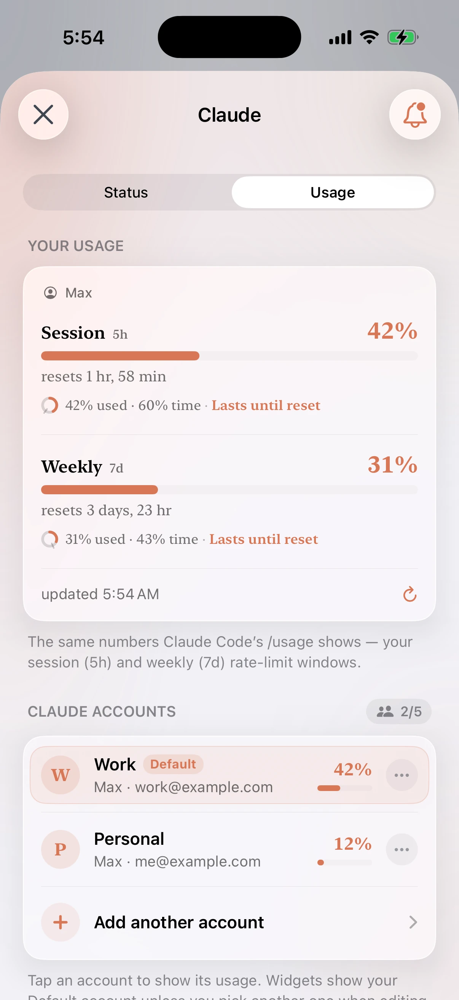
    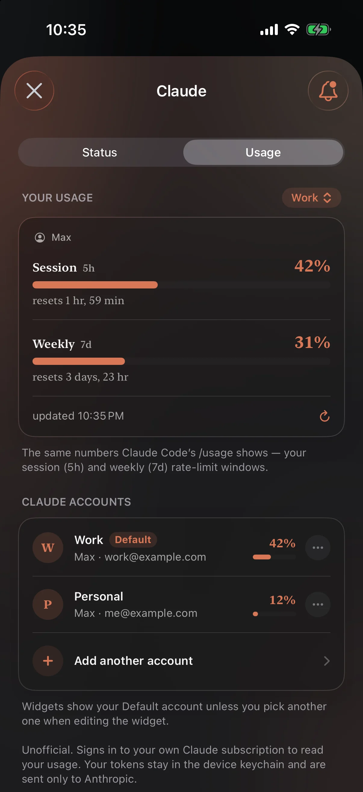
  

</Frame>

### 다른 계정 추가 {#add-another-account}

1. Nomo를 엽니다.
2. **제공업체** 탭을 탭합니다.
3. **Claude** 같은 제공업체를 탭합니다.
4. 위쪽의 **사용량**을 탭합니다.
5. 첫 번째 계정에 로그인되어 있는지 확인합니다.
6. 계정 아래에서 **다른 계정 추가**를 탭합니다.
7. **계속**을 탭합니다.
8. 다른 계정으로 로그인합니다. 첫 번째 계정과 다른 이메일을 사용하십시오.

<Frame caption="계속을 탭하면 로그인 페이지가 열립니다. X를 탭하면 아무것도 추가하지 않고 닫힙니다.">
  

    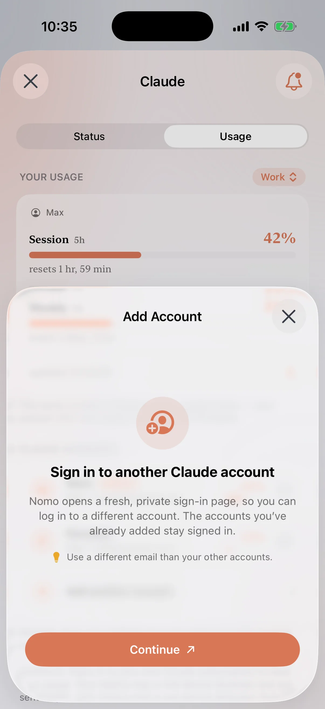
    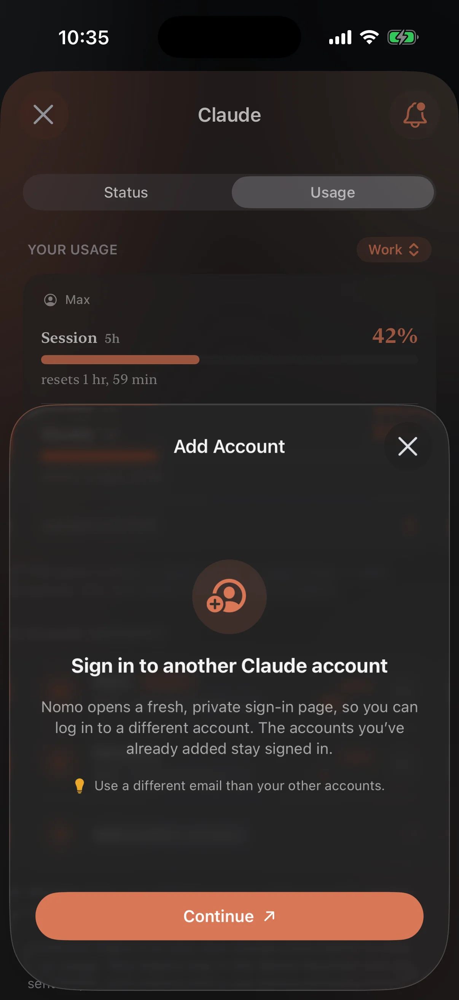
  

</Frame>

Nomo는 새로운 비공개 로그인 페이지를 열기 때문에, 이미 로그인한 계정을 다시
쓰지 않습니다. 이미 추가한 계정은 로그인 상태로 유지됩니다.

Claude는 로그인한 뒤 코드를 보여줍니다.

1. 코드를 복사합니다.
2. Nomo로 돌아옵니다. Nomo가 코드를 붙여넣고 연결합니다.
3. 아무 일도 일어나지 않으면 **붙여넣기**를 탭한 다음 **연결**을 탭합니다.

<Frame caption="Claude: 로그인한 뒤 Claude가 보여주는 코드를 붙여넣습니다.">
  

    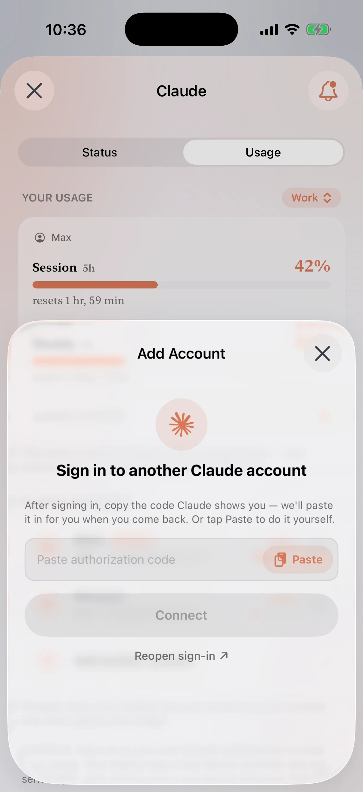
    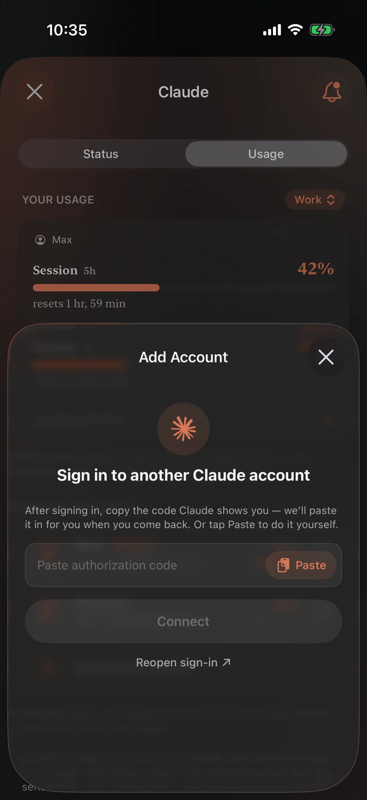
  

</Frame>

제공업체가 이메일을 알려주면, 새 계정의 이름은 그 이메일 주소가 됩니다. 이미
Nomo에 있는 계정으로 로그인하면 **이미 추가된 계정입니다**가 표시되고 아무것도
바뀌지 않습니다.

제공업체의 계정이 5개가 되면 **다른 계정 추가**가 흐리게 표시됩니다.

### 계정 관리 {#manage-accounts}

계정 옆의 **···**을 탭한 다음 아래 중 하나를 탭합니다.

- **이름 변경**: `업무`나 `개인` 같은 짧은 이름을 붙입니다.
- **기본으로 설정**: 이 계정을 기본 계정으로 만듭니다. 기본 계정에는 **기본**
  태그가 붙습니다.
- **제거**: 이 계정을 Nomo에서 로그아웃합니다. 다른 계정은 로그인 상태로
  유지됩니다. 이 계정을 보여주던 위젯에는
  **제거된 계정**이 표시되고, 다른 계정을 고르라는 안내가 나옵니다. 기본
  계정으로 바뀌지는 않습니다.

<Frame caption="기본 계정이 아닌 계정의 ··· 메뉴.">
  

    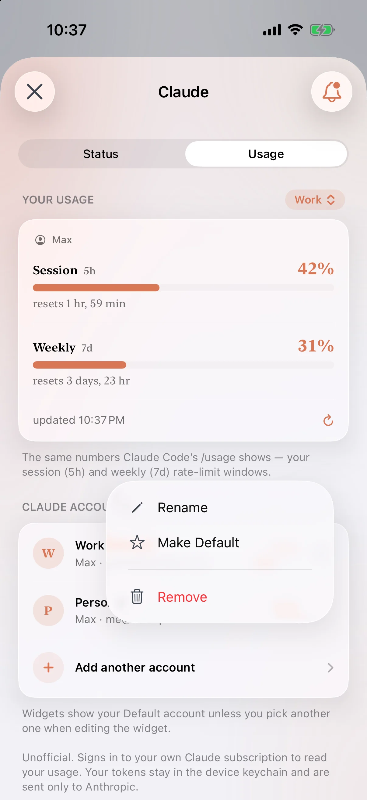
    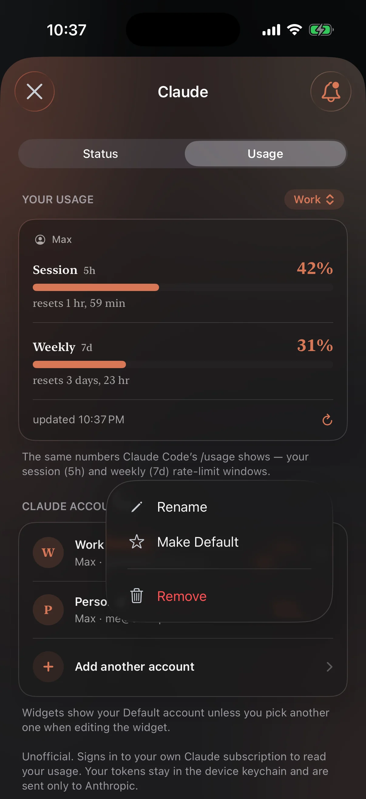
  

</Frame>

위쪽의 **내 사용량** 카드는 기본 계정을 보여줍니다. 다른 계정을 보려면 카드
모서리의 계정 이름을 탭하고 하나를 고릅니다.

### 위젯의 계정 {#accounts-in-widgets}

위젯은 다른 계정을 고르지 않으면 기본 계정을 보여줍니다.

1. 위젯을 길게 터치합니다.
2. **위젯 편집**을 탭합니다.
3. **계정**을 탭하고 하나를 고릅니다.

**계정** 옵션은 [Nomo 사용량](/ko/widgets#nomo-usage)과
[Nomo 사용 속도](/ko/widgets#nomo-pace)에 있습니다.
[Nomo 계정](/ko/widgets#nomo-accounts)은 모든 계정을 한 번에 보여줍니다.

### Nomo Pro가 없을 때 {#without-nomo-pro}

Nomo Pro가 없으면 제공업체마다 계정을 하나만 쓸 수 있습니다. **다른 계정
추가**에는 **PRO** 태그가 표시됩니다. 탭하면 Nomo Pro가 열립니다. 구독하면
바로 계정 추가로 넘어갑니다. 데모 모드로는 추가 계정을 쓸 수 없습니다.

Nomo Pro가 끝나면 추가 계정은 제거되지 않고 일시 중지됩니다. **일시 중지됨 ·
PRO**로 표시되고, 기본 계정만 계속 업데이트됩니다. 기본 계정은 일시 중지되지
않습니다. 이어서 쓰려면 **다시 구독하기**를 탭합니다.

일시 중지된 계정으로 설정한 Nomo 사용량 위젯에는 **일시 중지됨 · Nomo Pro**와
`Nomo Pro가 종료되었습니다. Nomo에서 다시 구독하면 이 계정을 볼 수 있습니다.`가
표시됩니다. 탭하면 Nomo Pro가 열립니다.

## 위젯

<Card title="위젯" href="/ko/widget" icon="puzzle-piece" horizontal>
  짧은 클립 두 개 — 홈 화면에 올리는 방법, 그리고 볼 서비스를 지정하는 방법.
</Card>

## 알림

<Card title="알림" href="/ko/notifications" icon="bell" horizontal>
  제공업체 사용량이 70%, 90%, 100%에 도달하면 알려 줍니다.
</Card>
