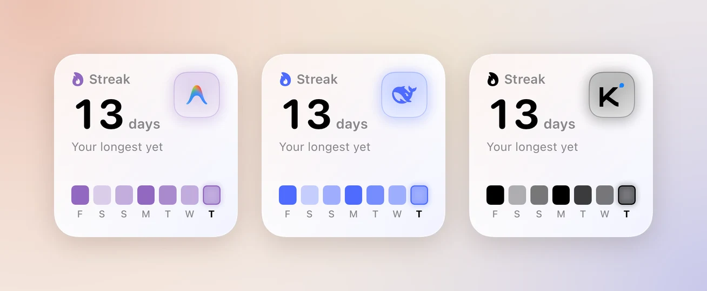
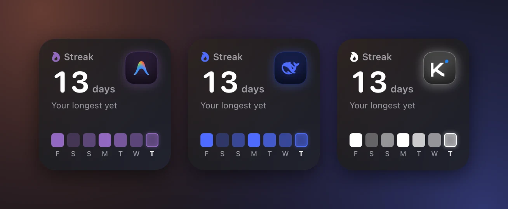

Nomo Pro는 무료 위젯에 위젯 5개를 더합니다. 각 위젯은 원래라면 앱을 열어야
알 수 있는 질문에 답합니다.

- **Nomo 사용 속도**: 사용량이 재설정될 때까지 버틸까?
- **Nomo 활동**: 에이전트와 며칠 연속으로 코딩했을까?
- **Nomo 계정**: 내 계정 중 어느 것이 가장 적게 남았을까?
- **실시간 에이전트**: 내 에이전트는 지금 무엇을 하고 있을까?
- **Nomo 토큰**: 어떤 모델로 토큰을 얼마나 썼을까?

<Frame caption="홈 화면에 놓은 Pro 위젯 5개 전부: Nomo 사용 속도, 실시간 에이전트, Nomo 활동, Nomo 토큰, Nomo 계정.">
  

    
    
  

</Frame>

Nomo 사용 속도와 Nomo 활동은 잠금 화면 크기로도 제공됩니다.

무료 위젯인 Nomo 상태와 Nomo 사용량은 [무료 위젯](/ko/free-widgets)에
있습니다. 홈 화면에 위젯을 놓으려면 [위젯](/ko/widget)을 참고하십시오.

위젯 갤러리에서 Pro 위젯의 설명은 **👑 Nomo Pro**로 시작합니다.

Nomo Pro가 없어도 Pro 위젯을 추가할 수 있습니다. 이때는 흐리게 표시된
미리보기 위에 **Nomo Pro**와 **잠금 해제**가 표시됩니다. 탭하면 앱에서
Nomo Pro가 열립니다.

## Nomo 사용 속도 {#nomo-pace}

<Frame caption="소형과 중형, 그리고 잠금 화면의 Nomo 사용 속도.">
  

    
    
  

</Frame>

**보여주는 내용:** 지금 속도로 계속 쓰면 한도가 재설정되기 전에 다 써버릴지
여부입니다.

큰 숫자 아래의 줄은 두 가지를 비교합니다.

- **사용**: 한도 중 얼마나 썼는지.
- **경과**: 기간 중 시간이 얼마나 지났는지.

예를 들어 `사용 45% · 경과 60%`입니다. 사용이 경과보다 낮으면 괜찮습니다.
위젯에 **재설정까지**와 재설정까지의 카운트다운이 표시됩니다.

사용이 경과보다 높으면 너무 빨리 쓰고 있는 것입니다. 위젯에 **소진까지**와
다 써버릴 때까지의 카운트다운이 표시됩니다. 앞에 붙은 `~`는 추정치라는
뜻입니다. 숫자는 호박색으로 바뀝니다.

다음 표시도 볼 수 있습니다.

- **아직 판단하기 이릅니다**: 기간이 막 시작된 직후입니다. 아직 판단할 근거가
  충분하지 않습니다.
- **한도 도달**: 기간이 100%에 도달했을 때입니다. 카운트다운은 재설정까지의
  시간입니다.
- **이 요금제에서는 사용 속도를 표시할 수 없습니다**: 제공업체가 한도의 재설정
  시점을 알려주지 않을 때입니다.

크기별 내용:

| 크기 | 표시 내용 |
| --- | --- |
| 소형 | 기간 하나와 그 링. |
| 중형 | 기간 두 개. 보통 5시간 기간과 주간 기간입니다. |
| 잠금 화면, 원형 | 얼마나 썼는지. 체크 표시는 괜찮다는 뜻입니다. 너무 빨리 쓰고 있으면 다 써버릴 시각을 표시합니다. |
| 잠금 화면, 직사각형 | `재설정까지 충분` 또는 다 써버릴 시각(예: `~오후 9:20 소진`). |

모든 링은 사용한 만큼 채워집니다. 작은 눈금은 고르게 사용했다면 지금 어디쯤
있어야 하는지를 나타냅니다. 채워진 부분이 눈금에 못 미치면 괜찮습니다.

**사용됨 또는 남음:** Nomo 사용 속도는 **설정 → 사용량 → 사용량 표시 방식**을
따릅니다. **남음**을 고르면 줄에 `남음 55% · 남은 시간 40%`처럼 표시됩니다. 링은
줄어드는 방식으로 바뀝니다. 채워진 부분은 남은 양을, 작은 눈금은 남은 시간을
나타냅니다. 채워진 부분이 눈금을 넘으면 괜찮습니다. 모든 크기에서 숫자도 바뀝니다.

**먼저 필요한 것:** Claude나 Codex 같은 연결된 계정. **제공업체** 탭을 열고
제공업체를 탭해 연결합니다. [사용량](/ko/usage)을 참고하십시오.

**설정하기:**

1. 위젯을 추가합니다. [위젯](/ko/widget)을 참고하십시오.
2. 위젯을 길게 터치합니다.
3. **위젯 편집**을 탭합니다.
4. **제공업체**를 탭하고 **Claude** 같은 제공업체를 하나 고릅니다.
5. **계정**을 탭하고 하나를 고릅니다. **기본**은 앱의 기본 계정을 따릅니다.
6. **기간**을 탭하고 하나를 고릅니다. **자동**은 요금제에 5시간 기간이 있으면
   그것을, 없으면 주간 기간을 사용합니다. 이 설정은 소형과 잠금 화면 크기를
   바꿉니다.
7. 위젯 바깥을 탭해 마칩니다.

위젯을 탭하면 Nomo에서 해당 제공업체의 **사용량** 페이지가 열립니다.

## Nomo 활동 {#nomo-activity}

<Frame caption="소형, 중형, 대형, 그리고 잠금 화면의 Nomo 활동.">
  

    
    
  

</Frame>

**보여주는 내용:** GitHub 프로필에 있는 것과 같은, AI 에이전트로 코딩한 날의
지도와 연속 기록입니다. 연속 기록은 며칠 연속으로 코딩했는지를 뜻합니다.
페어링한 모든 컴퓨터에 더해, Cursor 로그인에서 가져온 Grok Bot과 Cursor까지
합산합니다. [여러 컴퓨터](#more-than-one-computer)를 참고하세요.

색이 진할수록 그날 코딩을 많이 했다는 뜻입니다. 연속 기록은 아침에 초기화되지
않습니다. 그날 첫 세션 전까지는 어제까지의 기록을 셉니다.

| 크기 | 표시 내용 |
| --- | --- |
| 소형 | 연속 기록과 최근 7일. |
| 중형 | 연속 기록, 최근 16주, 지도 아래의 수치 3개. |
| 대형 | 제목 아래의 **최근 26주**, 같은 수치 3개가 있는 지도, 백분율로 보는 에이전트별 활동 비율, 그리고 합계: 세션, 토큰, 가장 많이 코딩한 날, 최장 연속 기록. |
| 잠금 화면, 직사각형 | 연속 기록과 최근 7일. |

지도 아래의 수치 3개는 지도에 표시된 주를 기준으로 합니다.

- 시계: 활동 시간.
- 달력: 활동한 날 수.
- 막대 차트: 주 평균.

중형에 공간이 부족하면 처음 2개만 표시됩니다. 그 기간에 활동 시간이 전혀
없으면 달력만 표시됩니다. [시간 없이 토큰만](#no-time-only-tokens)을
참고하십시오.

대형의 **토큰**은 26주 동안의 합계입니다. 컴퓨터에서 토큰 데이터가 전혀 오지
않으면 그 자리에 **활동 시간**이 대신 표시됩니다.

**먼저 필요한 것:**

- 컴퓨터에 설치한 Nomo 플러그인, 버전 **2.4.0** 이상.
  [설치](/ko/setup/install)와 [업데이트](/ko/sessions/commands#update)를
  참고하십시오.
- Nomo와 페어링한 그 컴퓨터. [페어링](/ko/setup/pairing)을 참고하십시오.

Claude Code, Codex, OpenCode를 셉니다. 플러그인이 컴퓨터에 이미 있는 기록을
읽기 때문에 지난 날짜도 표시됩니다.

Grok Bot과 Cursor도 셉니다. 컴퓨터는 필요 없습니다. [Grok Bot](#grok-bot)을
참고하십시오.

**설정하기:**

1. 위젯을 추가합니다. [위젯](/ko/widget)을 참고하십시오.
2. 위젯을 길게 터치합니다.
3. **위젯 편집**을 탭합니다.
4. **캐릭터**를 탭하고 **자동**, **Clawd**, **Codex**, **Grok Bot**,
   **Antigravity**, **Kimi**, **DeepSeek**, **Cursor**, **OpenCode** 중
   하나를 고릅니다.
5. 위젯 바깥을 탭해 마칩니다.

**자동**은 최근 7일 동안 가장 많이 쓴 에이전트, 즉 활동 시간이 가장 긴
에이전트를 보여줍니다. 그 기간에 Grok Bot이나 Cursor가 활동했다면 대신 활동한
날이 가장 많은 에이전트를 보여줍니다. 동점이면 최근 30일 동안 활동한 날이 더
많은 에이전트가 표시됩니다. [활동 화면](#activity-screen)도 같은 규칙을
따릅니다.

다른 것을 고르면 그 캐릭터가 표시되고, 지도와 오늘 칸, 연속 기록의 불꽃과 배지가 그
캐릭터의 색으로 바뀝니다(Clawd는 코럴, Codex는 파란색, Grok Bot은 금색).
대형에서 에이전트별 시간 비율을 보여주는 막대는 각 에이전트의 색을
유지합니다. 이미 홈 화면에 있던 위젯은 **자동**으로 시작합니다.

<Frame caption="Clawd, Codex, Grok Bot으로 설정한 Nomo 활동.">
  

    
    
  

</Frame>

움직이는 캐릭터는 Clawd, Codex, Grok Bot뿐입니다. Antigravity, Kimi,
DeepSeek, Cursor, OpenCode는 브랜드 색 타일 위에 로고를 보여주고, 지도와
불꽃, 오늘 칸, 빛도 그 색으로 바뀝니다.

Clawd의 표정은 연속 기록을 따릅니다. 연속 기록이 없으면 잠을 잡니다. 오늘
이미 코딩했다면 운동을 하고, 오늘 아직 기록이 없으면 타자를 칩니다. 연속
기록이 30일 이상이거나, 7일 이상이면서 지금까지의 최장 기록이면 Clawd는
Claude 스파크로 바뀝니다. 이때도 선택은 그대로 **Clawd**입니다. Grok Bot은
연속 기록이 없으면 잠을 잡니다. Codex는 항상 같은 모습입니다.

<Frame caption="Antigravity, DeepSeek, Kimi로 설정한 Nomo 활동.">
  

    
    
  

</Frame>

플러그인은 새 요약을 최대 6시간에 한 번 보내고, 플러그인을 업데이트한 직후에도
한 번 보냅니다. Nomo는 앱을 열 때 이를 가져오며, 최대 1시간에 한 번입니다.
그래서 지도가 몇 시간 늦을 수 있습니다. [활동 화면](#activity-screen)을 열면
최신 요약을 바로 가져옵니다(최대 30초에 한 번). 그 화면에서 아래로 당겨 다시
가져올 수도 있습니다.

위젯을 탭하면 Nomo의 [활동 화면](#activity-screen)이 열립니다.

이 지도를 위해 컴퓨터에서 나가는 정보는 [개인정보 보호](#privacy)에
나와 있습니다. 횟수만 나가며, 프롬프트나 코드는 절대 나가지 않습니다.

### Grok Bot {#grok-bot}

Nomo 2.4.2부터는 Nomo 활동과 Nomo 토큰이 Grok Bot도 셉니다. 컴퓨터는 필요
없습니다.

**먼저 필요한 것:**

- Nomo 2.4.2와 Nomo Pro.
- Grok Bot에 쓰는 계정과 같은 계정으로 Nomo에 연결한 Cursor. Grok이 아니라
  Cursor를 연결하십시오. [Cursor와 Grok](/ko/usage#cursor-and-grok)을
  참고하십시오.

그런 다음 [활동 화면](#activity-screen)을 엽니다. 열 때 Grok Bot을 쓴 날과
토큰을 가져옵니다. 위젯에 Grok Bot을 표시하려면 **캐릭터**에서 **Grok Bot**을
고르십시오.

**집계되는 것:**

- 그날 Grok Bot이 토큰을 조금이라도 썼다면 그날을 셉니다. 예약된 루틴과 Grok
  Bot 휴대폰 앱에서 쓴 것도 셉니다.
- Nomo 토큰과 활동 화면에는 Grok Bot의 실제 토큰 수가 표시됩니다.
- Cursor 편집기나 명령줄에서 직접 쓴 Cursor 사용은 **Cursor**라는 별도의 줄에
  표시됩니다.

#### 시간 없이 토큰만 {#no-time-only-tokens}

Grok Bot과 Cursor는 Cursor가 토큰만 알려줍니다. 시간과 세션은 없습니다.
그래서 다음과 같이 표시됩니다.

- **활동 시간**이나 **세션**처럼 시간이나 세션이 필요한 수치는 다른 데서
  가져올 값이 없으면 **—**로 표시됩니다.
- 지도에서 Grok Bot이나 Cursor를 쓴 날은 토큰 양에 따라, 그 에이전트의 다른
  날과 비교해 색이 칠해집니다.
- Grok Bot이나 Cursor가 활동했다면 에이전트별 비율은 시간이 아니라 활동한 날
  수로 셉니다.
- 합계는 Cursor가 알려준 값이며, 캐시된 토큰이 포함될 수 있습니다.
  [활동 화면](#activity-screen)에서는 **모델별** 아래의 안내에 그렇게
  표시됩니다.

Nomo가 읽는 정보는 [개인정보 보호](#privacy)에 나와 있습니다.

<Card title="Grok Bot 위젯을 iPhone에" icon="newspaper" href="https://nomo.gg/ko/blog/grok-bot-widget-iphone/" horizontal>
  사진과 함께 보는 전체 안내는 Nomo 블로그에 있습니다.
</Card>

## Nomo 토큰 {#nomo-tokens}

<Frame caption="중형과 대형의 Nomo 토큰.">
  

    
    
  

</Frame>

**보여주는 내용:** 에이전트가 최근 14일 동안 날마다 쓴 토큰 양. 날마다
모델별로 나뉘며, 원하면 에이전트별로 나눌 수도 있습니다. 페어링한 모든 컴퓨터에
더해, Cursor 로그인에서 가져온 Grok Bot과 Cursor까지 합산합니다.

여기서 토큰은 입력 + 출력 + 추론입니다. 캐시는 세지 않습니다. 같은 컨텍스트를
다시 읽는 것이라 다른 수치를 모두 덮어버리기 때문입니다. 캐시는
[활동 화면](#activity-screen)에서 따로 보여줍니다.

| 크기 | 표시 내용 |
| --- | --- |
| 중형 | 14일 합계, 오늘의 토큰, 가장 많이 쓴 모델과 그 비율. 에이전트별이면 대신 가장 많이 쓴 에이전트. |
| 대형 | 제목 아래의 **최근 14일**. 같은 수치에 더해 지난주 대비 변화와 상위 모델 4개. 나머지는 `기타 모델 6개`처럼 한 행으로 합쳐집니다. 에이전트별이면 대신 에이전트를 최대 5개까지. |

모든 모델은 어디서나 같은 색을 유지합니다. Claude 모델은 코럴, GPT는 파란색,
Grok은 금색, Gemini는 보라색, 그 밖의 모델은 회색입니다. 에이전트별로 보면
에이전트마다 고유한 색이 있습니다. 예를 들어 Claude Code는 코럴, Codex는
파란색, Grok Bot은 금색입니다. Cursor의 선은 점선입니다.

**먼저 필요한 것:** Nomo 활동과 같습니다. Nomo 플러그인이 있는 페어링된
컴퓨터가 필요합니다. Grok Bot은 Nomo에 Cursor를 연결하면 됩니다.
[Nomo 활동](#nomo-activity)을 참고하십시오.

**설정하기:**

1. 위젯을 추가합니다. [위젯](/ko/widget)을 참고하십시오.
2. 위젯을 길게 터치합니다.
3. **위젯 편집**을 탭합니다.
4. **캐릭터**를 탭하고 하나를 고릅니다. 선택지는
   [Nomo 활동](#nomo-activity)과 같습니다.
5. **그룹 기준**을 탭하고 **모델**이나 **에이전트**를 고릅니다.
6. **스타일**을 탭하고 **막대**나 **선**을 고릅니다.
7. **에이전트**를 골랐다면 새로 나타나는 **에이전트** 항목을 탭합니다. 원하는
   에이전트를 고릅니다: Claude Code, Codex, OpenCode, Grok Bot, Cursor. 처음에는
   모두 선택되어 있습니다.
8. 위젯 바깥을 탭해 마칩니다.

**에이전트** 항목은 **그룹 기준**이 **에이전트**일 때만 표시됩니다. 에이전트를
일부만 고르면 수치는 그 에이전트만 셉니다. 합계 아래의 레이블도 **14일 합계**
대신 **선택한 에이전트**로 바뀝니다. 고른 에이전트가 14일 동안 토큰을 전혀 쓰지
않았다면 위젯은 모든 에이전트를 보여줍니다.

이미 홈 화면에 있던 위젯은 **모델**과 **막대**로 시작하므로 전과 똑같이
보입니다.

**자동**은 가장 많이 쓴 모델의 제공업체를 따릅니다. Claude면 Clawd, GPT면
Codex, Grok이면 Grok Bot, Gemini면 Antigravity, Kimi, DeepSeek, Cursor
모델이면 각각의 로고입니다. 그 밖의 모델은 Clawd입니다. 고른 캐릭터는
캐릭터, 배경의 빛, 오늘 막대만 바꿉니다.
모델 색은 바뀌지 않습니다.

위젯에 Clawd가 표시되면 Clawd의 표정은 토큰을 따릅니다. 3일 동안 토큰이 없으면
잠을 자고, 오늘 아직 토큰이 없으면 타자를 칩니다. 오늘이 14일 중 가장 많이 쓴
날이면 Clawd는 Claude 스파크로 바뀝니다. 이때도 선택은 그대로 **Clawd**입니다.
Grok Bot은 3일 동안 토큰이 없으면 잠을 잡니다.

위젯을 탭하면 Nomo의 [활동 화면](#activity-screen)이 열립니다. Nomo Pro가
없으면 탭했을 때 Nomo Pro가 열립니다.

Nomo 활동과 같은 요약을 사용합니다. 컴퓨터에서 나가는 정보는
[개인정보 보호](#privacy)에 정리되어 있습니다.

## Nomo 계정 {#nomo-accounts}

<Frame caption="중형과 대형의 Nomo 계정.">
  

    
    
  

</Frame>

**보여주는 내용:** 모든 제공업체의 연결된 계정을 한 보드에 보여줍니다. 가장
적게 남은 계정이 맨 위에 옵니다.

각 행에는 계정 이름, 다 쓰기에 가장 가까운 기간, 사용한 양, 재설정 시점이
표시됩니다.

숫자, 막대, 열 제목은 **설정 → 사용량 → 사용량 표시 방식**을 따릅니다. **남음**을
고르면 남은 양을 보여줍니다. 순서는 바뀌지 않습니다.

- **중형**은 4행, **대형**은 8행을 보여줍니다.
- 계정이 그보다 많으면 마지막 행에 `외 3개`처럼 나머지 개수가 표시됩니다.
- 다시 로그인해야 하는 계정은 **Nomo에서 다시 연결**과 함께 보드 맨 아래에
  남습니다. 절대 사라지지 않습니다.

**먼저 필요한 것:** 연결된 계정 하나 이상. 같은 제공업체의 계정 두 개를
추적하려면 [여러 계정](#more-than-one-account)을 참고하십시오.

**설정하기:** 위젯을 추가합니다. [위젯](/ko/widget)을
참고하십시오. **위젯 편집**에서 고를 것은 없습니다.

보드는 Nomo가 마지막으로 가져온 수치를 보여줍니다. 대형에서는 모서리의 새로
고침 버튼을 탭하면 모든 계정을 새로 고칩니다.

계정 행을 탭하면 Nomo에서 해당 제공업체의 **사용량** 페이지가 열리고, 그 계정이
표시됩니다. **Nomo에서 다시 연결** 행도 같습니다. 다른 곳(`외 3개` 행 포함)을
탭하면 **제공업체** 탭이 열립니다. Nomo Pro가 없으면 탭했을 때 Nomo Pro가
열립니다.

## 실시간 에이전트 {#live-agents}

<Frame caption="소형과 중형의 실시간 에이전트. 보라색 행은 답변이 필요합니다.">
  

    
    
  

</Frame>

**보여주는 내용:** 지금 진행 중인 Claude Code, Codex, 그 밖의 에이전트
세션입니다. **세션** 탭과 같은 목록입니다.

**보라색은 답변이 필요한 세션이 있다는 뜻입니다.**

| 아이콘 | 레이블 | 의미 |
| --- | --- | --- |
| 보라 손 | `권한 필요` | 동작에 대한 권한을 요청합니다. 휴대폰에서 답할 수 있습니다. |
| 보라 손 | `답변 필요` | 질문을 하고 있습니다. 휴대폰에서 답할 수 있습니다. |
| 주황 손 | `주의 필요` | 멈춰서 기다리고 있지만, 휴대폰에서 답할 것은 없습니다. |
| 주황 점 | `실행 중` | 작업 중입니다. 할 일은 없습니다. |
| 초록 체크 | `완료` | 끝났습니다. |

[세션 탭](/ko/sessions/list#session-states)의 표시와 같습니다.

- **소형**은 실행 중인 세션 수를 보여줍니다. 답할 세션이 있으면 보라색 버튼이
  알려줍니다.
- **중형**은 세션을 최대 3개 보여줍니다. 답할 세션이 먼저 옵니다.

위젯에는 허용이나 거부 버튼이 없습니다. 위젯을 탭하면 Nomo에서 **세션**이
열립니다. 중형에서는 세션을 탭하면 그 세션이 열립니다.

위젯은 Nomo 앱의 세션 목록을 복사해 옵니다. 10분 동안 업데이트되지 않으면
호박색 점과 마지막 업데이트 후 지난 시간이 표시됩니다. Nomo를 열면 새로
고쳐집니다.

**먼저 필요한 것:** Nomo 플러그인을 설치하고 페어링한 컴퓨터.
[설치](/ko/setup/install)와 [페어링](/ko/setup/pairing)을 참고하십시오.

**설정하기:**

1. 위젯을 추가합니다. [위젯](/ko/widget)을 참고하십시오.
2. 위젯을 길게 터치합니다.
3. **위젯 편집**을 탭합니다.
4. **캐릭터**를 탭하고 하나를 고릅니다. 선택지는
   [Nomo 활동](#nomo-activity)과 같습니다.
5. 위젯 바깥을 탭해 마칩니다.

**자동**은 목록 맨 위 세션을 따릅니다. Antigravity, Cursor, OpenCode
세션이면 그 로고가 표시됩니다. 다른 것을 고르면 그 캐릭터가
표시되고 배경에 그 색이 옅게 깔립니다. 상태 색은 바뀌지 않습니다. 보라색은
여전히 답이 필요한 세션이 있다는 뜻입니다. 이미 홈 화면에 있던 위젯은
**자동**으로 시작합니다.

## 활동 화면과 결산 {#activity-screen}

활동 화면은 연속 기록과 토큰을 자세히 보여줍니다. 공유할 수 있는 결산
카드도 만들어 줍니다.

<Frame caption="활동 화면 위쪽: 연속 기록, 7 / 14 / 30일 전환, 토큰 차트.">
  

    
    
  

</Frame>

여는 방법:

1. Nomo를 엽니다.
2. **세션** 탭을 탭합니다.
3. 탭 막대 바로 위의 [연속 기록 바](#streak-bar)를 탭합니다. iOS 26.0 이하에서는
   대신 목록 맨 위의 **활동** 카드를 탭합니다.

Nomo 활동이나 Nomo 토큰 위젯을 탭해도 열립니다. Nomo가 닫혀 있어도 됩니다.
Nomo는 Nomo Pro 구독 여부를 확인한 뒤에 화면을 열기 때문에, 구독자가 실수로
Nomo Pro 화면으로 가는 일은 없습니다.

iOS 26.0 이하에서 Nomo Pro가 없으면 카드에 왕관, **활동**, **연속 기록, 일일
토큰, 결산은 Nomo Pro에서.**가 표시됩니다. 탭하면 Nomo Pro가 열립니다.

화면에 표시되는 내용:

- **연속 기록**: 연속 기록과 최근 26주의 지도. 지도 위에는 월 이름이,
  아래에는 [위젯](#nomo-activity)과 같은 수치 3개가 표시됩니다. 그 아래에는
  백분율로 보는 에이전트별 활동 비율, 그리고 **세션**과 **가장 활발한 날**이
  있습니다.
- **나의 결산**: 공유할 이미지를 만드는 카드. [결산](#wrapped)을
  참고하십시오.
- **7일**, **14일**, **30일** 전환. 전환하면 차트가 다음 기간으로 움직이며
  바뀝니다.
- **토큰**: 일일 토큰 차트와 **오늘**, **일 평균**, **활동 시간**, 이전 기간
  대비 변화. [토큰 차트](#tokens-chart)를 참고하십시오.
- **모델별**: 모델마다 **입력**, **출력**, **캐시**, **합계**를 보여주는 표.

**가장 활발한 날**은 활동 시간이 가장 긴 날입니다. 예를 들어
`가장 활발한 날 · 1h 59m`처럼 표시됩니다. 활동 시간이 전혀 없으면 토큰을 가장
많이 쓴 날입니다.

화면을 열면 1초 정도 애니메이션과 함께 나타납니다. **동작 줄이기**를 켜 두었다면
모든 내용이 바로 표시됩니다.

화면의 캐릭터와 색은 **자동**으로 설정한 [Nomo 활동](#nomo-activity)처럼 가장
많이 쓴 에이전트를 따릅니다. 연속 기록 바도 마찬가지입니다. 다른 캐릭터를
고르려면 [캐릭터 선택](#activity-character)을 참고하십시오.

### 캐릭터 선택 {#activity-character}

연속 기록 카드 아래에 **캐릭터를 선택하려면 길게 터치하세요**라고 표시됩니다.

1. 연속 기록 카드를 길게 터치합니다.
2. 카드가 떠오르며 뒤집혀 **캐릭터**가 나타납니다.
3. 캐릭터를 탭합니다: **자동**, **Clawd**, **Codex**, **Grok Bot**,
   **Antigravity**, **Kimi**, **DeepSeek**, **Cursor**, **OpenCode**.

카드는 저절로 다시 뒤집힙니다. 바꾸지 않고 돌아가려면 **×**를 탭하거나 카드
바깥을 탭합니다.

각 행에는 두 번째 줄이 있습니다.

- **자동**: 지금 표시되는 캐릭터. 예를 들어
  `가장 많이 쓴 에이전트를 따릅니다 · 현재 Clawd`처럼 표시됩니다.
- 내가 쓴 에이전트의 캐릭터: 활동에서 그 에이전트가 차지하는 비율. 예를 들어
  `활동의 38%`처럼 표시됩니다.
- 그 밖의 캐릭터: **아직 활동이 없습니다**.

고른 캐릭터에 따라 활동 화면과 [연속 기록 바](#streak-bar)의 캐릭터와 색이
바뀝니다. Nomo는 이 선택을 기억합니다. 위젯은 **위젯 편집**에 자체 **캐릭터**
옵션이 있고, 결산은 항상 가장 많이 쓴 에이전트를 따릅니다.

VoiceOver에서는 카드의 **캐릭터 변경** 동작을 사용하십시오.

### 토큰 차트 {#tokens-chart}

**토큰** 제목 옆에 전환 버튼 2개가 있습니다. 화면이 작으면 제목 아래에
있습니다.

- **모델** 또는 **에이전트**: 날마다 모델별 또는 에이전트별로 나눕니다.
- **막대** 또는 **선**: 막대 아이콘은 막대 차트를 보여줍니다. 선 아이콘은
  모델이나 에이전트마다 선을 하나씩 보여줍니다.

기간은 지금처럼 **7일**, **14일**, **30일** 전환으로 정합니다.

모델별로 보면 차트에 상위 모델 5개가 표시됩니다. 나머지는 **기타**로
합쳐집니다.

차트 아래에는 모델이나 에이전트마다 이름과 합계가 있습니다. 이름을 탭하면
차트에서 숨겨집니다. 다시 탭하면 표시됩니다. 차트 위의 수치는 여전히 모두를
셉니다. 숨기면 차트만 바뀝니다.

Nomo는 다음에도 이 선택을 기억합니다.

### 차트 필터 {#tokens-filter}

토큰 카드 아래에 **필터를 설정하려면 길게 터치하세요**라고 표시됩니다.

1. 토큰 카드를 길게 터치합니다.
2. 카드가 떠오르며 뒤집혀 **필터**가 나타납니다. 모델이나 에이전트마다 합계와
   그 기간에서 차지하는 비율이 담긴 타일이 있습니다.
3. 타일을 탭하면 숨기거나 표시합니다. 체크 표시가 있으면 표시 중이라는
   뜻입니다.
4. 모두 다시 표시하려면 **모두 보기**를 탭합니다.
5. 돌아가려면 **×**를 탭하거나 카드 바깥을 탭합니다.

차트 아래의 이름을 탭하는 것과 같은 선택입니다. 마지막 하나는 숨길 수 없으며,
자물쇠가 표시됩니다.

숨긴 것이 있으면 카드에 `4개 중 3개 표시`처럼 표시 중인 개수가 나옵니다.

VoiceOver에서는 카드의 **필터** 동작을 사용하십시오.

### 연속 기록 바 {#streak-bar}

iOS 26.1 이상에서는 **세션** 탭의 탭 막대 바로 위에 작은 바가 떠 있습니다. 연속
기록, 이번 주 토큰, 최근 7일의 미니 막대가 표시됩니다.

- 스크롤하면 작아지면서 탭 막대 옆으로 이동합니다.
- 탭하면 활동 화면이 열립니다.

다음과 같이 표시될 때도 있습니다.

| 표시 | 뜻 | 탭하면 |
| --- | --- | --- |
| **연속 기록 시작하기** | 페어링한 컴퓨터가 없고, Nomo에 Cursor도 연결되어 있지 않습니다. | **컴퓨터 페어링**과 같은 페어링 단계가 열립니다. |
| **아직 세션이 없습니다** | 컴퓨터를 페어링했거나 Cursor를 연결했지만, 아직 활동이 들어오지 않았습니다. | 활동 화면이 열립니다. |
| **Nomo 플러그인 업데이트** | 페어링한 모든 컴퓨터의 Nomo 플러그인이 2.4.0보다 오래된 버전입니다. | 업데이트 단계가 열립니다. |

바가 작아졌을 때는 **컴퓨터 페어링**, **아직 세션이 없습니다**, **플러그인
업데이트**로 표시됩니다.

이 바는 Nomo Pro가 있어야 합니다. Nomo Pro가 없으면 바가 표시되지 않습니다.

Nomo의 새 버전이 나오면 이 자리에 업데이트 바가 대신 표시됩니다. Nomo를
업데이트하거나 업데이트 바의 **×**를 탭하면 연속 기록 바가 다시 나타납니다.

iOS 26.0 이하에서는 바가 없습니다. 대신 연속 기록 카드가 세션 목록 맨 위에
표시됩니다.

### 결산 {#wrapped}

결산은 한 주, 한 달, 한 해를 공유할 수 있는 이미지 한 장으로 만들어 줍니다.

1. 활동 화면에서 연속 기록 카드 바로 아래의 **나의 결산**을 탭합니다.
   오른쪽 위의 공유 버튼을 탭해도 됩니다.
2. **주**(최근 7일), **월**(최근 30일), **년**(올해) 중 하나를 탭합니다.
3. 옆의 전환 버튼에서 스타일을 탭합니다: 막대, 선, 히트맵.
4. **공유**를 탭한 다음 보낼 곳을 고릅니다.

스타일에 따라 카드의 차트가 바뀌고, 공유하는 이미지도 그렇게 바뀝니다.

- **막대**: 날마다의 토큰. 한 해는 달마다 보여줍니다.
- **선**: 에이전트마다 선 하나. 토큰 비율이 5% 미만인 에이전트는 빠집니다.
  단, 가장 많이 쓴 에이전트라면 표시됩니다.
- **히트맵**: 활동한 날. 한 주는 타일 7개, 한 달은 최근 30일을 두 줄로,
  한 해는 지금까지의 한 해 전체 지도를 보여줍니다.

Nomo는 다음에도 이 스타일을 기억합니다.

<Frame caption="한 주의 결산 카드. iPhone의 화면 모드와 상관없이 항상 어둡게 표시됩니다.">
  

    
  

</Frame>

카드에는 토큰, 차트, 활동 시간, 가장 많이 쓴 날, 최장 연속 기록, 가장 많이
쓴 모델과 에이전트, 세션 수가 표시됩니다.

- **가장 많이 쓴 모델**은 항상 실제 모델입니다(예: Fable). Grok Bot과 Cursor는
  모델이 아닙니다. 이 둘만 썼다면 그 타일에 대신 **활동 일수**가 표시됩니다.
- Grok Bot이나 Cursor의 토큰이 포함되면 맨 아래 안내에
  `토큰 = 입력 + 출력 + 추론 + Cursor 합계`라고 표시됩니다.

캐릭터는 가장 많이 쓴 에이전트를 따릅니다. **공유**를 누르면 1080 × 1350
이미지로 보냅니다. 프롬프트, 프로젝트 이름, 파일 경로는 절대 들어가지
않습니다.

## 여러 컴퓨터 {#more-than-one-computer}

Nomo 활동, Nomo 토큰, 활동 화면, 결산, 연속 기록 바는 페어링한 모든 컴퓨터를
합산합니다.

- 활동 시간은 한 번만 셉니다. 두 Mac에서 동시에 코딩해도 그 시간이 두 번
  집계되지 않습니다.
- 토큰과 세션 수는 합산됩니다.
- 두 번 페어링된 Mac은 한 대로 셉니다.
- 컴퓨터를 제거하면 그 컴퓨터의 활동이 합계에서 빠집니다.

### 집계되지 않는 컴퓨터 {#not-counted}

Nomo 플러그인이 2.4.0보다 오래된 컴퓨터는 집계되지 않습니다. 다음과 같이
표시됩니다.

- 활동 화면의 연속 기록 아래: **MacBook Air 활동이 집계되지 않음 · 플러그인을
  업데이트하세요**처럼 해당 컴퓨터의 이름이 들어갑니다. 두 대 이상이면 **컴퓨터
  2대의 활동이 집계되지 않음 · 플러그인을 업데이트하세요**처럼 대수가
  표시됩니다. 탭하면 업데이트 방법이 열립니다.
- 대형 Nomo 활동 위젯: **컴퓨터 1대 미집계**. 가장 작은 iPhone에서는 표시할
  공간이 없습니다.

해결하려면 그 컴퓨터의 Nomo 플러그인을 업데이트합니다.
[업데이트](/ko/sessions/commands#update)를 참고하세요.

## 여러 계정 {#more-than-one-account}

Nomo Pro에서는 제공업체마다 계정을 최대 5개까지 추가할 수 있습니다. 예를 들어
업무용 Claude 계정과 개인용 계정입니다. Nomo 사용 속도, Nomo 사용량,
Nomo 계정 모두 이 계정들을 사용할 수 있습니다.

다른 계정을 고르지 않으면 위젯은 **기본** 계정을 보여줍니다. 계정을 고르려면
위젯을 길게 터치하고 **위젯 편집**을 탭한 다음 **계정**을 탭합니다.
Nomo 계정은 모든 계정을 각각 따로 보여줍니다.

계정을 제거하면 그 계정을 보여주던 위젯에 **제거된 계정**이 표시됩니다. 기본
계정으로 바뀌지는 않습니다. 위젯을 편집해 다른 계정을 고르십시오.

Nomo Pro가 끝나면 추가 계정은 일시 중지됩니다. 제거되는 것은 없고, 기본
계정은 계속 업데이트됩니다. 추가 계정으로 설정한 Nomo 사용량 위젯에는
**일시 중지됨 · Nomo Pro**와 `Nomo Pro가 종료되었습니다. Nomo에서 다시
구독하면 이 계정을 볼 수 있습니다.`가 표시됩니다. 탭하면 Nomo Pro가
열립니다. 기본 계정을 보여주는 위젯은 일시 중지되지 않습니다.

계정을 추가하거나 이름을 바꾸거나 제거하려면 사용량 페이지의
[여러 계정](/ko/usage#more-than-one-account)을 참고하십시오.

## 데모 모드로 체험하기 {#try-it-with-demo-mode}

데모 모드는 위젯을 샘플 데이터로 채우므로, 아무것도 연결하기 전에 위젯을 미리
볼 수 있습니다.

1. Nomo를 엽니다.
2. **설정** 탭을 탭합니다.
3. **데모 모드**까지 스크롤합니다.
4. **샘플 데이터 표시**를 켭니다.

그러면 Nomo 사용 속도, Nomo 활동, Nomo 토큰, 실시간 에이전트에 내 데이터 대신 샘플 데이터가
표시됩니다. 데모 모드는 항상 샘플 데이터를 보여줍니다. 단 하나의 예외로, 컴퓨터를
페어링하면 실시간 에이전트는 실제 세션을 보여줍니다.
Nomo 계정은 실제로 추가한 계정만 보여주므로, 계정을 추가하기 전까지는 비어
있습니다.

Nomo Pro가 없으면 데모 모드에서 Pro 위젯도 잠금 해제됩니다. 단, 페어링된
컴퓨터가 없을 때만입니다.

실제 데이터로 돌아가려면 **샘플 데이터 표시**를 끕니다.

## 개인정보 보호 {#privacy}

**Nomo 활동**

- 컴퓨터에서 나가는 것: 날짜별, 에이전트별 세션 수, 프롬프트 수, 하루 중 활동이
  있었던 5분 단위 구간, 모델별 토큰 합계.
- 절대 나가지 않는 것: 프롬프트, 에이전트의 답변, 프로젝트 이름, 파일 경로.
- 업로드 전에 종단 간 암호화됩니다(AES-256-GCM, 페어링 키 사용). Nomo의 중계
  서버는 내용을 읽을 수 없으며, **35일** 후 삭제합니다.
- 무작위 컴퓨터 ID도 포함됩니다. 플러그인이 컴퓨터에서 한 번 만들어
  `~/.config/cc-status/machine-id`에 보관합니다. 일련번호, MAC 주소, 컴퓨터 이름,
  사용자 이름 같은 하드웨어 정보로 만들지 않습니다. 다른 내용과 마찬가지로 종단 간
  암호화됩니다. Nomo는 iPhone이 같은 컴퓨터를 두 번 세지 않도록 하는 데만 이 ID를
  씁니다. 새 ID를 받으려면 이 파일을 삭제합니다.
- 업로드는 최대 6시간에 한 번이며, 변경된 것이 있을 때만 합니다. 초기화
  명령을 실행하면 바로 업로드합니다. 변경된 것이 없어도 중계 서버에서 삭제되지 않도록 일주일에 한 번 같은 요약을 다시 보냅니다. 새 iPhone과
  페어링한 직후에는 1분쯤 안에 한 번 업로드합니다.
- 컴퓨터에서는 `~/.config/cc-status/activity-days.json`에 보관됩니다. 내 사용자
  계정만 읽을 수 있습니다. 최대 400일까지 보관합니다.

**Grok Bot과 Cursor**

- Nomo는 Nomo에 연결한 Cursor 계정으로 1시간 단위 토큰 수만 읽습니다.
  메시지나 코드는 절대 읽지 않습니다.
- 토큰 수는 Cursor 서버에서 휴대폰으로 바로 옵니다. 다른 곳에 업로드되지
  않습니다.
- 그만 쓰려면 **제공업체** 탭에서 Cursor를 열고 **사용량**을 탭한 뒤
  **연결 해제**를 탭하십시오. 그러면 Nomo의 Cursor 사용량도 더 이상 표시되지
  않습니다.

**Nomo 토큰과 활동 화면**

- Nomo 활동과 같은 활동 요약과 같은 Grok Bot, Cursor 집계를 사용하므로, 위의
  내용이 그대로 적용됩니다.
- 차트 선택, 필터, 캐릭터 선택은 내 iPhone에만 저장됩니다.

**결산**

- 공유하면 카드에 보이는 이미지만 보냅니다.

**실시간 에이전트**

- 위젯은 앱이 iPhone에 저장한 세션 스냅샷을 읽습니다. 스냅샷은 휴대폰에만
  있고 어디로도 전송되지 않습니다.

**여러 계정**

- 로그인 정보는 iPhone 키체인에 저장됩니다.
- 로그인할 때 새로운 비공개 브라우저 페이지를 사용하므로, Safari 로그인을 다시
  쓰지 않습니다.

**한계**

- 중계 서버는 업로드가 있었다는 사실, 그 크기, 시점을 볼 수 있습니다.
- 잠금 해제된 내 휴대폰을 가진 사람은 누구나 내 활동을 볼 수 있습니다.

전체 내용은 [플러그인 README](https://github.com/KarrixLee/nomo#readme)의 보안
안내를 참고하십시오.
