See your Google Antigravity sessions on your iPhone — on the Lock Screen and in
the Dynamic Island. When Antigravity wants to run a command or change a file,
your phone asks you to **Allow** or **Deny** it. You can also stop a session,
or send it a message, from your phone.

It works with the Antigravity desktop app and with the `agy` command-line tool.

<Note>
  Live sessions are part of Nomo Pro. You need Nomo **2.3.5** or later on your phone
  and plugin **2.3.5** or later on your Mac.
</Note>

## What works the same

Sessions, folders and the [Dynamic Island](/sessions/island) work as they do
for the other agents. Everything that's shared has one home:

- **Install** → [Installation](/setup/install), **Antigravity** tab. One
  install covers the desktop app and `agy`.
- **Pair** → [Pairing](/setup/pairing). One pairing covers every agent on the
  computer.
- **Commands, update and uninstall** → [Commands](/sessions/commands), with
  [update](/sessions/commands#update) and
  [uninstall](/sessions/commands#uninstall).
- **Answering prompts** → [Answering from your phone](/sessions/approvals).
- **What each agent can do** → [What you can do](/sessions/features).
- **Something's wrong** → [Troubleshooting](/sessions/troubleshooting).

## Nomo's commands ask first {#commands}

Antigravity asks before it runs any Nomo command. Choose **Allow**. These
commands only ask in Antigravity. They never put a card on your phone.

`/nomo-status` gives a short summary in plain words. When everything is fine,
it shows one line like this:

```
✅ Connected to your phone as “MacBook Pro” · Phone approvals: on · Last activity: 2 min ago
```

If something is wrong, it adds a line that says what to do.
`/nomo-status verbose` shows all the details.

Antigravity doesn't know the commands? Run them
[from Terminal](/sessions/commands#without-slash-commands).

## What you see

- A session appears when you send your **first message**, not when you open a
  chat.
- Its name is Antigravity's own chat title. Until Antigravity has made one, it
  uses your first message, or else the folder name.
- The badge shows the model Antigravity is using.

## Answering from your phone

When Antigravity wants to **run a command** or **create or change a file**, your
phone asks you. Reading and searching files never reach your phone.

Touch and hold the session, or use the island, and choose:

<Frame caption="An Antigravity session asking to run a command.">
  <div className="device-frame">
    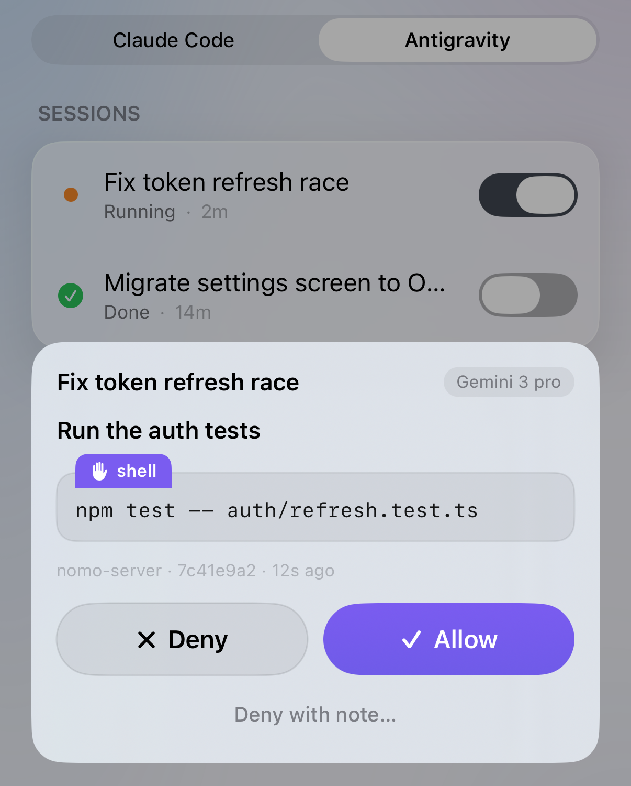
    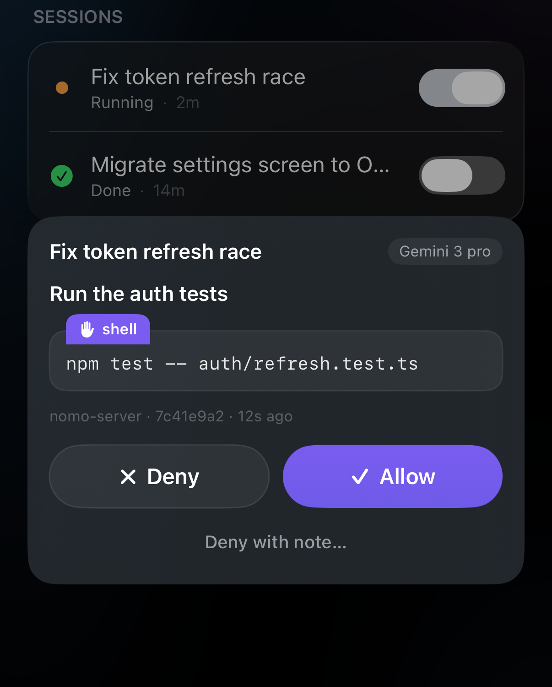
  </div>
</Frame>

- **Allow** — Antigravity goes ahead.
- **Deny** — Antigravity skips it and carries on.
- **Deny with note…** — skips it, and tells Antigravity why in your own words.

More in [Answering from your phone](/sessions/approvals).

Good to know:

- **Your own Antigravity rules come first.** Anything your rules block stays
  blocked — tapping Allow on your phone can never override it. In `agy`,
  commands your rules already allow run without asking your phone.
- **In the desktop app, everything asks your phone.** Nomo can't see the
  desktop app's permission settings, so every command and file change comes to
  your phone.
- **Stopped the chat on the computer?** The card disappears from your phone by
  itself.
- **The terminal stays quiet while it waits.** While a request waits for your
  phone, the terminal shows nothing. That's expected — the
  request is on your phone.
- **Reply sheet open?** The request also shows up in the chat, and you can
  answer it there — see [Approving from the chat](#approve-in-chat).

## Interrupt

Tap **[Interrupt](/sessions/list#interrupt-a-running-session)** on a
**Running** Antigravity session to stop it. It needs the green **⚡ Local** chip.
Antigravity finishes the step it's on, then stops, and the session shows
**Done**. The chat stays open — send a new message to carry on.

## Reply from your phone {#reply-from-your-phone}

Send a message to an Antigravity session from your iPhone — a correction, a
next step, or "carry on". It reaches Antigravity as if you'd typed it at the
Mac. The reply screen is a chat: your messages are on the right, and
Antigravity's requests appear on the left.

<Note>
  **For now, your iPhone and your Mac must be on the same Wi-Fi**, with
  **[Local network](/sessions/settings#local-network)** turned on in Nomo. This
  changes with an upcoming server update, after which replies work from
  anywhere.
</Note>

<Steps>
  <Step title="Open the session">
    In Nomo, open your computer and choose the **Antigravity** tab. Tap the
    session's name.

    You should see the session open up, with a blue **Reply** button under its
    details. A running session also has a red **Interrupt** button.

    <Frame caption="A running Antigravity session, opened, with Interrupt and Reply under its details.">
      <div className="device-frame">
        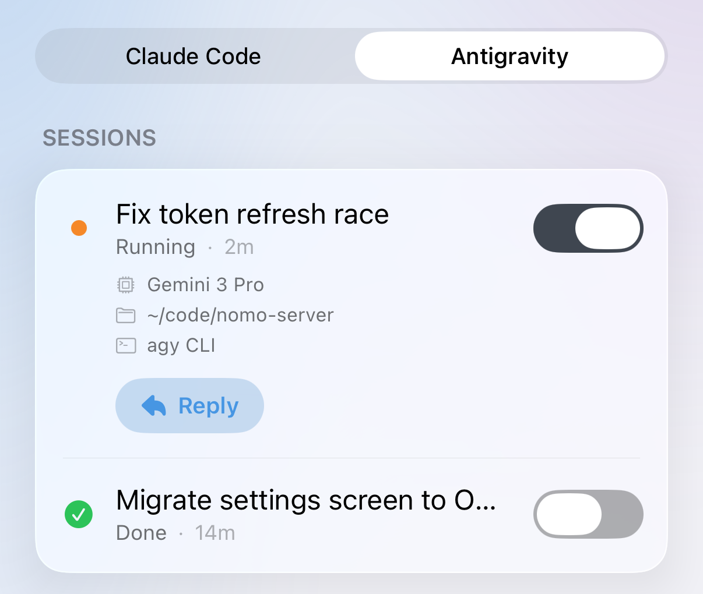
        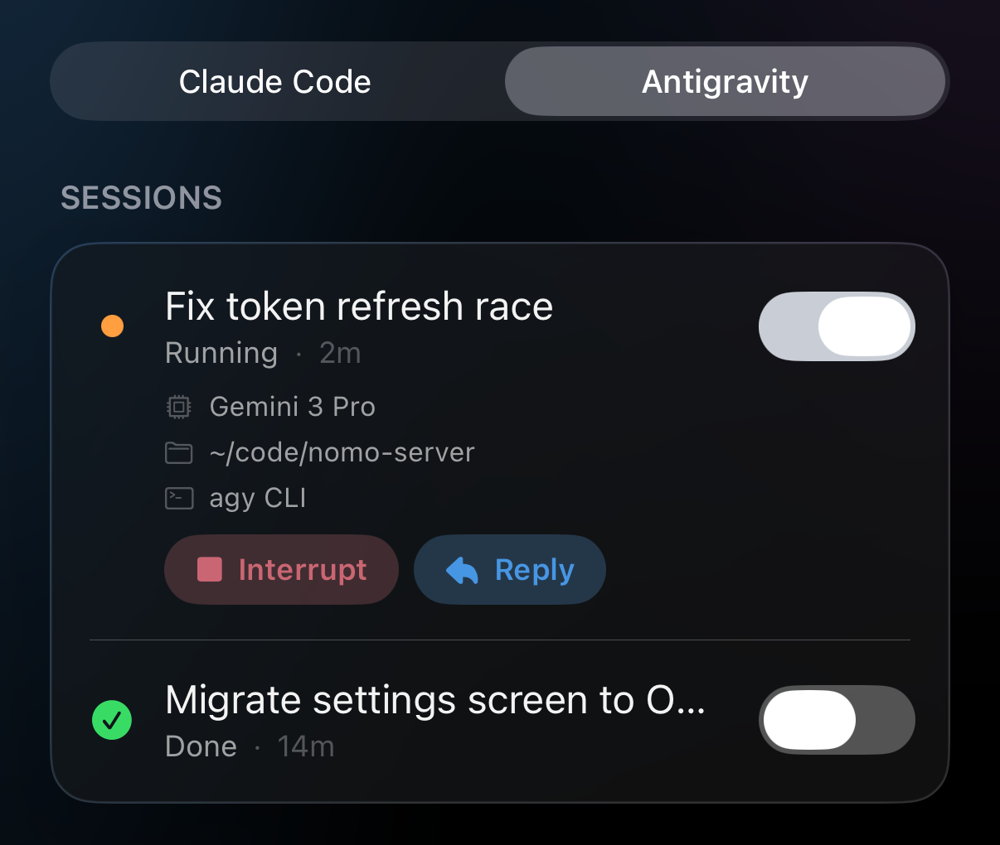
      </div>
    </Frame>
  </Step>

  <Step title="Tap Reply">
    You should see a sheet slide up with the session's name at the top and a
    box that says **Message this session**.

    To close the sheet at any time, tap **✕** at the top right.
  </Step>

  <Step title="Type your message and send it">
    Type your message, then tap the arrow.

    You should see your message as a bubble on the right, with a short status
    line under it. The status tells you where the message is — see the list
    below.

    <Frame caption="Two messages: the first has reached Antigravity, the second waits for its next step and can still be cancelled.">
      <div className="device-frame">
        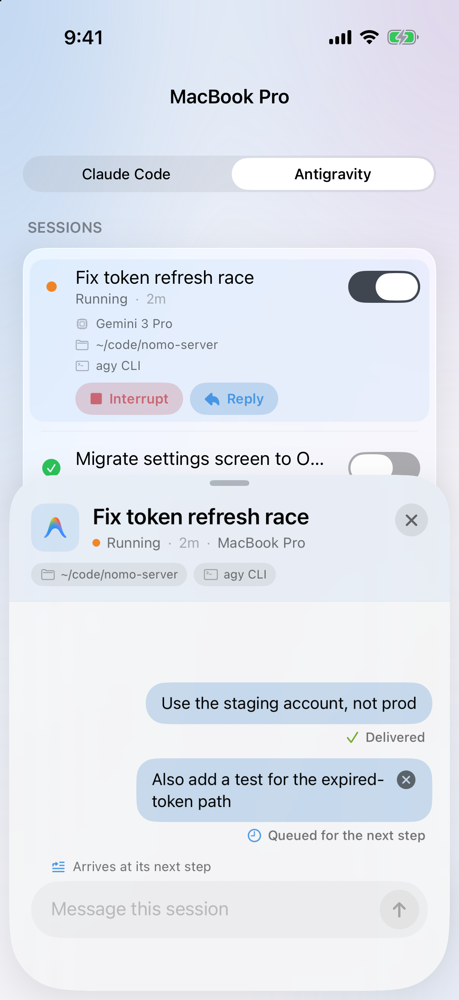
        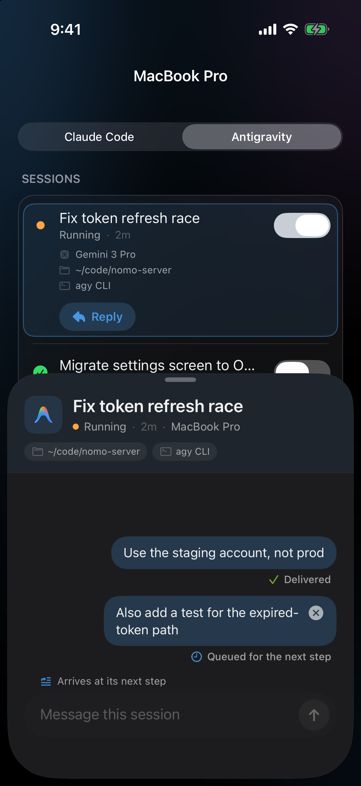
      </div>
    </Frame>
  </Step>
</Steps>

### Approving from the chat {#approve-in-chat}

When Antigravity asks to run a command while the reply sheet is open, you can
answer right there in the chat.

<Steps>
  <Step title="Find the request">
    Look for a bubble on the left, from Antigravity. It says **Wants to run:**,
    then the command, then two buttons: **Deny** and **Allow**.

    <Frame caption="Antigravity asks to run a command, inside the reply chat.">
      <div className="device-frame">
        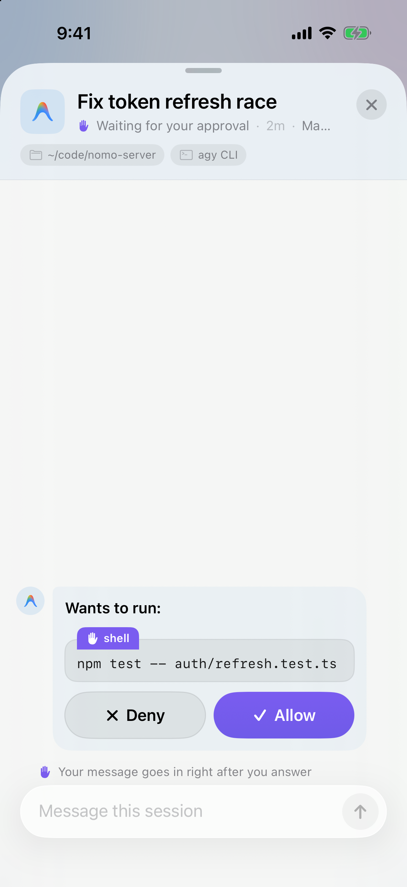
        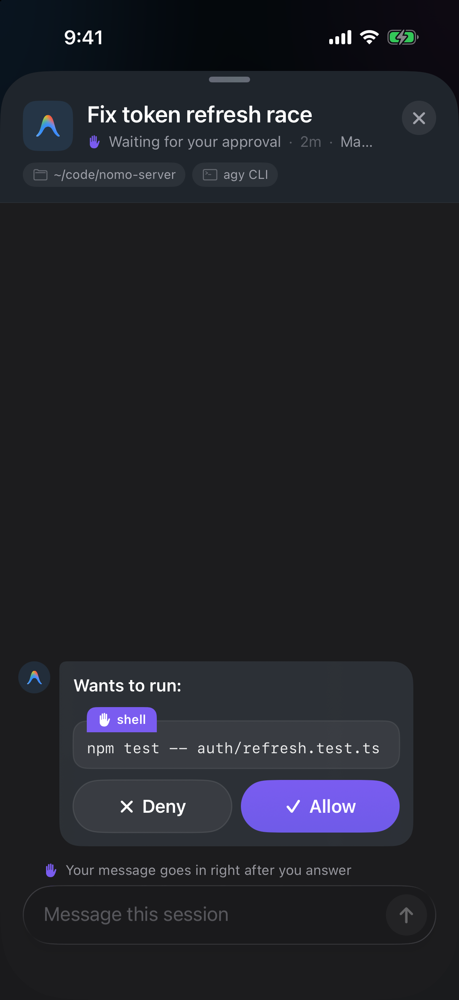
      </div>
    </Frame>
  </Step>

  <Step title="Tap Allow or Deny">
    Tap **Allow** to let Antigravity run it. Tap **Deny** to skip it.

    You should see the bubble shrink to one line that says what happened —
    see [What an answered request looks like](#answered-requests).
  </Step>
</Steps>

The **Deny** and **Allow** buttons in the bubble never send what you typed in
the box. Your typed text stays in the box.

### Deny & send {#deny-and-send}

Want to say no and tell Antigravity what to do instead? Do both with one
button.

<Steps>
  <Step title="Type your reason">
    While the request is waiting, type in the box what Antigravity should do
    instead — for example, "Use bun, not npm".

    You should see the send arrow turn into a red **Deny & send** button, and
    the line **Sends as the reason for Deny** above the box.

    <Frame caption="Text typed while a request waits: the send button becomes Deny & send.">
      <div className="device-frame">
        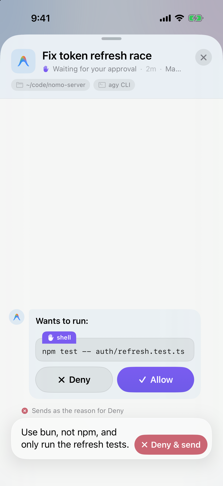
        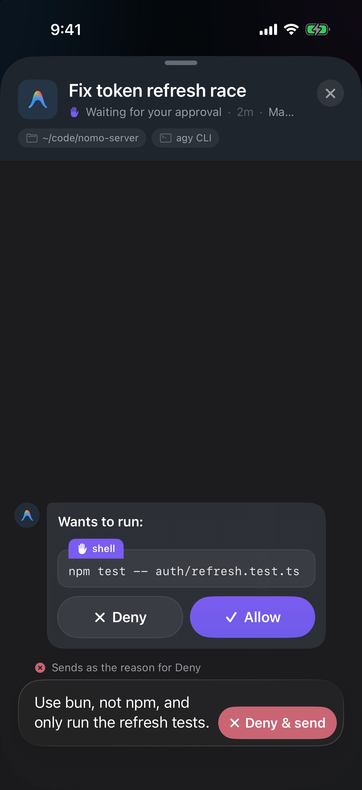
      </div>
    </Frame>
  </Step>

  <Step title="Tap Deny & send">
    Antigravity skips the command and reads your text as the reason.

    You should see the request change to **✕ Denied**, with your reason quoted
    under it.
  </Step>
</Steps>

<Tip>
  A reason can be up to 500 characters. If you type more, the button stays a
  normal send arrow. Your message waits, and goes in right after you answer the
  request.
</Tip>

### What an answered request looks like {#answered-requests}

| You see | What it means |
| --- | --- |
| `✓ Allowed · <command>` | You allowed it. |
| `✕ Denied · <command>` | You denied it. If you used **Deny & send**, your reason is quoted under it. |
| `Answered on your computer` | It was answered on the Mac. |
| `Timed out — continuing on your Mac` | It waited too long for your phone. Antigravity asks on the Mac instead. |

### What the status under a message means {#reply-statuses}

| You see | What it means |
| --- | --- |
| `Sending…` | Your phone is sending it. |
| `Waiting for your approval` | Antigravity is waiting for you to answer a request in the chat. Your message goes in right after you answer. |
| `Queued for the next step` | Your Mac has it. Antigravity reads it at its next step. Until then you can tap **×** on the bubble to cancel it. |
| `Delivered` | Antigravity has read it. |
| `Waking your Mac…` | The session had finished, and your Mac is now starting it again with your message. You only see this once your Mac has really started. It can't be cancelled now. |
| `Resumed on your Mac` | The session is running again with your message. |
| `Reconnecting…` | Your phone can't reach your Mac right now. It keeps trying by itself — you don't need to send it again. |

### Where it works {#where-reply-works}

It depends on where you run Antigravity.

**With the `agy` command-line tool:**

- **While it's working** — your message arrives at its next step.
- **Finished, and `agy` is closed** — your Mac starts the session again with
  your message. You'll see `Waking your Mac…`, then `Resumed on your Mac`.
- **Finished, but `agy` is still open** — your message waits. It shows
  `Queued for the next step` until you send your next message in `agy` on
  the Mac; then Antigravity reads both.

**With the Antigravity desktop app:**

- **While it's working** — your message arrives at its next step.
- **Finished** — only the Mac can continue it. **Reply** is greyed out, and the
  line under it says **Antigravity app sessions can only continue on your
  Mac**.

<Frame caption="A finished session from the desktop app: Reply is greyed out, and the line under it explains why.">
  <div className="device-frame">
    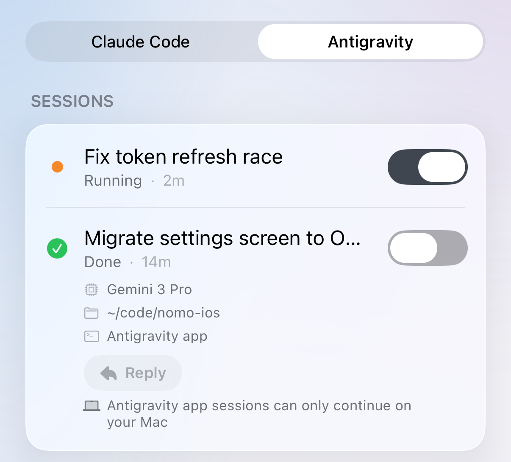
    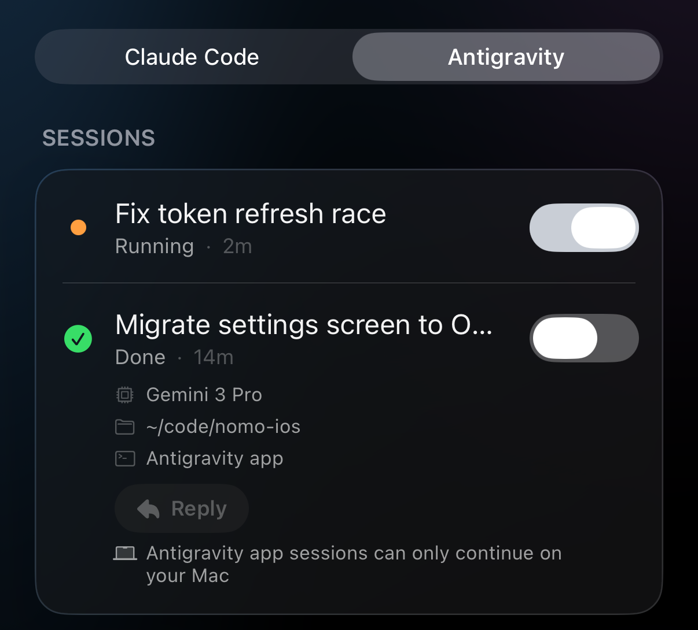
  </div>
</Frame>

Good to know:

- **Up to 4,000 characters** per message. The box stops taking text there.
- **Stop always wins.** If you tap **[Interrupt](#interrupt)** while a message is
  queued, Antigravity stops first. The message is never handed to the turn
  you stopped.
- **Your messages stay while Nomo is open.** If you close Nomo completely, the
  sheet starts empty next time. Messages your Mac already has still arrive.

## What this version doesn't do

- **No questions or plans.** Antigravity's questions and plan reviews don't show
  on your phone.
- **No "Open on Mac".** The button isn't available for Antigravity sessions.
- **No "Always allow".** Every answer is a one-time Allow or Deny.

## Something's not working {#troubleshooting}

<AccordionGroup>
  <Accordion title="My reply stays on “Queued for the next step”">
    Your Mac has the message. If Antigravity is working, it reads it at its
    next step — a long command can take a while.

    If the session has finished and `agy` is still open on the Mac, the message
    waits for your next message there. Send something in `agy`, and Antigravity
    reads both. Or tap **×** on the bubble to cancel it.
  </Accordion>

  <Accordion title="A Nomo command shows “operation not permitted”">
    This can happen the first time you use a Nomo command in the Antigravity
    desktop app. It's normal: Antigravity tries again outside its sandbox by
    itself. Wait for it to finish — you don't need to do anything.
  </Accordion>

  <Accordion title="Reply is greyed out">
    The session is from the Antigravity desktop app, and it has finished. Only
    the Mac can continue it. Send your next message in the app.
  </Accordion>

  <Accordion title="Every session shows up twice">
    Nomo's Claude Code plugin is imported into Antigravity. Run this in
    Terminal, then restart Antigravity:

    ```bash
    agy plugin uninstall nomo-cc
    ```
  </Accordion>

  <Accordion title="A Nomo command says it could not find its files">
    The Nomo folder was moved or deleted. Antigravity keeps working, but nothing
    reaches your phone. Run the installer again, then restart Antigravity:

    ```bash
    bunx nomo-ai --antigravity
    ```
  </Accordion>
</AccordionGroup>

Anything else — nothing on your phone, approvals that stopped, a stuck
session — is in [Troubleshooting](/sessions/troubleshooting).

## Technical details and security

Nomo only sends your phone what a session is doing and what it asks, end-to-end
encrypted. If anything fails, Antigravity asks on your computer as usual.

How it works under the hood is in the plugin's README: [how Nomo works with Antigravity](https://github.com/KarrixLee/nomo#antigravity-integration) and
[hooks and security](https://github.com/KarrixLee/nomo#antigravity-hooks).
