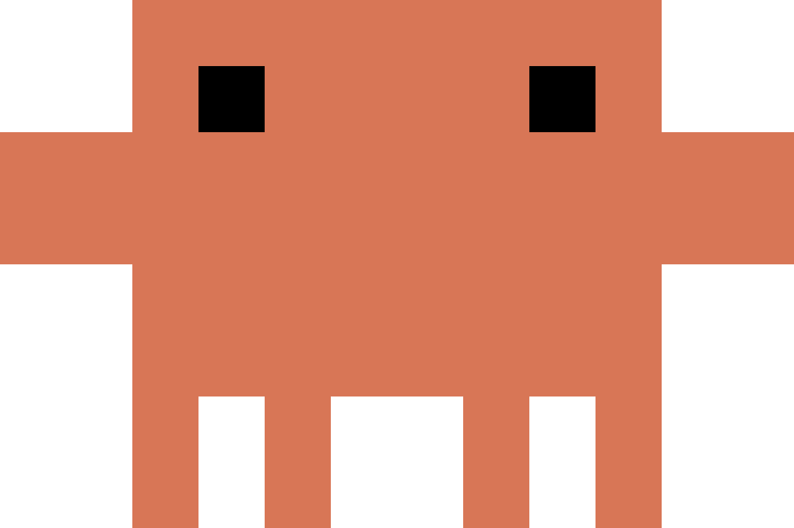
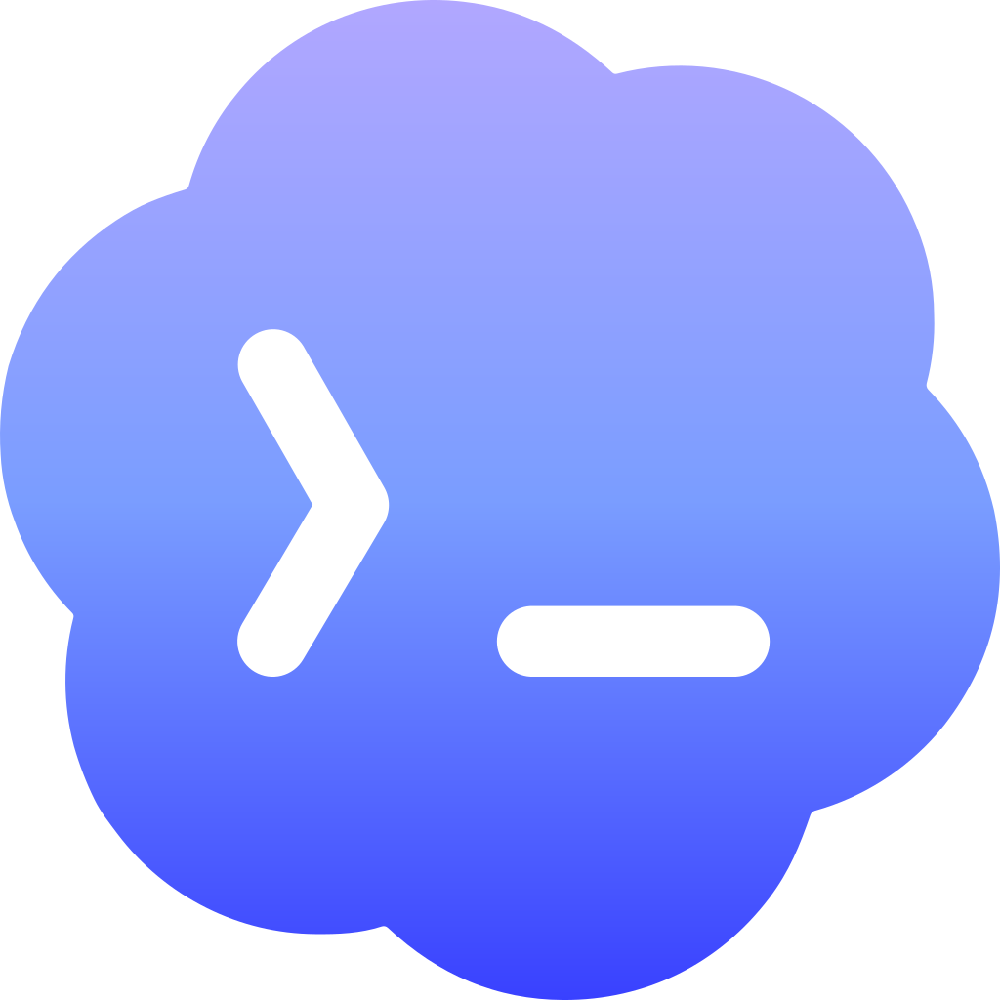
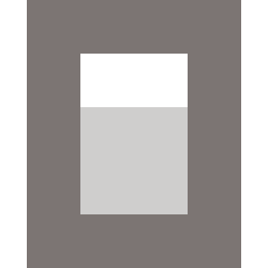

Five commands on Claude Code, Codex, OpenCode and Antigravity, a sixth that
only OpenCode needs, and four on Cursor. You run them from inside an agent
session on the computer you want to affect — a `/` command in Claude Code and
OpenCode, a `/` skill in Cursor and Antigravity, a `$` skill in Codex. Pair,
status, reset and unpair also work in Terminal: see [From Terminal](#terminal).

<Note>
  In Antigravity, every Nomo command asks first. Choose **Allow** — Antigravity
  asks before it runs any command on your computer. More in [Using
  Antigravity](/sessions/antigravity#commands).
</Note>

<Tip>
  In Claude Code everything is namespaced: typing `/nomo-cc:` lists them all.
  OpenCode command names are flat and global, so there Nomo's carry no prefix at
  all — and neither do its Cursor and Antigravity skills.
</Tip>

| |  Claude Code |  Codex |  OpenCode |  Cursor |  Antigravity |
| --- | --- | --- | --- | --- | --- |
| <a href="#pair">Pair this computer</a> | `/nomo-cc:pair` | `$nomo-pair` | `/nomo-pair` | `/nomo-pair` | `/nomo-pair` |
| <a href="#status">Check health</a> | `/nomo-cc:status` | `$nomo-status` | `/nomo-status` | `/nomo-status` | `/nomo-status` |
| <a href="#approvals">Pause or resume approvals</a> | `/nomo-cc:approvals` | `$nomo-approvals` | `/nomo-approvals` | — | `/nomo-approvals` |
| <a href="#reset">Clear stuck sessions</a> | `/nomo-cc:reset` | `$nomo-reset` | `/nomo-reset` | `/nomo-reset` | `/nomo-reset` |
| <a href="#unpair">Disconnect this computer</a> | `/nomo-cc:unpair` | `$nomo-unpair` | `/nomo-unpair` | `/nomo-unpair` | `/nomo-unpair` |
| <a href="#update">Update the plugin</a> | — | — | `/nomo-update` | — | — |

None of them can fail loudly. Every one exits cleanly even when there's nothing
to do — `Not paired` is a success, not an error.

The empty cells on the last row aren't an omission: Claude Code and Codex update
through their own hosts, so Nomo adds no command there, and Cursor updates by
running its installer again, as does Antigravity. What each of them needs —
which for Codex is usually nothing — is under [update](#update).

Cursor's empty cell on the approvals row isn't one either: Cursor sessions are
read-only, so there are no remote approvals to pause —
[Using Cursor](/sessions/cursor).

Removing Nomo has no slash command: it's one line you paste into Terminal —
see [uninstall](#uninstall).

## From Terminal {#terminal}

You can also run the main commands in Terminal, from any folder. On a Mac where
[Grok Bot](/sessions/grok-bot) is your only AI app, this is the only way.

| | Terminal |
| --- | --- |
| Install or update Nomo | `bunx nomo-ai` |
| <a href="#pair">Pair this computer</a> | `bunx nomo-ai pair` |
| Pair with a typed code | `bunx nomo-ai pair code` |
| <a href="#status">Check health</a> | `bunx nomo-ai status` |
| <a href="#reset">Clear stuck sessions and send your activity now</a> | `bunx nomo-ai reset` |
| <a href="#unpair">Disconnect this computer</a> | `bunx nomo-ai unpair` |
| <a href="#uninstall">Remove Nomo from an agent</a> | `bunx nomo-ai uninstall --cursor` |

They do the same as the commands inside your agent. One pairing or one reset
covers every agent on that computer. No bun? Use `npx nomo-ai` instead, such
as `npx nomo-ai status`. If Nomo isn't installed yet, they say so:

```
Nomo is not installed on this computer yet — run `bunx nomo-ai` first.
```

At the end of an install, `bunx nomo-ai` asks if you also want the short
`nomo` command. If you said yes, you can type `nomo pair`, `nomo status` and
`nomo reset` instead. `bunx nomo-ai …` always works either way. Don't type
`bunx nomo` or `npx nomo`: the npm package called `nomo` isn't Nomo's.

## pair

<CodeGroup>
```bash Claude Code icon="/images/claude-code.svg"
/nomo-cc:pair          # QR code, opens your browser
/nomo-cc:pair code     # one-time code, printed in the terminal
```

```bash Codex icon="/images/codex.svg"
$nomo-pair             # QR code, opens your browser
$nomo-pair code        # one-time code, printed in the terminal
```

```bash OpenCode icon="/images/opencode.svg"
/nomo-pair             # QR code, opens your browser
/nomo-pair code        # one-time code, printed in the terminal
```

```bash Cursor icon="/images/providers/cursor.svg"
/nomo-pair             # QR code, opens your browser
/nomo-pair code        # one-time code, printed in the terminal
```

```bash Antigravity icon="/images/providers/antigravity.png"
/nomo-pair             # QR code, opens your browser
/nomo-pair code        # one-time code, shown in the chat
```

```bash Terminal icon="terminal"
bunx nomo-ai pair      # QR code, opens your browser
bunx nomo-ai pair code # one-time code, printed in the terminal
```
</CodeGroup>

With no argument it opens a themed page in your browser with a QR code. Scan it
in the app and the page flips to **Paired ✓** on its own.

The `code` argument skips the browser entirely and prints a typeable one-time
code, for a headless box or an SSH session. It's the second-choice path on
purpose: that code lands in your terminal, and therefore in the agent's
transcript.

Pairing a computer that's already paired replaces its pairing. If the
computer is already paired, you don't need to pair it again.

Pairings expire after **10 minutes** unused. One pairing covers the machine, not
the agent — Claude Code, Codex, OpenCode, Cursor and Antigravity on the same
Mac share it. Full
walkthrough in [Pairing](/setup/pairing).

## status

<CodeGroup>
```bash Claude Code icon="/images/claude-code.svg"
/nomo-cc:status
```

```bash Codex icon="/images/codex.svg"
$nomo-status
```

```bash OpenCode icon="/images/opencode.svg"
/nomo-status
```

```bash Cursor icon="/images/providers/cursor.svg"
/nomo-status
```

```bash Antigravity icon="/images/providers/antigravity.png"
/nomo-status           # a short summary in plain words
/nomo-status verbose   # the full readout below
```

```bash Terminal icon="terminal"
bunx nomo-ai status
```
</CodeGroup>

The one to run first when anything looks wrong. A healthy machine is a handful
of calm lines — there are no checkmarks, because everything being fine is the
absence of anything to say:

```
Nomo 2.2.0 · Claude Code

Phone         paired · https://api.nomo.gg · pairing 3e65a0cb…
Delivery      last event sent 4m ago · watchdog running (pid 25780)
LAN           listening on port 51843 (id 9f3c1a20) since 3h ago
              phone last reached this Mac 12s ago (ping)
              address last advertised 4m ago (2 interfaces)
Approvals     on — permission prompts are held and sent to your phone

Claude Code — you are here
  Hooks       firing · last 8s ago
  Sessions    1 of 4 tracked here
```

The rows above the gap describe the **computer**, and read the same whichever
agent you asked from. Below them comes the agent you're actually in, marked
`— you are here`.

<ResponseField name="Phone">
  Whether this computer is paired at all, plus the worker it talks to and the
  pairing it holds. `NOT PAIRED` means nothing from here reaches the app, and
  the arrow underneath prints the [pair](#pair) command for the agent you're
  standing in.
</ResponseField>

<ResponseField name="Delivery">
  When an event last actually left this computer, and whether the watchdog is
  up. A watchdog that isn't running is fine on its own — it starts itself on the
  next session. `never` sent, with a session genuinely running, is not fine.
</ResponseField>

<ResponseField name="LAN">
  The direct [local network](/sessions/settings#local-network) link: the port
  and id this computer listens on, when your phone last reached it, and when the
  Mac last advertised its address. The middle line is the one that matters —
  it's the only proof the direct leg has ever worked. Advertised long ago and
  never reached means your phone can't get here; advertised seconds ago and not
  yet reached is simply too early to tell. A refused request prints its reason
  rather than leaving silence. The row is absent entirely on a computer that has
  never listened — the switch is on your phone and off by default.
</ResponseField>

<ResponseField name="Approvals">
  `on` means permission prompts are held here and sent to your phone. `PAUSED`
  means they aren't — they go to the terminal instead, and stay that way until
  someone resumes them, however many months later. If your phone has stopped
  asking you anything, this row is the entire explanation: see [Pausing
  it](/sessions/approvals#pausing-it).
</ResponseField>

<ResponseField name="Hooks">
  Whether your agent is feeding Nomo, and how long ago it last did. OpenCode has
  no hooks, so there the row is called `Plugin` instead. Nothing firing? Restart
  Claude Code so its hooks load; in Codex run `/hooks`; in OpenCode restart it so
  the plugin loads; restart Cursor or Antigravity, which only pick hooks up at
  start.
</ResponseField>

<ResponseField name="Runtime">
  Only appears when the runtime your hooks run on is out of date: bun older than
  **1.4.4**, or Node.js 22 older than **22.23.4**. The arrow says how to
  upgrade — `bun upgrade` for bun. It's a warning only: hooks keep running.
</ResponseField>

<ResponseField name="Sessions">
  Counted per agent now: `1 of 4 tracked here` means this computer is tracking
  four sessions and one of them is yours. Rows that should have died are what
  [reset](#reset) is for.
</ResponseField>

Problems carry two marks and nothing else: `!` is the problem, `→` is what to do
about it, written in the command dialect of the agent you asked from. Every
other agent on the computer gets one condensed line under **Also on this
computer** — and when one of *those* is broken, it says so here rather than
waiting for you to go and look:

```
Nomo 2.2.0 · Claude Code

Phone         NOT PAIRED — nothing from this computer reaches the app
              → run /nomo-cc:pair (or bunx nomo-ai pair)

Claude Code — you are here
  Hooks       firing · last 6s ago
  Sessions    1 of 3 tracked here

Also on this computer
  Codex       firing · last 12h ago · 2 of 3 tracked here
              ! Also runs the Claude Code plugin's hooks on every Codex event — double the work, no benefit.
              → in Codex run /hooks and untrust the `nomo-cc@nomo` entries
              → full detail: run $nomo-status inside Codex
  OpenCode    installed · no activity yet
```

Rows with nothing to say are left out — an unpaired computer has no delivery,
LAN or approvals to report. Another agent's problem is spelled out here in full,
then pointed at that agent's own status command for the rest of the detail. And
the first line carries the plugin version: quote it if you file a bug.

## approvals

<CodeGroup>
```bash Claude Code icon="/images/claude-code.svg"
/nomo-cc:approvals off      # pause on this computer
/nomo-cc:approvals on       # resume
/nomo-cc:approvals status   # which way is it set
```

```bash Codex icon="/images/codex.svg"
$nomo-approvals off         # pause on this computer
$nomo-approvals on          # resume
$nomo-approvals status      # which way is it set
```

```bash OpenCode icon="/images/opencode.svg"
/nomo-approvals off         # pause on this computer
/nomo-approvals on          # resume
/nomo-approvals status      # which way is it set
```

```bash Antigravity icon="/images/providers/antigravity.png"
/nomo-approvals off         # pause on this computer
/nomo-approvals on          # resume
/nomo-approvals status      # which way is it set
```
</CodeGroup>

Pauses remote approvals for **this computer**, so permission prompts go straight
to the terminal instead of waiting on your phone. The escape hatch for a phone
that's dead or out of reach.

```
Remote approvals are OFF for this computer — Claude Code permission prompts
will appear in the terminal as usual (your phone is not asked).
```

One switch per computer, **shared by every agent** — pausing it in Codex pauses
it for Claude Code and OpenCode on that machine too. It doesn't unpair anything
and doesn't touch your phone's settings.

There's a separate, phone-wide switch: **Answer on iPhone** in
[Settings](/sessions/settings#remote-approvals).

Cursor has no approvals command. Its prompts never reach your phone, so there's
nothing to pause.

## reset

<CodeGroup>
```bash Claude Code icon="/images/claude-code.svg"
/nomo-cc:reset
```

```bash Codex icon="/images/codex.svg"
$nomo-reset
```

```bash OpenCode icon="/images/opencode.svg"
/nomo-reset
```

```bash Cursor icon="/images/providers/cursor.svg"
/nomo-reset
```

```bash Antigravity icon="/images/providers/antigravity.png"
/nomo-reset
```

```bash Terminal icon="terminal"
bunx nomo-ai reset
```
</CodeGroup>

Stops the watchdog and clears dead or phantom session rows, then tells your
phone to drop them. Then it sends your activity (the heatmap and streak in
[Nomo Activity](/widgets#nomo-activity)) right away, instead of waiting up to
6 hours.

```
Stopped the watchdog (it restarts automatically on your next session).
Cleared 4 stale session record(s) (4 end signals delivered to your phone).
Left 2 live sessions untouched.
Sent your activity summary (heatmap and streak) to your phone.
Pairing and keys were not touched — to disconnect this computer, run bunx nomo-ai unpair (or your agent's unpair command).
```

The activity line can also say `No activity to send yet.`, or that it
couldn't send right now and will try again later by itself. The first reset
on a computer with a long Claude Code history can take a while.

One reset covers every agent on that computer.

The safe thing to reach for when rows look stale or duplicated, because it says
what it left alone. An OpenCode row belongs to the OpenCode **server**, so quit
OpenCode first if one won't clear — see
[Using OpenCode](/sessions/opencode#reset-needs-opencode-closed).

## unpair

<CodeGroup>
```bash Claude Code icon="/images/claude-code.svg"
/nomo-cc:unpair
```

```bash Codex icon="/images/codex.svg"
$nomo-unpair
```

```bash OpenCode icon="/images/opencode.svg"
/nomo-unpair
```

```bash Cursor icon="/images/providers/cursor.svg"
/nomo-unpair
```

```bash Antigravity icon="/images/providers/antigravity.png"
/nomo-unpair
```

```bash Terminal icon="terminal"
bunx nomo-ai unpair
```
</CodeGroup>

Revokes the pairing and erases the key on that computer.

Forgetting a computer **from the phone** is not the same thing: that stops it
appearing in your app, but the Mac keeps its local state until you run this
there.

## update

Only OpenCode has an update command. Every other agent updates another way —
open its tab.

`bunx nomo-ai` (or `npx nomo-ai`) updates too: an agent that already has Nomo
shows up as an update rather than an install. Only OpenCode's, Cursor's and
Antigravity's run — the Claude Code and Codex ones are printed for you.

<Tabs>
  <Tab title="Claude Code" icon="/images/claude-code.svg">
    ```bash
    claude plugin update nomo-cc@nomo
    ```

    Auto-update defaults off for third-party marketplaces, so nothing moves an
    install on its own. To turn it on: `/plugin` → **Marketplaces** → Nomo's →
    **Enable auto-update**.
  </Tab>

  <Tab title="Codex" icon="/images/codex.svg">
    Usually nothing to run. Codex reads the plugin live from its path, so
    pulling that checkout is the whole update — and there is no
    `codex plugin update` verb.

    If you added the marketplace from git, Codex holds a snapshot instead, and
    refreshing it is the update:

    ```bash
    codex plugin marketplace upgrade <marketplace-name>
    ```

    The name is whatever you added it as, not necessarily `nomo`.
  </Tab>

  <Tab title="OpenCode" icon="/images/opencode.svg">
    ```bash
    /nomo-update
    ```

    It checks before it changes anything. Already current is a stop, not a
    no-op with a pull attached:

    ```
    OpenCode plugin: /Users/you/.nomo
    Already on 2.1.22 — nothing to do.
    ```

    When there's something to get, it says what before it takes it:

    ```
    OpenCode plugin: /Users/you/.nomo
    Update available: 2.1.22 → 2.1.23.
    ```

    Then it pulls, re-runs the installer — which is what picks up any new
    `/nomo-*` command the release added — and tells you to restart OpenCode.
    Plugins are imported once when its server starts, so until you do, the old
    copy is still the one running.

    It refuses rather than acting when it can't be sure, and each refusal says
    what to do instead: a checkout pinned by an earlier `--ref` install, a
    working tree with uncommitted changes, a checkout that's been moved or
    deleted, a checkout that isn't Nomo's own repository, or nothing installed
    here at all.

    `bunx nomo-ai` runs the same update with `--global`: it updates only the
    global install, whichever folder you run it from. A `--project` install is
    updated by `/nomo-update`, run inside OpenCode in that project.

    <Note>
      It updates the checkout the **stub** points at — the copy OpenCode
      actually imports — which isn't necessarily the one whose command file you
      typed. If you keep more than one clone, that's the distinction that
      matters.
    </Note>
  </Tab>

  <Tab title="Cursor" icon="/images/providers/cursor.svg">
    The same command that installed it:

    ```bash
    bunx nomo-ai --cursor
    ```

    Restart Cursor afterwards, and any open `cursor-agent` session.
  </Tab>

  <Tab title="Antigravity" icon="/images/providers/antigravity.png">
    The same command that installed it:

    ```bash
    bunx nomo-ai --antigravity
    ```

    Restart Antigravity afterwards, and any open `agy` session.
  </Tab>

  <Tab title="Grok Bot" icon="robot">
    The same command that installed it:

    ```bash
    bunx nomo-ai --grokbot
    ```

    Nothing to restart. The next hourly run uses the update.
  </Tab>
</Tabs>

## uninstall

Removes Nomo from one agent. Run it in Terminal, not inside the agent: pick
your agent's tab, paste the line and press Return.

<CodeGroup>
```bash Claude Code icon="/images/claude-code.svg"
claude plugin uninstall nomo-cc@nomo
```

```bash Codex icon="/images/codex.svg"
codex plugin remove nomo@nomo
```

```bash OpenCode icon="/images/opencode.svg"
rm ~/.config/opencode/plugins/nomo.js
rm ~/.config/opencode/commands/nomo-*.md
```

```bash Cursor icon="/images/providers/cursor.svg"
bunx nomo-ai uninstall --cursor
```

```bash Antigravity icon="/images/providers/antigravity.png"
bunx nomo-ai uninstall --antigravity
```

```bash Grok Bot icon="robot"
bunx nomo-ai uninstall --grokbot
```
</CodeGroup>

No `bunx`? Use `npx` instead — for example `npx nomo-ai uninstall --cursor`.
The older spelling `--uninstall` works too. Or run the agent's own script, such
as `node ~/.nomo/plugin/scripts/cursor-install.mjs --uninstall`
(`antigravity-install.mjs` for Antigravity, `grokbot-install.mjs` for Grok
Bot).

For Grok Bot, this removes the hourly background job, and nothing else.

Uninstall leaves the short `nomo` command in place. To remove it too, run
`bun remove -g nomo-ai` (or `npm uninstall -g nomo-ai`).

Antigravity says when it's done:

```
✅ Nomo is removed from Antigravity. Restart Antigravity to finish. Your phone stays connected for your other coding apps.
```

Then restart the agent. For Cursor and Antigravity, quit the app and open it
again, and restart any open `cursor-agent` or `agy`.

It removes only what Nomo added to that agent. Your phone stays paired, so your
other agents keep working. To disconnect this computer as well, run
`bunx nomo-ai unpair`, before or after you uninstall. See [unpair](#unpair).

Imported Nomo's Claude Code plugin into Antigravity? Remove that too with
`agy plugin uninstall nomo-cc`, then restart Antigravity.

`bunx nomo-ai uninstall` always needs the agent named — it never guesses. More
on each agent's install in [Installation](/setup/install).

## Without slash commands

Antigravity doesn't know Nomo's commands? Run them from Terminal
instead. Pair, status, reset and unpair are easiest as
[`bunx nomo-ai` commands](#terminal). The full list, which works with the Nomo
installer:

| | |
| --- | --- |
| Pair | `~/.nomo/plugin/scripts/run.sh ~/.nomo/plugin/dist/pair.mjs` |
| Pair with a typed code | `~/.nomo/plugin/scripts/run.sh ~/.nomo/plugin/dist/pair.mjs --show-code` |
| Check status | `~/.nomo/plugin/scripts/run.sh ~/.nomo/plugin/dist/status-cmd.mjs antigravity` |
| Pause approvals | `~/.nomo/plugin/scripts/run.sh ~/.nomo/plugin/dist/cc-permission.mjs off` |
| Resume approvals | `~/.nomo/plugin/scripts/run.sh ~/.nomo/plugin/dist/cc-permission.mjs on` |
| Clear stuck sessions | `~/.nomo/plugin/scripts/run.sh ~/.nomo/plugin/dist/reset.mjs` |
| Unpair | `~/.nomo/plugin/scripts/run.sh ~/.nomo/plugin/dist/unpair.mjs` |

After pairing from Terminal, run
`~/.nomo/plugin/scripts/run.sh ~/.nomo/plugin/dist/pair.mjs wait` and scan the
QR code. Add `--verbose` to the installer to see what it changes.

## Where state lives

Everything the plugin keeps sits in `~/.config/cc-status/` — the pairing, the
encryption key (mode `0600`), one file per tracked session, and a local trace
log. Nothing in that folder is sent anywhere.

## Read the source

These commands are the plugin, and the plugin is open source. If you want to
know exactly what runs on your machine and what leaves it, the answer is in one
repository — marketplace installs are a plain clone of it.

<Card title="KarrixLee/nomo" href="https://github.com/KarrixLee/nomo" icon="github" horizontal>
  The full plugin source, MIT licensed. Issues and bug reports live here too.
</Card>
