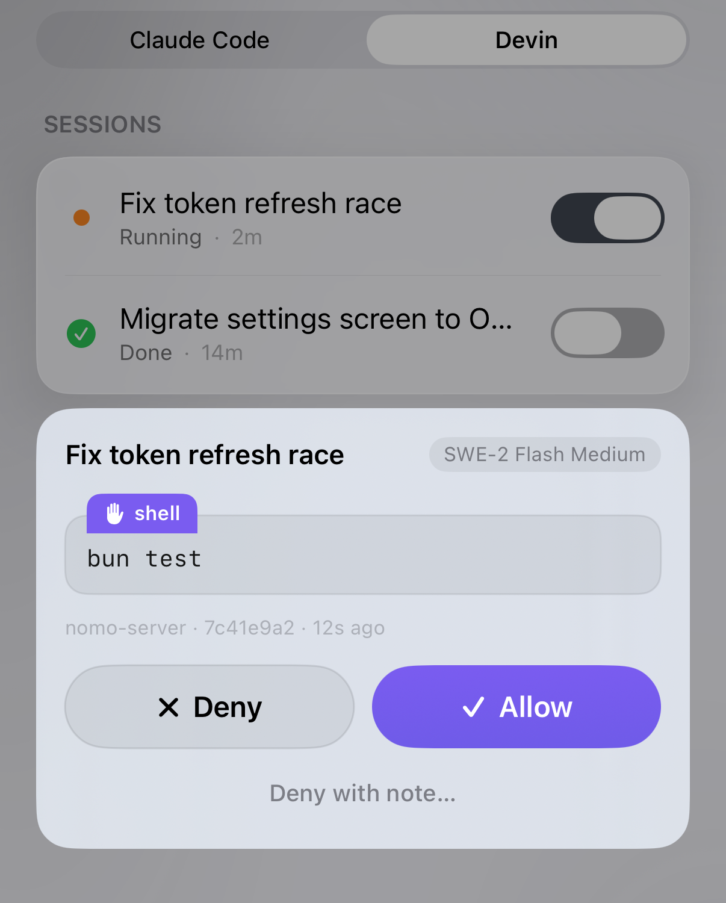
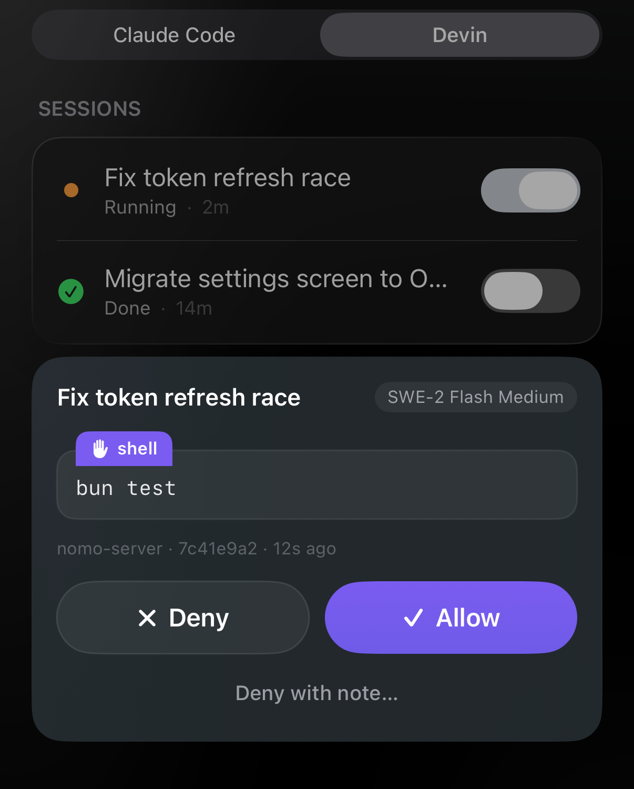

See your Devin sessions on your iPhone — on the Lock Screen and in the Dynamic
Island. When Devin asks for permission, your phone asks you to **Allow** or
**Deny** it. When Devin asks you a question, you can answer it from your phone
too.

It works with the Devin CLI, the `devin` command in Terminal, and with
[Devin Desktop](#devin-desktop).

<Note>
  Sessions is part of Nomo Pro. You need Nomo **2.5.0** or later on your phone
  and plugin **2.5.0** or later on your Mac.
</Note>

## Set it up

There are two ways to add Nomo to Devin: the **Devin plugin**, or the **Nomo
installer**. Install one of them. If you install both, Nomo uses the installer
one, and the plugin stays quiet.

<Tabs>
  <Tab title="Devin plugin">
    <Steps>
      <Step title="Open Terminal">
        On your Mac, open the **Terminal** app. It's in **Applications →
        Utilities**.
      </Step>

      <Step title="Install the Devin CLI">
        Already have it? Skip this step.

        Copy this line, paste it into Terminal, and press Return:

        ```bash
        brew install --cask devin-cli
        ```

        No Homebrew? Use this instead:

        ```bash
        curl -fsSL https://cli.devin.ai/install.sh | bash
        ```

        Then type `devin` and press Return. If Devin asks you to sign in,
        follow its steps.
      </Step>

      <Step title="Install the Nomo plugin">
        Type this in Terminal, not inside Devin. If Devin is open, open a new
        Terminal window first (press **⌘N**).

        Copy this line, paste it into Terminal, and press Return:

        ```bash
        devin plugins install KarrixLee/nomo
        ```

        Using Devin Desktop instead? Go to **Customize → Plugins → From
        repository**, and enter `KarrixLee/nomo`.
      </Step>

      <Step title="Start Devin">
        In Terminal, type `devin` and press Return.
      </Step>

      <Step title="Type /nomo:pair">
        In `devin`, type this and send it:

        ```
        /nomo:pair
        ```

        Devin opens a page with a QR code in your browser.
      </Step>

      <Step title="Scan the QR code">
        On your iPhone, open Nomo → **Sessions** → **Pair a Computer**, and scan
        the QR code.
      </Step>

      <Step title="Check it">
        In `devin`, type this and send it:

        ```
        /nomo:status
        ```

        If a line starts with `!`, do what the `→` line under it says.
      </Step>

      <Step title="Send a message in Devin">
        In `devin`, send anything.

        You should see the session appear in Nomo, under the **Devin** tab of
        your computer. No Devin tab? Tap the **+** button (**Choose agents**)
        and turn Devin on.
      </Step>
    </Steps>
  </Tab>

  <Tab title="Nomo installer">
    <Steps>
      <Step title="Open Terminal">
        On your Mac, open the **Terminal** app. It's in **Applications →
        Utilities**.
      </Step>

      <Step title="Install the Devin CLI">
        Already have it? Skip this step.

        Copy this line, paste it into Terminal, and press Return:

        ```bash
        brew install --cask devin-cli
        ```

        No Homebrew? Use this instead:

        ```bash
        curl -fsSL https://cli.devin.ai/install.sh | bash
        ```

        Then type `devin` and press Return. If Devin asks you to sign in,
        follow its steps.
      </Step>

      <Step title="Run the Nomo installer">
        Copy this line, paste it into Terminal, and press Return:

        ```bash
        bunx nomo-ai --devin
        ```

        No `bunx`? Use `npx nomo-ai --devin` instead.

        Among the lines it prints, you should see:

        ```
        devin-install: Devin sessions will now show in Nomo — restart devin (and Devin Desktop)
        ```
      </Step>

      <Step title="Restart Devin">
        Close every open `devin`, then start it again. Using Devin Desktop?
        Quit it and open it again too.

        <Warning>
          Don't skip this. Nomo stays off until Devin restarts.
        </Warning>
      </Step>

      <Step title="Type /nomo-pair">
        In `devin`, type this and send it:

        ```
        /nomo-pair
        ```

        If Devin asks to run a Nomo command, allow it. Devin opens a page with
        a QR code in your browser.
      </Step>

      <Step title="Scan the QR code">
        On your iPhone, open Nomo → **Sessions** → **Pair a Computer**, and scan
        the QR code.
      </Step>

      <Step title="Check it">
        In `devin`, type this and send it:

        ```
        /nomo-status
        ```

        If a line starts with `!`, do what the `→` line under it says.
      </Step>

      <Step title="Send a message in Devin">
        In `devin`, send anything.

        You should see the session appear in Nomo, under the **Devin** tab of
        your computer. No Devin tab? Tap the **+** button (**Choose agents**)
        and turn Devin on.
      </Step>
    </Steps>
  </Tab>
</Tabs>

<Tip>
  **Already paired from Claude Code, Codex, OpenCode, Cursor or Antigravity?**
  One pairing covers the whole computer. Skip the pairing steps.
</Tip>

<Tip>
  **No browser on this computer?** Ask for a short code instead of a QR code:
  type `/nomo-pair code` in Devin (with the plugin, `/nomo:pair code`). On
  your iPhone, open Nomo → **Sessions** → **Pair a Computer** → **Enter Code**,
  and type the code. It expires in 10 minutes.
</Tip>

<Note>
  **Devin Desktop's Restricted Mode turns Nomo off.** It turns off hooks, which
  Nomo needs, so your sessions don't reach your phone while it's on.
</Note>

## Commands

Type these in Devin. With the Devin plugin, they start with `/nomo:` instead
of `/nomo-` — for example `/nomo:pair`.

| Type this | With the Devin plugin | What it does |
| --- | --- | --- |
| `/nomo-pair` | `/nomo:pair` | Connect this computer to your phone |
| `/nomo-pair code` | `/nomo:pair code` | The same, with a short code to type instead of a QR code |
| `/nomo-status` | `/nomo:status` | Check that everything works |
| `/nomo-approvals off` | `/nomo:approvals off` | Stop asking your phone — Devin asks on the Mac instead |
| `/nomo-approvals on` | `/nomo:approvals on` | Ask your phone again |
| `/nomo-reset` | `/nomo:reset` | Clear stuck sessions from your phone, and stay connected |
| `/nomo-unpair` | `/nomo:unpair` | Disconnect this computer from your phone |

If Devin asks to run a Nomo command, allow it. Devin doesn't know the
commands? Run the installer again and restart Devin — or use them from
Terminal, under [Advanced](#advanced).

The connection and the approvals switch are shared by every coding app on this
computer. Turning approvals off here turns them off for Claude Code and Codex
too.

## What you see

- A session appears when you send your **first message**.
- It shows **Running** while Devin works, and **Done** when it finishes.
- Its name is Devin's own session title. Until Devin has made one, it uses
  your first message.
- The badge shows the model Devin is using.
- The [Dynamic Island](/sessions/island) works as it does for the other agents.

## Answering from your phone

When Devin asks for permission — to run a command, for example — your phone
asks you.

Touch and hold the session, or use the island, and choose:

<Frame caption="A Devin session asking to run a command.">
  <div className="device-frame">
    
    
  </div>
</Frame>

- **Allow** — Devin goes ahead.
- **Always allow … (this session)** — Devin goes ahead, and Nomo stops asking
  for the same thing until this session ends. See [below](#always-allow).
- **Deny** — Devin doesn't do it.
- **Deny with note…** — Devin doesn't do it, and gets your note telling it why.

More in [Answering from your phone](/sessions/approvals).

Good to know:

- **Devin waits for your phone.** If it times out, Devin asks on your Mac
  instead.
- **No phone? No problem.** If your phone can't be reached, or approvals are
  [paused](/sessions/approvals#pausing-it), Devin asks on your Mac, just as it
  would without Nomo.

### Always allow {#always-allow}

**Always allow** lasts for **this session only**. When the session ends, Nomo
forgets it, and the next session asks again.

- **A simple command** is remembered by its name. Allow `touch b.txt` always,
  and Nomo also allows `touch c.txt` — but not a different command.
- **A chained command** — one with `&&`, `;`, `|` or `>` in it — still comes to
  your phone every time, unless it's exactly the same command you already
  allowed. So `touch x && rm -rf ~` still asks you.
- **Anything else**, like writing a file, is allowed for the rest of the
  session.

Nomo keeps this on your computer and never changes Devin's own settings. It
keeps working even if you pause approvals, until the session ends.

### Answering Devin's questions {#questions}

When Devin asks you a question, the session reads `Needs an answer`. Touch and
hold it, and choose **Answer…**:

1. Tap an option. Where Devin allows it, you can pick more than one.
2. None fits? Tap **Other…** and type your own answer.
3. Tap **Submit**.

**Add note** attaches a comment to your answer. **Deny** tells Devin you chose
not to answer.

<Note>
  **On your Mac, the question shows as rejected. That's expected.** Devin has
  no way to take an answer from Nomo directly, so Nomo sends your answer as the
  reason for closing Devin's question. You'll see the question marked
  **rejected**, with your answer written next to it. Devin reads your answer
  and carries on.
</Note>

## Interrupt {#interrupt}

Tap **[Interrupt](/sessions/list#interrupt-a-running-session)** on a
**Running** Devin session to stop it. It needs the green **⚡ Local** chip — your
iPhone and your Mac on the same network.

Devin finishes the step it's on, then stops. It can't cut off a command or a
reply halfway. The session shows **Done**, and Devin stays open — send a new
message to carry on.

## Devin Desktop {#devin-desktop}

Devin's docs say Devin Desktop's **Devin Local** agent runs on the same engine
as the Devin CLI, so Nomo works there the same way. Nomo has been tested with
the Devin CLI and with Devin's ACP server.

- **Your phone answers first.** While your phone has a permission prompt or a
  question, Devin Desktop doesn't show its own buttons for it. Answer on your
  phone. To answer on the Mac instead, [pause
  approvals](/sessions/approvals#pausing-it) before Devin's next prompt.
- **What reaches your phone.** In Devin Desktop's default **Code** mode, Devin
  only asks before running commands, fetching web pages, and writing outside
  your project. Those are the prompts you'll see on your phone.
- **Restricted Mode turns Nomo off.** Sessions stop reaching your phone until
  you leave it.

## What's different for Devin

- **Only Devin on your Mac.** Devin Cloud sessions don't appear — Nomo shows
  Devin running on your Mac only.
- **The model badge can be missing on short sessions.** Devin saves the model
  only when a session ends.
- **Not available for Devin:**
  [Reply](/sessions/antigravity#reply-from-your-phone) and **Open on Mac**.

## Something's not working {#troubleshooting}

<AccordionGroup>
  <Accordion title="My phone shows nothing">
    1. Close every open `devin`, and start it again.
    2. Check Nomo. Type `/nomo-status` in Devin (with the plugin,
       `/nomo:status`).

    3. Do what the line starting with `→` says.

    Using Devin Desktop? Make sure **Restricted Mode** is off.

    Still nothing? In Nomo, tap the **+** button (**Choose agents**) and turn
    Devin on.

    If the Devin tab says **No Devin sessions yet**, send a message in Devin
    first — a session appears only after your first message.
  </Accordion>

  <Accordion title="The installer says my config had comments">
    That's fine. Devin's settings file can't keep comments once Nomo adds to
    it, so the installer saved your original file first, next to it:

    ```
    ~/.config/devin/config.json.nomo-backup
    ```

    All your settings are still there. Only the comments were removed.
  </Accordion>

  <Accordion title="Devin shows my answer as rejected">
    That's expected. Nomo sends your answer as the reason for closing Devin's
    question, so the Mac shows the question as **rejected**, with your answer
    next to it. Devin reads your answer and carries on.
  </Accordion>

  <Accordion title="Devin Desktop shows no buttons for a prompt">
    Your phone has it. Answer it on your phone. To answer on the Mac instead,
    [pause approvals](/sessions/approvals#pausing-it) before Devin's next
    prompt.
  </Accordion>

  <Accordion title="Interrupt didn't stop Devin right away">
    Devin finishes the step it's on first — a command or a reply that's already
    running keeps going until it's done. Then it stops.

    No **Interrupt** button? Your iPhone and your Mac need to be on the same
    network, with the green **⚡ Local** chip showing.
  </Accordion>

  <Accordion title="My phone stopped asking me to approve">
    Type `/nomo-approvals on` in Devin (with the plugin, `/nomo:approvals on`).

    If approvals were already on, check **Answer on iPhone** in
    [Settings](/sessions/settings#remote-approvals).
  </Accordion>

  <Accordion title="A session is stuck on Running">
    Type `/nomo-reset` in Devin (with the plugin, `/nomo:reset`).
  </Accordion>
</AccordionGroup>

More help in [Troubleshooting](/sessions/troubleshooting).

## Updating

If you used the installer, run it again, then restart Devin:

```bash
bunx nomo-ai --devin
```

## Uninstalling

**The Devin plugin:** copy this line, paste it into Terminal, and press Return:

```bash
devin plugins remove nomo
```

**The Nomo installer:**

<Steps>
  <Step title="Run this in Terminal">
    ```bash
    bunx nomo-ai --uninstall --devin
    ```

    You should see:

    ```
    devin-install: removed Nomo's hooks from Devin — restart devin
    ```

    No `bunx`? Use `npx nomo-ai --uninstall --devin`, or
    `node ~/.nomo/plugin/scripts/devin-install.mjs --uninstall`.
  </Step>

  <Step title="Restart Devin">
    Close every open `devin`, and start it again.
  </Step>
</Steps>

Your phone stays connected for your other coding apps. To disconnect this
computer from your phone as well, type `/nomo-unpair` in Devin **before** you
uninstall.

## Advanced

<AccordionGroup>
  <Accordion title="Without slash commands" icon="terminal">
    The same commands, run from Terminal instead of a Devin chat (with the
    Nomo installer):

    | | |
    | --- | --- |
    | Pair | `~/.nomo/plugin/scripts/run.sh ~/.nomo/plugin/dist/pair.mjs` |
    | Pair with a typed code | `~/.nomo/plugin/scripts/run.sh ~/.nomo/plugin/dist/pair.mjs --show-code` |
    | Check status | `~/.nomo/plugin/scripts/run.sh ~/.nomo/plugin/dist/status-cmd.mjs devin` |
    | Pause approvals | `~/.nomo/plugin/scripts/run.sh ~/.nomo/plugin/dist/cc-permission.mjs off` |
    | Resume approvals | `~/.nomo/plugin/scripts/run.sh ~/.nomo/plugin/dist/cc-permission.mjs on` |
    | Clear stuck sessions | `~/.nomo/plugin/scripts/run.sh ~/.nomo/plugin/dist/reset.mjs` |
    | Unpair | `~/.nomo/plugin/scripts/run.sh ~/.nomo/plugin/dist/unpair.mjs` |

    After pairing from Terminal, run
    `~/.nomo/plugin/scripts/run.sh ~/.nomo/plugin/dist/pair.mjs wait` and
    scan the QR code. Add `--verbose` to the installer to see what it
    changes.
  </Accordion>

  <Accordion title="How it works" icon="gear">
    - **What the installer changes.** It clones the plugin to `~/.nomo` and adds
      Nomo's entries to the `"hooks"` key of `~/.config/devin/config.json`.
      Your other Devin settings are left as they are. It also adds the
      `/nomo-*` commands as Devin skills in `~/.config/devin/skills/`; a skill
      of yours with the same name is left alone. Running it again changes
      nothing. If the file has comments, it first copies it to
      `config.json.nomo-backup`. Uninstalling removes only Nomo's entries and
      skills. Type `/hooks` in `devin` to see what it loaded.
    - **What the plugin adds.** The Devin plugin adds the same two hooks, and
      the same commands as `/nomo:pair`, `/nomo:status`, `/nomo:approvals`,
      `/nomo:reset` and `/nomo:unpair`. It adds no rules, MCP
      servers or agents, and runs only in local Devin sessions, never in Devin
      Cloud. While the installer's entries are there, the plugin's hooks send
      nothing.
    - **Status.** A hook on `UserPromptSubmit`, `PostToolUse`, `Stop` and
      `SessionEnd` reports status. It prints nothing, so it can't block a
      prompt or change a tool call — except after you tap **Interrupt**: then
      its next `PostToolUse` prints `{"continue":false}`, which ends that turn.
    - **Approvals.** A hook on `PermissionRequest` sends the tool name and its
      command or file path to your phone, end-to-end encrypted. It answers
      `approve` only for an Allow from your paired phone for that exact
      request, and `block` with your note for a Deny. Everything else —
      unpaired, approvals paused, offline, a timeout, an error — prints
      nothing, which leaves the decision to Devin's own prompt.
    - **Questions.** The same hook on `PreToolUse` (only for
      `ask_user_question`) sends Devin's question and its options to your
      phone, end-to-end encrypted. Your answer comes back as a `block` whose
      reason is your answer, which Devin's model reads.
    - **Always allow.** A grant is stored in
      `~/.config/cc-status/sessions/<session>.devin-allow`, readable only by
      you, and removed when the session ends. Devin's own settings files are
      never written.
    - **No double rows.** Devin also runs Claude Code hooks. Nomo's Claude Code
      plugin stays quiet inside Devin, so a Devin session never shows up as a
      Claude Code session.

    The full details are in the plugin's
    [README](https://github.com/KarrixLee/nomo#install--devin).
  </Accordion>
</AccordionGroup>
