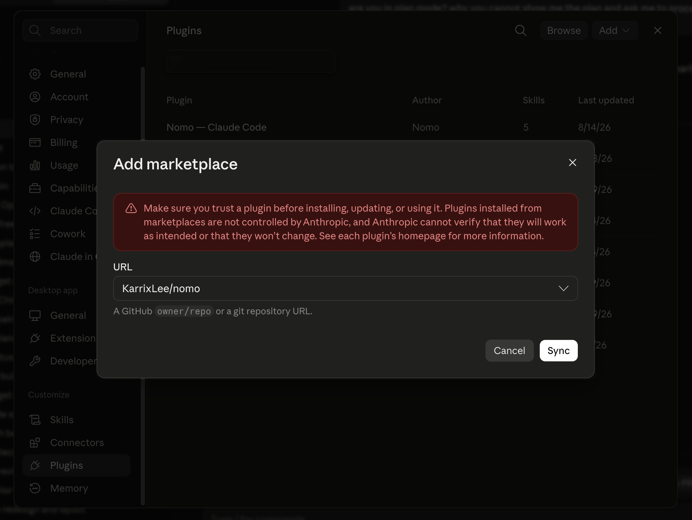
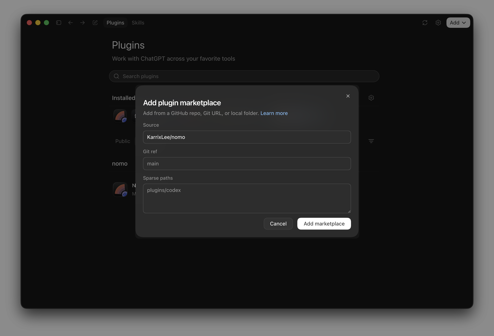
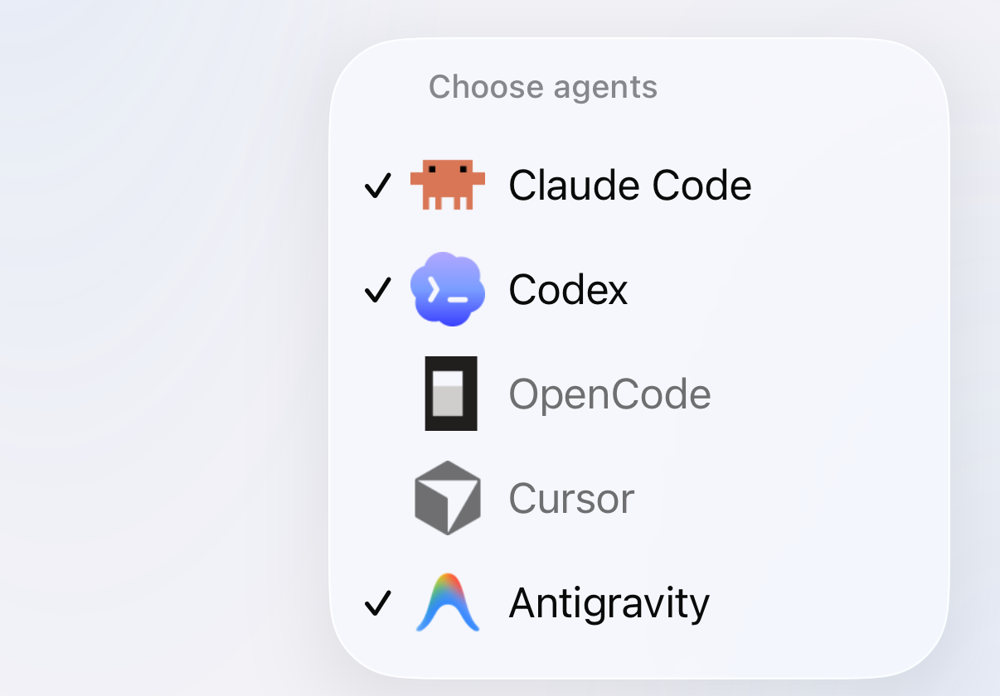
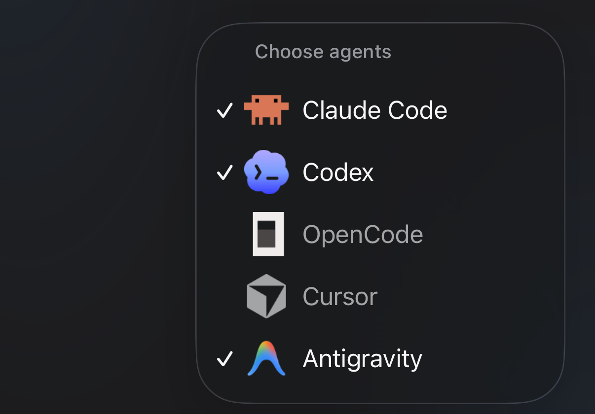

Install once per computer. You need **bun** or **node 18+** — the plugin has no
npm dependencies and runs on Node built-ins. Keep bun at **1.4.4** or newer, and
Node.js 22 at **22.23.4** or newer: the status command warns you about older
ones.

## Install by hand

<Tabs>
  <Tab title="Claude Code" icon="/images/claude-code.svg">
    <Tabs>
      <Tab title="Terminal" icon="terminal">
        From inside a Claude Code session:

        ```
        /plugin marketplace add KarrixLee/nomo
        /plugin install nomo-cc@nomo
        ```
      </Tab>

      <Tab title="Desktop app" icon="window">
        **Settings** → **Plugins** → **Add** → **Add marketplace**. Put the
        repository in **URL**:

        ```
        KarrixLee/nomo
        ```

        Then **Sync**, and install **Nomo — Claude Code** from the list.

        <Frame caption="A GitHub owner/repo is enough — Nomo's repository is the marketplace.">
          
        </Frame>
      </Tab>
    </Tabs>

    Restart Claude Code afterward so the plugin's hooks load.

    Confirm it's there:

    ```
    /nomo-cc:status
    ```

    <Tip>
      All Nomo commands in Claude Code are namespaced `nomo-cc:` — typing
      `/nomo-cc:` will list them, and so does
      [Commands](/sessions/commands).
    </Tip>
  </Tab>

  <Tab title="Codex" icon="/images/codex.svg">
    Codex **0.142 or later** ships its own plugin system, so Nomo installs as a
    standalone Codex plugin. Claude Code is not required.

    <Steps>
      <Step title="Install the plugin">
        <Tabs>
          <Tab title="Terminal" icon="terminal">
            From inside a Codex session:

            ```
            codex plugin marketplace add KarrixLee/nomo
            codex plugin add nomo@nomo
            ```

            The desktop app's built-in terminal works too, if you'd rather type
            than click.
          </Tab>

          <Tab title="Desktop app" icon="window">
            **Plugins** → **Add** → **Add plugin marketplace**. Put the
            repository in **Source**:

            ```
            KarrixLee/nomo
            ```

            Leave **Git ref** and **Sparse paths** alone — the grey text in
            them is placeholder, not a value you need to match. Then
            **Add marketplace**, and install **nomo** from the list.

            <Frame caption="Nomo's repository is the marketplace — there's no listing to browse or submit to.">
              
            </Frame>
          </Tab>
        </Tabs>

        <Note>
          "Marketplace" here isn't a store you browse. It's a registry pointed
          at a GitHub repository — Nomo's own. That's why you add the repo
          first, then install the plugin from it.
        </Note>
      </Step>

      <Step title="Trust the hooks — required">
        <Tabs>
          <Tab title="Terminal" icon="terminal">
            ```
            /hooks
            ```

            Trust the **ten Nomo entries**.
          </Tab>

          <Tab title="Desktop app" icon="window">
            **Settings** → **Hooks** → **Nomo**, and turn them on.
          </Tab>
        </Tabs>

        <Warning>
          Don't skip this. Nomo's hooks ship with the plugin but stay **inert
          until trusted**. Until you do it, the plugin is installed and doing
          nothing — no sessions reach your phone, and nothing reports an error.
        </Warning>

        This is Codex's own safety gate, and Nomo can't pre-approve it. The hook
        command lines are byte-stable across releases, so trusting once holds
        through updates — only a changed hook line re-opens the review.
      </Step>

      <Step title="Confirm">
        ```
        $nomo-status
        ```

        This reports pairing, watchdog, **hook-trust**, and last-delivery health
        — so it's also how you check the trust step actually took.
      </Step>
    </Steps>

    <Tip>
      Codex skills use a `$` prefix rather than a slash. All five are listed in
      [Commands](/sessions/commands).
    </Tip>
  </Tab>

  <Tab title="OpenCode" icon="/images/opencode.svg">
    OpenCode has no marketplace and no plugin command — it picks up whatever it
    finds in its own config folders. So Nomo installs from a clone, and one
    script puts the files where OpenCode already looks.

    <Steps>
      <Step title="Clone it and run the installer">
        ```bash
        git clone https://github.com/KarrixLee/nomo.git ~/.nomo
        ~/.nomo/plugin/scripts/opencode-install.sh
        ```

        Clone it wherever you like — the script works out its own location, so
        there's no path to look up and nothing to hand-edit. It prints exactly
        what it wrote:

        - `~/.config/opencode/plugins/nomo.js` — a one-line stub pointing back
          at the clone.
        - `~/.config/opencode/commands/nomo-*.md` — the six commands.

        Already installed Nomo for Claude Code or Codex? Point the script at
        that copy instead of cloning a second one — `claude plugin list` or
        `codex plugin list` prints where it lives.

        <Tip>
          `--project` installs into `./.opencode` for one repository instead of
          globally. Re-running is safe, and it's also how you move the clone:
          run it again from the new location.
        </Tip>
      </Step>

      <Step title="Restart OpenCode — required">
        <Warning>
          OpenCode imports plugins once, when its server starts, and there's no
          hot reload. Until you quit and reopen it, the plugin is installed and
          doing nothing. The desktop app runs that same server, so it needs the
          same restart.
        </Warning>
      </Step>

      <Step title="Confirm">
        ```
        /nomo-status
        ```
      </Step>
    </Steps>

    That one install covers the OpenCode desktop app as well: it runs OpenCode's
    own server, which reads the same plugin folder.

    <Note>
      Updating later is one command from inside OpenCode: `/nomo-update` checks
      first, then pulls and re-runs this installer —
      [what it does, and when it refuses](/sessions/commands#update).
    </Note>

    <Tip>
      OpenCode command names are flat and global, so Nomo's carry no prefix at
      all: `/nomo-pair`, not `/nomo-cc:pair` or `$nomo-pair`. All six are in
      [Commands](/sessions/commands).
    </Tip>

    What lands differently on your phone is in
    [Using OpenCode](/sessions/opencode).
  </Tab>

  <Tab title="Cursor" icon="/images/providers/cursor.svg">
    One install covers both the Cursor desktop app's agent and the
    `cursor-agent` CLI. Cursor sessions are read-only in this version —
    [Using Cursor](/sessions/cursor) has what that means.

    <Steps>
      <Step title="Run the installer">
        <CodeGroup>
        ```bash bunx icon="terminal"
        bunx nomo-ai --cursor
        ```

        ```bash npx icon="terminal"
        npx nomo-ai --cursor
        ```
        </CodeGroup>

        It does three things:

        - Clones the plugin to `~/.nomo`.
        - Adds Nomo's hook entries to `~/.cursor/hooks.json`. It merges with
          whatever is already there and leaves other tools' entries untouched.
        - Installs four skills under `~/.cursor/skills/`.
      </Step>

      <Step title="Restart Cursor — required">
        <Warning>
          Cursor only picks hooks up when it starts. Quit and reopen Cursor,
          and restart any `cursor-agent` session you have open. Until you do,
          the plugin is installed and doing nothing.
        </Warning>
      </Step>

      <Step title="Pair">
        In Cursor, type `/` to pick a skill, and run:

        ```
        /nomo-pair
        ```

        It shows a QR code — scan it with the Nomo app. Where you can't open a
        browser, `/nomo-pair code` gives you a short code to type instead. Both
        paths are walked through in [Pairing](/setup/pairing).

        Pairing is shared across agents on one Mac. A computer already paired
        for Claude Code, Codex or OpenCode doesn't need pairing again for
        Cursor — installing is enough, and you can skip this step.
      </Step>

      <Step title="Show the Cursor tab">
        In the app, open the computer. Cursor sessions sit under a **Cursor**
        tab in its session drawer.

        The drawer shows up to three agent tabs. If Cursor isn't one of them,
        tap the **+** button (**Choose agents**) and turn it on.
      </Step>
    </Steps>

    <Tip>
      Nomo's Cursor commands are skills with no prefix: `/nomo-pair`,
      `/nomo-status`, `/nomo-reset` and `/nomo-unpair`. All four are in
      [Commands](/sessions/commands).
    </Tip>
  </Tab>

  <Tab title="Antigravity" icon="/images/providers/antigravity.png">
    One install covers both the Antigravity desktop app and the `agy` CLI.
    Shell commands and file writes can be answered from your phone —
    [Using Antigravity](/sessions/antigravity) has the details.

    <Steps>
      <Step title="Run the installer">
        Paste this into Terminal and press Return:

        <CodeGroup>
        ```bash bunx icon="terminal"
        bunx nomo-ai --antigravity
        ```

        ```bash npx icon="terminal"
        npx nomo-ai --antigravity
        ```
        </CodeGroup>

        You should see:

        ```
        ✅ Antigravity is connected to Nomo. Restart Antigravity, then type /nomo-pair.
        ```
      </Step>

      <Step title="Restart Antigravity — required">
        <Warning>
          Quit Antigravity completely and open it again. If you use `agy`,
          restart it too. Nomo stays off until you do.
        </Warning>
      </Step>

      <Step title="Type /nomo-pair">
        In an Antigravity chat, type `/nomo-pair` and send it. When Antigravity
        asks to run a Nomo command, choose **Allow**. Then scan the QR code with
        Nomo on your iPhone.

        You should see, in Antigravity: "Done! This computer is connected to
        your phone."

        In the Antigravity desktop app, the first Nomo command may show one line
        that says `operation not permitted`. That's normal — Antigravity tries
        again outside its sandbox by itself. Just wait.

        Already paired from another agent? Type `/nomo-status` instead to check.
      </Step>

      <Step title="Send a message in Antigravity">
        Start a chat and send anything.

        You should see the session appear in Nomo, under the **Antigravity** tab
        of your computer. No Antigravity tab? Tap the **+** button (**Choose
        agents**) and turn Antigravity on.

        <Frame caption="Choose agents, from the + button. Antigravity is ticked, so it gets its own tab.">
          <div className="device-frame">
            
            
          </div>
        </Frame>
      </Step>
    </Steps>

    <Warning>
      Don't import Nomo's Claude Code plugin into Antigravity (for example with
      `agy plugin import claude`) — every session would show up twice. If you
      did, the installer warns you:

      ```
      ⚠️ Antigravity also has the Claude Code version of Nomo ("nomo-cc") imported. It would show every session twice — please remove it by running: agy plugin uninstall nomo-cc
      ```

      To fix it, run `agy plugin uninstall nomo-cc` and restart Antigravity.
    </Warning>
  </Tab>
</Tabs>

## One command

The installer detects which of Claude Code, Codex, OpenCode, Cursor,
Antigravity and Grok Bot are on
this machine and sets Nomo up in the ones you pick:

<CodeGroup>
```bash bunx icon="terminal"
bunx nomo-ai
```

```bash npx icon="terminal"
npx nomo-ai
```
</CodeGroup>

Nothing is ticked at the start: arrow keys (or `k` / `j`) move, space ticks an
agent, enter installs everything ticked. Then it runs each agent's own install —
the same five flows above. Nothing is installed globally and no package is left
behind.

For scripting and CI:

| Flag | |
| --- | --- |
| `--claude` `--codex` `--opencode` `--cursor` `--antigravity` `--grokbot` | install exactly these — naming any one of them skips the picker |
| `--all` | all of them, detected or not — except Cursor and Antigravity, which are skipped when they aren't on this machine (name `--cursor` or `--antigravity` to try anyway). Grok Bot is added only when it's the only agent on this Mac |
| `-y`, `--yes` | no picker; install everything detected. Grok Bot is added only when it's the only agent on this Mac |
| `-n`, `--dry-run` | print the commands, run nothing |
| `--global` | also add the short `nomo` command, without asking. See [From Terminal](/sessions/commands#terminal) |
| `uninstall` | with `--cursor`, `--antigravity` or `--grokbot`: remove Nomo from that agent (`--uninstall` works too). Name the agent — it never guesses. See [uninstall](/sessions/commands#uninstall) |

It never pairs your phone. Finish exactly as the steps above describe: restart
the agent, trust the hooks if it's Codex, and pair — `bunx nomo-ai pair` in
Terminal, or `/nomo-pair`, `/nomo-cc:pair` in Claude Code and `$nomo-pair` in
Codex. More Terminal commands are in
[From Terminal](/sessions/commands#terminal).

`--grokbot` is for a Mac where the Grok Bot app is your only AI app. It works on
macOS only. Instead of hooks, it adds a small job that counts your Grok Bot days
when you log in and once an hour, then stops. See
[Using Grok Bot](/sessions/grok-bot).

With `--all` or `-y`, Grok Bot is left out when another agent is on this Mac,
because that agent already sends your activity. The installer says:

```
Grok Bot left out — another agent here already sends its activity. Name it with --grokbot to install it anyway.
```

## Updating

<Note>
  To update or uninstall, see [Commands → update](/sessions/commands#update)
  and [Commands → uninstall](/sessions/commands#uninstall). Every agent is
  there, on its own tab.
</Note>

## What the plugin does

It watches the session and reports state changes to your phone: what the agent
is working on, when it stops, and when it needs permission for something.

It sends nothing until you [pair a phone](/setup/pairing), and everything it
does send is encrypted on this machine first.

Its hooks run in your project's folder, but never load that project's
`bunfig.toml` or `.env` files.

The plugin is **open source** — you can read exactly what it collects and sends
before you install it:

<Card title="KarrixLee/nomo" href="https://github.com/KarrixLee/nomo" icon="github" horizontal>
  The full plugin source, MIT licensed. Marketplace installs are a plain clone
  of this repository.
</Card>

## Next

<Card title="Pair your computer" href="/setup/pairing" icon="qrcode-read">
  Scan a QR code, or type a one-time code if you can't open a browser.
</Card>
