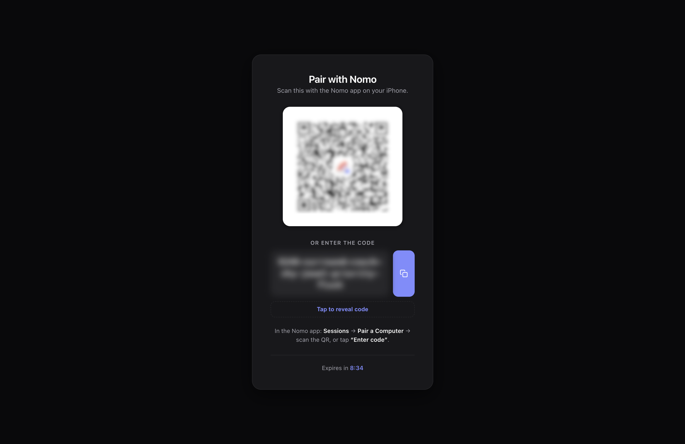

Pairing hands your phone and your computer a shared encryption key. No server
ever sees it — which is why it takes a scan or a typed code rather than a login.

You do this once per computer. The pairing expires if unused for **10 minutes**.

Pairing is free. Nomo Free connects one computer, and Nomo Pro connects more.
[Free and Pro](/free-and-pro) shows what else Pro adds.

<Note>
  One pairing covers the machine, not the agent. If you run any mix of Claude
  Code, Codex, OpenCode, Cursor, Antigravity and Devin on the same computer,
  they share it — you don't pair twice.
</Note>

<Tabs>
  <Tab title="QR code" icon="qrcode-read">
    The normal path. Use it whenever you can open a browser on the computer.

    <Steps>
      <Step title="Start pairing">
        <CodeGroup>
        ```bash Claude Code icon="/images/claude-code.svg"
        /nomo-cc:pair
        ```

        ```bash Codex icon="/images/codex.svg"
        $nomo-pair
        ```

        ```bash OpenCode icon="/images/opencode.svg"
        /nomo-pair
        ```

        ```bash Cursor icon="/images/providers/cursor.svg"
        /nomo-pair
        ```

        ```bash Antigravity icon="/images/providers/antigravity.png"
        /nomo-pair
        ```

        ```bash Devin icon="/images/providers/devin.svg"
        /nomo-pair
        ```
        </CodeGroup>

        In Antigravity, choose **Allow** when it asks to run a Nomo command.
        With the Devin plugin, type `/nomo:pair` in Devin instead. If Devin
        doesn't know the command, paste
        `~/.nomo/plugin/scripts/run.sh ~/.nomo/plugin/dist/pair.mjs` into
        Terminal.

        A themed pairing page opens in your browser with a QR code.

        <Frame caption="The pairing page on your computer. It flips to Paired ✓ on its own once the scan lands.">
          
        </Frame>
      </Step>

      <Step title="Scan it">
        In Nomo, tap **Connect your Mac** on **Home**, or **+** in **Sessions**.
        Point the camera at the QR code.

        {/* TODO: screenshot of the in-app scanner */}
      </Step>

      <Step title="Done">
        The page flips to **Paired ✓** on its own and tears itself down. Your
        computer now appears in the Sessions tab.
      </Step>
    </Steps>

    <Tip>
      Scanned it with the Camera app instead? The pairing link opens Nomo on
      **Pair with this computer?**, showing the pairing and the server it
      connects to. Nothing pairs until you confirm, and it pairs exactly the
      link on that screen.
    </Tip>

    <Note>
      The QR code and the one-time code appear **only** in that browser page,
      never in your terminal. That's deliberate — terminal output ends up in
      agent transcripts, and these are the values an attacker would need.
    </Note>

  </Tab>

  <Tab title="Typed code" icon="keyboard">
    For a headless box, an SSH session, or anywhere you can't open a browser.

    <Warning>
      This path puts the pairing code into your terminal, and therefore into the
      agent's transcript. It's a deliberate trade-off for machines that have no
      browser — prefer the QR path when you have one.
    </Warning>

    <Steps>
      <Step title="Ask for the code">
        Pass `code` as the argument:

        <CodeGroup>
        ```bash Claude Code icon="/images/claude-code.svg"
        /nomo-cc:pair code
        ```

        ```bash Codex icon="/images/codex.svg"
        $nomo-pair code
        ```

        ```bash OpenCode icon="/images/opencode.svg"
        /nomo-pair code
        ```

        ```bash Cursor icon="/images/providers/cursor.svg"
        /nomo-pair code
        ```

        ```bash Antigravity icon="/images/providers/antigravity.png"
        /nomo-pair code
        ```

        ```bash Devin icon="/images/providers/devin.svg"
        /nomo-pair code
        ```
        </CodeGroup>

        With the Devin plugin, type `/nomo:pair code` in Devin instead.

        No browser opens. A one-time code prints straight to the terminal:

        ```
        One-time code: <shown here> · expires in 10 min
        ```
      </Step>

      <Step title="What the code looks like">
        A number, then six words, lowercase and hyphen-joined:

        ```
        7-anchor-brisk-cotton-dial-emerge-fabric
        ```

        <Info>
          The words come from the BIP39 wordlist: no two share their first four
          letters, and there are no lookalike characters. Long, but hard to
          mistype or mishear.
        </Info>
      </Step>

      <Step title="Type it into the app">
        In Nomo, tap **Connect your Mac** on **Home**, or **+** in **Sessions**.
        Then tap **Enter Code**.

        {/* TODO: screenshot of the Enter code screen */}
      </Step>
    </Steps>
  </Tab>
</Tabs>

## Checking on it later

[`/nomo-cc:status`](/sessions/commands#status) on that machine reports whether
it's still connected and whether events are actually being delivered.

## If pairing doesn't take

- **No QR page opens** — the plugin's hooks probably didn't load. Restart the
  agent and try again, or use the typed-code path.
- **The scan succeeds but no computer appears** — run the status command above
  to see whether events are being delivered at all.
- **Old or duplicate rows show up** — run `/nomo-cc:reset` (or `$nomo-reset`).
  It clears rows for sessions that are gone, and you stay paired.
- **You want to disconnect a computer** — run `/nomo-cc:unpair` (or
  `$nomo-unpair`). It removes the pairing and deletes the local key.
- **One Computer on Free** — Nomo Free connects one computer. To use a
  different one, touch and hold the paired one in the Sessions tab, tap
  **Forget This Computer**, and pair again. Or get Nomo Pro to connect more.
- **Computer Limit Reached** — you've paired as many computers as your plan
  allows. Touch and hold one in the Sessions tab, forget it, and pair again.
- **Couldn't Verify This iPhone** — Nomo's server couldn't verify your phone.
  Try again, and contact support if it keeps happening.

Anything else, and the fix is probably on
[Troubleshooting](/sessions/troubleshooting). To take a computer back off,
see [`unpair`](/sessions/commands#unpair).
