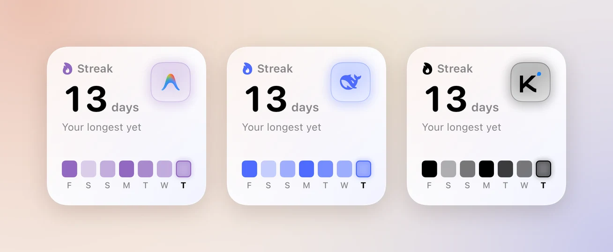
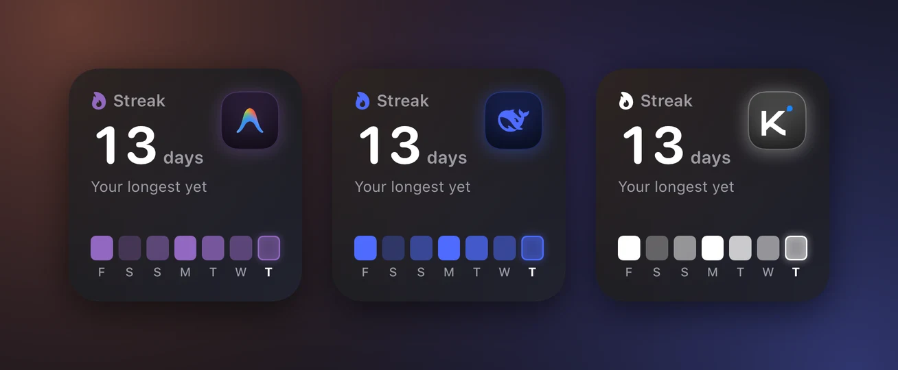

Nomo Pro adds five widgets to the free ones. Each one answers a question you'd
otherwise open the app for.

- **Nomo Pace**: will my usage last until it resets?
- **Nomo Activity**: how many days in a row have I coded with an agent?
- **Nomo Accounts**: which of my accounts has the least left?
- **Live Agents**: what are my agents doing right now?
- **Nomo Tokens**: how many tokens did I use, and on which models?

<Frame caption="All five Pro widgets on a Home Screen: Nomo Pace, Live Agents, Nomo Activity, Nomo Tokens and Nomo Accounts.">
  

    
    
  

</Frame>

Nomo Pace and Nomo Activity also come in Lock Screen sizes.

The free widgets, Nomo status and Nomo Usage, are on
[Free widgets](/free-widgets). To put a widget on your Home Screen, see
[Widget](/widget).

In the widget gallery, a Pro widget's description starts with **👑 Nomo Pro**.

Without Nomo Pro, you can still add a Pro widget. It shows a faded preview with
**Nomo Pro** and **Unlock** on top. Tap it to open Nomo Pro in the app.

## Nomo Pace {#nomo-pace}

<Frame caption="Nomo Pace in Small and Medium, and on the Lock Screen.">
  

    
    
  

</Frame>

**What it shows:** whether you'll run out before your limit resets, if you
keep going at your current speed.

The line under the big number compares two things:

- **used**: how much of the limit you've used.
- **time**: how much of the time window has gone by.

For example, `45% used · 60% time`. If used is lower than time, you're fine.
The widget shows **Resets in** and a countdown to the reset.

If used is higher than time, you're going too fast. The widget shows **Runs out
in** and a countdown to when you'd run out. A `~` in front means it's an
estimate. The number turns amber.

You'll also see:

- **Too early to tell**, right after a window starts. There isn't enough to go
  on yet.
- **Maxed out**, when a window is at 100%. The countdown is to the reset.
- **Pace isn't available for this plan**, when the provider doesn't say when
  the limit resets.

The sizes:

| Size | What's on it |
| --- | --- |
| Small | One window and its ring. |
| Medium | Two windows, usually the 5-hour one and the weekly one. |
| Lock Screen, round | How much you've used. A checkmark means you're fine. When you're going too fast, it shows the time you'd run out. |
| Lock Screen, rectangle | `Lasts until reset`, or the time you'd run out, such as `Out ~9:20 PM`. |

Every ring fills with how much you've used. The small tick shows where you'd
be if you used it evenly. If the fill is behind the tick, you're fine.

**Used or Left:** Nomo Pace follows **Settings → Usage → Show usage as**. With
**Left**, the line reads `55% left · 40% time left`. The ring drains instead:
the fill shows what's left, and the tick shows the time left. If the fill goes
past the tick, you're fine. The numbers on every size flip too.

If you have Claude or Codex resets, the Medium size shows how many next to the
updated time. The Small size shows the reset symbol and the number. They turn
amber or red when you're going too fast. See
[Available resets](/usage#available-resets).

**What you need first:** a connected account, such as Claude or Codex. Open the
**Providers** tab, tap the provider, and connect it. See [Usage](/usage).

**Set it up:**

1. Add the widget. See [Widget](/widget).
2. Touch and hold the widget.
3. Tap **Edit Widget**.
4. Tap **Provider** and pick one, such as **Claude**.
5. Tap **Account** and pick one. **Default** follows your Default account in the
   app.
6. Tap **Window** and pick one. **Automatic** uses the 5-hour window if your
   plan has one, and the weekly window if not. This changes the Small and Lock
   Screen sizes.
7. Tap outside the widget to finish.

Tap the widget to open that provider's **Usage** page in Nomo.

## Nomo Activity {#nomo-activity}

<Frame caption="Nomo Activity in Small, Medium and Large, and on the Lock Screen.">
  

    
    
  

</Frame>

**What it shows:** a map of the days you coded with AI agents, like the one on
a GitHub profile, plus your streak. A streak is how many days in a row you've
coded. It adds up every paired computer, plus Grok Bot and Cursor from your
Cursor sign-in. See [More than one computer](#more-than-one-computer).

A stronger color means more coding that day. Your streak doesn't reset in the
morning: until your first session of the day, it counts up to yesterday.

| Size | What's on it |
| --- | --- |
| Small | Your streak and the last 7 days. |
| Medium | Your streak, the last 16 weeks, and three stats under the map. |
| Large | **Last 26 weeks** under the title, the map with the same three stats, how your activity splits between agents with percentages, and totals: sessions, tokens, your busiest day and your longest streak. |
| Lock Screen, rectangle | Your streak and the last 7 days. |

The three stats under the map cover the weeks the map shows:

- A clock: your active hours, such as `153h`.
- A calendar: how many days you were active, such as `79 days`.
- A bar chart: your average per week, such as `9.7h/wk`.

If Medium is short on room, it shows only the first two. If those weeks have
no time at all, only the calendar shows. See
[No time, only tokens](#no-time-only-tokens).

On Large, **Tokens** is your total for the 26 weeks. If no token data comes in
from your computers, that tile shows **Active hours** instead.

**What you need first:**

- The Nomo plugin on your computer, version **2.4.0** or later. See
  [Install](/setup/install) and [Updating](/sessions/commands#update).
- That computer paired with Nomo. See [Pairing](/setup/pairing).

It counts Claude Code, Codex and OpenCode. Past days show up too, because the
plugin reads the history that's already on your computer.

It also counts Grok Bot and Cursor, with no computer needed. See
[Grok Bot](#grok-bot).

**Set it up:**

1. Add the widget. See [Widget](/widget).
2. Touch and hold the widget.
3. Tap **Edit Widget**.
4. Tap **Character** and pick one: **Automatic**, **Clawd**, **Codex**,
   **Grok Bot**, **Antigravity**, **Kimi**, **DeepSeek**, **Cursor** or
   **OpenCode**.
5. Tap outside the widget to finish.

**Automatic** shows the agent you used most in the last 7 days: the one with
the most active time. If Grok Bot or Cursor was active in those days, it's the
one with the most active days instead. A tie goes to the agent with more active
days in the last 30 days. The [Activity screen](#activity-screen) uses the same
rule.

Any other pick shows that character, and its color: the map, today's square, the streak flame
and the streak badge turn coral (Clawd), blue (Codex) or gold (Grok Bot). On
Large, the bar that splits your time between agents keeps each agent's own
color. A widget that was already on your Home Screen starts on **Automatic**.

<Frame caption="Nomo Activity with Clawd, Codex and Grok Bot.">
  

    
    
  

</Frame>

Only Clawd, Codex and Grok Bot are animated characters. Antigravity, Kimi,
DeepSeek, Cursor and OpenCode show their logo on a tile in their brand color,
and that color takes over the map, the flame, today's square and the glow.

Clawd's mood follows your streak. It sleeps when you have no streak. It works
out on a day you've already coded, and types while today is still empty. On a
streak of 30 days or more, or a streak of at least 7 days that's your longest
yet, Clawd turns into the Claude spark. That's still the **Clawd** pick. Grok
Bot sleeps when you have no streak. Codex always looks the same.

<Frame caption="Nomo Activity with Antigravity, DeepSeek and Kimi.">
  

    
    
  

</Frame>

The plugin sends a new summary at most every 6 hours, and once right after a
plugin update. Nomo fetches it when you open the app, at most once an hour. So
the map can be a few hours behind. Opening the
[Activity screen](#activity-screen) fetches the latest summary right away, at
most once every 30 seconds. You can also pull down there to fetch again.

Tap the widget to open the [Activity screen](#activity-screen) in Nomo.

What leaves your computer for this map is listed under
[Privacy](#privacy). It's counts only, never your prompts or code.

### Grok Bot {#grok-bot}

From Nomo 2.4.2, Nomo Activity and Nomo Tokens also count Grok Bot. You don't
need a computer.

**What you need first:**

- Nomo 2.4.2 and Nomo Pro.
- Cursor connected in Nomo, with the same account you use for Grok Bot.
  Connect Cursor, not Grok. See [Cursor and Grok](/usage#cursor-and-grok).

Then open the [Activity screen](#activity-screen). It fetches your Grok Bot
days and tokens when it opens. To show Grok Bot on the widget, pick **Grok
Bot** under **Character**.

**What counts:**

- A day counts when Grok Bot used any tokens that day. Scheduled routines and
  use in the Grok Bot phone app count too.
- Nomo Tokens and the Activity screen show Grok Bot's real token counts.
- Your own Cursor use, in the Cursor editor or its command line, shows up on
  its own line: **Cursor**.

#### No time, only tokens {#no-time-only-tokens}

For Grok Bot and Cursor, Cursor reports tokens only. There's no time and no
sessions. So:

- A number that needs time or sessions, such as **Active hours** or
  **Sessions**, shows **—** when nothing else gave one.
- On the map, a Grok Bot or Cursor day is shaded by its tokens, compared with
  its other days.
- When Grok Bot or Cursor was active, the split between agents counts active
  days, not time.
- Their totals are the ones Cursor reports, and may include cached tokens. On
  the [Activity screen](#activity-screen), the note under **By model** says so.

What Nomo reads is under [Privacy](#privacy).

<Card title="Grok Bot widgets on iPhone" icon="newspaper" href="https://nomo.gg/blog/grok-bot-widget-iphone/" horizontal>
  The full walkthrough with pictures, on the Nomo blog.
</Card>

## Nomo Tokens {#nomo-tokens}

<Frame caption="Nomo Tokens in Medium and Large.">
  

    
    
  

</Frame>

**What it shows:** how many tokens your agents used each day for the last 14
days. Each day is split by model, or by agent if you pick that. It adds up
every paired computer, plus Grok Bot and Cursor from your Cursor sign-in.

Tokens here means input + output + reasoning. Cache isn't counted: it re-reads
the same context, so it would swamp every other number. The
[Activity screen](#activity-screen) lists cache on its own.

| Size | What's on it |
| --- | --- |
| Medium | The 14-day total, today's tokens, and your top model with its share. By agent, your top agent instead. |
| Large | **Last 14 days** under the title. The same numbers, plus the change from last week and your top 4 models. The rest are added up in one row, such as `6 more models`. By agent, up to 5 agents instead. |

Each model keeps one color everywhere: Claude models are coral, GPT blue, Grok
gold, Gemini purple, and other models grey. By agent, each agent has its own
color, such as coral for Claude Code, blue for Codex and gold for Grok Bot.
Cursor's line is dashed.

**What you need first:** the same as Nomo Activity: the Nomo plugin on a
paired computer, or Cursor connected in Nomo for Grok Bot. See
[Nomo Activity](#nomo-activity).

**Set it up:**

1. Add the widget. See [Widget](/widget).
2. Touch and hold the widget.
3. Tap **Edit Widget**.
4. Tap **Character** and pick one, the same choices as
   [Nomo Activity](#nomo-activity).
5. Tap **Group by** and pick **Model** or **Agent**.
6. Tap **Style** and pick **Bars** or **Lines**.
7. If you picked **Agent**, tap **Agents**. Pick the agents you want: Claude
   Code, Codex, OpenCode, Grok Bot or Cursor. At first, all of them are picked.
8. Tap outside the widget to finish.

**Agents** shows only when **Group by** is **Agent**. If you pick only some
agents, the numbers count just them, and the label under the total reads
**Selected agents** instead of **14-day total**. If none of your picks used
tokens in the 14 days, the widget shows every agent.

A widget that was already on your Home Screen starts on **Model** and **Bars**,
so it looks the same as before.

**Automatic** follows your top model's provider: Clawd for Claude, Codex for
GPT, Grok Bot for Grok, Antigravity for Gemini, and the Kimi, DeepSeek or
Cursor logo for their models. Any other model gets Clawd. Your pick changes
only the character, the background glow and today's bar. Model colors never
change.

When the widget shows Clawd, its mood follows your tokens. It sleeps after 3
days with no tokens, and types while today has none yet. When today is your
best day of the 14, Clawd turns into the Claude spark. That's still the
**Clawd** pick. Grok Bot sleeps after 3 days with no tokens.

Tap the widget to open the [Activity screen](#activity-screen) in Nomo. Without
Nomo Pro, a tap opens Nomo Pro.

It uses the same summary as Nomo Activity. What leaves your computer is listed
under [Privacy](#privacy).

## Nomo Accounts {#nomo-accounts}

<Frame caption="Nomo Accounts in Medium and Large.">
  

    
    
  

</Frame>

**What it shows:** every connected account on one board, from every provider.
The account with the least left is at the top.

Each row shows the account's name, the window it's closest to using up, how
much is used, and when it resets.

The number, the bar and the column header follow **Settings → Usage → Show
usage as**. With **Left**, they show how much is left. The order stays the same.

- **Medium** shows 4 rows. **Large** shows 8.
- If you have more accounts than that, the last row says how many more, such as
  `+3 more`.
- An account that needs you to sign in again stays on the board, at the bottom,
  with **Reconnect in Nomo**. It never disappears.

**What you need first:** at least one connected account. To track two accounts
of the same provider, see [More than one account](#more-than-one-account).

**Set it up:** add the widget. See [Widget](/widget). There's
nothing to pick in **Edit Widget**.

The board shows the last numbers Nomo fetched. On Large, tap the refresh button
in its corner to update every account.

Tap an account's row to open that provider's **Usage** page in Nomo, showing
that account. A **Reconnect in Nomo** row works the same way. Tap anywhere
else, including the `+3 more` row, to open the **Providers** tab. Without
Nomo Pro, a tap opens Nomo Pro.

## Live Agents {#live-agents}

<Frame caption="Live Agents in Small and Medium. The violet row needs your answer.">
  

    
    
  

</Frame>

**What it shows:** your Claude Code, Codex and other agent sessions right now.
It's the same list as the **Sessions** tab.

**Violet means one needs your answer.**

| Icon | Label | What it means |
| --- | --- | --- |
| Violet hand | `Needs permission` | Asking permission for an action. You can answer from your phone. |
| Violet hand | `Needs an answer` | Asking you a question. You can answer from your phone. |
| Orange hand | `Needs attention` | Stopped and waiting for you, with nothing to answer from the phone. |
| Orange dot | `Running` | Working. Nothing needed from you. |
| Green check | `Done` | Finished. |

These match the [Sessions tab](/sessions/list#session-states).

- **Small** shows how many sessions are running. When one needs you, a violet
  button says so.
- **Medium** shows up to 3 sessions. The ones that need you come first.

The widget has no Allow or Deny buttons. Tap it to open **Sessions** in Nomo.
On Medium, tap a session to open that session.

The widget copies the Sessions list from the Nomo app. If it hasn't been
updated for 10 minutes, it shows an amber dot and how long ago it updated.
Open Nomo to refresh it.

**What you need first:** a paired computer with the Nomo plugin. See
[Install](/setup/install) and [Pairing](/setup/pairing).

**Set it up:**

1. Add the widget. See [Widget](/widget).
2. Touch and hold the widget.
3. Tap **Edit Widget**.
4. Tap **Character** and pick one, the same choices as
   [Nomo Activity](#nomo-activity).
5. Tap outside the widget to finish.

**Automatic** follows the session at the top of the list. For an Antigravity,
Cursor or OpenCode session, that's its logo. Any other pick shows
that character and gives the background a light tint of its color. The status
colors never change: violet still means a session needs your answer. A widget
that was already on your Home Screen starts on **Automatic**.

## Activity screen and Wrapped {#activity-screen}

The Activity screen shows your streak and your tokens in full. It also makes a
Wrapped card you can share.

<Frame caption="The top of the Activity screen: your streak, the 7 / 14 / 30 days switch and the tokens chart.">
  

    
    
  

</Frame>

To open it:

1. Open Nomo.
2. Tap the **Sessions** tab.
3. Tap the [streak bar](#streak-bar) just above the tab bar. On iOS 26.0 or
   earlier, tap the **Activity** card at the top of the list instead.

You can also tap the Nomo Activity or Nomo Tokens widget. This works even when
Nomo is closed. Nomo waits until it knows you have Nomo Pro, so a subscriber
never lands on the Nomo Pro screen by mistake.

On iOS 26.0 or earlier without Nomo Pro, the card shows a crown, **Activity**
and **Streak, daily tokens and Wrapped with Nomo Pro.** Tap it to open Nomo
Pro.

The screen shows:

- **Streak**: your streak and a map of the last 26 weeks, with month names
  above it and the same three stats as the [widget](#nomo-activity). Under
  them: how your activity splits between agents, with percentages, then
  **Sessions** and **Busiest day**.
- **Your Wrapped**: a card that makes an image to share. See
  [Wrapped](#wrapped).
- A switch for **7 days**, **14 days** or **30 days**. The chart moves from one
  range to the next when you switch.
- **Tokens**: a chart of your daily tokens, with **Today**, **Daily average**,
  **Active hours** and the change from the previous period. See
  [The Tokens chart](#tokens-chart).
- **By model**: a table with **Input**, **Output**, **Cache** and **Total**
  for each model.

**Busiest day** is the day with the most active time, such as
`Busiest day · 1h 59m`. With no time at all, it's the day with the most tokens.

When you open the screen, it animates in for about a second. If Reduce Motion
is on, everything just appears.

The screen's character and color follow the agent you used most, like
[Nomo Activity](#nomo-activity) on **Automatic**. The streak bar does the same.
To pick another one, see [Choose a character](#activity-character).

### Choose a character {#activity-character}

Under the streak card, it says **Touch and hold to choose a character**.

1. Touch and hold the streak card.
2. The card lifts and turns over to **Character**.
3. Tap a character: **Automatic**, **Clawd**, **Codex**, **Grok Bot**,
   **Antigravity**, **Kimi**, **DeepSeek**, **Cursor** or **OpenCode**.

The card turns back by itself. To go back without a change, tap **×**, or tap
outside the card.

Each row has a second line:

- **Automatic**: the character it shows now, such as
  `Follows your most-used agent · now Clawd`.
- A character whose agent you've used: its share of your activity, such as
  `38% of your activity`.
- Any other character: **No activity yet**.

Your pick changes the character and the colors of the Activity screen and the
[streak bar](#streak-bar). Nomo remembers it. Widgets keep their own
**Character** option in **Edit Widget**, and Wrapped always follows your
favorite agent.

With VoiceOver, use the card's **Change character** action.

### The Tokens chart {#tokens-chart}

Two switches sit next to the **Tokens** title. On a small screen, they sit
under it.

- **Model** or **Agent**: split each day by model, or by agent.
- **Bars** or **Lines**: the bar icon shows a bar chart. The line icon shows one
  line for each model or agent.

The **7 days**, **14 days** and **30 days** switch still sets the range.

By model, the chart shows your top 5 models. The rest are added up as
**Other**.

Under the chart, each model or agent has a name and a total. Tap a name to
hide it from the chart. Tap it again to show it. The numbers above the chart
still count everything: hiding changes only the chart.

Nomo remembers your choices for next time.

### Filter the chart {#tokens-filter}

Under the Tokens card, it says **Touch and hold to filter**.

1. Touch and hold the Tokens card.
2. The card lifts and turns over to **Filter**. Each model or agent has a tile
   with its total and its share of the range.
3. Tap a tile to hide it or show it. A checkmark means it's shown.
4. To show everything again, tap **Show all**.
5. To go back, tap **×**, or tap outside the card.

It's the same choice as tapping a name under the chart. You can't hide the
last one: it shows a lock.

While something is hidden, the card says how many are shown, such as
`3 of 4 shown`.

With VoiceOver, use the card's **Filter** action.

### The streak bar {#streak-bar}

On iOS 26.1 or later, the **Sessions** tab has a small bar that floats just
above the tab bar. It shows your streak, this week's tokens and the last 7
days as mini bars.

- When you scroll, it shrinks and sits next to the tab bar.
- Tap it to open the Activity screen.

Sometimes it shows something else:

| What it says | What it means | What a tap does |
| --- | --- | --- |
| **Start your streak** | No computer is paired, and Cursor isn't connected in Nomo. | Opens the same pairing steps as **Pair a Computer**. |
| **No sessions yet** | A computer is paired or Cursor is connected, but no activity has come in yet. | Opens the Activity screen. |
| **Update the Nomo plugin** | Every paired computer has a Nomo plugin older than 2.4.0. | Opens the steps to update it. |

When the bar is shrunk, these say **Pair a computer**, **No sessions yet** and
**Update plugin**.

The bar needs Nomo Pro. Without it, you won't see the bar.

When a new version of Nomo is out, the update bar takes this spot instead.
Update Nomo, or tap **×** on the update bar, to get the streak bar back.

On iOS 26.0 or earlier, there's no bar. The streak card sits at the top of the
Sessions list instead.

### Wrapped {#wrapped}

Wrapped turns your week, month or year into one image you can share.

1. On the Activity screen, tap **Your Wrapped**, just under the streak card.
   You can also tap the share button at the top right.
2. Tap **Week** (the last 7 days), **Month** (the last 30 days) or **Year**
   (this calendar year).
3. In the switch next to it, tap a style: bars, lines or heatmap.
4. Tap **Share**, then pick where to send it.

The style sets the chart on the card, and so on the image you share:

- **Bars**: your tokens for each day. For a year, for each month.
- **Lines**: one line for each agent. An agent with less than 5% of your tokens
  is left out, unless it's your top one.
- **Heatmap**: your active days. A week shows 7 tiles. A month shows the last
  30 days in two rows. A year shows the whole year's map so far.

Nomo remembers the style for next time.

<Frame caption="A week's Wrapped card. It's always dark, whatever your iPhone's appearance.">
  

    
  

</Frame>

The card shows your tokens, a chart, your active hours, your busiest day, your
longest streak, your favorite model and agent, and how many sessions you ran.

- **Favorite model** is always a real model, such as Fable. Grok Bot and Cursor
  aren't models. If they're all you used, the tile shows **Active days**
  instead.
- When Grok Bot or Cursor tokens are included, the note at the bottom reads
  `Tokens = input + output + reasoning + Cursor's totals`.

Its character follows your favorite agent. **Share** sends it as a 1080 × 1350 image. It never includes your prompts,
project names or file paths.

## More than one computer {#more-than-one-computer}

Nomo Activity, Nomo Tokens, the Activity screen, Wrapped and the streak bar
add up every paired computer.

- Active time counts once. If you code on two Macs at the same time, that time
  isn't counted twice.
- Tokens and sessions add up.
- A Mac that was paired twice is counted once.
- When you remove a computer, its activity leaves the totals.

### When a computer isn't counted {#not-counted}

A computer with a Nomo plugin older than 2.4.0 isn't counted. You'll see:

- On the Activity screen, under your streak: `MacBook Air isn't counted ·
  update its plugin`, with that computer's name. If there's more than one, it
  says how many, such as `2 computers aren't counted · update their plugin`.
  Tap it to see how to update.
- On the Large Nomo Activity widget: `1 computer not counted`. On the smallest
  iPhones, there's no room for it.

To fix it, update the Nomo plugin on that computer. See
[Updating](/sessions/commands#update).

## More than one account {#more-than-one-account}

With Nomo Pro, you can add up to 5 accounts for each provider. For example,
a work Claude account and a personal one. Nomo Pace, Nomo Usage and Nomo
Accounts can all use them.

Your widgets show the **Default** account unless you pick another one. To pick
one, touch and hold the widget, tap **Edit Widget**, then tap **Account**.
Nomo Accounts shows every account on its own.

If you remove an account, widgets that showed it show **Account removed**.
They don't switch to your Default account. Edit the widget and pick another
account.

If your Nomo Pro ends, your extra accounts are paused. Nothing is removed, and
your Default account keeps updating. A Nomo Usage widget set to an extra
account shows **Paused · Nomo Pro** and `Your Nomo Pro ended. Resubscribe in
Nomo to see this account.` Tap it to open Nomo Pro. A widget that shows your
Default account is never paused.

To add, rename or remove an account, see
[More than one account](/usage#more-than-one-account) on the Usage page.

## Try it with Demo mode

Demo mode fills the widgets with sample data, so you can see them before you
connect anything.

1. Open Nomo.
2. Tap the **Settings** tab.
3. Scroll to **Demo mode**.
4. Turn on **Show sample data**.

Nomo Pace, Nomo Activity, Nomo Tokens and Live Agents then show sample data,
not your own.
Demo mode always shows sample data. The one exception: once a computer is
paired, Live Agents shows your real sessions.
Nomo Accounts only lists accounts you've really added, so it stays empty until
you add one.

If you don't have Nomo Pro, Demo mode also unlocks the Pro widgets, but only
while no computer is paired.

To go back to your real data, turn **Show sample data** off.

## Privacy

**Nomo Activity**

- What leaves your computer: for each day and each agent, the number of
  sessions, the number of prompts, which 5-minute slots of the day were active,
  and token totals per model.
- What never leaves: your prompts, the agent's replies, project names and file
  paths.
- It's end-to-end encrypted (AES-256-GCM, with your pairing key) before it's
  uploaded. Nomo's relay can't read it, and deletes it after **35 days**.
- It also holds a random computer id. The plugin makes it once on your
  computer and keeps it in `~/.config/cc-status/machine-id`. It never comes
  from your hardware, such as the serial number, MAC address, computer name or
  user name. It's end-to-end encrypted with the rest. Nomo uses it only so
  your phone doesn't count the same computer twice. To get a new one, delete
  that file.
- It uploads at most every 6 hours, and only when something changed. The
  reset command uploads it right away. If
  nothing changed, it sends the same summary again once a week, so the relay
  doesn't delete it. Right after you pair a new phone, it uploads once within
  about a minute.
- On your computer, it's kept in `~/.config/cc-status/activity-days.json`. Only
  your user account can read it. It keeps 400 days at most.

**Grok Bot and Cursor**

- Nomo reads only token counts per hour, with the Cursor account you connect
  in Nomo. It never reads your messages or code.
- The counts go straight from Cursor's server to your phone. They aren't
  uploaded anywhere.
- To stop, open Cursor in the **Providers** tab, tap **Usage**, and tap
  **Disconnect**. This also stops your Cursor usage in Nomo.

**Nomo Tokens and the Activity screen**

- They use the same activity summary as Nomo Activity, and the same Grok Bot
  and Cursor counts, so everything above applies to them too.
- Your chart choices, your filter and your character pick are saved on your
  iPhone only.

**Wrapped**

- Sharing sends only the image you see on the card.

**Live Agents**

- The widget reads a snapshot of your sessions that the app saves on your
  iPhone. It stays on the phone and is never sent anywhere.

**More than one account**

- Your logins are saved in the iPhone Keychain.
- Signing in uses a fresh, private browser page, so it doesn't reuse your
  Safari login.

**The limits**

- The relay can see that an upload happened, how big it was, and when.
- Anyone who has your unlocked phone can see your activity.

For the full picture, see the security notes in the
[plugin's README](https://github.com/KarrixLee/nomo#readme).
