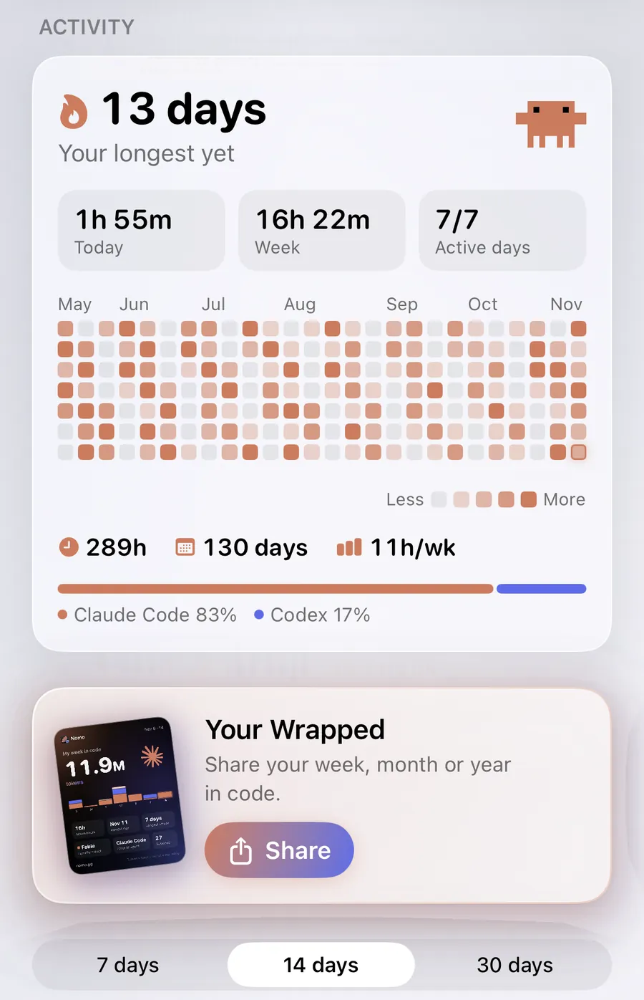
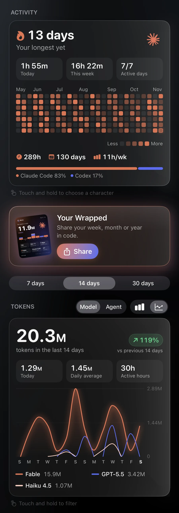

活动会显示你用 AI 智能体写了多少代码。它在 Nomo 的**首页**标签页上。

## 设置 {#set-up}

<CardGroup cols={2}>
  <Card title="一键安装" href="/zh-Hans/setup/install" icon="download">
    在电脑上把 Nomo 添加到 Claude Code、Codex 或其他智能体，并配对你的手机。你写代码时，活动就会慢慢填满。
  </Card>
  <Card title="或者手动安装" href="/zh-Hans/setup/manual" icon="screwdriver-wrench">
    用智能体自带的插件市场安装，再用 Nomo 扫描二维码。
  </Card>
</CardGroup>

配对电脑之前，活动会显示一张空卡片。轻点卡片上的**配对你的 Mac** 开始。

<Frame caption="配对之前的活动：空的日历和“配对你的 Mac”。">
  

    
    
  

</Frame>

<Frame caption="首页上的活动：正在编程的智能体、你的连续记录、最近 30 天的日历，以及“你的回顾”。">
  

    
    
  

</Frame>

## 打开方式 {#open-it}

1. 打开 Nomo。
2. 轻点**首页**标签页。
3. 向下滚动到**活动**。

也可以轻点 Nomo 活动或 Nomo Token 小组件。Nomo 会打开**首页**，并停在活动。见 [Pro 小组件](/zh-Hans/widgets#nomo-activity)。

想获取最新的活动，在**首页**下拉。

## 显示内容 {#what-it-shows}

- **正在编程**：智能体运行时，最上面有一行会显示，例如“Claude Code 正在编程”，以及电脑的名称。
- **你的连续记录**：你连续多少天用智能体写代码。
- **今天**、**本周**和**活跃天数**：今天和本周的编程时长，以及本周写代码的天数。
- **日历**：最近 30 天，每天一格。颜色越深，表示那天写的代码越多。有 Nomo Pro 时，显示最近 26 周。
- **合计**：你的活跃时长、活跃天数和每周时长。
- **你的智能体**：你的时间在各智能体之间怎么分配，例如 `Claude Code 82%` 和 `Codex 18%`。

每个智能体都会计入。活动会把你所有配对过的电脑加在一起。见[多台电脑](/zh-Hans/widgets#more-than-one-computer)。

连续记录不会在早上清零。在当天第一个会话之前，它算到昨天为止。

## 选择角色 {#character}

连续记录卡片上有一个会动的角色。它跟随你用得最多的智能体。想换一个：

1. 按住连续记录卡片。
2. 卡片翻过来，显示**角色**。
3. 轻点一个角色，例如 **Clawd**、**Codex** 或 **Grok Bot**。想重新跟随你用得最多的智能体，轻点**自动**。

卡片会自己翻回来。想不做更改就返回，轻点 **×**。

你选的角色也会改变活动的颜色。小组件在“编辑小组件”里有自己的**角色**选项。

## 你的回顾 {#wrapped}

“你的回顾”会把你的一周或一个月做成一张可以分享的图片。

1. 在**首页**，滚动到连续记录下方的**你的回顾**。
2. 轻点**分享**。
3. 轻点**周**（最近 7 天）或**月**（最近 30 天）。
4. 选一种样式：柱状、折线或热力图。
5. 轻点**分享**，然后选择要发到哪里。

可以分享成**帖子**或**快拍**。大数字是你的连续记录或编程时长。

有 Nomo Pro 时，还可以选**年**（今年到目前为止），也可以把 Token 作为大数字。

<Frame caption="一周的回顾卡片。不管 iPhone 用哪种外观，它都是深色的。">
  

    
  

</Frame>

回顾绝不会包含你的提示、项目名称或文件路径。

## Token  {#tokens-chart}

有 Nomo Pro 时，活动还会显示你的 Token。日历显示最近 26 周，“你的回顾”卡片也会多出**年**。

<Frame caption="有 Nomo Pro 时的活动：26 周的地图、可以选年的“你的回顾”，以及 7 / 14 / 30 天切换。">
  

    
    
  

</Frame>

在“你的回顾”下方：

1. 轻点 **7 天**、**14 天**或 **30 天**，选择时间范围。
2. 在 **Token** 旁边，轻点**模型**或**智能体**，按模型或按智能体拆分每一天。
3. 轻点折线图标显示折线，轻点柱状图标显示柱状。一开始显示的是折线。

<Frame caption="选了智能体和折线的 Token 图表：每个智能体一条线。">
  

    
    
  

</Frame>

卡片会显示总数、**今天**、**日均**、**活跃时长**，以及和上一个时段相比的变化。按模型时，图表显示前 5 个模型，其余的合并为**其他**。

这里的 Token 指输入 + 输出 + 推理。缓存不计入：它是重复读取同样的上下文，会把其他数字全部淹没。图表下方的**按模型**表格会列出每个模型的**输入**、**输出**、**缓存**和**总计**。

Nomo 会记住你的选择，下次还是一样。

### 筛选图表 {#tokens-filter}

想隐藏某个模型或智能体，轻点图表下方它的名称。再轻点一次就会显示。图表上方的数字仍然全部计入。

也可以从列表里选：

1. 按住 Token 卡片。
2. 卡片翻过来，显示**筛选**。
3. 轻点一个方块来隐藏或显示它。有对勾表示正在显示。
4. 想全部重新显示，轻点**显示全部**。
5. 想返回，轻点 **×**。

最后一个不能隐藏：它会显示一把锁。

## 隐私 {#privacy}

活动只用到数字：天数、活跃时长、会话数和 Token 数。绝不会用到你的提示、代码、项目名称或文件路径。完整的说明见小组件页面的[隐私](/zh-Hans/widgets#privacy)。
