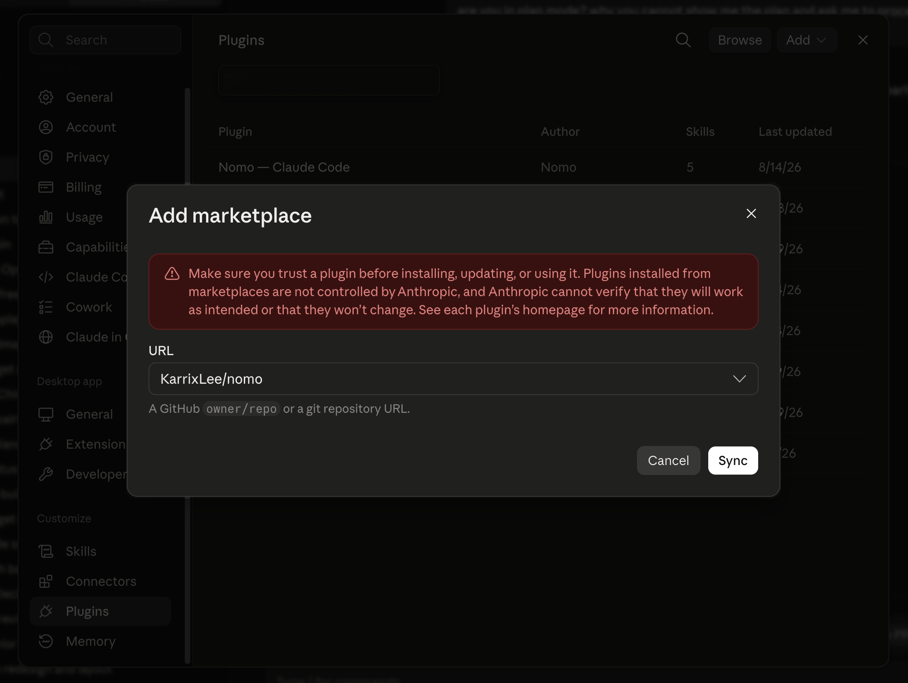
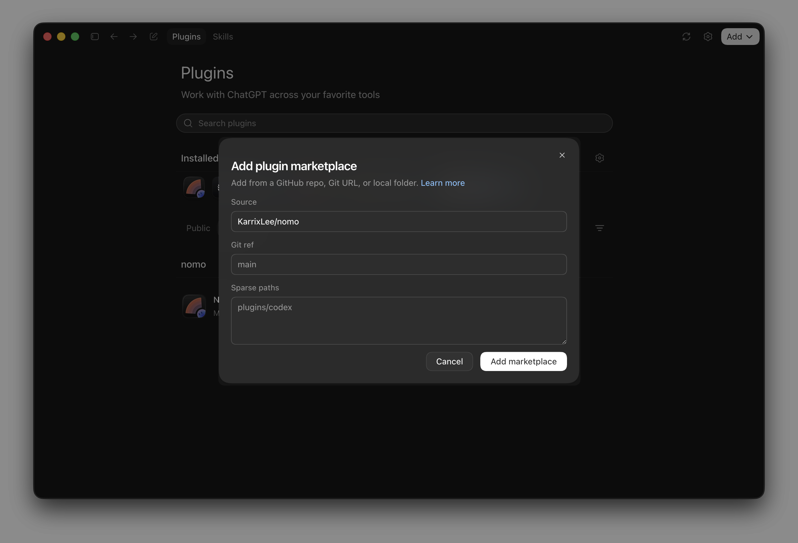
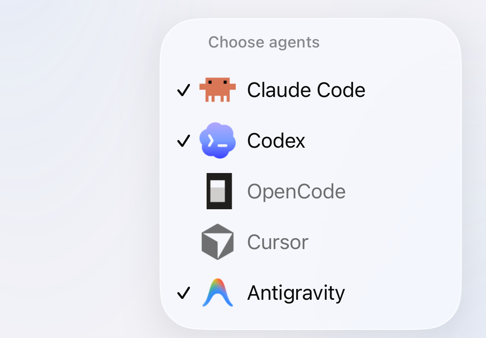
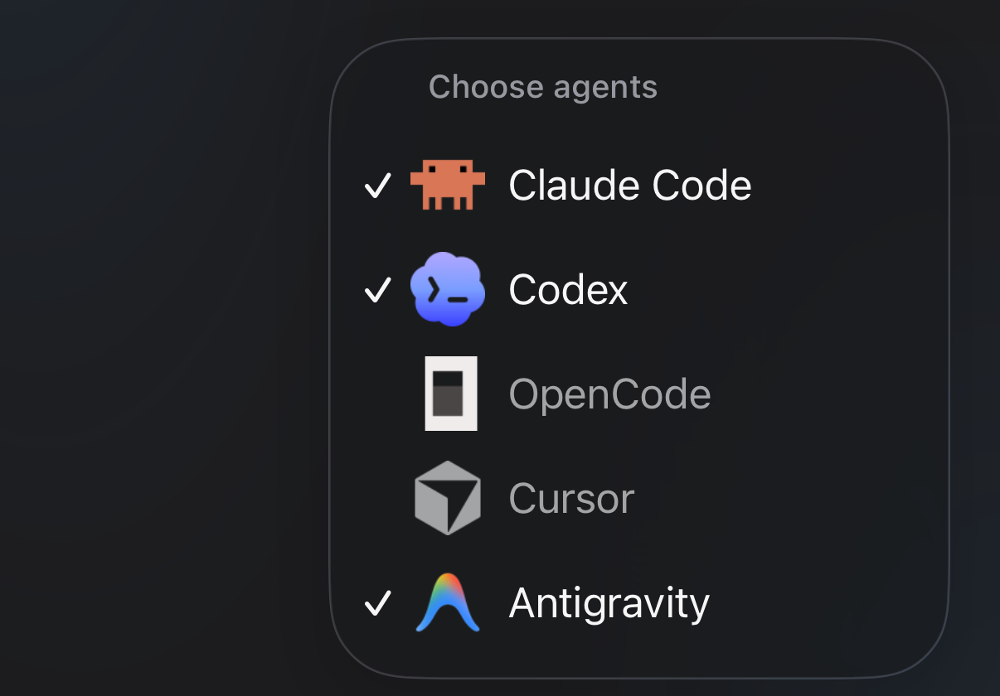

每台电脑安装一次即可。需要 **bun** 或 **node 18 及以上版本** —— 该插件没有任何 npm 依赖，只用 Node 内置模块运行。请让 bun 保持在 **1.4.4** 或更高、Node.js 22 保持在 **22.23.4** 或更高：版本更旧时，状态命令会提醒你。

## 手动安装 {#install-by-hand}

<Tabs>
  <Tab title="Claude Code" icon="/images/claude-code.svg">
    <Tabs>
      <Tab title="终端" icon="terminal">
        在 Claude Code 会话里执行：

        ```
        /plugin marketplace add KarrixLee/nomo
        /plugin install nomo-cc@nomo
        ```
      </Tab>

      <Tab title="桌面应用" icon="window">
        依次进入 **Settings** → **Plugins** → **Add** → **Add marketplace**，在 **URL** 里填入仓库：

        ```
        KarrixLee/nomo
        ```

        然后点 **Sync**，在列表里安装 **Nomo — Claude Code**。

        <Frame caption="填 GitHub 的 owner/repo 就够了——Nomo 的仓库本身就是插件市场。">
          
        </Frame>
      </Tab>
    </Tabs>

    之后重启 Claude Code，让插件的 hook 加载。

    确认已安装：

    ```
    /nomo-cc:status
    ```

    <Tip>
      Claude Code 中所有 Nomo 命令都带 `nomo-cc:` 命名空间 —— 输入
      `/nomo-cc:` 就会列出它们。
    </Tip>
  </Tab>

  <Tab title="Codex" icon="/images/codex.svg">
    Codex **0.142 及以上版本**自带插件系统，所以 Nomo 可以作为独立的 Codex
    插件安装，不需要 Claude Code。

    <Steps>
      <Step title="安装插件">
        <Tabs>
          <Tab title="终端" icon="terminal">
            ```
            codex plugin marketplace add KarrixLee/nomo
            codex plugin add nomo@nomo
            ```

            如果你更愿意打字，桌面应用的内置终端也一样可以。
          </Tab>

          <Tab title="桌面应用" icon="window">
            依次进入 **插件** → **添加** → **添加插件市场**，在 **Source** 里填入仓库：

            ```
            KarrixLee/nomo
            ```

            **Git ref** 和 **Sparse paths** 保持原样即可——里面的灰字是占位符，不是你要填的值。然后点 **添加插件市场**，在列表里安装 **nomo**。

            <Frame caption="Nomo 的仓库本身就是插件市场，没有列表可浏览，也不需要提交审核。">
              
            </Frame>
          </Tab>
        </Tabs>

        <Note>
          这里说的"插件市场"不是一个可以逛的商店，而是一个指向 GitHub 仓库的注册表——就是 Nomo 自己的仓库。所以要先添加仓库，再从里面安装插件。
        </Note>
      </Step>

      <Step title="信任 hook —— 必做">
        <Tabs>
          <Tab title="终端" icon="terminal">
            ```
            /hooks
            ```

            信任那**十条 Nomo 条目**。终端里显示为英文的 “trust”。
          </Tab>

          <Tab title="桌面应用" icon="window">
            打开齿轮图标里的 **钩子** → **nomo**，把它们打开。
          </Tab>
        </Tabs>

        <Warning>
          不要跳过这一步。Nomo 的 hook 随插件一起安装，但在**被信任之前始终不会生效**。在你完成这一步之前，插件虽已安装却什么都不做 —— 没有会话到达你的手机，也不会有任何报错。
        </Warning>

        这是 Codex 自身的安全关卡，Nomo 无法预先批准。hook 的命令行在各个版本之间逐字节保持不变，所以信任一次即可跨版本沿用 —— 只有 hook 命令行发生变化才会重新触发审核。
      </Step>

      <Step title="确认">
        ```
        $nomo-status
        ```

        它会报告配对、看门狗、**hook 信任状态**以及最近一次投递的健康情况 ——
        所以这也是检查信任那一步是否真正生效的方法。
      </Step>
    </Steps>

    <Tip>
      Codex 的技能使用 `$` 前缀而不是斜杠 —— `$nomo-pair`、
      `$nomo-status`、`$nomo-reset`、`$nomo-unpair`。
    </Tip>
  </Tab>

  <Tab title="OpenCode" icon="/images/opencode.svg">
    OpenCode 既没有插件市场，也没有插件命令——它只认自己配置文件夹里现成的东西。所以 Nomo 从一份克隆安装，由一个脚本把文件放到 OpenCode 本来就会去找的位置。

    <Steps>
      <Step title="克隆并运行安装脚本">
        ```bash
        git clone https://github.com/KarrixLee/nomo.git ~/.nomo
        ~/.nomo/plugin/scripts/opencode-install.sh
        ```

        克隆到哪里都行——脚本会自己算出所在位置，没有路径要查，也没有东西要手改。它会原样打印出自己写了些什么：

        - `~/.config/opencode/plugins/nomo.js`——一个指回克隆目录的单行桩文件。
        - `~/.config/opencode/commands/nomo-*.md`——那六条命令。

        已经为 Claude Code 或 Codex 装过 Nomo？那就让脚本指向那份副本，不必再克隆一份——`claude plugin list` 或 `codex plugin list` 会打印出它在哪儿。

        <Tip>
          `--project` 会装进 `./.opencode`，只对一个存储库生效，而不是全局安装。重复运行是安全的，这也是搬动克隆目录的办法：在新位置再跑一次。
        </Tip>
      </Step>

      <Step title="重启 OpenCode——必做">
        <Warning>
          OpenCode 只在自己的服务器启动时导入一次插件，没有热重载。在你退出并重新打开它之前，插件虽已安装却什么都不做。桌面应用跑的是同一个服务器，所以同样需要这次重启。
        </Warning>
      </Step>

      <Step title="确认">
        ```
        /nomo-status
        ```
      </Step>
    </Steps>

    这一次安装同时也覆盖 OpenCode 桌面应用：它跑的是 OpenCode 自己的服务器，读的是同一个插件文件夹。

    <Note>
      以后更新，在 OpenCode 里一条命令就够：`/nomo-update` 会先检查，再拉取并重新运行这个安装脚本——[它做什么、什么时候会拒绝](/zh-Hans/sessions/commands#update)。
    </Note>

    <Tip>
      OpenCode 的命令名是扁平且全局的，所以 Nomo 的命令完全不带前缀：是 `/nomo-pair`，不是 `/nomo-cc:pair` 或 `$nomo-pair`。六条都在[命令](/zh-Hans/sessions/commands)里。
    </Tip>

    到了手机上有哪些不一样，见[搭配 OpenCode 使用](/zh-Hans/sessions/opencode)。
  </Tab>

  <Tab title="Cursor" icon="/images/providers/cursor.svg">
    一次安装同时覆盖 Cursor 桌面应用里的智能体和 `cursor-agent` CLI。Cursor 会话在这个版本里是只读的——这意味着什么，见[搭配 Cursor 使用](/zh-Hans/sessions/cursor)。

    <Steps>
      <Step title="运行安装工具">
        <CodeGroup>
        ```bash bunx icon="terminal"
        bunx nomo-ai --cursor
        ```

        ```bash npx icon="terminal"
        npx nomo-ai --cursor
        ```
        </CodeGroup>

        它做三件事：

        - 把插件克隆到 `~/.nomo`。
        - 把 Nomo 的 hook 条目加进 `~/.cursor/hooks.json`。它会和已有的内容合并，其他工具的条目原样不动。
        - 在 `~/.cursor/skills/` 下安装四个 skill。
      </Step>

      <Step title="重启 Cursor——必做">
        <Warning>
          Cursor 只在启动时加载 hook。退出并重新打开 Cursor，并重启你开着的每一个 `cursor-agent` 会话。在你这样做之前，插件虽已安装却什么都不做。
        </Warning>
      </Step>

      <Step title="配对">
        在 Cursor 里输入 `/` 来挑选 skill，然后运行：

        ```
        /nomo-pair
        ```

        它会显示一个二维码——用 Nomo App 扫一下。打不开浏览器的地方，`/nomo-pair code` 会改为给你一段可以手输的短码。两种方式的完整流程都在[配对](/zh-Hans/setup/pairing)里。

        同一台 Mac 上的各个智能体共用配对。一台已经为 Claude Code、Codex 或 OpenCode 配对过的电脑，不需要为 Cursor 再配对一次——安装就够了，这一步可以跳过。
      </Step>

      <Step title="显示 Cursor 标签页">
        在 App 里打开那台电脑。Cursor 的会话在它会话详情页的 **Cursor** 标签页下面。

        详情页最多显示三个智能体标签页。如果 Cursor 不在其中，轻点 **+** 按钮（**选择智能体**），把它打开。
      </Step>
    </Steps>

    <Tip>
      Nomo 的 Cursor 命令是不带前缀的 skill：`/nomo-pair`、`/nomo-status`、`/nomo-reset` 和 `/nomo-unpair`。四个都在[命令](/zh-Hans/sessions/commands)里。
    </Tip>
  </Tab>

  <Tab title="Antigravity" icon="/images/providers/antigravity.png">
    一次安装同时覆盖 Antigravity 桌面应用和 `agy` CLI。shell 命令和文件写入可以在手机上答复——详情见[搭配 Antigravity 使用](/zh-Hans/sessions/antigravity)。

    <Steps>
      <Step title="运行安装工具">
        把下面这条粘贴到终端里，然后按回车：

        <CodeGroup>
        ```bash bunx icon="terminal"
        bunx nomo-ai --antigravity
        ```

        ```bash npx icon="terminal"
        npx nomo-ai --antigravity
        ```
        </CodeGroup>

        你应该会看到：

        ```
        ✅ Antigravity is connected to Nomo. Restart Antigravity, then type /nomo-pair.
        ```
      </Step>

      <Step title="重启 Antigravity——必做">
        <Warning>
          完全退出 Antigravity，再重新打开。如果你用 `agy`，也把它重启。在你这样做之前，Nomo 不会生效。
        </Warning>
      </Step>

      <Step title="输入 /nomo-pair">
        在 Antigravity 的对话里输入 `/nomo-pair` 并发送。Antigravity 问你要不要运行 Nomo 命令时，选择 **Allow**（允许）。然后用 iPhone 上的 Nomo 扫描二维码。

        你应该会在 Antigravity 里看到：“Done! This computer is connected to your phone.”（完成！这台电脑已连接到你的手机。）

        在 Antigravity 桌面应用里，第一条 Nomo 命令可能会显示一行 `operation not permitted`。这是正常的——Antigravity 会自己在沙箱外重试。等着就好。

        已经在别的智能体里配对过？改为输入 `/nomo-status` 检查一下。
      </Step>

      <Step title="在 Antigravity 里发一条消息">
        开始一个对话，随便发点什么。

        你应该会看到这个会话出现在 Nomo 里，在你这台电脑的 **Antigravity** 标签页下。没有 Antigravity 标签页？轻点 **+** 按钮（**选择智能体**），把 Antigravity 打开。

        <Frame caption="从 + 按钮打开的“选择智能体”。Antigravity 已勾选，所以它有自己的标签页。">
          <div className="device-frame">
            
            
          </div>
        </Frame>
      </Step>
    </Steps>

    <Warning>
      不要把 Nomo 的 Claude Code 插件导入 Antigravity（比如用 `agy plugin import claude`）——否则每个会话都会出现两次。如果你已经导入了，安装工具会提醒你：

      ```
      ⚠️ Antigravity also has the Claude Code version of Nomo ("nomo-cc") imported. It would show every session twice — please remove it by running: agy plugin uninstall nomo-cc
      ```

      要修复，运行 `agy plugin uninstall nomo-cc`，然后重启 Antigravity。
    </Warning>
  </Tab>
</Tabs>

## 一键安装 {#one-command}

安装工具会找出这台电脑上有哪些 Claude Code、Codex、OpenCode、Cursor、Antigravity 和 Grok Bot，然后把 Nomo 装进你挑中的那几个：

<CodeGroup>
```bash bunx icon="terminal"
bunx nomo-ai
```

```bash npx icon="terminal"
npx nomo-ai
```
</CodeGroup>

一开始一个都没勾上：箭头键（或 `k`、`j`）移动，空格勾选，回车安装所有勾上的。接着它就去跑每个智能体本来的安装流程——也就是上面那五套。它不会全局安装任何东西，也不会留下包。

写脚本或在 CI 里用时：

| 选项 | |
| --- | --- |
| `--claude` `--codex` `--opencode` `--cursor` `--antigravity` `--grokbot` | 只装这些——只要指定其中任意一个，就会跳过选择界面 |
| `--all` | 全部都装，无论有没有找到——只有 Cursor、Antigravity 和 Grok Bot 例外：这台电脑上没有它们时会跳过（想照装就指定 `--cursor`、`--antigravity` 或 `--grokbot`） |
| `-y`、`--yes` | 不出选择界面，找到多少装多少 |
| `-n`、`--dry-run` | 把要执行的命令打印出来，什么都不执行 |
| `--global` | 同时加上简短的 `nomo` 命令，不再询问。见[终端命令](/zh-Hans/sessions/commands#terminal) |
| `uninstall` | 配合 `--cursor`、`--antigravity` 或 `--grokbot` 使用：从那个智能体里移除 Nomo（写成 `--uninstall` 也可以）。必须指定智能体——它从不猜。见 [uninstall](/zh-Hans/sessions/commands#uninstall) |

它不会替你配对手机。之后照上面的步骤收尾：重启智能体，是 Codex 的话信任那些 hook，然后配对——在终端里运行 `bunx nomo-ai pair`，或者用 `/nomo-pair`，Claude Code 里是 `/nomo-cc:pair`，Codex 里是 `$nomo-pair`。更多终端命令见[终端命令](/zh-Hans/sessions/commands#terminal)。

`--grokbot` 适用于只用 Grok Bot 应用这一个 AI 应用的 Mac。它加的不是 hook，而是一个每小时运行一次的小任务，而且只支持 macOS。见[搭配 Grok Bot 使用](/zh-Hans/sessions/grok-bot)。

## 更新 {#updating}

<Note>
  要更新或卸载，见[命令 → update](/zh-Hans/sessions/commands#update)和[命令 → uninstall](/zh-Hans/sessions/commands#uninstall)。每个智能体都在那里，各有自己的标签页。
</Note>

## 插件做了什么

它监视会话，并把状态变化报告给你的手机：智能体正在做什么、什么时候停下，以及什么时候需要你授予权限。

在你[配对手机](/zh-Hans/setup/pairing)之前，它什么都不会发送；而它发送的所有内容都先在本机加密。

它的 hook 在你的项目文件夹里运行，但绝不会加载那个项目的 `bunfig.toml` 或 `.env` 文件。

该插件是**开源**的 —— 在安装之前，你可以确切地读到它收集和发送了什么：

<Card title="KarrixLee/nomo" href="https://github.com/KarrixLee/nomo" icon="github" horizontal>
  完整的插件源码，采用 MIT 许可证。从插件市场安装就是对这个仓库的一次普通克隆。
</Card>

## 下一步

<Card title="配对你的电脑" href="/zh-Hans/setup/pairing" icon="qrcode-read">
  扫描二维码；如果打不开浏览器，就输入一次性配对码。
</Card>
