Nomo Pro 在免费小组件之外再加五个小组件。每个都回答一个你原本要打开 App 才能弄清的问题。

- **Nomo 用量速度**：我的用量能撑到重置吗？
- **Nomo 活动**：我已经连续几天用智能体写代码了？
- **Nomo 账户**：我哪个账户剩得最少？
- **智能体实时状态**：我的智能体此刻在做什么？
- **Nomo Token**：我用了多少 Token，用在哪些模型上？

<Frame caption="主屏幕上的全部五个 Pro 小组件：Nomo 用量速度、智能体实时状态、Nomo 活动、Nomo Token 和 Nomo 账户。">
  

    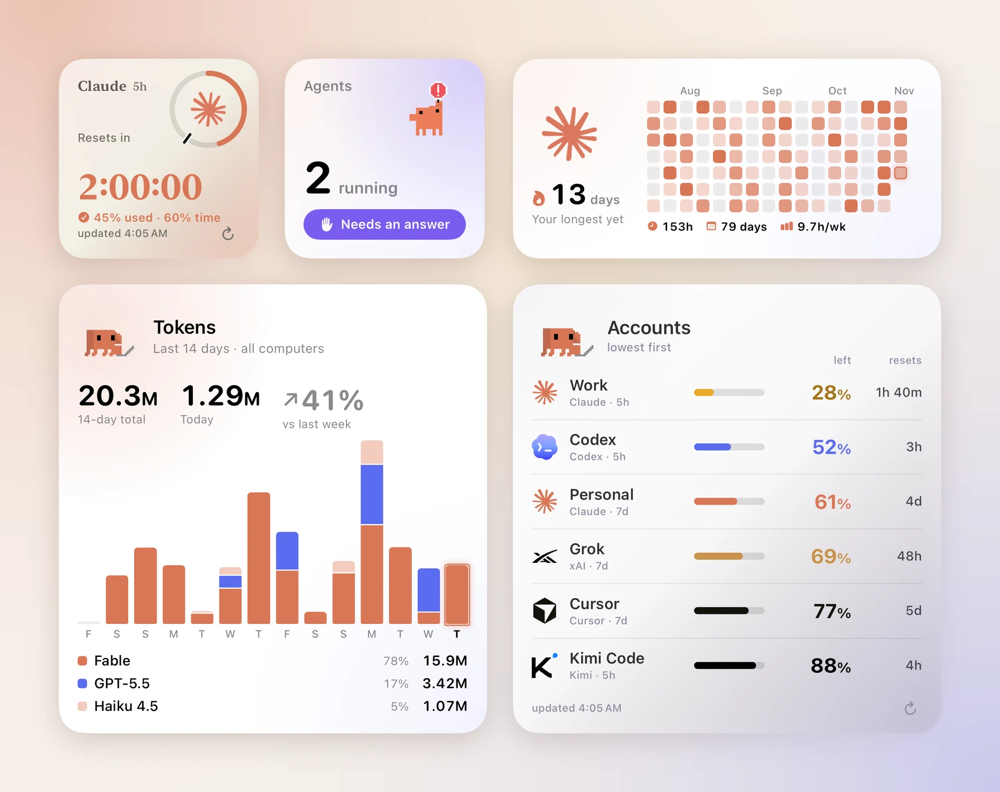
    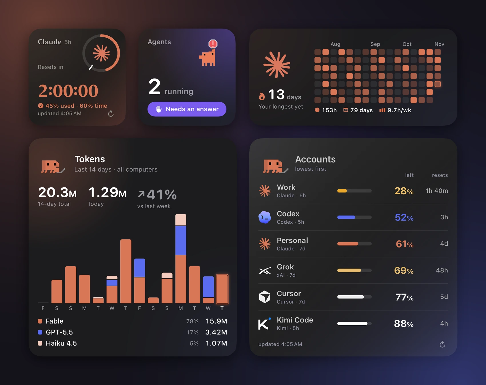
  

</Frame>

Nomo 用量速度和 Nomo 活动也有锁定屏幕尺寸。

免费小组件 Nomo 状态、Nomo 用量，以及小号和中号的 Nomo 活动，见[免费小组件](/zh-Hans/free-widgets)。想把小组件放到主屏幕上，见[小组件](/zh-Hans/widget)。

在小组件中心里，Pro 小组件的描述以 **👑 Nomo Pro** 开头。

没有 Nomo Pro 也可以添加 Pro 小组件。它会显示一个淡化的预览，上面写着 **Nomo Pro** 和“解锁”。轻点它，就会在 App 里打开 Nomo Pro。只有一个例外：配对了电脑后，小号和中号的 Nomo 活动是免费的。

App 里的连续记录和 Token 在“首页”标签页。见[活动](/zh-Hans/activity)。

## Nomo 用量速度 {#nomo-pace}

<Frame caption="小号和中号的 Nomo 用量速度，以及锁定屏幕上的样子。">
  

    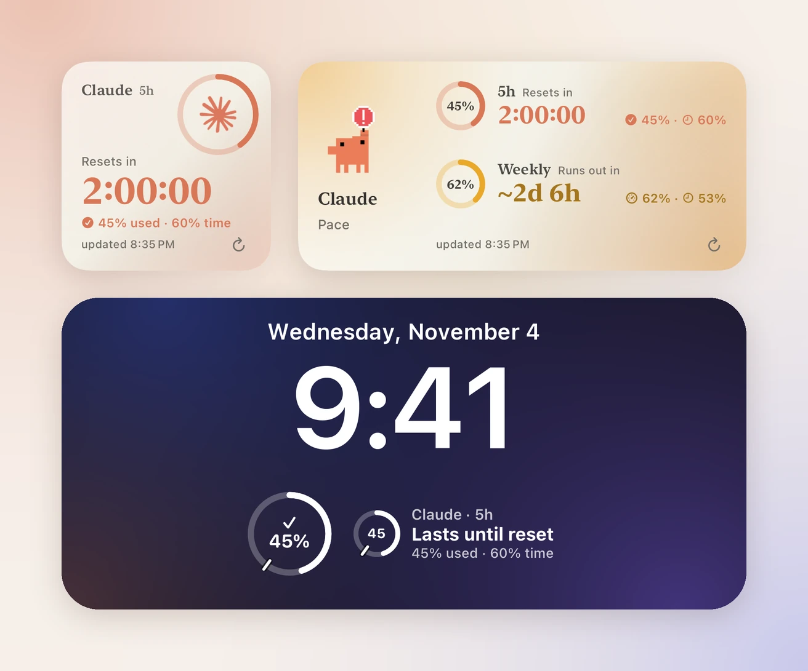
    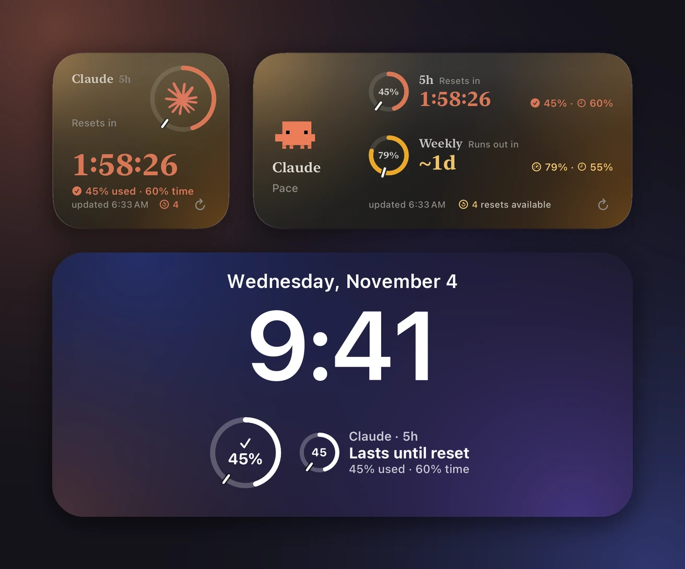
  

</Frame>

**它显示什么**：照现在的速度用下去，你会不会在限额重置前用完。

大数字下面那一行比较两样东西：

- **已用**：限额已经用了多少。
- **时间**：这个时段已经过去了多少。

例如 `已用 45%・时间 60%`。已用比时间低，就没问题。小组件会显示“重置倒计时”和距离重置的倒计时。

已用比时间高，说明你用得太快了。小组件会显示“用完倒计时”和距离用完的倒计时。前面带 `~` 表示这是估算。数字会变成琥珀色。

你还可能看到：

- “现在还看不出来”，出现在时段刚开始的时候。现在还没有足够的数据可以判断。
- “已达限额”，出现在某个时段达到 100% 的时候。倒计时是到重置为止。
- “此套餐无法估算用量速度”，出现在服务商没有说明限额何时重置的时候。

各尺寸：

| 尺寸 | 显示内容 |
| --- | --- |
| 小号 | 一个时段及其圆环。 |
| 中号 | 两个时段，通常是 5 小时时段和每周时段。 |
| 锁定屏幕（圆形） | 你用了多少。对勾表示没问题。用得太快时，显示你会用完的时间。 |
| 锁定屏幕（矩形） | `够用到重置`，或你会用完的时间，例如 `~21:20 用完`。 |

每个圆环都按你用了多少来填充。那个小刻度表示如果你均匀地用，现在应该用到哪里。填充没到刻度，就说明没问题。

**已用或剩余**：Nomo 用量速度跟随**设置 → 用量 → 用量显示方式**。选**剩余**时，那一行显示 `剩余 55%・剩余时间 40%`。圆环会改为逐渐变少：填充表示还剩多少，小刻度表示还剩多少时间。填充超过刻度，就没问题。各尺寸上的数字也会跟着变。

有 Claude 或 Codex 的重置次数时，中号会在更新时间旁显示次数，小号只显示重置符号和数字。用得太快时，会变成琥珀色或红色。见[可用的重置次数](/zh-Hans/usage#available-resets)。

**事先需要**：一个已连接的账户，例如 Claude 或 Codex。打开“服务商”标签页，轻点那个服务商并连接。见[用量](/zh-Hans/usage)。

**设置方法**：

1. 添加小组件。见[小组件](/zh-Hans/widget)。
2. 按住小组件。
3. 轻点“编辑小组件”。
4. 轻点“服务商”，选一个，例如 **Claude**。
5. 轻点“账户”，选一个。“默认”会跟随你在 App 里设定的默认账户。
6. 轻点“时段”，选一个。“自动”会在你的套餐有 5 小时时段时用它，没有时用每周时段。这会改变小号和锁定屏幕尺寸的显示。
7. 轻点小组件外面，完成设置。

选 Antigravity 时，“时段”里还有“模型限额”和“模型 5 小时限额”，分别对应 Claude 和 GPT 模型的每周限额和 5 小时限额。见 [Antigravity 的模型限额](/zh-Hans/free-widgets#antigravity-model-limits)。

轻点小组件，会在 Nomo 中打开那个服务商的“用量”页面。

## Nomo 活动 {#nomo-activity}

<Frame caption="小号、中号和大号的 Nomo 活动，以及锁定屏幕上的样子。">
  

    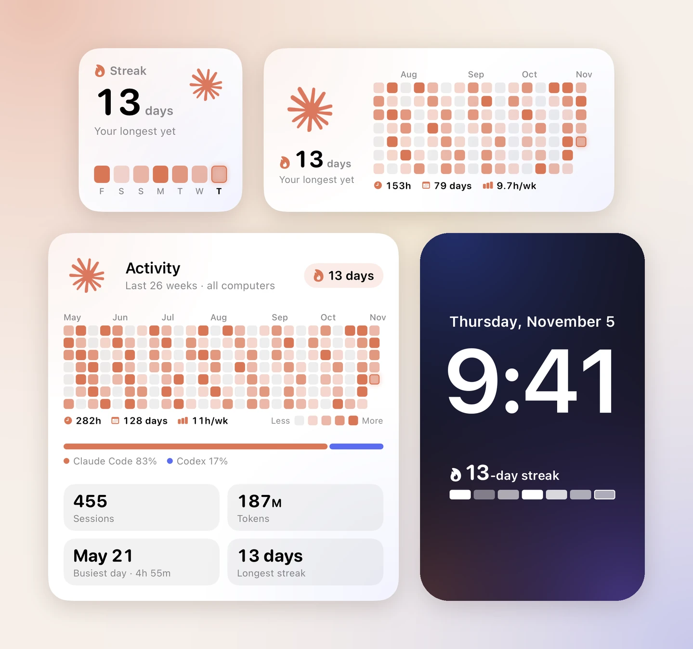
    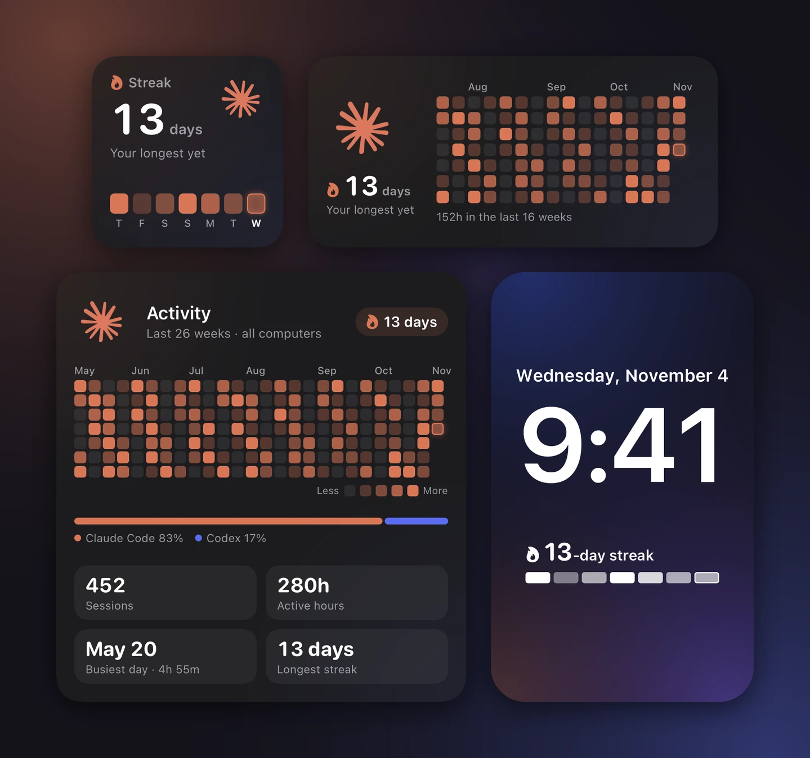
  

</Frame>

**它显示什么**：一张你用 AI 智能体写代码的日子的地图，就像 GitHub 个人主页上的那种，外加你的连续记录。连续记录就是你连续写了几天代码。它会把所有配对过的电脑加在一起，再加上通过你的 Cursor 登录统计的 Grok Bot 和 Cursor。见[多台电脑](#more-than-one-computer)。

颜色越深，表示那天写的代码越多。你的连续记录不会在早上清零：在你当天的第一个会话之前，它算到昨天为止。

| 尺寸 | 显示内容 |
| --- | --- |
| 小号 | 你的连续记录和最近 7 天。 |
| 中号 | 你的连续记录、最近 16 周，以及地图下方的三项数据。 |
| 大号 | 标题下方显示“最近 26 周”，然后是地图和同样的三项数据、你的活动在各智能体之间的分配（带百分比），以及合计：会话数、Token、你最忙的一天和你最长的连续记录。 |
| 锁定屏幕（矩形） | 你的连续记录和最近 7 天。 |

配对了电脑后，小号和中号是免费的。没有 Nomo Pro 时，中号显示最近 30 天，而不是 16 周。见[免费小组件](/zh-Hans/free-widgets#nomo-activity)。大号和锁定屏幕尺寸需要 Nomo Pro。

地图下方的三项数据，统计的是地图上显示的那段时间：

- 时钟：你的活跃时长。
- 日历：你活跃了多少天。
- 柱状图：你每周的平均时长。

中号放不下时，只显示前两项。如果这几周完全没有时长，只显示日历那一项。见[只有 Token、没有时长](#no-time-only-tokens)。

在大号上，“Token”是这 26 周的总数。如果你的电脑没有传来任何 Token 数据，这一格会改为显示“活跃时长”。

**事先需要**：

- 你电脑上的 Nomo 插件，版本 **2.4.0** 或更高。见[安装](/zh-Hans/setup/install)和[更新](/zh-Hans/sessions/commands#update)。
- 那台电脑已经和 Nomo 配对。见[配对](/zh-Hans/setup/pairing)。

它统计哪些智能体，见[哪些智能体会计入](#which-agents-count)。

**设置方法**：

1. 添加小组件。见[小组件](/zh-Hans/widget)。
2. 按住小组件。
3. 轻点“编辑小组件”。
4. 轻点“角色”，从“自动”、**Clawd**、**Codex**、**Grok Bot**、**Antigravity**、**Kimi**、**DeepSeek**、**Cursor**、**OpenCode**、**Devin** 中选一个。
5. 轻点小组件外面，完成设置。

“自动”会显示你最近 7 天用得最多的智能体，也就是活跃时长最长的那个。如果这几天里 Grok Bot 或 Cursor 有活动，就改为看谁的活跃天数最多。打平时，选最近 30 天里活跃天数更多的智能体。“首页”上的[活动](/zh-Hans/activity#character)也用同样的规则。

选其他角色时，小组件会显示那个角色，地图、今天的方格、连续记录的火焰和徽章都会换成它的颜色：Clawd 是珊瑚色，Codex 是蓝色，Grok Bot 是金色。大号尺寸里按智能体划分时间的条形图，仍保留各智能体自己的颜色。已经在主屏幕上的小组件会从“自动”开始。

<Frame caption="Clawd、Codex 和 Grok Bot 三种角色的 Nomo 活动。">
  

    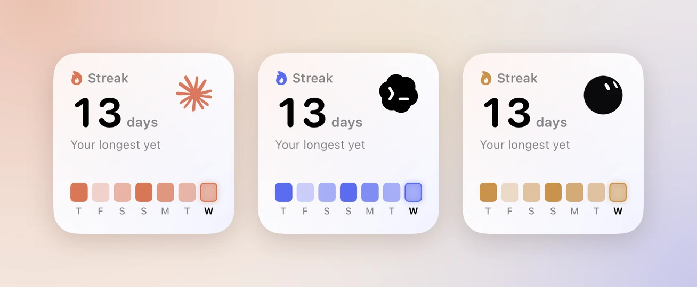
    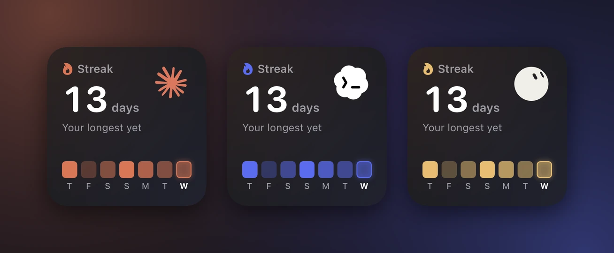
  

</Frame>

只有 Clawd、Codex 和 Grok Bot 是会动的角色。Antigravity、Kimi、DeepSeek、Cursor、OpenCode 和 Devin 会在品牌色的方块上显示自己的标志，地图、火焰、今天的方格和光晕也会换成这个颜色。

Clawd 的心情会跟着你的连续记录变化。没有连续记录时，它在睡觉。当天已经写过代码，它会在健身；今天还没写，它就在打字。连续记录达到 30 天或以上，或者至少 7 天且是你迄今最长的一次时，Clawd 会变成 Claude 的星芒标志。这仍然算是选了 **Clawd**。没有连续记录时，Grok Bot 也会睡觉。Codex 的样子始终不变。

<Frame caption="Antigravity、DeepSeek 和 Kimi 的 Nomo 活动。">
  

    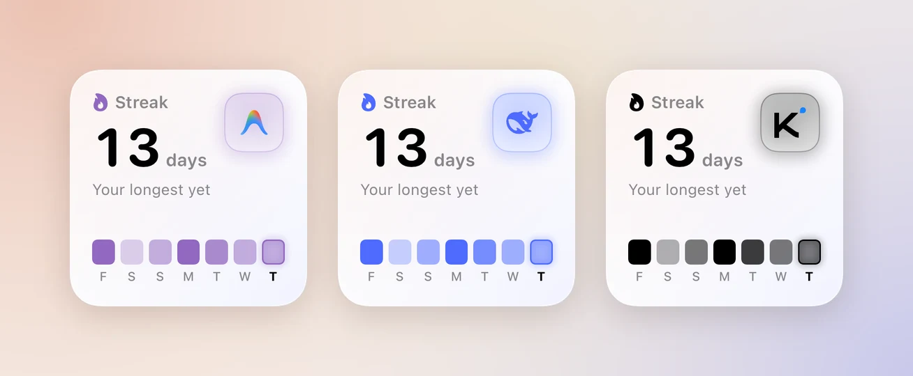
    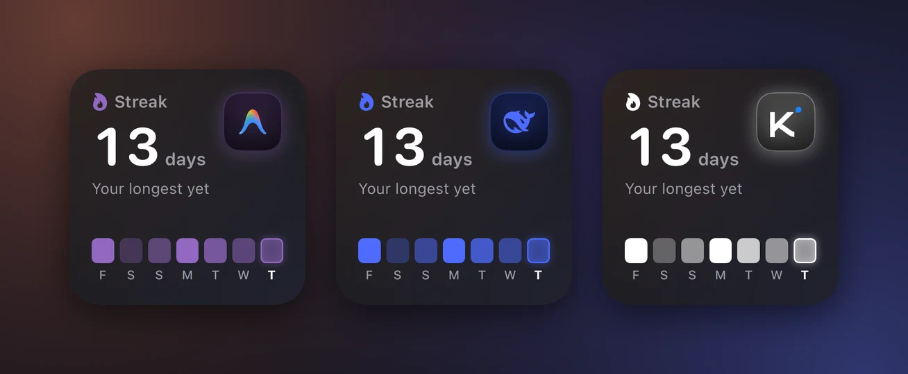
  

</Frame>

插件最多每 6 小时发送一次新的汇总，插件更新后也会马上发送一次。Nomo 在你打开 App 时获取它，最多每小时一次。所以地图可能会晚几个小时。打开“首页”上的[活动](/zh-Hans/activity)时，会马上获取最新的汇总（最多每 30 秒一次）。你也可以在“首页”下拉，再获取一次。

轻点小组件，会打开 Nomo 的“首页”，并停在[活动](/zh-Hans/activity)。

为这张地图离开你电脑的内容，列在[隐私](#privacy)下面。只有计数，绝不包括你的提示或代码。

### 哪些智能体会计入 {#which-agents-count}

Nomo 活动、Nomo Token 和“首页”上的[活动](/zh-Hans/activity)统计的是同样的智能体：

- **在你配对过的电脑上**：Claude Code、Codex、OpenCode、Devin 和 Antigravity。过去的日子也会显示，因为插件会读取你电脑上已有的历史记录。
- **不需要电脑**：通过你在 Nomo 里的 Cursor 登录统计的 Grok Bot 和 Cursor。见 [Grok Bot](#grok-bot)。

只有在配对过的电脑上运行的才会计入。app.devin.ai 上的 Devin Cloud 会话不计入，没有配对的电脑上的 Antigravity 也不计入。

#### Devin 和 Antigravity {#devin-and-antigravity}

从 Nomo 2.5.1 起，插件还会统计：

- **Devin**：Devin CLI。
- **Antigravity**：Antigravity 桌面应用和 `agy` 命令行。

要开始统计它们：

1. 把电脑上的 Nomo 插件更新到 2.5.1 或更高。见[更新](/zh-Hans/sessions/commands#update)。
2. 把 iPhone 上的 Nomo 更新到 2.5.1 或更高。

**你能看到什么**：

- 免费：两者都会计入你的连续记录、日历和编程时长，也会出现在各智能体的时间分配里。
- 有 Nomo Pro 时，还能看到它们每个模型的 Token，例如 Devin 的 **SWE-2 Flash Medium** 和 Antigravity 的 **Gemini 3.8 Flash High**。
- 有 Nomo Pro 时，还可以在 Nomo Token 的“智能体”一项里选它们，并在 [Token 图表](/zh-Hans/activity#tokens-chart)的**智能体**视图里看到它们。

### Grok Bot {#grok-bot}

从 Nomo 2.4.2 起，Nomo 活动和 Nomo Token 也会统计 Grok Bot。不需要电脑。

**事先需要**：

- Nomo 2.4.2 和 Nomo Pro。
- 在 Nomo 里连接 Cursor，用你登录 Grok Bot 的同一个账户。要连接的是 Cursor，不是 Grok。见[Cursor 和 Grok](/zh-Hans/usage#cursor-and-grok)。

然后打开“首页”上的[活动](/zh-Hans/activity)。它一打开就会获取你用 Grok Bot 的日子和 Token。想在小组件上显示 Grok Bot，在“角色”里选 **Grok Bot**。

**怎样才算**：

- 只要当天 Grok Bot 用了 Token，那一天就算。定时例程和在 Grok Bot 手机应用里的使用也算。
- Nomo Token 和活动会显示 Grok Bot 真实的 Token 数。
- 你自己用 Cursor（在 Cursor 编辑器或它的命令行里）会单独占一行显示：**Cursor**。

#### 只有 Token、没有时长 {#no-time-only-tokens}

对于 Grok Bot 和 Cursor，Cursor 只提供 Token 数，没有时长，也没有会话。所以：

- 需要时长或会话的数字，比如“活跃时长”或“会话”，在没有其他来源时显示“—”。
- 在地图上，Grok Bot 或 Cursor 的日子按当天的 Token 着色，和它自己的其他日子相比。
- 当 Grok Bot 或 Cursor 有活动时，各智能体之间的分配按活跃天数计算，而不是按时长。
- 它们的总数是 Cursor 报告的数字，可能包含缓存的 Token。[活动](/zh-Hans/activity#tokens-chart)里“按模型”下方的说明会提到这一点。

Nomo 读取哪些内容，见[隐私](#privacy)。

<Card title="Grok Bot widgets on iPhone" icon="newspaper" href="https://nomo.gg/blog/grok-bot-widget-iphone/" horizontal>
  带图的完整教程，在 Nomo 博客上（英文）。
</Card>

## Nomo Token {#nomo-tokens}

<Frame caption="中号和大号的 Nomo Token。">
  

    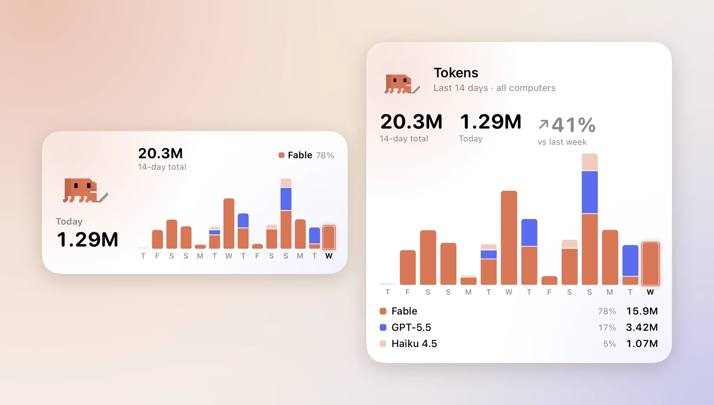
    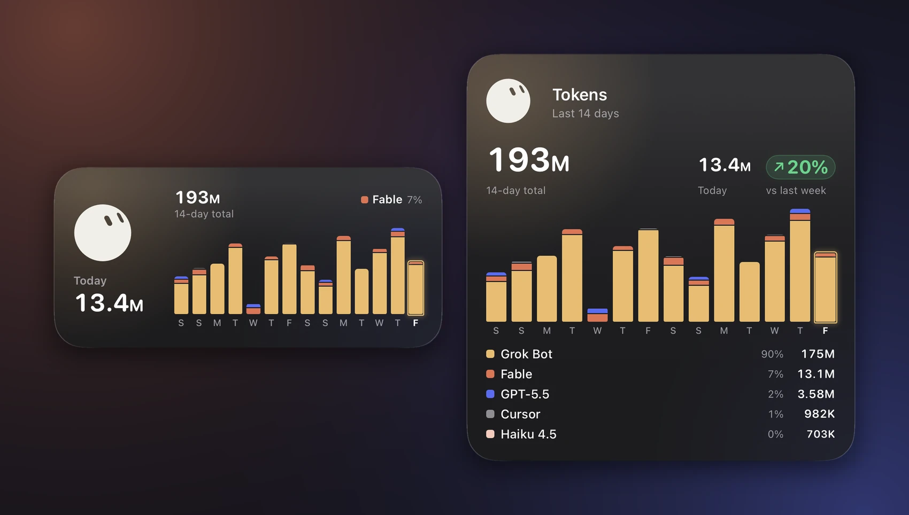
  

</Frame>

**它显示什么**：你的智能体最近 14 天每天用了多少 Token。每天按模型分段，也可以选择按智能体分段。它会把所有配对过的电脑加在一起，再加上通过你的 Cursor 登录统计的 Grok Bot 和 Cursor。

这里的 Token 指输入 + 输出 + 推理。缓存不计入：它是重复读取同样的上下文，会把其他数字全部淹没。[活动](/zh-Hans/activity#tokens-chart)里的“按模型”表格会单独列出缓存。

| 尺寸 | 显示内容 |
| --- | --- |
| 中号 | 14 天总计、今天的 Token，以及用得最多的模型和它的占比。Grok Bot 和 Cursor 不是模型，所以这里不算它们。按智能体分组时，改为显示用得最多的智能体。 |
| 大号 | 标题下方显示“最近 14 天”。同样的数字，外加较上周的变化和最多 5 行。Grok Bot 和 Cursor 跟你的模型并列，各占一行。超过 5 个时，最后一行合并其余的，例如 `其他 6 个模型`。按智能体分组时，改为最多显示 5 个智能体。 |

每个模型在任何地方都保持同一种颜色：Claude 模型是珊瑚色，GPT 是蓝色，Grok 是金色，Gemini 是紫色，Devin 的 SWE 模型是 Devin 的蓝色，其他模型是灰色。按智能体分组时，每个智能体有自己的颜色，比如 Claude Code 是珊瑚色，Codex 是蓝色，Grok Bot 是金色。Cursor 的线是虚线。

**事先需要**：和 Nomo 活动一样，需要一台装了 Nomo 插件并已配对的电脑；如果是 Grok Bot，则需要在 Nomo 里连接 Cursor。见 [Nomo 活动](#nomo-activity)。

**设置方法**：

1. 添加小组件。见[小组件](/zh-Hans/widget)。
2. 按住小组件。
3. 轻点“编辑小组件”。
4. 轻点“角色”，选一个。选项和 [Nomo 活动](#nomo-activity)相同。
5. 轻点“分组方式”，选“模型”或“智能体”。
6. 轻点“样式”，选“柱状”或“折线”。
7. 如果选了“智能体”，再轻点下面出现的“智能体”一项，选你想要的智能体：Claude Code、Codex、OpenCode、Grok Bot、Cursor、Antigravity 或 Devin。一开始全部都是选中的。
8. 轻点小组件外面，完成设置。

只有“分组方式”设为“智能体”时，才会出现这个“智能体”选项。如果只选了部分智能体，数字只统计它们，总数下方的标签也会从“14 天总计”变为“所选智能体”。如果你选的智能体在这 14 天里都没有用过 Token，小组件会显示所有智能体。

新的小组件会从“模型”和“折线”开始。如果你之前选了“柱状”，小组件会保持“柱状”。

“自动”会跟随你用得最多的模型的服务商：Claude 对应 Clawd，GPT 对应 Codex，Grok 对应 Grok Bot，Gemini 对应 Antigravity，Kimi、DeepSeek、Cursor 和 Devin 的模型显示各自的标志。其他模型都是 Clawd。你选的角色只会改变角色本身、背景光晕和今天的条形。模型颜色永远不变。

小组件显示 Clawd 时，它的心情会跟着你的 Token 变化。连续 3 天没有 Token，它会睡觉；今天还没有 Token 时，它在打字。今天是这 14 天里用得最多的一天时，Clawd 会变成 Claude 的星芒标志。这仍然算是选了 **Clawd**。连续 3 天没有 Token 时，Grok Bot 也会睡觉。

轻点小组件，会打开 Nomo 的“首页”，并停在[活动](/zh-Hans/activity#tokens-chart)。没有 Nomo Pro 时，轻点会打开 Nomo Pro。

它和 Nomo 活动使用同一份摘要。离开你电脑的内容列在[隐私](#privacy)下面。

## Nomo 账户 {#nomo-accounts}

<Frame caption="中号和大号的 Nomo 账户。">
  

    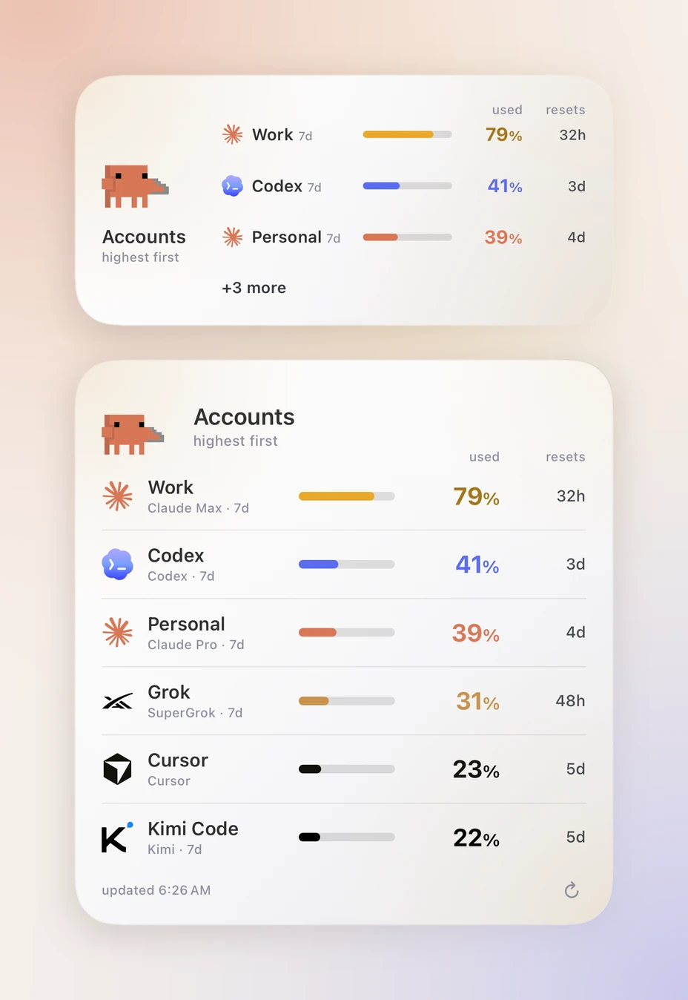
    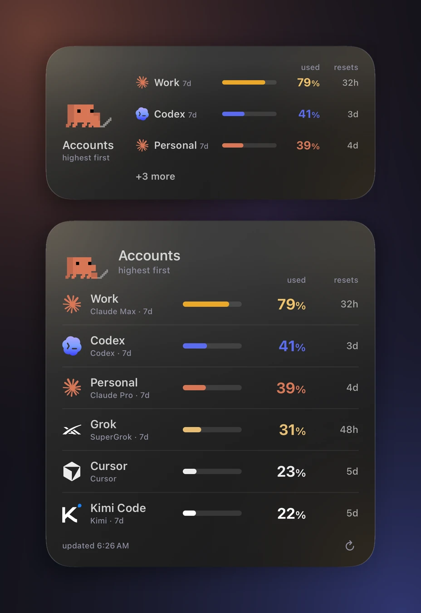
  

</Frame>

**它显示什么**：所有服务商的所有已连接账户，集中在一块面板上。剩得最少的账户排在最上面。

每一行显示账户名称、最接近用完的那个时段、用了多少，以及何时重置。

数字、进度条和列标题跟随**设置 → 用量 → 用量显示方式**。选**剩余**时，显示还剩多少。排序不变。

- **中号**显示 4 行。**大号**显示 8 行。
- 如果你的账户比这还多，最后一行会显示还有几个，例如 `还有 3 个`。
- 需要你重新登录的账户会留在面板上，排在最底部，并显示“在 Nomo 中重新连接”。它永远不会消失。

**事先需要**：至少一个已连接的账户。要追踪同一服务商的两个账户，见[多个账户](#more-than-one-account)。

**设置方法**：添加小组件。见[小组件](/zh-Hans/widget)。“编辑小组件”里没有需要选的。

面板显示的是 Nomo 最后一次获取的数字。在大号尺寸上，轻点角落里的刷新按钮可以更新所有账户。

轻点某个账户的那一行，会在 Nomo 中打开那个服务商的“用量”页面，并显示这个账户。显示“在 Nomo 中重新连接”的那一行也一样。轻点其他任何地方（包括 `还有 3 个` 那一行），会打开“服务商”标签页。没有 Nomo Pro 时，轻点会打开 Nomo Pro。

## 智能体实时状态 {#live-agents}

<Frame caption="小号和中号的智能体实时状态。紫色那一行需要你回答。">
  

    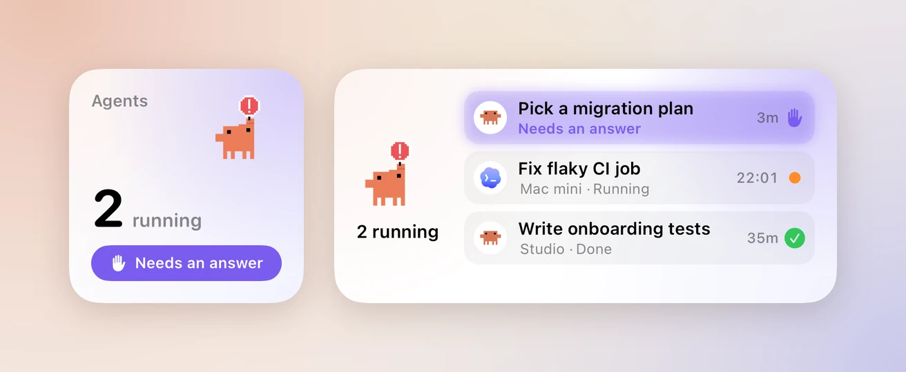
    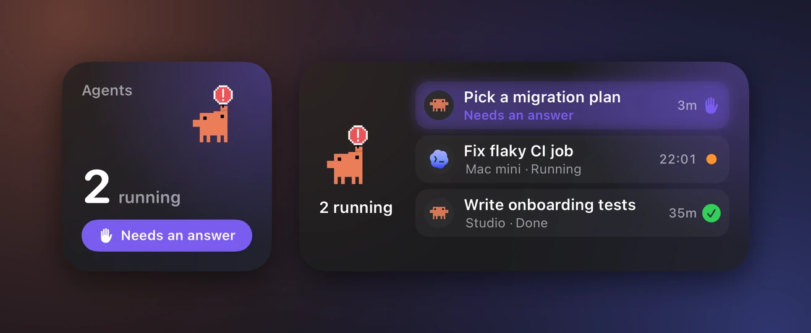
  

</Frame>

**它显示什么**：你此刻的 Claude Code、Codex 和其他智能体会话。它和“会话”标签页是同一份列表。

**紫色表示有一个需要你回答。**

| 图标 | 标签 | 含义 |
| --- | --- | --- |
| 紫色的手 | `需要权限` | 正在为某个操作请求权限。你可以在手机上回答。 |
| 紫色的手 | `需要回答` | 正在问你一个问题。你可以在手机上回答。 |
| 橙色的手 | `需要关注` | 停下来等你，但没有可以在手机上回答的内容。 |
| 橙色圆点 | `运行中` | 正在工作。不需要你做什么。 |
| 绿色对勾 | `完成` | 已结束。 |

这些和[会话标签页](/zh-Hans/sessions/list#session-states)一致。

- **小号**显示有几个会话在运行。有会话需要你时，会有一个紫色按钮提示。
- **中号**最多显示 3 个会话。需要你处理的排在前面。

这个小组件没有“允许”或“拒绝”按钮。轻点它会在 Nomo 中打开“会话”。在中号上，轻点某个会话就会打开那个会话。

小组件的会话列表是从 Nomo 复制过来的。Nomo 打开时会更新它，在 iPhone 允许时也会在后台更新。

如果小组件 10 分钟没有更新，它会变暗，并显示一个琥珀色圆点和 `7 小时前更新`。运行中会话的时钟会显示 `--:--`，不再继续走。在小号上，这一行会取代紫色按钮。

想不打开 Nomo 就更新小组件，轻点它右下角的 ↻。

**事先需要**：一台装了 Nomo 插件并已配对的电脑。见[安装](/zh-Hans/setup/install)和[配对](/zh-Hans/setup/pairing)。

**设置方法**：

1. 添加小组件。见[小组件](/zh-Hans/widget)。
2. 按住小组件。
3. 轻点“编辑小组件”。
4. 轻点“角色”，选一个。选项和 [Nomo 活动](#nomo-activity)相同。
5. 轻点小组件外面，完成设置。

“自动”会跟随列表最上面的会话。如果是 Antigravity、Cursor、OpenCode 或 Devin 的会话，就显示它的标志。选其他角色时，小组件会显示那个角色，背景也会带上淡淡的同色调。状态颜色不会变：紫色仍然表示有会话需要你回答。已经在主屏幕上的小组件会从“自动”开始。

## 多台电脑 {#more-than-one-computer}

Nomo 活动、Nomo Token、“首页”上的[活动](/zh-Hans/activity)和回顾，会把所有配对过的电脑加在一起。

- 活跃时长只算一次。你同时在两台 Mac 上写代码，这段时间不会被算两次。
- Token 和会话数会相加。
- 同一台 Mac 配对了两次，只算一台。
- 移除一台电脑后，它的活动会从总数中去掉。

### 未计入的电脑 {#not-counted}

Nomo 插件早于 2.4.0 的电脑不会被计入。你会看到：

- 在“首页”的活动里，连续记录下方：“MacBook Air 未计入 · 请更新它的插件”，其中是那台电脑的名称。如果不止一台，会显示台数，例如“2 台电脑未计入 · 请更新它们的插件”。轻点它可以查看更新方法。
- 在大号 Nomo 活动小组件上：“1 台电脑未计入”。在最小的 iPhone 上没有空间显示。

要解决这个问题，请更新那台电脑上的 Nomo 插件。见[更新](/zh-Hans/sessions/commands#update)。

## 多个账户 {#more-than-one-account}

有了 Nomo Pro，每个服务商最多可以添加 5 个账户。例如，一个工作用的 Claude 账户和一个个人账户。Nomo 用量速度、Nomo 用量和 Nomo 账户都可以使用它们。

除非你选了别的账户，否则小组件显示的是“默认”账户。要选择账户，按住小组件，轻点“编辑小组件”，然后轻点“账户”。Nomo 账户会把每个账户分别显示出来。

如果你移除了一个账户，原本显示它的小组件会显示“账户已移除”。它们不会改为显示默认账户。请编辑小组件，选择其他账户。

如果你的 Nomo Pro 到期，额外的账户会被暂停。不会移除任何内容，默认账户也会继续更新。设为额外账户的 Nomo 用量小组件会显示“已暂停 · Nomo Pro”和 `你的 Nomo Pro 已结束。在 Nomo 中重新订阅即可查看此账户。`。轻点它会打开 Nomo Pro。显示默认账户的小组件永远不会被暂停。

要添加、重命名或移除账户，见用量页面的[多个账户](/zh-Hans/usage#more-than-one-account)。

## 用演示模式试用 {#try-it-with-demo-mode}

演示模式会用示例数据填满小组件，让你在连接任何东西之前就能看到它们的样子。

1. 打开 Nomo。
2. 轻点“设置”标签页。
3. 滚动到“演示模式”。
4. 打开“显示示例数据”。

之后，Nomo 用量速度、Nomo 活动、Nomo Token 和智能体实时状态就会显示示例数据，而不是你自己的数据。演示模式始终显示示例数据。唯一的例外：一旦有电脑配对，智能体实时状态就显示你真实的会话。
Nomo 账户只列出你真正添加过的账户，所以在你添加账户之前它一直是空的。

如果你没有 Nomo Pro，演示模式也会解锁 Pro 小组件，但只在没有任何电脑配对时有效。

要回到你的真实数据，关闭“显示示例数据”。

## 隐私 {#privacy}

**Nomo 活动**

- 离开你电脑的内容：每天、每个智能体的会话数、提示数、一天中哪些 5 分钟时段有活动，以及每个模型的 token 总数。
- 绝不离开的内容：你的提示、智能体的回复、项目名称和文件路径。
- 对于 Devin 和 Antigravity，插件会读取它们在你电脑上的历史记录：Devin 的会话数据库和 Antigravity 的对话文件。它只读取，并且只取上面这些计数。
- 上传前会进行端到端加密（AES-256-GCM，使用你的配对密钥）。Nomo 的中继服务器无法读取，并会在 **35 天**后删除。
- 其中还有一个随机的电脑 ID。它由插件在你的电脑上生成一次，保存在 `~/.config/cc-status/machine-id`。它绝不来自你的硬件信息，例如序列号、MAC 地址、电脑名称或用户名。它和其他内容一样经过端到端加密。Nomo 只用它来避免 iPhone 把同一台电脑算两次。删除这个文件就会生成新的 ID。
- 最多每 6 小时上传一次，而且只在有变化时上传。重置命令会立即上传。如果没有变化，它每周会把同样的摘要重新上传一次，以免中继服务器把它删除。刚和新的 iPhone 配对后，会在大约一分钟内上传一次。
- 在你的电脑上，它保存在 `~/.config/cc-status/activity-days.json`。只有你的用户账户能读取。最多保留 400 天。

**Grok Bot 和 Cursor**

- Nomo 只用你在 Nomo 里连接的 Cursor 账户读取每小时的 Token 数。它从不读取你的消息或代码。
- 这些数字直接从 Cursor 的服务器发到你的手机，不会上传到任何地方。
- 想停止的话，在“服务商”标签页打开 Cursor，轻点“用量”，再轻点“断开连接”。这样 Nomo 里的 Cursor 用量也会一起停止。

**Nomo Token 和“首页”上的活动**

- 它们使用和 Nomo 活动同一份活动摘要，以及同样的 Grok Bot 和 Cursor 数据，所以上面的内容同样适用。
- 你的图表选择、筛选和角色选择只保存在你的 iPhone 上。

**回顾**

- 分享时只会发出你在卡片上看到的那张图片。

**智能体实时状态**

- 小组件读取的是 App 保存在你 iPhone 上的一份会话快照。它留在手机上，从不发送到任何地方。

**多个账户**

- 你的登录信息保存在 iPhone 钥匙串中。
- 登录时使用一个全新的私密浏览器页面，所以不会沿用你在 Safari 中的登录。

**局限**

- 中继服务器能看到发生了一次上传、上传有多大，以及发生的时间。
- 任何拿到你已解锁手机的人，都能看到你的活动。

完整说明见[插件的 README](https://github.com/KarrixLee/nomo#security-at-a-glance) 中的安全部分。
