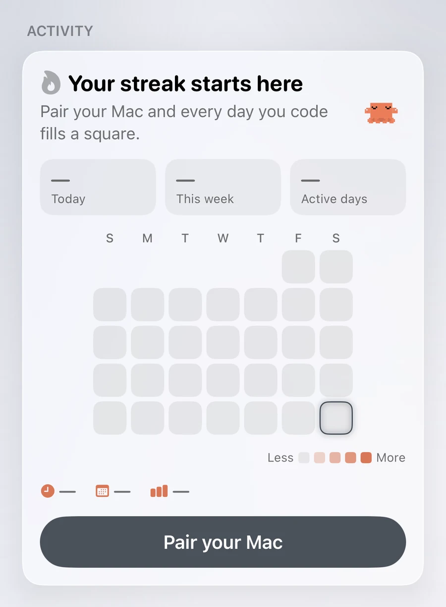

活動會顯示你用 AI 代理寫了多少程式。它在 Nomo 的**首頁**分頁上。

還沒設定？先[安裝外掛程式](/zh-Hant/setup/install)，再[配對你的電腦](/zh-Hant/setup/pairing)。你寫程式時，活動就會慢慢填滿。

<Frame caption="首頁上的活動：正在寫程式的代理、你的連續紀錄、最近 30 天的日曆，以及「你的回顧」。">
  

    
    
  

</Frame>

## 打開方式 {#open-it}

1. 打開 Nomo。
2. 點一下**首頁**分頁。
3. 往下捲動到**活動**。

也可以點一下 Nomo 活動或 Nomo Token 小工具。Nomo 會打開**首頁**，並停在活動。請看 [Pro 小工具](/zh-Hant/widgets#nomo-activity)。

想取得最新的活動，請在**首頁**往下拉。

## 顯示內容 {#what-it-shows}

- **正在寫程式**：代理執行時，最上面有一行會顯示，例如「Claude Code 正在寫程式」，以及電腦的名稱。
- **你的連續紀錄**：你連續幾天用代理寫程式。
- **今天**、**本週**和**活躍天數**：今天和本週寫程式的時間，以及本週寫程式的天數。
- **日曆**：最近 30 天，每天一格。顏色越深，表示那天寫的程式越多。有 Nomo Pro 時，會顯示最近 26 週。
- **總計**：你的活躍時數、活躍天數和每週時數。
- **你的代理**：你的時間在各代理之間怎麼分配，例如 `Claude Code 82%` 和 `Codex 18%`。

每個代理都會計入。活動會把你所有配對過的電腦加在一起。請看[多台電腦](/zh-Hant/widgets#more-than-one-computer)。

連續紀錄不會在早上歸零。在當天第一個 session 之前，它算到昨天為止。

## 選擇角色 {#character}

連續紀錄卡片上有一個會動的角色。它會跟著你最常用的代理。想換一個：

1. 按住連續紀錄卡片。
2. 卡片翻過來，顯示**角色**。
3. 點一下一個角色，例如 **Clawd**、**Codex** 或 **Grok Bot**。想重新跟著你最常用的代理，請點一下**自動**。

卡片會自己翻回來。想不做更改就返回，請點一下 **×**。

你選的角色也會改變活動的顏色。小工具在「編輯小工具」裡有自己的**角色**選項。

## 你的回顧 {#wrapped}

「你的回顧」會把你的一週或一個月做成一張可以分享的圖片。

1. 在**首頁**，捲動到連續紀錄下方的**你的回顧**。
2. 點一下**分享**。
3. 點一下**週**（最近 7 天）或**月**（最近 30 天）。
4. 選一種樣式：長條、折線或熱度圖。
5. 點一下**分享**，然後選擇要傳到哪裡。

可以分享成**貼文**或**限時動態**。大數字是你的連續紀錄或寫程式的時間。

有 Nomo Pro 時，還可以選**年**（今年到目前為止），也可以把 Token 當作大數字。

<Frame caption="一週的回顧卡片。不管 iPhone 用哪種外觀，它都是深色的。">
  

    
  

</Frame>

回顧絕不會包含你的提示、專案名稱或檔案路徑。

## Token  {#tokens-chart}

有 Nomo Pro 時，活動還會顯示你的 Token。日曆會顯示最近 26 週，「你的回顧」卡片也會多出**年**。

<Frame caption="有 Nomo Pro 時的活動：26 週的地圖、可以選年的「你的回顧」，以及 7 / 14 / 30 天切換。">
  

    
    
  

</Frame>

在「你的回顧」下方：

1. 點一下 **7 天**、**14 天**或 **30 天**，選擇時間範圍。
2. 在 **Token** 旁邊，點一下**模型**或**代理**，依模型或依代理拆分每一天。
3. 點一下折線圖示顯示折線，點一下長條圖示顯示長條。一開始顯示的是折線。

<Frame caption="選了代理和折線的 Token 圖表：每個代理一條線。">
  

    
    
  

</Frame>

卡片會顯示總數、**今天**、**日均**、**活躍時數**，以及和上一個時段相比的變化。依模型時，圖表會顯示前 5 個模型，其餘的合併為**其他**。

這裡的 Token 指輸入 + 輸出 + 推理。快取不計入：它是重複讀取同樣的上下文，會把其他數字全部蓋過去。圖表下方的**依模型**表格會列出每個模型的**輸入**、**輸出**、**快取**和**總計**。

Nomo 會記住你的選擇，下次還是一樣。

### 篩選圖表 {#tokens-filter}

想隱藏某個模型或代理，請點一下圖表下方它的名稱。再點一下就會顯示。圖表上方的數字仍然全部計入。

也可以從清單裡選：

1. 按住 Token 卡片。
2. 卡片翻過來，顯示**篩選**。
3. 點一下方塊來隱藏或顯示它。有勾號表示正在顯示。
4. 想全部重新顯示，請點一下**顯示全部**。
5. 想返回，請點一下 **×**。

最後一個不能隱藏：它會顯示一把鎖。

## 隱私 {#privacy}

活動只用到數字：天數、活躍時間、session 數和 Token 數。絕不會用到你的提示、程式碼、專案名稱或檔案路徑。完整的說明請看小工具頁面的[隱私](/zh-Hant/widgets#privacy)。

## 設定 {#set-up}

配對電腦之前，活動會顯示一張空卡片。點一下卡片上的**配對你的 Mac** 開始。

<Frame caption="配對之前的活動：空的日曆和「配對你的 Mac」。">
  

    
    
  

</Frame>

只需要兩步，都是免費的。

<CardGroup cols={2}>
  <Card title="1. 安裝外掛程式" href="/zh-Hant/setup/install" icon="download">
    在電腦上把 Nomo 加到 Claude Code、Codex 或其他代理。
  </Card>
  <Card title="2. 配對電腦" href="/zh-Hant/setup/pairing" icon="qrcode-read">
    用 Nomo 掃描 QR code。你寫程式時，活動就會慢慢填滿。
  </Card>
</CardGroup>
