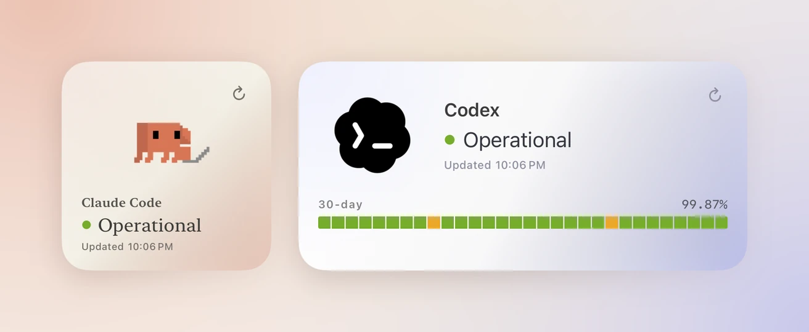
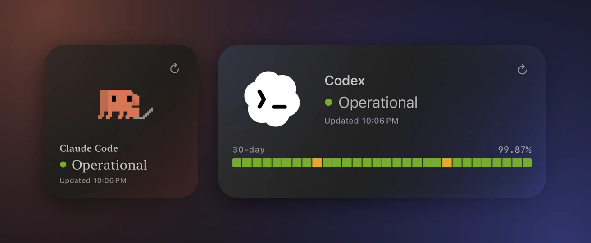
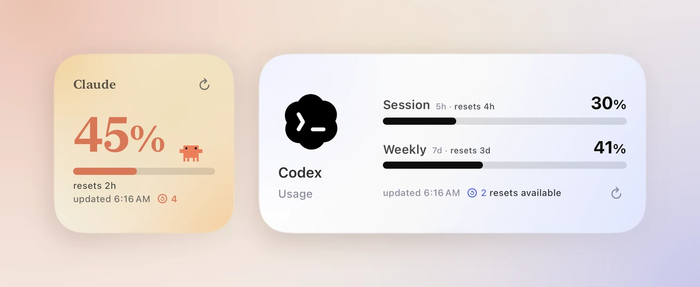
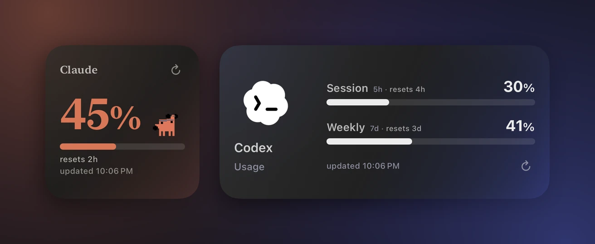
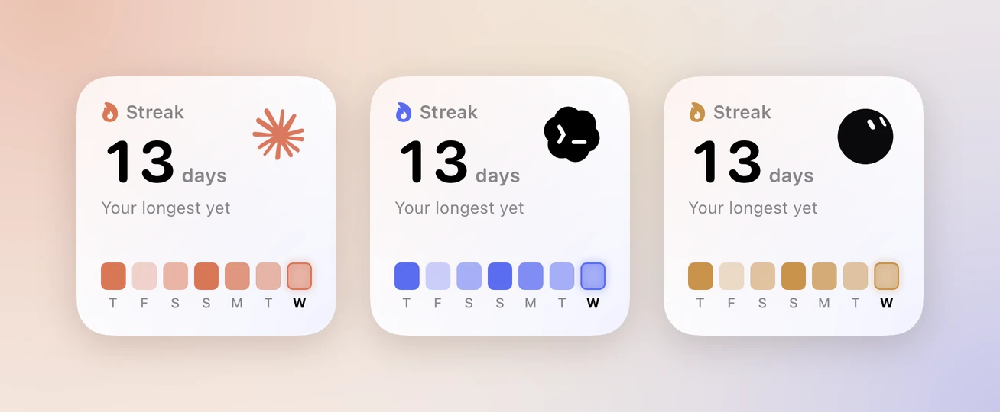
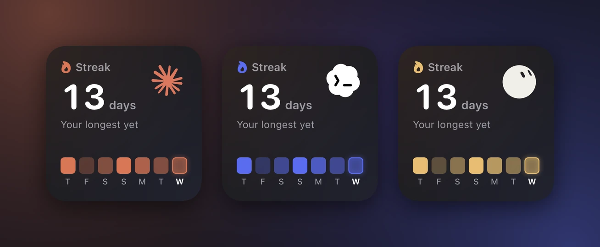

Nomo 有七個 iPhone 小工具。其中兩個是免費的：顯示狀態的 **Nomo**，以及 **Nomo 用量**。配對了電腦後，**Nomo 活動**的小型和中型也是免費的。這一頁介紹這三個。其餘的要有 Nomo Pro：請看 [Pro 小工具](/zh-Hant/widgets)。

想把小工具放到主畫面上，請看[小工具](/zh-Hant/widget)。

## 免費版與 Pro {#free-and-pro}

| | 免費 | Nomo Pro  |
| --- | --- | --- |
| **Nomo** 狀態小工具 | ✓ | ✓ |
| **Nomo 用量**小工具 | ✓ | ✓ |
| [Nomo 活動](#nomo-activity)小型和中型（需配對電腦） | ✓ | ✓ |
| [Nomo 用量速度](/zh-Hant/widgets#nomo-pace)、[Nomo 活動](/zh-Hant/widgets#nomo-activity)（大型和鎖定畫面）、[Nomo 帳戶](/zh-Hant/widgets#nomo-accounts)、[代理即時狀態](/zh-Hant/widgets#live-agents)、[Nomo Token](/zh-Hant/widgets#nomo-tokens) | | ✓ |
| [每個供應商多個帳戶](/zh-Hant/widgets#more-than-one-account) | | ✓ |

## Nomo 狀態 {#nomo-status}

<Frame caption="小型和中型的 Nomo 狀態。">
  

    
    
  

</Frame>

在小工具資料庫裡，這個小工具叫做 **Nomo**。

**它顯示什麼**：某一項服務現在是否正常，例如 Claude Code 或 Codex。你會看到以下其中一種：

- `正常運作`
- `效能降低`
- `部分中斷`
- `嚴重中斷`
- `維護中`

如果 Nomo 取不到狀態，會顯示 `無法取得`。

| 尺寸 | 顯示內容 |
| --- | --- |
| 小型 | 服務、它的狀態，以及上次更新的時間。 |
| 中型 | 同樣的內容，再加上過去 30 天的紀錄條和可用率。 |

**事前需要**：什麼都不用。不需要帳戶，也不用登入。

**設定方式**：

1. 加入小工具。請看[小工具](/zh-Hant/widget)。
2. 按住小工具。
3. 點一下「編輯小工具」。
4. 點一下「供應商」，從 Claude、OpenAI、Cursor、xAI、Antigravity、Kimi、DeepSeek、Devin、OpenCode 中選一個。
5. 點一下「服務」並選一個，例如 **Claude Code**。
6. 點一下小工具外面就完成了。

想立刻更新，點一下角落的重新整理按鈕。點一下其他任何地方，會在 Nomo 中打開那家供應商的「狀態」頁面。

詳細內容請看[狀態](/zh-Hant/status)。

## Nomo 用量 {#nomo-usage}

<Frame caption="小型和中型的 Nomo 用量。">
  

    
    
  

</Frame>

**它顯示什麼**：一個帳戶的方案限額用了多少，以及什麼時候重設。

| 尺寸 | 顯示內容 |
| --- | --- |
| 小型 | 一個時段：大大的百分比、進度條，以及多久後重設。 |
| 中型 | 兩個時段，通常是「session」（5 小時）和「每週」，各附進度條和多久後重設。 |

用到 70% 時進度條會變成琥珀色，90% 時變成紅色。如果你的方案沒有 5 小時限額，會改成顯示 `無 session 限額`。

有 Claude 或 Codex 的重設次數時，中型會在更新時間旁顯示次數，小型只顯示重設符號和數字。請看[可用的重設次數](/zh-Hant/usage#available-resets)。

**事前需要**：一個已連結的帳戶，例如 Claude 或 Codex。打開「供應商」分頁，點一下那家供應商並連結。請看[用量](/zh-Hant/usage)。連結之前，小工具會顯示 `未連結`。

**設定方式**：

1. 加入小工具。請看[小工具](/zh-Hant/widget)。
2. 按住小工具。
3. 點一下「編輯小工具」。
4. 點一下「供應商」並選一個，例如 **Codex**。
5. 點一下「帳戶」並選一個。「預設」會跟隨你在 App 裡設定的預設帳戶。
6. 點一下「小尺寸樣式」並選一個。「大百分比」會把數字放大顯示。「大動畫」會把動畫圖示放大顯示。
7. 點一下「小型小工具焦點」，選擇小型尺寸要顯示的時段。「自動」會幫你選。可以選的項目依供應商而不同。
8. 點一下小工具外面就完成了。

選 Cursor 時還多一個選項：「Cursor 圖示」。選 **Grok Bot** 或「Cursor 標誌」。

想立刻更新，點一下角落的重新整理按鈕。點一下其他任何地方，會在 Nomo 中打開那家供應商的「用量」頁面。

### Antigravity 的模型限額 {#antigravity-model-limits}

Antigravity 的 Claude 和 GPT 模型共用一個 5 小時限額和一個每週限額。Gemini 模型只有每週限額。在「小型小工具焦點」裡，有兩個選項會顯示 Claude 和 GPT 的限額：

- 「模型限額」：每週限額。
- 「模型 5 小時限額」：5 小時限額。小工具頂端的標籤會顯示 `5h · Claude & GPT`。

如果你的帳戶沒有提供 5 小時限額，小工具會顯示 `—`。中型尺寸不變。

## Nomo 活動 {#nomo-activity}

<Frame caption="小型的 Nomo 活動。">
  

    
    
  

</Frame>

**它顯示什麼**：你的連續紀錄，以及你用 AI 代理寫程式的日子。連續紀錄就是你連續寫了幾天程式。顏色越深，表示那天寫的程式越多。

| 尺寸 | 顯示內容 |
| --- | --- |
| 小型 | 你的連續紀錄和最近 7 天。 |
| 中型 | 你的連續紀錄、最近 30 天的日曆，以及這 30 天的總計：時數、天數和每週時數。 |

在比較窄的 iPhone 上，中型放不下總計。

大型和鎖定畫面尺寸需要 Nomo Pro。有 Nomo Pro 時，中型會顯示最近 16 週。請看 Pro 小工具裡的 [Nomo 活動](/zh-Hant/widgets#nomo-activity)。

**事前需要**：

- 你電腦上的 Nomo 外掛程式，版本 **2.4.0** 或更新。請看[安裝](/zh-Hant/setup/install)。
- 那台電腦已經和 Nomo 配對。配對是免費的。請看[配對](/zh-Hant/setup/pairing)。

**設定方式**：

1. 加入小工具。請看[小工具](/zh-Hant/widget)。
2. 按住小工具。
3. 點一下「編輯小工具」。
4. 點一下「角色」，選一個，例如「自動」或 **Clawd**。
5. 點一下小工具外面就完成了。

點一下小工具，會打開 Nomo 的「首頁」，並停在[活動](/zh-Hant/activity)。

想了解所有角色、連續紀錄怎麼算，以及哪些內容會離開你的電腦，請看 Pro 小工具裡的 [Nomo 活動](/zh-Hant/widgets#nomo-activity)。
