在 iPhone 的鎖定畫面和動態島上，看著你的 Google Antigravity sessions。當 Antigravity 想執行一個指令或變更一個檔案時，手機會問你要「允許」還是「拒絕」。你也可以在手機上停止一個 session，或傳訊息給它。

Antigravity 桌面應用程式和 `agy` 命令列工具都能用。

<Note>
  即時 sessions 屬於 Nomo Pro。你的手機需要 Nomo **2.3.5** 以上，Mac 上需要外掛程式 **2.3.5** 以上。
</Note>

## 相同的部分 {#what-works-the-same}

sessions、資料夾和[動態島](/zh-Hant/sessions/island)的運作和其他代理一樣。所有共用的部分都只寫在一個地方：

- **安裝** → [安裝](/zh-Hant/setup/install)的 **Antigravity** 分頁。一次安裝同時涵蓋桌面應用程式和 `agy`。
- **配對** → [配對](/zh-Hant/setup/pairing)。一次配對涵蓋這台電腦上的每個代理。
- **指令、更新與解除安裝** → [指令](/zh-Hant/sessions/commands)，其中有 [update](/zh-Hant/sessions/commands#update) 和 [uninstall](/zh-Hant/sessions/commands#uninstall)。
- **回答權限請求** → [在手機上回覆](/zh-Hant/sessions/approvals)。
- **每個代理能做什麼** → [功能一覽](/zh-Hant/sessions/features)。
- **出了問題** → [疑難排解](/zh-Hant/sessions/troubleshooting)。

## Nomo 的指令會先問你 {#commands}

Antigravity 在執行任何 Nomo 指令之前都會先問你。請選擇 **Allow**（允許）。這些指令只會在 Antigravity 裡問你，永遠不會在手機上跳出卡片。

`/nomo-status` 會用簡單的話顯示一段簡短摘要。一切正常時，它會顯示像這樣的一行：

```
✅ Connected to your phone as “MacBook Pro” · Phone approvals: on · Last activity: 2 min ago
```

如果有哪裡不對，它會多加一行，告訴你該怎麼做。`/nomo-status verbose` 會列出所有細節。

Antigravity 不認得這些指令？改[在終端機裡](/zh-Hant/sessions/commands#without-slash-commands)執行它們。

## 你會看到什麼 {#what-you-see}

- session 會在你送出**第一則訊息**時出現，而不是在你打開對話的時候。
- 它的名稱就是 Antigravity 自己的對話標題。在 Antigravity 取好標題之前，會先用你的第一則訊息，沒有的話就用資料夾名稱。
- 標籤顯示 Antigravity 正在使用的模型。

## 在手機上回覆 {#answering-from-your-phone}

當 Antigravity 想**執行一個指令**，或**建立或變更一個檔案**時，手機會問你。讀取和搜尋檔案永遠不會送到你的手機。

按住那個 session，或使用動態島，然後選擇：

<Frame caption="一個請求執行指令的 Antigravity session。">
  <div className="device-frame">
    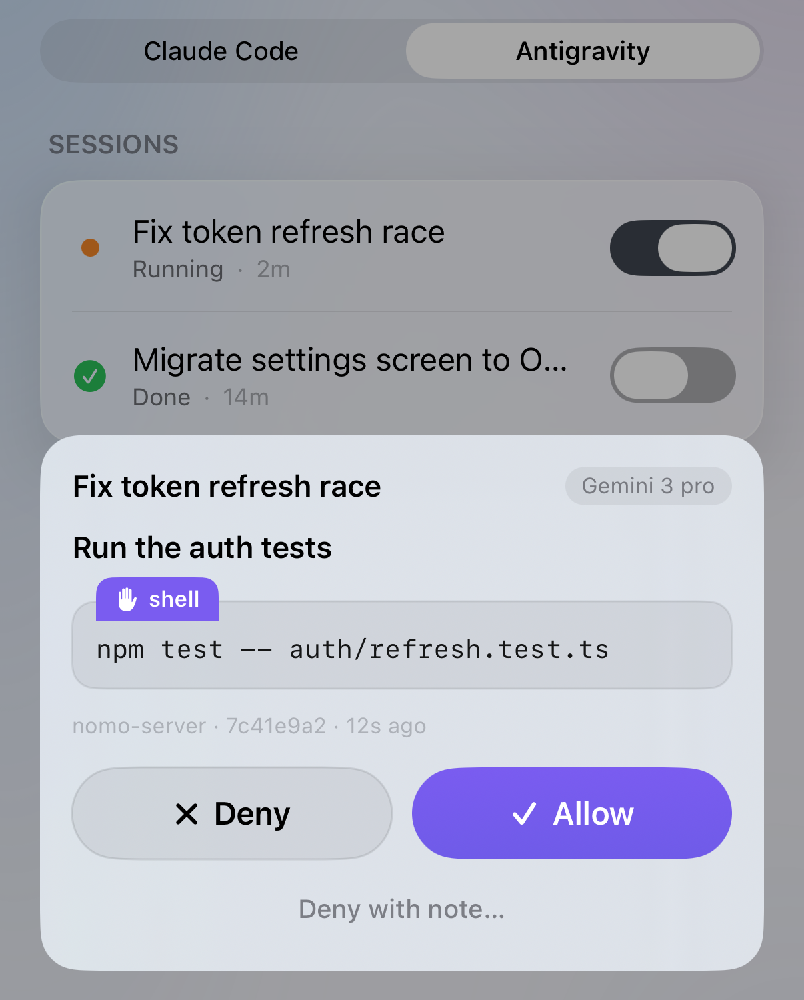
    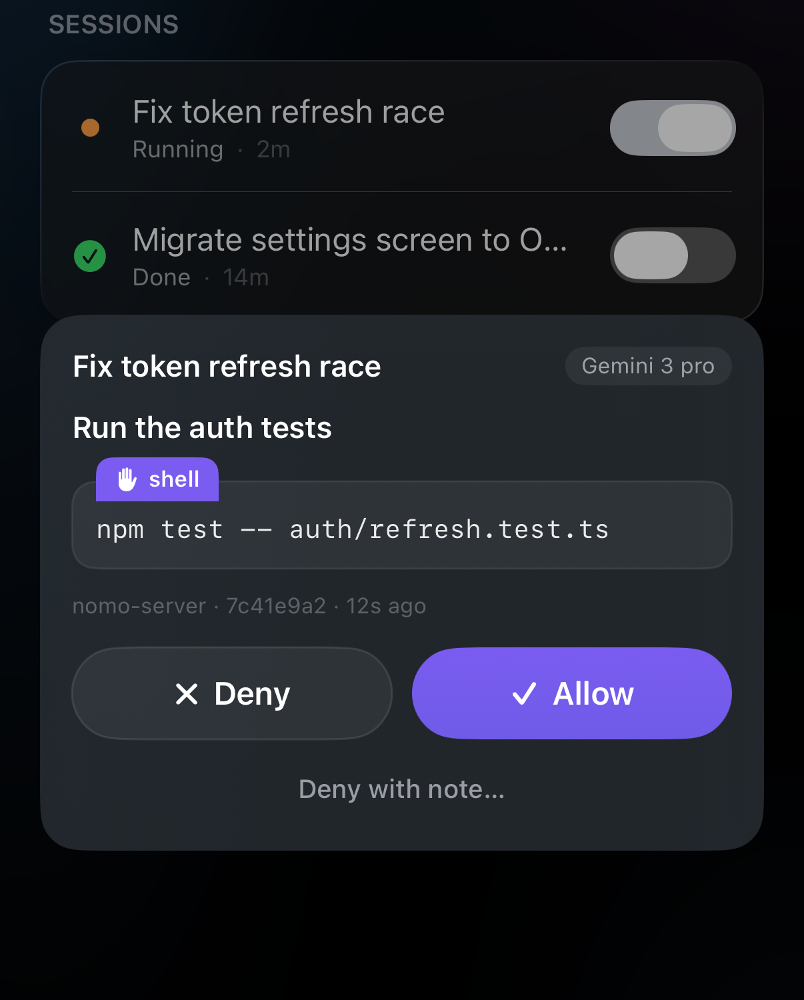
  </div>
</Frame>

- 「允許」— Antigravity 繼續做。
- 「拒絕」— Antigravity 跳過它，繼續做下去。
- 「拒絕並附註…」— 跳過它，並用你自己的話告訴 Antigravity 原因。

更多內容請看[在手機上回覆](/zh-Hant/sessions/approvals)。

小提醒：

- **你自己的 Antigravity 規則優先**。被你的規則擋下的東西會一直擋著 — 在手機上點「允許」也絕不會推翻它。在 `agy` 裡，你的規則已經允許的指令會直接執行，不會問你的手機。
- **在桌面應用程式裡，什麼都會問你的手機**。Nomo 看不到桌面應用程式的權限設定，所以每一個指令和檔案變更都會送到你的手機。
- **在電腦上停止了對話？**手機上的卡片會自己消失。
- **等待期間，終端機裡什麼都不顯示**。請求在等你的手機時，終端機裡不會出現任何內容。這是正常的 — 請求在你的手機上。
- **回覆表單開著？**請求也會出現在聊天裡，你可以在那裡回答 — 請看[在聊天裡批准](#approve-in-chat)。

## 停止這一輪 {#interrupt}

在 `執行中` 的 Antigravity session 上點一下 **[停止](/zh-Hant/sessions/list#interrupt-a-running-session)** 就能停下它。它需要綠色的 **⚡ 本機** 標籤。Antigravity 會先做完目前這一步再停下，session 會顯示 `完成`。對話仍然開著 — 送出新的訊息就能繼續。

## 從手機回覆 {#reply-from-your-phone}

從 iPhone 傳一則訊息給 Antigravity session — 修正一個地方、交代下一步，或一句「繼續」。它會像你在 Mac 上打字一樣送到 Antigravity。回覆畫面是一個聊天：你的訊息在右邊，Antigravity 的請求出現在左邊。

<Note>
  **目前，你的 iPhone 和 Mac 必須連著同一個 Wi-Fi**，並且在 Nomo 裡打開「**[區域網路](/zh-Hant/sessions/settings#local-network)**」。即將推出的伺服器更新之後，在哪裡都能回覆。
</Note>

<Steps>
  <Step title="打開 session">
    在 Nomo 裡打開你的電腦，選擇 **Antigravity** 分頁。點一下 session 的名稱。

    你應該會看到這個 session 展開，詳細資訊下方有一個藍色的「**回覆**」按鈕。正在執行的 session 還有一個紅色的「**停止**」按鈕。

    <Frame caption="一個正在執行、已展開的 Antigravity session，詳細資訊下方有「停止」和「回覆」。">
      <div className="device-frame">
        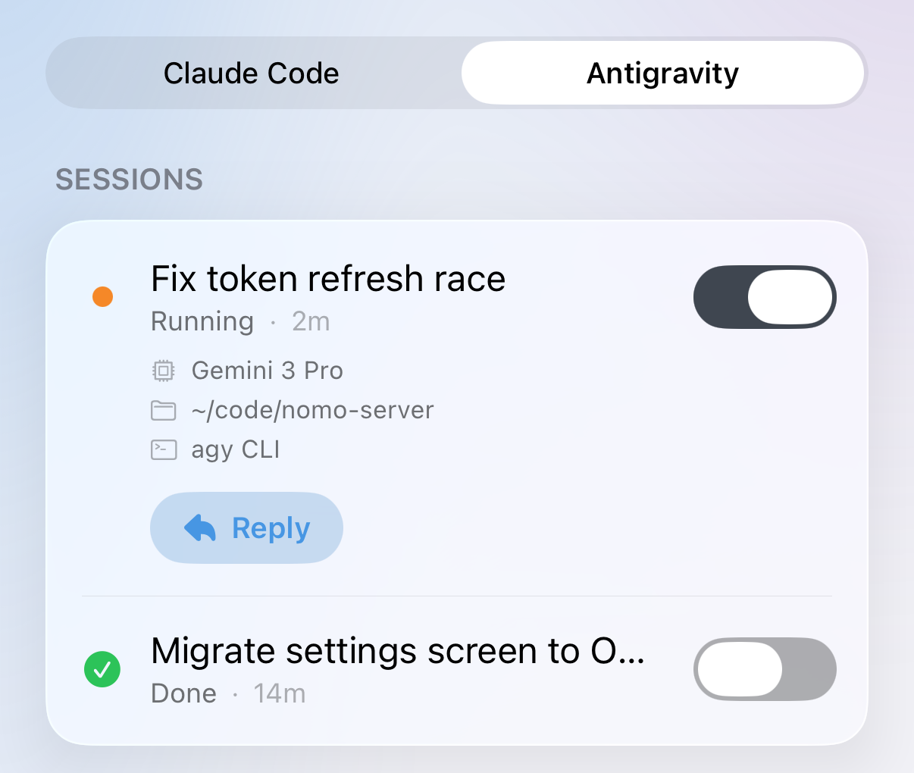
        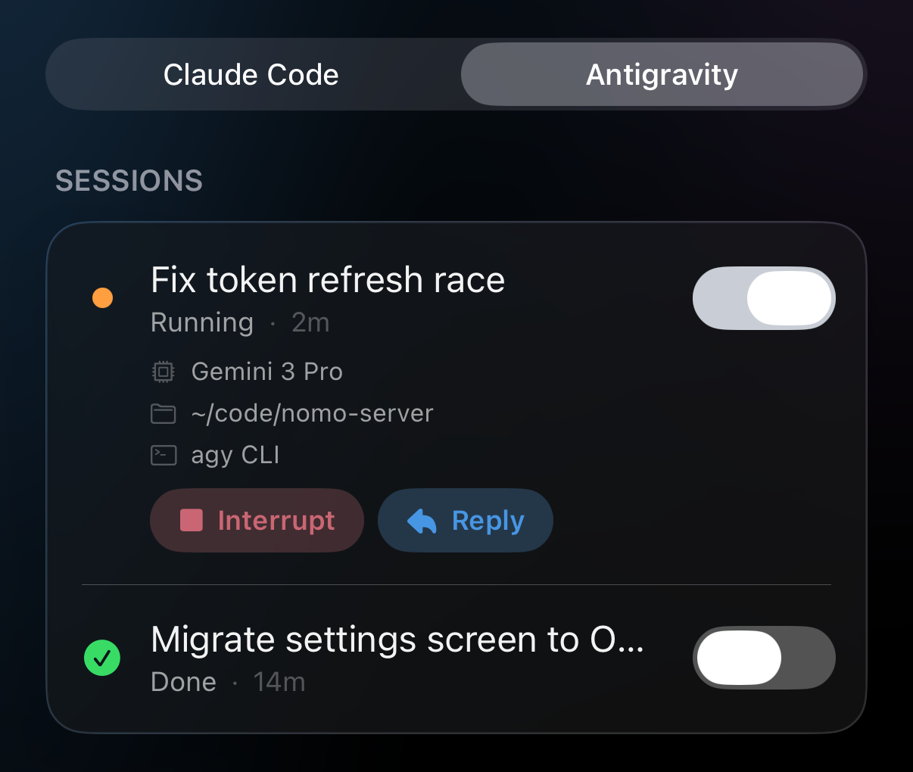
      </div>
    </Frame>
  </Step>

  <Step title="點一下「回覆」">
    你應該會看到一張表單滑上來，上方是 session 名稱，下方是寫著「**傳訊息給這個 session**」的輸入框。

    隨時要關閉表單，點一下右上角的 **✕**。
  </Step>

  <Step title="輸入訊息並送出">
    輸入你的訊息，然後點一下箭頭。

    你應該會看到訊息變成右邊的一個泡泡，下面有一行簡短的狀態。狀態告訴你這則訊息走到哪裡了 — 請看下面的列表。

    <Frame caption="兩則訊息：第一則已經送到 Antigravity，第二則在等它的下一步，還可以取消。">
      <div className="device-frame">
        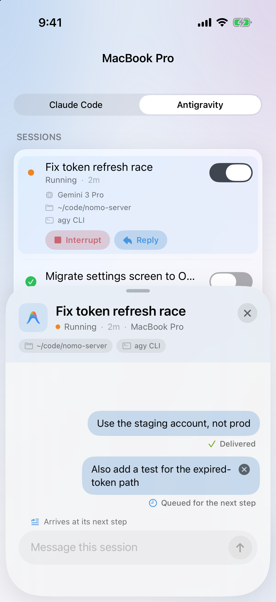
        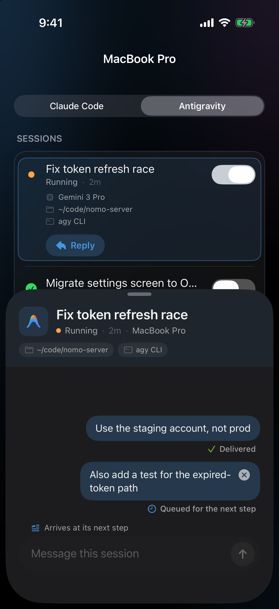
      </div>
    </Frame>
  </Step>
</Steps>

### 在聊天裡批准 {#approve-in-chat}

回覆表單開著時，如果 Antigravity 請求執行指令，你可以直接在聊天裡回答。

<Steps>
  <Step title="找到請求">
    在左邊找到來自 Antigravity 的泡泡。上面寫著「**想要執行：**」，接著是指令，然後是「**拒絕**」和「**允許**」兩個按鈕。

    <Frame caption="Antigravity 在回覆聊天裡請求執行一個指令。">
      <div className="device-frame">
        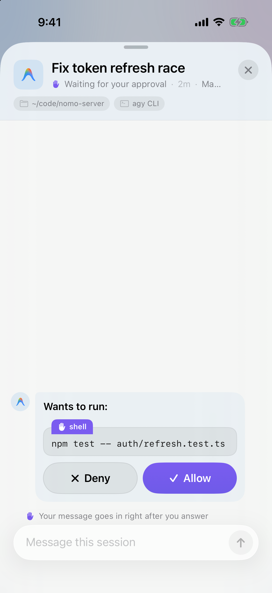
        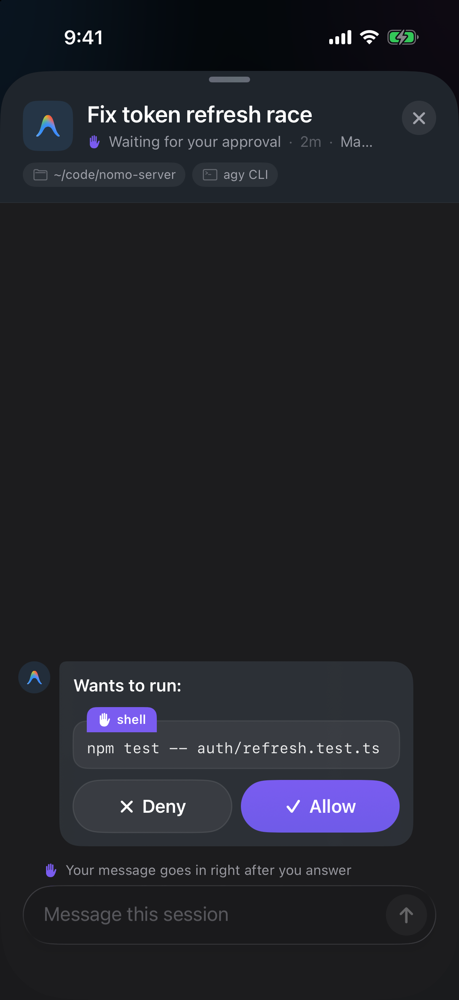
      </div>
    </Frame>
  </Step>

  <Step title="點一下「允許」或「拒絕」">
    點一下「**允許**」讓 Antigravity 執行它。點一下「**拒絕**」讓它跳過。

    你應該會看到泡泡縮成一行，說明發生了什麼 — 請看[已回答的請求](#answered-requests)。
  </Step>
</Steps>

泡泡裡的「**拒絕**」和「**允許**」按鈕永遠不會送出你在輸入框裡寫的內容。你輸入的文字會留在輸入框裡。

### 拒絕並傳送 {#deny-and-send}

想說不，同時告訴 Antigravity 改做什麼？一個按鈕就能同時做到。

<Steps>
  <Step title="寫下理由">
    請求還在等待時，在輸入框裡寫下 Antigravity 應該改做什麼 — 例如「用 bun，不要用 npm」。

    你應該會看到送出箭頭變成紅色的「**拒絕並傳送**」按鈕，輸入框上方出現一行「**將作為拒絕的理由傳送**」。

    <Frame caption="請求等待時輸入文字：送出按鈕變成「拒絕並傳送」。">
      <div className="device-frame">
        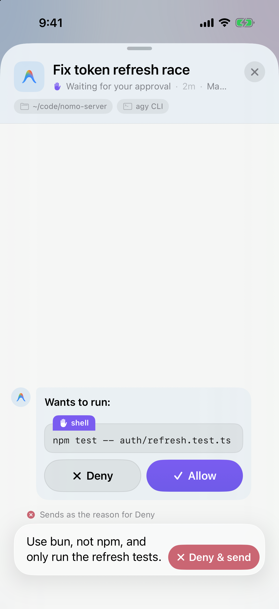
        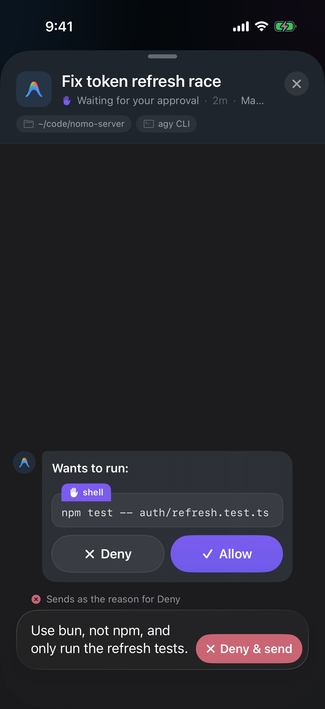
      </div>
    </Frame>
  </Step>

  <Step title="點一下「拒絕並傳送」">
    Antigravity 會跳過這個指令，並把你的文字當作理由讀到。

    你應該會看到請求變成 **✕ 已拒絕**，下面引用著你的理由。
  </Step>
</Steps>

<Tip>
  理由最多 500 個字元。超過的話，按鈕會保持一般的送出箭頭。你的訊息會等著，你回應請求後立即送達。
</Tip>

### 已回答的請求 {#answered-requests}

| 你看到 | 意思 |
| --- | --- |
| `✓ 已允許 · <指令>` | 你允許了它。 |
| `✕ 已拒絕 · <指令>` | 你拒絕了它。如果用了「**拒絕並傳送**」，下面會引用你的理由。 |
| `已在電腦上回答` | 在 Mac 上回答了。 |
| `已逾時 — 在 Mac 上繼續` | 等你的手機等太久了。Antigravity 改在 Mac 上詢問。 |

### 訊息下方狀態的意思 {#reply-statuses}

| 你看到 | 意思 |
| --- | --- |
| `傳送中…` | 你的手機正在傳送。 |
| `等待你批准` | Antigravity 在等你回答聊天裡的請求。你回應後，訊息會立即送達。 |
| `等待下一步` | 你的 Mac 已經收到。Antigravity 會在它的下一步讀到。在那之前，你可以點一下泡泡上的 **×** 取消它。 |
| `已送達` | Antigravity 已經讀到了。 |
| `正在 Mac 上喚醒…` | session 已經結束，你的 Mac 正在帶著你的訊息重新啟動它。只有 Mac 真的開始重新啟動時才會顯示。這時已經不能取消。 |
| `已在 Mac 上繼續` | session 帶著你的訊息又跑起來了。 |
| `重新連線中…` | 你的手機現在連不到你的 Mac。它會自己一直重試 — 你不需要再傳一次。 |

### 在哪些情況下能用 {#where-reply-works}

取決於你在哪裡使用 Antigravity。

**使用 `agy` 命令列工具時：**

- **正在工作** — 訊息會在它的下一步送到。
- **已結束，`agy` 已關閉** — 你的 Mac 會帶著你的訊息重新啟動 session。你會先看到 `正在 Mac 上喚醒…`，然後是 `已在 Mac 上繼續`。
- **已結束，但 `agy` 還開著** — 訊息會等著。在你於 Mac 上的 `agy` 裡送出下一則訊息之前，它都顯示 `等待下一步`；送出之後，Antigravity 會把兩則一起讀到。

**使用 Antigravity 桌面應用程式時：**

- **正在工作** — 訊息會在它的下一步送到。
- **已結束** — 只能在 Mac 上繼續。「**回覆**」會變成灰色，下面那一行寫著「**Antigravity App 的 session 只能在 Mac 上繼續**」。

<Frame caption="桌面應用程式裡已結束的 session：「回覆」變成灰色，下面那一行說明原因。">
  <div className="device-frame">
    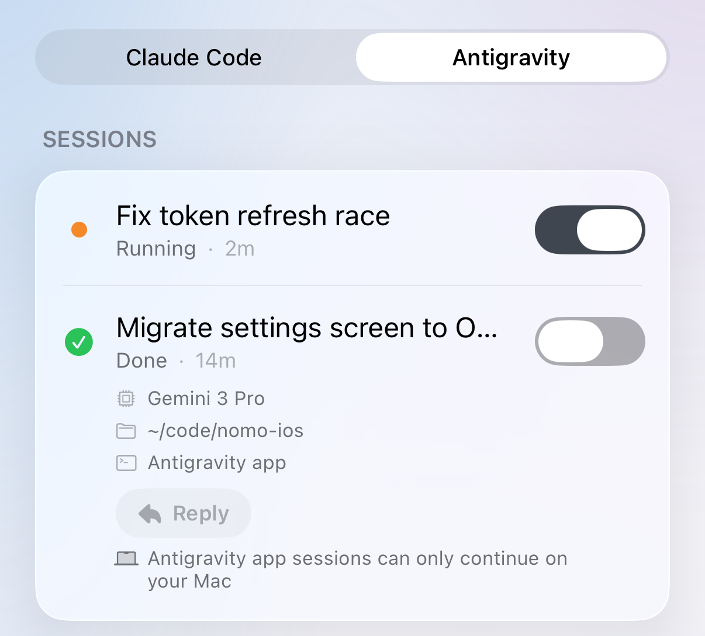
    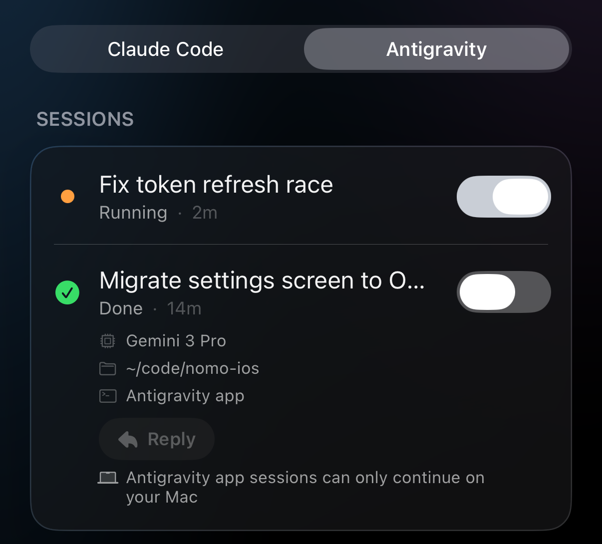
  </div>
</Frame>

小提醒：

- **每則訊息最多 4,000 個字元**。輸入框到這裡就不再接收文字。
- **停止永遠優先**。如果在有訊息排隊時點一下 **[停止](#interrupt)**，Antigravity 會先停下。這則訊息絕不會交給你停掉的那一輪。
- **訊息只在 Nomo 開著時保留**。如果你完全關閉 Nomo，下次打開時表單是空的。你的 Mac 已經收到的訊息還是會送到。

## 這個版本的限制 {#what-this-version-doesnt-do}

- **沒有問題，也沒有計畫**。Antigravity 的問題和計畫審核不會顯示在你的手機上。
- **沒有「在 Mac 上開啟」**。這個按鈕在 Antigravity 的 sessions 上無法使用。
- **沒有「一律允許」**。每一次回覆都是一次性的「允許」或「拒絕」。

## 有東西不能用 {#troubleshooting}

<AccordionGroup>
  <Accordion title="回覆一直停在「等待下一步」">
    你的 Mac 已經收到這則訊息。如果 Antigravity 正在工作，它會在下一步讀到 — 執行很久的指令可能要等一下。

    如果 session 已經結束，而 Mac 上的 `agy` 還開著，這則訊息會等你在那裡送出下一則訊息。在 `agy` 裡隨便送點什麼，Antigravity 就會把兩則一起讀到。也可以點一下泡泡上的 **×** 取消它。
  </Accordion>

  <Accordion title="Nomo 指令顯示「operation not permitted」">
    第一次在 Antigravity 桌面應用程式裡用 Nomo 指令時可能會出現。這是正常的：Antigravity 會自己在沙箱外重試。等它完成就好，你什麼都不用做。
  </Accordion>

  <Accordion title="「回覆」是灰色的">
    這個 session 來自 Antigravity 桌面應用程式，而且已經結束。只能在 Mac 上繼續。請在應用程式裡送出下一則訊息。
  </Accordion>

  <Accordion title="每個 session 都出現兩次">
    Nomo 的 Claude Code 外掛程式被匯入了 Antigravity。請在終端機裡執行下面這行，然後重新啟動 Antigravity：

    ```bash
    agy plugin uninstall nomo-cc
    ```
  </Accordion>

  <Accordion title="Nomo 指令說它找不到自己的檔案">
    Nomo 的資料夾被搬走或刪除了。Antigravity 還是能用，但什麼都不會送到你的手機。請再執行一次安裝工具，然後重新啟動 Antigravity：

    ```bash
    bunx nomo-ai --antigravity
    ```
  </Accordion>
</AccordionGroup>

其他問題 — 手機上什麼都沒有、批准停了、session 卡住 — 都在[疑難排解](/zh-Hant/sessions/troubleshooting)裡。

## 技術細節與安全性 {#technical-details-and-security}

Nomo 只會把 session 正在做什麼、它要問你什麼傳到你的手機，而且是端對端加密。出了任何問題，Antigravity 都會照常在電腦上問你。

內部怎麼運作，請看外掛程式的 README：[Nomo 如何搭配 Antigravity](https://github.com/KarrixLee/nomo#antigravity-integration)、[hook 與安全性](https://github.com/KarrixLee/nomo#antigravity-hooks)。
