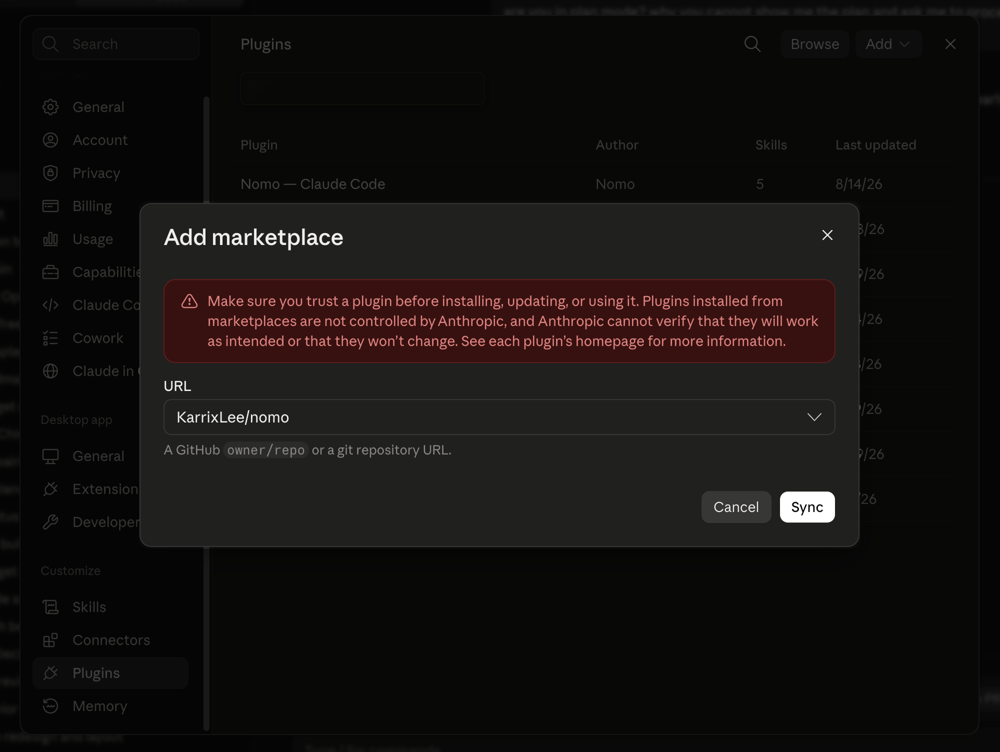
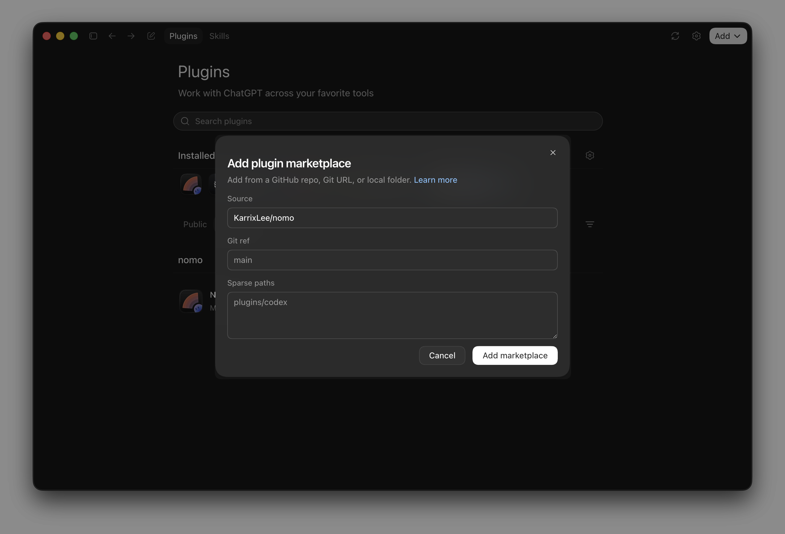
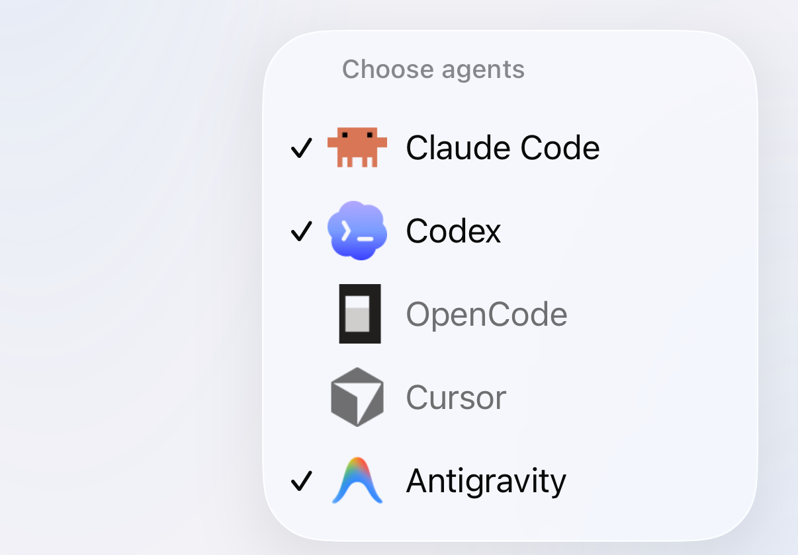
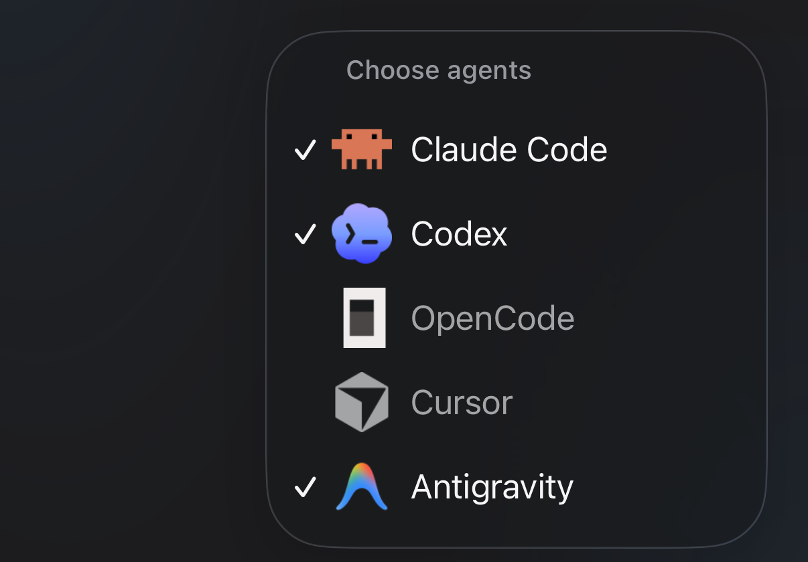

每台電腦只需安裝一次。需要 **bun** 或 **node 18 以上版本** — 這個外掛程式沒有任何 npm 相依套件，只用 Node 內建模組執行。請讓 bun 保持在 **1.4.4** 以上、Node.js 22 保持在 **22.23.4** 以上：版本較舊時，status 指令會提醒你。

## 手動安裝 {#install-by-hand}

<Tabs>
  <Tab title="Claude Code" icon="/images/claude-code.svg">
    <Tabs>
      <Tab title="終端機" icon="terminal">
        在 Claude Code session 裡執行：

        ```
        /plugin marketplace add KarrixLee/nomo
        /plugin install nomo-cc@nomo
        ```
      </Tab>

      <Tab title="桌面應用程式" icon="window">
        依序進入 **Settings** → **Plugins** → **Add** → **Add marketplace**，在 **URL** 填入儲存庫：

        ```
        KarrixLee/nomo
        ```

        接著按 **Sync**，在清單裡安裝 **Nomo — Claude Code**。

        <Frame caption="填 GitHub 的 owner/repo 就夠了 — Nomo 的儲存庫本身就是市集。">
          
        </Frame>
      </Tab>
    </Tabs>

    之後請重新啟動 Claude Code，讓外掛程式的 hooks 載入。

    確認它已經裝好：

    ```
    /nomo-cc:status
    ```

    <Tip>
      Claude Code 裡所有 Nomo 指令都在 `nomo-cc:` 命名空間下 — 輸入
      `/nomo-cc:` 就會列出全部。
    </Tip>
  </Tab>

  <Tab title="Codex" icon="/images/codex.svg">
    Codex **0.142 以上版本**內建自己的外掛程式系統，因此 Nomo 是以獨立的
    Codex 外掛程式安裝，不需要 Claude Code。

    <Steps>
      <Step title="安裝外掛程式">
        <Tabs>
          <Tab title="終端機" icon="terminal">
            ```
            codex plugin marketplace add KarrixLee/nomo
            codex plugin add nomo@nomo
            ```

            如果你比較習慣打字，桌面應用程式的內建終端機也可以。
          </Tab>

          <Tab title="桌面應用程式" icon="window">
            依序進入 **外掛程式** → **新增** → **新增市集**，在 **Source** 填入儲存庫：

            ```
            KarrixLee/nomo
            ```

            **Git ref** 和 **Sparse paths** 維持原樣就好 — 裡面的灰字是佔位符，不是你要填的值。接著按 **新增市集**，在清單裡安裝 **nomo**。

            <Frame caption="Nomo 的儲存庫本身就是市集，沒有清單可以瀏覽，也不需要送審。">
              
            </Frame>
          </Tab>
        </Tabs>

        <Note>
          這裡說的「市集」不是可以逛的商店，而是指向 GitHub 儲存庫的登錄檔 — 也就是 Nomo 自己的儲存庫。所以要先加入儲存庫，再從裡面安裝外掛程式。
        </Note>
      </Step>

      <Step title="信任 hooks — 必要步驟">
        <Tabs>
          <Tab title="終端機" icon="terminal">
            ```
            /hooks
            ```

            信任那**十個 Nomo 項目**。終端機裡顯示為英文的「trust」。
          </Tab>

          <Tab title="桌面應用程式" icon="window">
            開啟齒輪圖示裡的 **掛勾** → **nomo**，把它們打開。Codex 在這裡用的是「掛勾」，同一畫面上的計數卻寫成 Hook — 那是它自己的翻譯不一致，不是你看錯。
          </Tab>
        </Tabs>

        <Warning>
          別跳過這一步。Nomo 的 hooks 會隨外掛程式一起安裝，但在你信任之前**都不會運作**。在那之前，外掛程式雖然裝好了卻什麼也沒做 — 沒有任何 session 會送到你的手機，也不會有任何錯誤訊息。
        </Warning>

        這是 Codex 自己的安全關卡，Nomo 無法代為預先批准。hook 的指令行在各版本之間逐位元組保持不變，所以信任一次就能延續到後續更新 — 只有指令行變動時才會重新要求審核。
      </Step>

      <Step title="確認">
        ```
        $nomo-status
        ```

        這會回報配對、watchdog、**hook 信任狀態**與最後一次傳送的健康狀況
        — 所以也可以用它來確認信任那一步真的生效了。
      </Step>
    </Steps>

    <Tip>
      Codex 的 skills 使用 `$` 前綴而不是斜線 — `$nomo-pair`、`$nomo-status`、`$nomo-reset`、`$nomo-unpair`。
    </Tip>
  </Tab>

  <Tab title="OpenCode" icon="/images/opencode.svg">
    OpenCode 沒有市集，也沒有安裝外掛程式的指令 — 它只會撿取自己設定資料夾裡找得到的東西。所以 Nomo 是從一份 clone 安裝的，再由一個 script 把檔案放進 OpenCode 本來就會去看的位置。

    <Steps>
      <Step title="Clone 下來並執行安裝 script">
        ```bash
        git clone https://github.com/KarrixLee/nomo.git ~/.nomo
        ~/.nomo/plugin/scripts/opencode-install.sh
        ```

        你想 clone 到哪裡都可以 — script 會自己算出所在位置，所以沒有路徑要查，也沒有東西要手動編輯。它會明確印出自己寫了什麼：

        - `~/.config/opencode/plugins/nomo.js` — 一行指回那份 clone 的 stub。
        - `~/.config/opencode/commands/nomo-*.md` — 那六個指令。

        已經為 Claude Code 或 Codex 裝過 Nomo 了嗎？把 script 指向那一份就好，不用再 clone 第二份 — `claude plugin list` 或 `codex plugin list` 會印出它放在哪裡。

        <Tip>
          `--project` 會裝進 `./.opencode`，只作用於一個儲存庫而不是全域。重複執行是安全的，而且要搬動那份 clone 時也是這樣做：從新位置再執行一次。
        </Tip>
      </Step>

      <Step title="重新啟動 OpenCode — 必要步驟">
        <Warning>
          OpenCode 只在伺服器啟動時匯入外掛程式一次，而且沒有熱重載。在你結束並重新開啟它之前，這個外掛程式雖然裝好了卻什麼也沒做。桌面應用程式跑的是同一個伺服器，所以同樣需要這次重新啟動。
        </Warning>
      </Step>

      <Step title="確認">
        ```
        /nomo-status
        ```
      </Step>
    </Steps>

    這一次安裝同時也涵蓋 OpenCode 桌面應用程式：它跑的是 OpenCode 自己的伺服器，讀的是同一個外掛程式資料夾。

    <Note>
      之後要更新，在 OpenCode 裡一個指令就好：`/nomo-update` 會先檢查，再拉取並重新執行這個安裝 script — [它做什麼，以及什麼時候會拒絕](/zh-Hant/sessions/commands#update)。
    </Note>

    <Tip>
      OpenCode 的指令名稱是扁平而且全域的，所以 Nomo 的指令完全不帶前綴：是 `/nomo-pair`，不是 `/nomo-cc:pair` 或 `$nomo-pair`。六個都在[指令](/zh-Hant/sessions/commands)裡。
    </Tip>

    到你手機上會不一樣的部分寫在[搭配 OpenCode 使用](/zh-Hant/sessions/opencode)。
  </Tab>

  <Tab title="Cursor" icon="/images/providers/cursor.svg">
    一次安裝同時涵蓋 Cursor 桌面應用程式的代理和 `cursor-agent` CLI。Cursor 的 sessions 在這個版本是唯讀的 — 那代表什麼，寫在[搭配 Cursor 使用](/zh-Hant/sessions/cursor)裡。

    <Steps>
      <Step title="執行安裝工具">
        <CodeGroup>
        ```bash bunx icon="terminal"
        bunx nomo-ai --cursor
        ```

        ```bash npx icon="terminal"
        npx nomo-ai --cursor
        ```
        </CodeGroup>

        它會做三件事：

        - 把外掛程式 clone 到 `~/.nomo`。
        - 把 Nomo 的 hook 項目加進 `~/.cursor/hooks.json`。它會和原本就在那裡的內容合併，其他工具的項目則原封不動。
        - 在 `~/.cursor/skills/` 底下安裝四個 skills。
      </Step>

      <Step title="重新啟動 Cursor — 必要步驟">
        <Warning>
          Cursor 只在啟動時載入 hooks。請結束並重新開啟 Cursor，也重新啟動你開著的任何 `cursor-agent` session。在你這麼做之前，這個外掛程式雖然裝好了卻什麼也沒做。
        </Warning>
      </Step>

      <Step title="配對">
        在 Cursor 裡輸入 `/` 來挑選 skill，然後執行：

        ```
        /nomo-pair
        ```

        它會顯示一個 QR code — 用 Nomo App 掃描它。在無法開啟瀏覽器的地方，`/nomo-pair code` 會改給你一組可以打字輸入的短代碼。兩條路徑的完整流程都在[配對](/zh-Hant/setup/pairing)裡。

        配對由同一台 Mac 上的所有代理共用。已經為 Claude Code、Codex 或 OpenCode 配對過的電腦，不需要為 Cursor 再配對一次 — 安裝好就夠了，這一步可以跳過。
      </Step>

      <Step title="顯示 Cursor 分頁">
        在 App 裡打開那台電腦。Cursor 的 sessions 放在它 session 面板裡的 **Cursor** 分頁底下。

        面板最多顯示三個代理分頁。如果 Cursor 不在其中，點一下 **+** 按鈕（「選擇代理」）把它打開。
      </Step>
    </Steps>

    <Tip>
      Nomo 在 Cursor 裡的指令是不帶前綴的 skills：`/nomo-pair`、`/nomo-status`、`/nomo-reset` 和 `/nomo-unpair`。四個都在[指令](/zh-Hant/sessions/commands)裡。
    </Tip>
  </Tab>

  <Tab title="Antigravity" icon="/images/providers/antigravity.png">
    一次安裝同時涵蓋 Antigravity 桌面應用程式和 `agy` CLI。shell 指令和檔案寫入可以在手機上回覆 — 細節寫在[搭配 Antigravity 使用](/zh-Hant/sessions/antigravity)裡。

    <Steps>
      <Step title="執行安裝工具">
        把這行貼到終端機裡，然後按下 Return：

        <CodeGroup>
        ```bash bunx icon="terminal"
        bunx nomo-ai --antigravity
        ```

        ```bash npx icon="terminal"
        npx nomo-ai --antigravity
        ```
        </CodeGroup>

        你應該會看到：

        ```
        ✅ Antigravity is connected to Nomo. Restart Antigravity, then type /nomo-pair.
        ```
      </Step>

      <Step title="重新啟動 Antigravity — 必要步驟">
        <Warning>
          完全結束 Antigravity，再重新打開它。如果你有在用 `agy`，也把它重新啟動。在你這麼做之前，Nomo 都不會運作。
        </Warning>
      </Step>

      <Step title="輸入 /nomo-pair">
        在 Antigravity 的對話裡輸入 `/nomo-pair` 並送出。當 Antigravity 問要不要執行 Nomo 的指令時，請選擇 **Allow**（允許）。然後用 iPhone 上的 Nomo 掃描 QR code。

        你應該會在 Antigravity 裡看到：「Done! This computer is connected to your phone.」（完成！這台電腦已經連上你的手機。）

        在 Antigravity 桌面應用程式裡，第一個 Nomo 指令可能會顯示一行 `operation not permitted`。這是正常的 — Antigravity 會自己在沙箱外重試。等著就好。

        已經從其他代理配對過了？改輸入 `/nomo-status` 確認就好。
      </Step>

      <Step title="在 Antigravity 裡送出一則訊息">
        開始一段對話，隨便送出什麼都可以。

        你應該會看到這個 session 出現在 Nomo 裡，在你那台電腦的 **Antigravity** 分頁底下。沒有 Antigravity 分頁？點一下 **+** 按鈕（「選擇代理」），把 Antigravity 打開。

        <Frame caption="從 + 按鈕打開的「選擇代理」。Antigravity 已勾選，所以它有自己的分頁。">
          <div className="device-frame">
            
            
          </div>
        </Frame>
      </Step>
    </Steps>

    <Warning>
      不要把 Nomo 的 Claude Code 外掛程式匯入 Antigravity（例如用 `agy plugin import claude`）— 否則每個 session 都會出現兩次。如果你已經這麼做了，安裝工具會警告你：

      ```
      ⚠️ Antigravity also has the Claude Code version of Nomo ("nomo-cc") imported. It would show every session twice — please remove it by running: agy plugin uninstall nomo-cc
      ```

      要修正它，請執行 `agy plugin uninstall nomo-cc`，然後重新啟動 Antigravity。
    </Warning>
  </Tab>
</Tabs>

## 一鍵安裝 {#one-command}

安裝工具會找出這台電腦上有哪些 Claude Code、Codex、OpenCode、Cursor、Antigravity 和 Grok Bot，再把 Nomo 裝進你挑的那幾個：

<CodeGroup>
```bash bunx icon="terminal"
bunx nomo-ai
```

```bash npx icon="terminal"
npx nomo-ai
```
</CodeGroup>

一開始一個都沒勾選：方向鍵（或 `k`、`j`）移動，空白鍵勾選，Enter 安裝所有勾選的。接著它就去跑每個代理本來的安裝流程 — 也就是上面那五套。它不會在全域裝任何東西，也不會留下套件。

寫指令碼或在 CI 裡使用時：

| 選項 | |
| --- | --- |
| `--claude` `--codex` `--opencode` `--cursor` `--antigravity` `--grokbot` | 只裝這幾個 — 只要指定其中任何一個，就會略過選擇畫面 |
| `--all` | 全部都裝，不管有沒有找到 — 只有 Cursor、Antigravity 和 Grok Bot 例外：這台電腦上沒有它們時會略過（想照裝就指定 `--cursor`、`--antigravity` 或 `--grokbot`） |
| `-y`、`--yes` | 不出選擇畫面，找到多少裝多少 |
| `-n`、`--dry-run` | 把要執行的指令印出來，什麼都不執行 |
| `--global` | 同時加上簡短的 `nomo` 指令，不會先問你。請見[從終端機執行](/zh-Hant/sessions/commands#terminal) |
| `uninstall` | 搭配 `--cursor`、`--antigravity` 或 `--grokbot`：從那個代理移除 Nomo（`--uninstall` 也可以）。請指定代理 — 它絕不會自己猜。請見 [uninstall](/zh-Hant/sessions/commands#uninstall) |

它不會替你配對手機。之後就照上面的步驟收尾：重新啟動代理，如果是 Codex 就信任那些 hook，然後配對 — 在終端機裡是 `bunx nomo-ai pair`，或是 `/nomo-pair`，在 Claude Code 裡是 `/nomo-cc:pair`，在 Codex 裡是 `$nomo-pair`。更多終端機指令請見[從終端機執行](/zh-Hant/sessions/commands#terminal)。

`--grokbot` 適用於唯一的 AI 應用程式是 Grok Bot 應用程式的 Mac。它加入的是一個每小時執行的小型工作，而不是 hooks，而且只能在 macOS 上使用。請見[搭配 Grok Bot 使用](/zh-Hant/sessions/grok-bot)。

## 更新 {#updating}

<Note>
  要更新或解除安裝，請見[指令 → update](/zh-Hant/sessions/commands#update) 和[指令 → uninstall](/zh-Hant/sessions/commands#uninstall)。每個代理都在那裡，各有自己的分頁。
</Note>

## 外掛程式做的事

它會監看 session，並把狀態變化回報到你的手機：代理正在處理什麼、什麼時候停下來，以及什麼時候需要你授予權限。

在你[配對手機](/zh-Hant/setup/pairing)之前，它不會送出任何東西；而所有送出的內容都會先在這台電腦上加密。

它的 hooks 會在你的專案資料夾裡執行，但絕不會載入那個專案的 `bunfig.toml` 或 `.env` 檔案。

這個外掛程式是**開源**的 — 你可以在安裝之前，確切讀到它收集與送出的內容：

<Card title="KarrixLee/nomo" href="https://github.com/KarrixLee/nomo" icon="github" horizontal>
  完整的外掛程式原始碼，採用 MIT 授權。從 marketplace 安裝就只是單純複製這個儲存庫。
</Card>

## 下一步

<Card title="配對你的電腦" href="/zh-Hant/setup/pairing" icon="qrcode-read">
  掃描 QR code；如果無法開啟瀏覽器，也可以手動輸入一次性代碼。
</Card>
