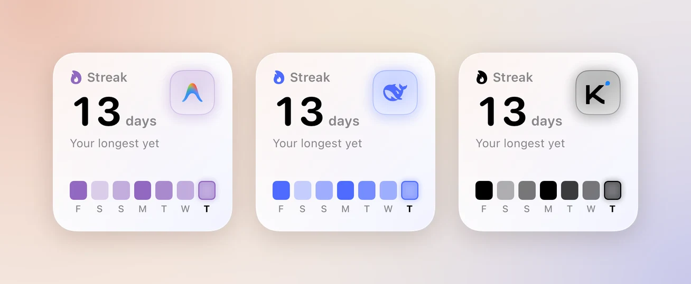
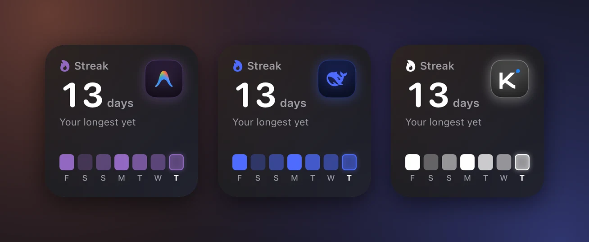

Nomo 有七個 iPhone 小工具。其中兩個免費：顯示狀態的 **Nomo** 和 **Nomo 用量**。另外五個需要 Nomo Pro。

這一頁說明每個小工具顯示什麼，以及怎麼設定。要把小工具放到主畫面上，請看[小工具](/zh-Hant/widget)。

## 免費版與 Pro {#free-and-pro}

| | 免費 | Nomo Pro  |
| --- | --- | --- |
| **Nomo** 狀態小工具 | ✓ | ✓ |
| **Nomo 用量**小工具 | ✓ | ✓ |
| **Nomo 用量速度**、**Nomo 活動**、**Nomo 帳戶**、**代理即時狀態**、**Nomo Token** | | ✓ |
| 每個供應商多個帳戶 | | ✓ |

在小工具資料庫裡，Pro 小工具的說明會以 **👑 Nomo Pro** 開頭。

沒有 Nomo Pro 也能加入 Pro 小工具。它會顯示淡化的預覽，上面寫著 **Nomo Pro** 和「解鎖」。點一下它，就會在 App 裡打開 Nomo Pro。

## 免費小工具 {#free-widgets}

### Nomo 狀態 {#nomo-status}

<Frame caption="小型和中型的 Nomo 狀態。">
  

    
    
  

</Frame>

在小工具資料庫裡，這個小工具叫做 **Nomo**。

**它顯示什麼**：某一項服務現在是否正常，例如 Claude Code 或 Codex。你會看到以下其中一種：

- `正常運作`
- `效能降低`
- `部分中斷`
- `嚴重中斷`
- `維護中`

如果 Nomo 取不到狀態，會顯示 `無法取得`。

| 尺寸 | 顯示內容 |
| --- | --- |
| 小型 | 服務、它的狀態，以及上次更新的時間。 |
| 中型 | 同樣的內容，再加上過去 30 天的紀錄條和可用率。 |

**事前需要**：什麼都不用。不需要帳戶，也不用登入。

**設定方式**：

1. 加入小工具。請看[小工具](/zh-Hant/widget)。
2. 按住小工具。
3. 點一下「編輯小工具」。
4. 點一下「供應商」，從 Claude、OpenAI、Cursor、xAI、Antigravity、Kimi、DeepSeek、Devin 中選一個。
5. 點一下「服務」並選一個，例如 **Claude Code**。
6. 點一下小工具外面就完成了。

想立刻更新，點一下角落的重新整理按鈕。點一下其他任何地方，會在 Nomo 中打開那家供應商的「狀態」頁面。

詳細內容請看[狀態](/zh-Hant/status)。

### Nomo 用量 {#nomo-usage}

<Frame caption="小型和中型的 Nomo 用量。">
  

    
    
  

</Frame>

**它顯示什麼**：一個帳戶的方案限額用了多少，以及什麼時候重設。

| 尺寸 | 顯示內容 |
| --- | --- |
| 小型 | 一個時段：大大的百分比、進度條，以及多久後重設。 |
| 中型 | 兩個時段，通常是「session」（5 小時）和「每週」，各附進度條和多久後重設。 |

用到 70% 時進度條會變成琥珀色，90% 時變成紅色。如果你的方案沒有 5 小時限額，會改成顯示 `無 session 限額`。

**事前需要**：一個已連結的帳戶，例如 Claude 或 Codex。打開「供應商」分頁，點一下那家供應商並連結。請看[用量](/zh-Hant/usage)。連結之前，小工具會顯示 `未連結`。

**設定方式**：

1. 加入小工具。請看[小工具](/zh-Hant/widget)。
2. 按住小工具。
3. 點一下「編輯小工具」。
4. 點一下「供應商」並選一個，例如 **Codex**。
5. 點一下「帳戶」並選一個。「預設」會跟隨你在 App 裡設定的預設帳戶。
6. 點一下「小尺寸樣式」並選一個。「大百分比」會把數字放大顯示。「大動畫」會把動畫圖示放大顯示。
7. 點一下「小型小工具焦點」，選擇小型尺寸要顯示的時段。「自動」會幫你選。可以選的項目依供應商而不同。
8. 點一下小工具外面就完成了。

選 Cursor 時還多一個選項：「Cursor 圖示」。選 **Grok Bot** 或「Cursor 標誌」。

想立刻更新，點一下角落的重新整理按鈕。點一下其他任何地方，會在 Nomo 中打開那家供應商的「用量」頁面。

## Pro 小工具  {#pro-widgets}

Nomo Pro 在免費小工具之外再加上五個小工具。每一個都回答一個你原本得打開 App 才能知道的問題。

- **Nomo 用量速度**：我的用量撐得到重設嗎？
- **Nomo 活動**：我已經連續幾天用代理寫程式了？
- **Nomo 帳戶**：我哪個帳戶剩得最少？
- **代理即時狀態**：我的代理現在在做什麼？
- **Nomo Token**：我用了多少 Token，用在哪些模型上？

<Frame caption="主畫面上的全部五個 Pro 小工具：Nomo 用量速度、代理即時狀態、Nomo 活動、Nomo Token 和 Nomo 帳戶。">
  

    
    
  

</Frame>

Nomo 用量速度和 Nomo 活動也有鎖定畫面尺寸。

### Nomo 用量速度  {#nomo-pace}

<Frame caption="小型和中型的 Nomo 用量速度，以及在鎖定畫面上的樣子。">
  

    
    
  

</Frame>

**它顯示什麼**：照目前的速度用下去，你會不會在限額重設前用完。

大數字下面那一行比較兩件事：

- **已用**：限額已經用了多少。
- **時間**：這個時段已經過了多少。

例如 `已用 45%・時間 60%`。已用比時間低，就沒問題。小工具會顯示「重設倒數」和距離重設的倒數。

已用比時間高，表示你用得太快了。小工具會顯示「用完倒數」和距離用完的倒數。前面有 `~` 表示這是估計值。數字會變成琥珀色。

你也可能看到：

- 「現在還看不出來」，出現在時段剛開始的時候。目前還沒有足夠的資料可以判斷。
- 「已達限額」，出現在某個時段達到 100% 的時候。倒數是到重設為止。
- 「此方案無法估算用量速度」，出現在供應商沒有說明限額何時重設的時候。

各尺寸：

| 尺寸 | 顯示內容 |
| --- | --- |
| 小型 | 一個時段及其圓環。 |
| 中型 | 兩個時段，通常是 5 小時時段和每週時段。 |
| 鎖定畫面（圓形） | 你用了多少。勾號表示沒問題。用得太快時，會顯示你會用完的時間。 |
| 鎖定畫面（矩形） | `可用到重設`，或你會用完的時間，例如 `~21:20 用完`。 |

每個圓環都會依你用了多少來填滿。那個小刻度表示如果你平均地用，現在應該用到哪裡。填滿的部分還沒到刻度，就表示沒問題。

**事前需要**：一個已連結的帳戶，例如 Claude 或 Codex。打開「供應商」分頁，點一下那家供應商並連結。請看[用量](/zh-Hant/usage)。

**設定方式**：

1. 加入小工具。請看[小工具](/zh-Hant/widget)。
2. 按住小工具。
3. 點一下「編輯小工具」。
4. 點一下「供應商」並選一個，例如 **Claude**。
5. 點一下「帳戶」並選一個。「預設」會跟隨你在 App 裡設定的預設帳戶。
6. 點一下「時段」並選一個。「自動」在你的方案有 5 小時時段時使用它，沒有時使用每週時段。這會改變小型和鎖定畫面尺寸的顯示。
7. 點一下小工具外面就完成了。

點一下小工具，會在 Nomo 中打開那家供應商的「用量」頁面。

### Nomo 活動  {#nomo-activity}

<Frame caption="小型、中型和大型的 Nomo 活動，以及在鎖定畫面上的樣子。">
  

    
    
  

</Frame>

**它顯示什麼**：一張你用 AI 代理寫程式的日子地圖，就像 GitHub 個人檔案上的那種，再加上你的連續紀錄。連續紀錄就是你連續寫了幾天程式。所有配對過的電腦合併計算。請看[多台電腦](#more-than-one-computer)。

顏色越深，表示那天寫的程式越多。你的連續紀錄不會在早上歸零：在你當天的第一個 session 之前，它會算到昨天為止。

| 尺寸 | 顯示內容 |
| --- | --- |
| 小型 | 你的連續紀錄和最近 7 天。 |
| 中型 | 你的連續紀錄、最近 16 週，以及地圖下方的三項數據。 |
| 大型 | 最近 26 週和同樣的三項數據、你的時間在各代理之間怎麼分配，以及總計：sessions 數、Token、你最忙的一天和你最長的連續紀錄。 |
| 鎖定畫面（矩形） | 你的連續紀錄和最近 7 天。 |

地圖下方的三項數據，統計的是地圖上顯示的那幾週：

- 時鐘：你的活躍時數。
- 日曆：你活躍了幾天。
- 長條圖：你每週的平均時數。

中型放不下時，只會顯示前兩項。

在大型上，「Token」是這 26 週的總數。如果你的電腦沒有傳來任何 Token 資料，這一格會改成顯示「活躍時數」。

**事前需要**：

- 你電腦上的 Nomo 外掛程式，版本 **2.4.0** 或更新。請看[安裝](/zh-Hant/setup/install)和[更新](/zh-Hant/sessions/commands#update)。
- 那台電腦已經和 Nomo 配對。請看[配對](/zh-Hant/setup/pairing)。

它會計算 Claude Code、Codex 和 OpenCode。過去的日子也會出現，因為外掛程式會讀取你電腦上已經有的歷史紀錄。

**設定方式**：

1. 加入小工具。請看[小工具](/zh-Hant/widget)。
2. 按住小工具。
3. 點一下「編輯小工具」。
4. 點一下「角色」，從「自動」、**Clawd**、**Codex**、**Grok Bot**、**Antigravity**、**Kimi**、**DeepSeek**、**Cursor**、**OpenCode**、**Devin** 中選一個。
5. 點一下小工具外面就完成了。

「自動」會顯示你最近 7 天最常用的代理。選其他角色時，小工具會顯示那個角色，地圖、今天的方格、連續紀錄的火焰和徽章都會換成它的顏色：Clawd 是珊瑚色，Codex 是藍色，Grok Bot 是金色。大型尺寸裡依代理分配時間的長條，仍保留各代理自己的顏色。已經在主畫面上的小工具會從「自動」開始。

<Frame caption="Clawd、Codex 和 Grok Bot 三種角色的 Nomo 活動。">
  

    
    
  

</Frame>

只有 Clawd、Codex 和 Grok Bot 是會動的角色。Antigravity、Kimi、DeepSeek、Cursor、OpenCode 和 Devin 會在品牌色的方塊上顯示自己的標誌，地圖、火焰、今天的方格和光暈也會換成這個顏色。

<Frame caption="Antigravity、DeepSeek 和 Kimi 的 Nomo 活動。">
  

    
    
  

</Frame>

外掛程式最多每 6 小時傳送一次新的摘要。Nomo 會在你打開 App 時取得它。所以地圖可能會落後幾個小時。

點一下小工具，會在 Nomo 中打開[活動頁面](#activity-screen)。

為了這張地圖而離開你電腦的內容，列在[隱私](#privacy)底下。只有計數，絕不包括你的提示或程式碼。

### Nomo Token  {#nomo-tokens}

<Frame caption="中型和大型的 Nomo Token。">
  

    
    
  

</Frame>

**它顯示什麼**：所有配對過的電腦上，你的代理最近 14 天每天用了多少 Token。每天的長條依模型分段。

這裡的 Token 指輸入 + 輸出 + 推理。快取不計入：它是重複讀取同樣的上下文，會把其他數字全部蓋過去。[活動頁面](#activity-screen)會另外列出快取。

| 尺寸 | 顯示內容 |
| --- | --- |
| 中型 | 14 天總計、今天的 Token，以及用得最多的模型和它的占比。 |
| 大型 | 同樣的內容，再加上較上週的變化和前 4 個模型。其餘的合併成一列，例如 `其他 6 個模型`。 |

每個模型在任何地方都維持同一種顏色：Claude 模型是珊瑚色，GPT 是藍色，Grok 是金色，Gemini 是紫色，其他模型是灰色。

**事前需要**：和 Nomo 活動一樣，需要一台裝了 Nomo 外掛程式並已配對的電腦。請看 [Nomo 活動](#nomo-activity)。

**設定方式**：

1. 加入小工具。請看[小工具](/zh-Hant/widget)。
2. 按住小工具。
3. 點一下「編輯小工具」。
4. 點一下「角色」，選一個。選項和 [Nomo 活動](#nomo-activity)相同。
5. 點一下小工具外面就完成了。

「自動」會跟著你用得最多的模型的供應商：Claude 對應 Clawd，GPT 對應 Codex，Grok 對應 Grok Bot，Gemini 對應 Antigravity，Kimi、DeepSeek、Cursor 和 Devin 的模型顯示各自的標誌。其他模型都是 Clawd。你選的角色只會改變角色本身、背景光暈和今天的長條。模型顏色永遠不變。

點一下小工具，會在 Nomo 中打開[活動頁面](#activity-screen)。沒有 Nomo Pro 時，點一下會打開 Nomo Pro。

它和 Nomo 活動使用同一份摘要。離開你電腦的內容列在[隱私](#privacy)底下。

### Nomo 帳戶  {#nomo-accounts}

<Frame caption="中型和大型的 Nomo 帳戶。">
  

    
    
  

</Frame>

**它顯示什麼**：所有供應商的每一個已連結帳戶，集中在一個看板上。剩得最少的帳戶排在最上面。

每一列會顯示帳戶名稱、最接近用完的那個時段、還剩多少，以及何時重設。

- **中型**顯示 4 列。**大型**顯示 8 列。
- 如果你的帳戶比這還多，最後一列會顯示還有幾個，例如 `還有 3 個`。
- 需要你重新登入的帳戶會留在看板最底部，並顯示「在 Nomo 中重新連結」。它永遠不會消失。

**事前需要**：至少一個已連結的帳戶。要追蹤同一家供應商的兩個帳戶，請看[多個帳戶](#more-than-one-account)。

**設定方式**：加入小工具。請看[小工具](/zh-Hant/widget)。「編輯小工具」裡沒有要選的東西。

看板顯示的是 Nomo 最後一次取得的數字。在大型尺寸上，點一下角落的重新整理按鈕就能更新所有帳戶。

點一下某個帳戶的那一列，會在 Nomo 中打開那家供應商的「用量」頁面，並顯示這個帳戶。顯示「在 Nomo 中重新連結」的那一列也一樣。點一下其他任何地方（包括 `還有 3 個` 那一列），會打開「供應商」分頁。沒有 Nomo Pro 時，點一下會打開 Nomo Pro。

### 代理即時狀態  {#live-agents}

<Frame caption="小型和中型的代理即時狀態。紫色那一列需要你回答。">
  

    
    
  

</Frame>

**它顯示什麼**：你此刻的 Claude Code、Codex 和其他代理的 sessions。跟 **Sessions** 分頁是同一份清單。

**紫色表示有一個需要你回答。**

| 圖示 | 標籤 | 意思 |
| --- | --- | --- |
| 紫色的手 | `需要權限` | 正在為某個動作請求權限。你可以在手機上回覆。 |
| 紫色的手 | `需要回答` | 正在問你一個問題。你可以在手機上回覆。 |
| 橘色的手 | `需要注意` | 停下來在等你，但沒有可以在手機上回覆的東西。 |
| 橘色圓點 | `執行中` | 正在工作。不需要你做什麼。 |
| 綠色勾號 | `完成` | 已結束。 |

這些和 [Sessions 分頁](/zh-Hant/sessions/list#session-states)一致。

- **小型**顯示有幾個 sessions 正在執行。有一個需要你時，會有紫色按鈕提醒。
- **中型**最多顯示 3 個 sessions。需要你處理的排在最前面。

這個小工具沒有「允許」或「拒絕」按鈕。點一下它會在 Nomo 中打開 **Sessions**。在中型上，點一下某個 session 就會打開那個 session。

小工具會從 Nomo App 複製 sessions 清單。如果 10 分鐘沒有更新，它會顯示一個琥珀色圓點，以及距離上次更新多久。打開 Nomo 就能重新整理。

**事前需要**：一台裝了 Nomo 外掛程式並已配對的電腦。請看[安裝](/zh-Hant/setup/install)和[配對](/zh-Hant/setup/pairing)。

**設定方式**：

1. 加入小工具。請看[小工具](/zh-Hant/widget)。
2. 按住小工具。
3. 點一下「編輯小工具」。
4. 點一下「角色」，選一個。選項和 [Nomo 活動](#nomo-activity)相同。
5. 點一下小工具外面就完成了。

「自動」會跟著清單最上面的 session。如果是 Antigravity、Cursor、OpenCode 或 Devin 的 session，就顯示它的標誌。選其他角色時，小工具會顯示那個角色，背景也會帶上淡淡的同色調。狀態顏色不會變：紫色仍然表示有 session 需要你回答。已經在主畫面上的小工具會從「自動」開始。

## 活動頁面和回顧  {#activity-screen}

活動頁面會完整顯示你的連續紀錄和 Token，還能產生一張可以分享的回顧卡片。

<Frame caption="活動頁面的上半部：連續紀錄、7 / 14 / 30 天切換，以及 Token 圖表。">
  

    
    
  

</Frame>

打開方式：

1. 打開 Nomo。
2. 點一下「Sessions」分頁。
3. 點一下標籤列正上方的[連續紀錄列](#streak-bar)。在 iOS 26.0 或更早版本上，改為點一下列表最上面的「活動」卡片。

也可以點一下 Nomo 活動或 Nomo Token 小工具打開，即使 Nomo 沒有開著也可以。Nomo 會先確認你有沒有 Nomo Pro 再打開頁面，所以訂閱者不會誤跳到 Nomo Pro 頁面。

在 iOS 26.0 或更早版本上，沒有 Nomo Pro 時，卡片上會顯示一個皇冠、「活動」和「連續紀錄、每日 Token 與回顧，盡在 Nomo Pro。」。點一下它會打開 Nomo Pro。

頁面上有：

- 「連續紀錄」：你的連續紀錄和最近 26 週的地圖，地圖下方有和[小工具](#nomo-activity)一樣的三項數據。
- 「7 天」「14 天」「30 天」切換。切換時，圖表會以動畫過渡到新的期間。
- 「Token」：依模型堆疊的每日 Token 圖表，以及「今天」「日均」「活躍時數」和較上一段期間的變化。
- 「依模型」：每個模型的「輸入」「輸出」「快取」「總計」表格。

打開頁面時，它會用大約一秒的動畫出現。如果打開了「減少動態效果」，所有內容會直接顯示出來。

頁面的角色和顏色會跟著你用得最多的模型的供應商，和設為「自動」的 [Nomo Token](#nomo-tokens) 一樣。連續紀錄列也是如此。

### 連續紀錄列  {#streak-bar}

在 iOS 26.1 或更新版本上，「Sessions」分頁的標籤列正上方會浮著一條小列。它會顯示你的連續紀錄、本週的 Token，以及最近 7 天的迷你長條圖。

- 捲動時，它會縮小並移到標籤列旁邊。
- 點一下它會打開活動頁面。

有時它會顯示別的內容：

| 顯示內容 | 意思 | 點一下後 |
| --- | --- | --- |
| 「開始連續紀錄」 | 還沒有配對任何電腦。 | 打開和「配對電腦」一樣的配對步驟。 |
| 「還沒有 sessions」 | 已經配對了電腦，但還沒有傳來任何 sessions。 | 打開活動頁面。 |
| 「更新 Nomo 外掛程式」 | 每台配對過的電腦上的 Nomo 外掛程式都早於 2.4.0。 | 打開更新步驟。 |

這條列縮小時，會改成顯示「配對電腦」「還沒有 sessions」和「更新外掛程式」。

這條列需要 Nomo Pro。沒有 Nomo Pro 時，不會顯示這條列。

Nomo 有新版本時，這個位置會改為顯示更新列。更新 Nomo，或點一下更新列上的 **×**，連續紀錄列就會回來。

在 iOS 26.0 或更早版本上沒有這條列，連續紀錄卡片會顯示在 Sessions 列表的最上面。

### 回顧 {#wrapped}

回顧會把你的一週、一個月或一年變成一張可以分享的圖片。

1. 在活動頁面捲動到最下面。
2. 點一下「你的回顧」。
3. 點一下「週」（最近 7 天）、「月」（最近 30 天）或「年」（今年）。
4. 點一下「分享」，再選擇要傳到哪裡。

<Frame caption="一週的回顧卡片。不論 iPhone 是淺色還是深色外觀，它永遠是深色的。">
  

    
  

</Frame>

卡片上會顯示你的 Token、圖表、活躍時數、最忙的一天、最長連續紀錄、最常用的模型和代理，以及 sessions 數。角色會跟著你最常用的模型的供應商，或你最常用的代理。「分享」會把它當成一張 1080 × 1350 的圖片傳出去。它絕不包含你的提示、專案名稱或檔案路徑。

## 多台電腦 {#more-than-one-computer}

Nomo 活動、Nomo Token、活動頁面、回顧和連續紀錄列，會把所有配對過的電腦加在一起。

- 活躍時間只算一次。你同時在兩台 Mac 上寫程式，這段時間不會被算兩次。
- Token 和 sessions 數會相加。
- 同一台 Mac 配對了兩次，只算一台。
- 移除一台電腦後，它的活動會從總數中拿掉。

### 未計入的電腦 {#not-counted}

Nomo 外掛程式早於 2.4.0 的電腦不會被計入。你會看到：

- 在活動頁面的連續紀錄下方：「MacBook Air 未計入 · 請更新它的外掛程式」，其中是那台電腦的名稱。如果不只一台，會顯示台數，例如「2 台電腦未計入 · 請更新它們的外掛程式」。點一下它可以查看更新方法。
- 在大型 Nomo 活動小工具上：「1 台電腦未計入」。在最小的 iPhone 上沒有空間顯示。

要解決這個問題，請更新那台電腦上的 Nomo 外掛程式。請看[更新](/zh-Hant/sessions/commands#update)。

## 多個帳戶  {#more-than-one-account}

有了 Nomo Pro，每家供應商最多可以新增 5 個帳戶。例如，一個工作用的 Claude 帳戶和一個個人帳戶。Nomo 用量速度、Nomo 用量和 Nomo 帳戶都能使用它們。

除非你選了別的帳戶，否則小工具會顯示「預設」帳戶。要選擇帳戶，按住小工具，點一下「編輯小工具」，然後點一下「帳戶」。Nomo 帳戶會把每個帳戶分開顯示。

如果你移除了一個帳戶，原本顯示它的小工具會顯示「帳戶已移除」。它們不會改成顯示預設帳戶。請編輯小工具，選擇其他帳戶。

如果你的 Nomo Pro 到期，額外的帳戶會被暫停。不會移除任何內容，預設帳戶也會繼續更新。設為額外帳戶的 Nomo 用量小工具會顯示「已暫停 · Nomo Pro」和 `你的 Nomo Pro 已結束。在 Nomo 中重新訂閱即可查看此帳戶。`。點一下它會打開 Nomo Pro。顯示預設帳戶的小工具永遠不會被暫停。

要新增、重新命名或移除帳戶，請看用量頁面的[多個帳戶](/zh-Hant/usage#more-than-one-account)。

## 用示範模式試用 {#try-it-with-demo-mode}

示範模式會用範例資料填滿小工具，讓你在連結任何東西之前就能看到它們的樣子。

1. 打開 Nomo。
2. 點一下「設定」分頁。
3. 捲動到「示範模式」。
4. 打開「顯示範例資料」。

之後 Nomo 用量速度、Nomo 活動、Nomo Token 和代理即時狀態就會顯示範例資料，而不是你自己的資料。示範模式永遠顯示範例資料。唯一的例外：一旦有電腦配對，代理即時狀態就會顯示你真實的 sessions。
Nomo 帳戶只會列出你真正新增過的帳戶，所以在你新增帳戶之前，它會一直是空的。

如果你沒有 Nomo Pro，示範模式也會解鎖 Pro 小工具，但只限於沒有任何電腦配對的時候。

要回到你的真實資料，關閉「顯示範例資料」。

## 隱私 {#privacy}

**Nomo 活動**

- 會離開你電腦的內容：每一天、每個代理的 sessions 數、提示數、一天中哪些 5 分鐘時段有活動，以及每個模型的 token 總數。
- 絕不會離開的內容：你的提示、代理的回覆、專案名稱和檔案路徑。
- 上傳前會先端對端加密（AES-256-GCM，使用你的配對金鑰）。Nomo 的中繼伺服器無法讀取，並會在 **35 天**後刪除。
- 其中還有一個隨機的電腦 ID。它由外掛程式在你的電腦上產生一次，儲存在 `~/.config/cc-status/machine-id`。它絕不來自你的硬體資訊，例如序號、MAC 位址、電腦名稱或使用者名稱。它和其他內容一樣經過端對端加密。Nomo 只用它來避免 iPhone 把同一台電腦算兩次。刪除這個檔案就會產生新的 ID。
- 最多每 6 小時上傳一次，而且只在有變化時上傳。如果沒有變化，它每週會把同樣的摘要重新上傳一次，以免中繼伺服器把它刪除。剛和新的 iPhone 配對後，會在大約一分鐘內上傳一次。
- 在你的電腦上，它存放在 `~/.config/cc-status/activity-days.json`。只有你的使用者帳號能讀取。最多保留 400 天。

**Nomo Token 和活動頁面**

- 它們使用和 Nomo 活動同一份活動摘要，所以上面的內容同樣適用。

**回顧**

- 分享時只會傳出你在卡片上看到的那張圖片。

**代理即時狀態**

- 小工具讀取的是 App 存在你 iPhone 上的一份 sessions 快照。它留在手機上，從不傳送到任何地方。

**多個帳戶**

- 你的登入資訊存放在 iPhone 鑰匙圈中。
- 登入時使用全新的私密瀏覽器頁面，所以不會沿用你在 Safari 的登入。

**限制**

- 中繼伺服器看得到有一次上傳、上傳的大小，以及上傳的時間。
- 任何拿到你已解鎖手機的人，都能看到你的活動。

完整說明請看[外掛程式的 README](https://github.com/KarrixLee/nomo#readme) 中的安全性說明。
